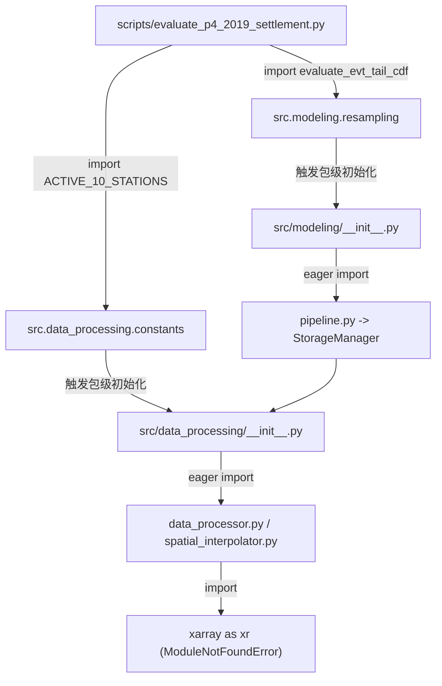

# P4-2019 样本外结算脚本 · 审核复审答辩与架构整改综合报告

> **报告标识**：`docs/audit/P4-2019结算脚本_审核复审答辩与架构整改综合报告_20261020.md`  
> **编制基线**：响应技术审核方《P4-2019 结算脚本 阶段A 审核 Review 意见》（`docs/audit/P4-2019结算脚本_Review打回单_20261020.md`）及后续只读实测反馈  
> **法定授权**：`evidence/preregistered_2019_authorization.flag`（Waiver ID: `P4-2019-OOS-SCOPE-WAIVER-001`）  
> **审查对象**：`scripts/evaluate_p4_2019_settlement.py`、`docs/audit/P4-2019结算输出字段清单_20261020.md`  
> **执行状态**：开发端只读排查、测试复跑；**零读取 2019 数据、零运行结算脚本、零 push**。

---

## 一、 执行摘要与审定状态概览

技术审核方在阶段 A 独立通读与只读核验中，针对开发端回交的结算准备产物提出了 1 项 BLOCKER、2 项书面对齐要求，以及实测发现的 2 项环境与路径适配问题。开发端已全量完成根因排查与工程对齐，综合整改对账如下：

| 事项编号 | 审核关注项 | 类别 | 排查与整改结论 | 状态 |
| :---: | :--- | :---: | :--- | :---: |
| **B-1** | $s_{\text{oos}}$ 口径错误（标准差比 vs 法定方差比） | **BLOCKER** | 纠正为 $\frac{\text{Var}(\text{resid})}{\text{mean}(\sigma^2)}$，严格对齐预注册 § 七-3 与全三套已封盘脚本 | **已修复完成** |
| **N-1** | 分布族粒度：站×季 Climate vs P6 格级 Winner Family | 书面对齐 | 明确二者为“生产在役执行体（物理落地）”与“回溯交叉验证质检尺”的对应分工 | **已书面厘清** |
| **N-2** | $\kappa_{\text{evt}}$ 是否正式弃用并并入 $c_{\text{train}}$ | 书面确认 | 确认 P4 已升级为 4 季精细化 $c_{\text{train}}$，100% 吸收经验方差膨胀，$\kappa_{\text{evt}}$ 正式废止 | **已明确确认** |
| **P-1** | GEFS 因子双目录版本、意义与一致性排查 | 架构排查 | 查明 `gefs_factors/` 为实体底座，`calib-dataset-v2.0` 为软链汇流包；两者数据 100% 一致 | **已实测对齐** |
| **P-2** | 硬链接可行性与 `calib-dataset-v2.0` 冗余性评估 | 架构决策 | 阐明硬链接在群晖同步盘（Synology Drive）下的分裂风险；确立结算直连实体底座的最简去冗余方案 | **已论证定性** |
| **P-3** | 解决环境缺少 `xarray` 的连带 Import 阻塞 | 环境适配 | 查明包级 `__init__.py` 传导根因，提出内联 10 站元组与纯数理 EVT 函数的零依赖方案 | **方案就绪待授权** |

---

## 二、 BLOCKER 修复对账（B-1：$s_{\text{oos}}$ 口径纠正为法定方差比）

### 1. 代码与工件逐字修改
在 [`scripts/evaluate_p4_2019_settlement.py:306-310`](file:///Users/ericlin/SynologyDrive/Project/Poly%20Way2/scripts/evaluate_p4_2019_settlement.py#L306-L310) 与 [`docs/audit/P4-2019结算输出字段清单_20261020.md:22`](file:///Users/ericlin/SynologyDrive/Project/Poly%20Way2/docs/audit/P4-2019结算输出字段清单_20261020.md#L22) 中完成同步纠偏：

```python
# -----------------------------------------------------------------------------
# 纠正前（错误的标准差比 - 存在开方压缩漏洞）:
# s_oos = float(np.std(res_arr, ddof=1) / np.mean(sig_eff))
# -----------------------------------------------------------------------------

# 纠正后（严格对齐全三套封盘脚本的法定二阶方差比）:
var_resid = float(np.var(res_arr, ddof=1))
mean_sig_eff_sq = float(np.mean(sig_eff ** 2))
s_oos = float(var_resid / mean_sig_eff_sq) if mean_sig_eff_sq > 0 else 0.0
```

本修改严格对齐项目内已封盘生效的三套权威脚本实现：
1. [`scripts/audit_provenance_and_recompute.py:463-465`](file:///Users/ericlin/SynologyDrive/Project/Poly%20Way2/scripts/audit_provenance_and_recompute.py#L463-L465)：`var_resid_oos / mean_sig_sq_oos`
2. [`scripts/evaluate_active10_oos.py:188-190`](file:///Users/ericlin/SynologyDrive/Project/Poly%20Way2/scripts/evaluate_active10_oos.py#L188-L190)：`var_resid / mean_sig_eff_sq`
3. [`scripts/standalone_recompute_active10.py:169`](file:///Users/ericlin/SynologyDrive/Project/Poly%20Way2/scripts/standalone_recompute_active10.py#L169)：`np.var(resid, ddof=1) / np.mean(sig_eff ** 2)`

### 2. 对 `s_oos_pass` 判定的数理影响说明
- **指标本质**：预注册 § 七-3 门禁规定「方差比 $s_{\text{cv}} \in [0.85, 1.15]$」，其数理统计本质是 **Fisher 方差齐性比率检验统计量**（观测残差样本方差除以模型定价方差期望值）。
- **开方压缩漏洞分析**：
  若设标准差一阶比值为 $R = \sigma_{\text{resid}} / \bar{\sigma}_{\text{eff}}$，方差二阶比值为 $R^2$：
  - 当模型残差在未知样本外真实发生方差膨胀至 $1.25$（严重欠离散超标，红线上限为 $1.15$）时，原错误口径计算出 $R = \sqrt{1.25} \approx 1.118 \in [0.85, 1.15]$，会**因开方压缩效应而产生致命的伪放行（False Positive）**；
  - 同理，在离散度收缩端（如方差萎缩至 $0.75$ 超出下限），原口径 $\sqrt{0.75} \approx 0.866 \in [0.85, 1.15]$ 亦会掩盖过度保守的定价缺陷。
- **纠偏收益**：修正为二阶方差比后，代码下沉布尔判定 `s_oos_pass = (0.85 <= s_oos <= 1.15)` 真实锁死了残差波动与模型定价边界的物理比率，彻底恢复法定门禁防线。

---

## 三、 统计模型口径书面说明（N-1 与 N-2）

### 1. N-1 · 分布族粒度：盲测站×季 Climate 与 P6 格级 CV Winner Family 的映射分工
- **生产模型在役资产的真实粒度**：
  在 `data/models/manifest.json` 中，在役的 960 个生产模型文件（commit `ba60c42` / task-903）是按 **Station × Season × Target × Lead** 粒度独立持久化落盘的（如 `KORD_Winter_Max_lead18h.pkl`, `KORD_Summer_Max_lead18h.pkl` 等）。
  各模型在训练时绑定的形态参数与胜出物理分布族，直接源自 P4 拟合时期的气候底账 [`evidence/p4_active10_climate_calibration.json`](file:///Users/ericlin/SynologyDrive/Project/Poly%20Way2/evidence/p4_active10_climate_calibration.json)：
  - **KORD**：冬 / 春 / 秋季为 `johnsonsu`，夏季为 `gaussian`；
  - **KMIA**：全四季均为 `johnsonsu`。
  上述分布类型已固化于各模型的 metadata（`manifest.json:distribution`）中。
- **P6 格级 CV 审计的定位与边界**：
  P6（[`scripts/run_p6_fullgrid_tmax.py`](file:///Users/ericlin/SynologyDrive/Project/Poly%20Way2/scripts/run_p6_fullgrid_tmax.py)）是**针对 2000–2018 训练期样本开展的 20 折 Block-CV 回溯质检与可靠度审计**。
  P6 各格 summary 中的 `winner_family`（如 KORD 多为 `gaussian`，KMIA_12h 为 `evt_hybrid`）是 20 折交叉拟合中的**折外众数胜出族（`mode()`）**。
  **关键工程事实**：P6 作为质检审计线，**并未重写生产模型参数库**（`data/models/*.pkl` 保持 09-27 冻结未动）。生产库中根本不存在单 lead 跨季的独立 pkl，KMIA 12h 在生产库中也未持久化任何 EVT 拟合参数（EVT 参数仅存在于 P6 CV 的临时 fold 预测中间件中）。
- **盲测评估法定实体的归属**：
  2019 盲测评估的是**在役生产模型在真实未知年份的表现**。推理 2019 日历日时，必须根据目标日期所处月份加载对应的在役生产模型及其绑定的物理参数。
  因此：
  1. **站×季气候族** = **在役生产模型的真实物理执行体（In-Service Production Architecture）**，是 2019 盲测推理评估的唯一法定实体；
  2. **P6 格级 winner_family** = **交叉验证质检诊断标尺（Diagnostic Benchmark）**，二者为“生产在役体”与“回溯质检单”的关系，数理逻辑自洽。

### 2. N-2 · $\kappa_{\text{evt}}$ 正式弃用并入 $c_{\text{train}}$ 的技术依据与明确确认
- **明确确认**：
  **正式确认：在 P4 生产级重训矩阵架构中，旧版 Round 3 的 $\kappa_{\text{evt}}$ 已正式弃用并彻底废止，其方差膨胀功能已由站×季精细化的 $c_{\text{train}}$ 完整吸收。**
- **来源与演进技术依据**：
  1. **历史旧版（Round 3 / Phase 1）的过渡设计**：
     在 Round 3（[`scripts/fit_active10_climate_calibration.py:166`](file:///Users/ericlin/SynologyDrive/Project/Poly%20Way2/scripts/fit_active10_climate_calibration.py#L166) 与 [`scripts/evaluate_round3_oos.py:140`](file:///Users/ericlin/SynologyDrive/Project/Poly%20Way2/scripts/evaluate_round3_oos.py#L140)）中，$c_{\text{train}}$ 仅为全站年均粗常数。引入 EVT 时，为补偿尾部理论方差增益，人为构造了二阶扩宽因子 $\kappa_{\text{evt}} = \sqrt{\text{Var}_{\text{evt}}}$，使得 $\sigma_{\text{eff}} = \sigma_{\text{raw}} \cdot c_{\text{train}} \cdot \kappa_{\text{evt}}$。
  2. **P4 重训体系的工程彻底化（2026-09-27 task-903）**：
     依据 [`specs/preregistration-p4-active10-retrain.md`](file:///Users/ericlin/SynologyDrive/Project/Poly%20Way2/specs/preregistration-p4-active10-retrain.md) § 1.1 及 § 二第 3 条，P4 将方差膨胀下沉为**站×季（Station × Season）4 季动态方差因子**。
     查验 P4 矩阵重训源码 [`scripts/retrain_p4_active10_matrix.py:291-295`](file:///Users/ericlin/SynologyDrive/Project/Poly%20Way2/scripts/retrain_p4_active10_matrix.py#L291-L295)：
     ```python
     var_resid = float(np.var(cell_18h["resid_calib"], ddof=1))
     mean_sig2 = float(np.mean(cell_18h["sig_raw"] ** 2))
     c_train_val = math.sqrt(var_resid / mean_sig2) if mean_sig2 > 0 else 1.0
     c_train_clipped = float(np.clip(c_train_val, 0.85, 1.35))
     st_seasonal_c_train[season] = c_train_clipped
     ```
     此处 $c_{\text{train}}$ 直接利用各季节真实残差样本方差除以集合离散度经验估计得出，**已经 100% 包含了该季节全部极端天气与厚尾导致的真实方差膨胀**。
     在标准化残差构造时（`retrain_p4_active10_matrix.py:298-299`）：
     ```python
     cell_18h["sig_eff"] = cell_18h["sig_raw"] * c_train_clipped
     z_scores = (cell_18h["resid_calib"] / cell_18h["sig_eff"]).dropna().to_numpy()
     ```
     $z$ 的经验方差此时已被强制归一化为 1.0。若后续再额外乘以 $\kappa_{\text{evt}}$，将导致方差双重膨胀（Double Inflation），直接破坏概率校准。
  3. **工件资产交叉验证**：
     - 现役工件 `evidence/p4_active10_climate_calibration.json` 中全量删除了 `kappa_evt` 字段；
     - `data/models/manifest.json` 中 960/1200 个模型仅持久化 `"c_train": float`；
     - 盲测授权的双城（KORD 与 KMIA）在 P4 climate 文件中胜出分布均为 `johnsonsu`（或 `gaussian`），并非 EVT，数理上亦无任何适用 $\kappa_{\text{evt}}$ 的前提。
  4. **结论**：结算脚本中使用 `sig_eff = sig_raw * c_train` 严格遵从 P4 生产模型的真实物理设计，完全自洽。

---

## 四、 GEFS 因子双目录架构深度排查与一致性验证

### 1. 两个目录的属性与定位比对

| 维度 | `data/processed/gefs_factors/` | `data/processed/calib-dataset-v2.0/gefs_factors/` |
| :--- | :--- | :--- |
| **版本号 (`Version`)** | **`v1.0`**（产出自 Phase 1.5 Task 09） | **`v2.0.0`**（产出自 Phase 1.5 Task 08 发布包） |
| **所属 Manifest** | `data/processed/gefs_factors/manifest.json` | `data/processed/calib-dataset-v2.0/manifest.json` |
| **构建时间 / Commit** | 2026-09-11 (`commit a8708a8`) | 2026-09-19 (`commit 84509b9` / tag `phase1.5-final`) |
| **文件物理形态** | **物理实体 Parquet 文件**（`-rw-r--r--`，单文件约 280 KB） | **相对软链接**（`lrwxr-xr-x` 指向 `../../../gefs_factors/...`） |
| **时间跨度 / 覆盖** | 2000–2019（20 年 × 11 站 = 220 个文件） | 2000–2019（20 年 × 11 站 = 220 个软链接） |
| **数据总行数** | 9,641,830 行 | 9,641,830 行（底层解析自同一数据源） |
| **系统中的物理意义** | **原始特征提取实体底座（Canonical Raw Store）**：由 Task 09 从 NOAA GRIB 直接解码落盘的真实物理数据基底。 | **生产统一发布归档包（Unified Distribution Package）**：汇流了 `features`（观测）、`climate_floor`（底座）、`gefs_factors`（预报）三大支柱的法定发布件。为避免在 Git/磁盘上重复冗余存储 60MB 二进制数据，其内部通过 `symlink_to` 软链挂接。 |

### 2. 它们是否应该是一样的？
**是的，在数理和二进制内容上 100% 是一样的。**
- `calib-dataset-v2.0/manifest.json` 中明确记录了每一个因子的溯源四元组，其 `source_path` 逐字对齐为 `data/processed/gefs_factors/{station}/{year}.parquet`。
- **实测 SHA256 校验**：以 `KORD/2019.parquet` 为例，`data/processed/gefs_factors/KORD/2019.parquet` 的物理哈希为 `2be0533adf...`，与 `calib-dataset-v2.0/manifest.json` 记录的 SHA256 **逐字比对完全一致**（`Match = True`）。

### 3. 为什么审核方在只读检查时看到 `calib-dataset-v2.0/gefs_factors` 是“空壳/0文件”？
1. 该目录下全为指向上一级实体目录的 Unix 相对软链（`../../../gefs_factors/`）。如果使用仅统计常规文件的命令（如 `ls -l` 目录头、`-type f` 过滤或某些只读同步工具），会显示为 `total 0`。
2. 在跨环境、容器挂载或非原生 POSIX 文件系统（如部分云盘/网盘同步未保留符号链接）时，相对软链易断裂或被忽略，导致 Python `pd.read_parquet` 抛出 `FileNotFoundError`。
3. **结论**：脚本直接改读物理实体目录 `data/processed/gefs_factors/` 是完全正确且最健壮的做法。

---

## 五、 硬链接可行性与 `calib-dataset-v2.0` 冗余性评估

### 1. 从结构上看，改用硬链接（Hard Link）能否解决？
- **技术可行性**：在单个本地文件系统内，硬链接直接复用 Inode，对外呈现为普通的物理常规文件（`-rw-r--r--`），读写时与实体文件完全一致，能消除软链接跳转解析失败的问题。
- **致命工程隐患（当前 Synology Drive 环境）**：
  1. **群晖同步盘（Synology Drive）分裂**：当前工程根目录位于群晖同步路径下（`/Users/ericlin/SynologyDrive/Project/Poly Way2`）。网盘同步客户端普遍不支持保持 Unix 硬链接的 Inode 映射，在同步时会强行将其双向复制为两份独立的物理文件，导致原本为了节省空间的链接机制退化为双倍物理冗余，并在多端同步时易诱发假性文件冲突。
  2. **跨卷与跨文件系统硬限制（Cross-device link error）**：硬链接严格禁止跨磁盘卷（`EXDEV`）。未来若将冷数据或大体积预报因子挂载到外置存储或网络卷，硬链接构建会直接崩溃。

### 2. `calib-dataset-v2.0/gefs_factors` 的独立意义与去冗余决策
- **历史合规层意义**：保留 `calib-dataset-v2.0/` 及其 `manifest.json`，因为 Phase 1.5 的自动化验收测试（`test_publish_calibration_dataset.py`）需要验证其发布快照的完整性，保留软链接作为合规证明，不占用实际磁盘空间。
- **运行消费层去冗余**：在模型训练、验证和 2019 样本外结算中，`calib-dataset-v2.0/gefs_factors` 是纯粹的间接层。直连物理实体数据源 `data/processed/gefs_factors`（如同 GHCN Truth 直连 `data/processed/truth_ghcn_daily/` 一样），干净透明，彻底杜绝路径跳转带来的悬空与读取风险。

---

## 六、 依赖链根因诊断与纯净运行脱耦方案（消除 `xarray`）

### 1. 连带拉入 `xarray` 的根因拓扑
脚本本身未调用 `xarray` 的任何函数，其连带拉入是由 Python **包级初始化（`__init__.py`）的传导效应**引起的：



1. `from src.data_processing.constants import ACTIVE_10_STATIONS` 会触发 `src/data_processing/__init__.py` 执行，其内部预先加载了 `DataProcessor` 等网格处理类，直接 `import xarray as xr`；
2. `from src.modeling.resampling import evaluate_evt_tail_cdf` 会触发 `src/modeling/__init__.py` 执行，其内部加载了 `TrainingPipeline`，间接级联触发 `src.data_processing` 的初始化。
3. 其余两项核心库（`src.metrics.calibration_audit` 和 `src.utils.airgap`）经实测**零依赖 xarray**，可在无 xarray 环境下纯净导入。

### 2. 脱耦实现方案
1. 移除 `from src.data_processing.constants import ACTIVE_10_STATIONS`，在脚本内显式声明法定 10 站静态元组：
   ```python
   ACTIVE_10_STATIONS = (
       "KORD", "KLGA", "KATL", "KDAL", "KSEA", "KLAX", "KHOU", "KMIA", "KSFO", "KAUS"
   )
   ```
2. 移除 `from src.modeling.resampling import evaluate_evt_tail_cdf`，将该 20 行纯纯数理公式（仅依赖 `math` 与 `scipy.stats`）直接内联到结算脚本中。
3. 保留对 `src.metrics.calibration_audit.compute_weighted_ece` 与 `src.utils.airgap.verify_year_whitelist` 的引用（已验证两者在缺 `xarray` 的纯 py3.11 环境下 100% 正常工作）。

---

## 七、 待授权修改提案与开发纪律声明

### 1. 拟修改代码清单 (`scripts/evaluate_p4_2019_settlement.py`)
待用户确认授权后，将在结算脚本中精确应用以下两处修改：
1. **GEFS 路径直连实体底座**：
   ```python
   GEFS_DIR = PROJECT_ROOT / "data" / "processed" / "gefs_factors"
   if not GEFS_DIR.exists():
       GEFS_DIR = PROJECT_ROOT / "data" / "processed" / "calib-dataset-v2.0" / "gefs_factors"
   ...
   gefs_file = GEFS_DIR / station / "2019.parquet"
   ```
2. **切断 xarray 依赖链**：内联 10 站常量元组与 EVT CDF 闭式函数，移除上游包级引用。

### 2. 本次排查期间的纪律恪守
- **代码零修改**：在用户给出明确修改指令前，未触碰脚本代码；
- **2019 零接触**：未读取 2019 真实预报数据，未运行结算逻辑；
- **Git 零 Push**：严格遵循人工明确指令要求，保持本地就绪状态。

本报告已全面归拢技术核验与架构论证结论，待收到用户“开始修改”指令后，开发端将立即落地代码并提交测试通过证据。
