<!-- 供主导方 debate 读取 | 日期: 2026-10-13 | 角色: 开发端 Agent -->
# P7-ALGO-2 代码与素材全景盘点报告

> **编制日期**：2026-10-13  
> **编制角色**：开发端（执行端）Agent  
> **审查对象**：
> 1. 上游判决与法理依据（`P7-ALGO-VERDICT.md`、`P7-ALGO-1_kelly_provenance.md`、6 份关联 ADR、方案 v2.8）；
> 2. 交易隔离归档代码（`docs/archive/trading_modules/` 下 5 大模块、27 个源文件、5 个脚本、20 个测试套件）；
> 3. 历史 v1 代码镜像与标定实测（`legacy/v1-strategy/` 下 `strategy.py`, `config.yaml`, `calibrator.py` 等）。
>
> **目标**：从工程可行性、数据结构、数据流流转、核心算法公式、异常状态机等维度建立完整事实底座，作为后续与主导方开展异步辩论（Debate）及起草规格书的唯一客观基准。

---

## 一、 算法目标与业务语境（提取自方案 v2.8 与微观结构实证）

1. **核心使命**：
   在 Polymarket 2°F 离散区间二元期权市场中，将气象科学预测的客观物理优势（Active 10 站 960 生产模型 EMOS 概率分布 + 动态单调截断 + 物理不可逆硬门禁）无损转化为账户 USDC 的安全稳健复利增长。
2. **商业定位与对手盘现实**：
   - 不与顶级高频做市商比拼微波低时延，对手盘定位为**信息滞后数十分钟、缺乏高精物理分布的手工散户**，以及在气温发生单步物理突变（如雷暴骤降温、破晓陡升温）时调整迟钝的被动做市商；
   - 系统容差统一锚定在**秒级（5~10 秒级工程公差）**，在分钟级周期建立确定性信息与算法优势。
3. **交易原则基石**：
   - **坚决“只买不卖、向前对冲”**：不参与反手市价平仓踩踏，已有成交持仓绝缘持有至官方结算；
   - **严禁市价单（Zero Market Order）**：100% 采用具有 EV 零点保护价的 **IOC 限价单**，杜绝稀薄流动性下的深度穿透；
   - **四桶资金状态机与双轨估值**：严格隔离流动性，僵尸与争议资产在 sizing 母数中以 0.0x 剔除。

---

## 二、 归档交易代码（`docs/archive/trading_modules/`）全模块深入盘点

### 2.1 模块全景表

| 模块目录 | 核心文件 | 代码行数 | 主要职责 | 关键类 / 函数 | 核心输入与输出 |
| :--- | :--- | :---: | :--- | :--- | :--- |
| **`bankroll`** | `multinomial_kelly.py` | 204 | 多项联合凯利优化求解器 | `MultinomialKellyOptimizer` | **入**: 胜率向量 $p$, 价格向量 $q$, 既有持仓分红 $N$, 可用资金 $W_{\text{free}}$ **出**: 增量配置向量 $f^*$, 期望对数增长率 $G^*$ |
| | `bankroll_manager.py` | 255 | 四桶资金状态机与 Decimal 精度控制器 | `BankrollManager`, `to_usdc_decimal` | **入**: 金额变更指令（lock, unlock, settle, transfer） **出**: `FourBucketBalance`, `effective_bankroll` |
| | `risk_limiter.py` | 186 | 组合、单市场与流动性分层限制器 | `RiskLimiter` | **入**: 原始 sizing 向量, 既有敞口, 四桶资金池, 僵尸分级 **出**: 审批/折剪后的安全配置向量, 占用率 |
| | `zombie_evaluator.py` | 195 | 超期 12h 僵尸判定与流动性熔断看门狗 | `ZombieEvaluator`, `LiquidityTier` | **入**: 链上/盘口到期时间, 台站时区, 持仓列表 **出**: 僵尸转移列表, 财务 NAV, 仓位折扣系数 |
| **`pricing`** | `ev_engine.py` | 208 | 订单簿深度穿透与微观 EV 引擎 | `DynamicEVEngine`, `calculate_effective_price` | **入**: 订单簿快照 Asks/Bids, 模型概率, 目标金额 **出**: `EVTradeSignal` (有效均价 $P_{\text{eff}}$, 净 EV, Edge) |
| **`execution`** | `execution_engine.py` | 197 | 统合执行编排引擎 | `CLOBExecutionEngine` | **入**: 意图配置, 模型分布, 剩余时间, 气温残差 $\Delta T$ **出**: `EngineExecutionResult`, 撮合单, 残余状态 |
| | `order_router.py` | 226 | 保护价计算与 IOC 订单组装路由 | `OrderRouter`, `calculate_protection_price` | **入**: 凯利资金分配, 订单簿 Asks, 最小 Edge **出**: 保护价限价单 `CLOBOrder`, 实际锁定资金 |
| | `residual_risk.py` | 287 | 非原子部分成交残差风险与自愈状态机 | `ResidualRiskStateMachine`, `ResidualRiskEvaluator` | **入**: 实际成交列表 fills, 模型概率, 总成本 **出**: 敞口报告, 补单重对冲或超时止损信号 |
| | `clob_client.py` | 266 | CLOB 接口契约、模拟撮合与签名 | `CLOBClientInterface`, `MockCLOBClient`, `CLOBSigner` | **入**: `CLOBOrder` **出**: `OrderPlacementResult` (IOC 部分/完全成交) |
| | `models.py` | 100 | 交易与订单核心数据结构契约 | `CLOBOrder`, `FillEvent`, `OrderStatus` | 纯类型与枚举定义 |
| **`risk`** | `two_dimensional_risk.py`| 99 | ADR-0011 两维阶梯风控控制器 | `TwoDimensionalRiskController` | **入**: 距关盘时间 $T_{\text{remain}}$, 残差温度 $\Delta T$ **出**: `RiskRegimeDecision` (NORMAL/CRITICAL/CERTAIN, 折扣) |
| | `pre_buy_gate.py` | 249 | 纯内存买单前双连通门禁与本地硬阀 | `PreBuyGateKeeper`, `LocalHardValve` | **入**: 订单意图, 最新观测时间戳, 网络心跳 **出**: `PreBuyDecision` (放行 / 驳回) |
| | `central_arbiter.py` | 300 | 控制面中央异常仲裁中枢 | `CentralExceptionArbiter` | **入**: 各模块标准 `IncidentReport` **出**: 台站状态机流转 (ACTIVE/SUSPENDED/INVALIDATED) |
| | `emergency_control.py` | 98 | 拔网线与磁盘紧急哨兵控制器 | `EmergencyFileSentinel` | **入**: 磁盘触发文件 `EMERGENCY_STOP_*` **出**: 毫秒级硬阻断指令 |
| | `incident_protocol.py` | 130 | 标准异常事故总线与事件契约 | `IncidentBus`, `IncidentReport` | 统合通信协议 |
| **`simulation`**| `paper_engine.py` | 250 | 纸面交易事件驱动仿真引擎 | `PaperTradingEngine` | 串联 Pricing、Bankroll、Execution、Settlement |
| | `market_maker.py` | 164 | 对抗式合成做市商（提供真实盘口深度）| `SyntheticMarketMaker` | **入**: 未标定 GEFS 集合均值与离散度 **出**: 具 3~8 美分价差及三档深度的 `SimulatedOrderBook` |
| | `settlement_sim.py`| 122 | 终验结算模拟与账本兑付 | `SettlementSimulator` | **入**: 官方胜出档位, 纸面持仓 **出**: 释放 active_locked, 兑付 free_usdc |
| | `clock.py` / `metrics.py` | 200 | 仿真时钟与资金绩效度量 (Sharpe, MDD)| `SimulationClock`, `SimMetricsCalculator` | 仿真基建 |

---

### 2.2 核心数据流逻辑全景（从输入到成交）

```mermaid
flowchart TD
    subgraph DataFlow ["交易链路执行时序"]
        D1["气象预测输入: EMOS 概率分布 + 截断层修正"] --> P1["DynamicEVEngine: 结合订单簿 Asks 穿透深度"]
        P1 --> P2["计算加权均价 P_eff, 净 EV = p*(1-fee) - P_eff, Edge"]
        P2 --> B1["BankrollManager: 获取 Effective Bankroll (Free + Active)"]
        B1 --> K1["MultinomialKellyOptimizer: 增量对冲 SLSQP 最优化"]
        K1 --> R1["RiskLimiter: 检查 10% 单市场上限 & 70% 全局流动性 & 僵尸折剪"]
        R1 --> E1["CLOBExecutionEngine 编排调度"]
        
        subgraph PreFlight ["买单前最后 1 秒本地硬核门禁 (ADR-0014)"]
            E1 --> G1{"PreBuyGateKeeper 校验"}
            G1 -- "观测龄期 <= 7m AND 网关已连接" --> G2{"Arbiter 状态 == ACTIVE"}
            G2 -- "Pass" --> G3{"LocalHardValve == Open"}
            G1 -- "Fail" --> RJ["驳回订单 (REJECTED)"]
            G2 -- "Fail" --> RJ
            G3 -- "Fail" --> RJ
        end
        
        subgraph SizingModulation ["两维阶梯风控动态调制 (ADR-0011)"]
            G3 -- "Pass" --> TR1["TwoDimensionalRiskController: 输入 (T_remain, ΔT)"]
            TR1 -- "CRITICAL (T<1h, ΔT>3°F)" --> TR2["施加 0.20x 严厉折剪"]
            TR1 -- "CERTAIN (T<0.5h, ΔT<=0.5°F)" --> TR3["锁定胜局, 严禁反向投机"]
            TR1 -- "NORMAL" --> TR4["维持 1.00x 原配置"]
        end
        
        TR2 --> OR1["OrderRouter: 逐档计算 EV 零点保护价 P_protect"]
        TR3 --> OR1
        TR4 --> OR1
        
        OR1 --> BK_LOCK["BankrollManager.lock_funds(max_cost) 冻结资金"]
        BK_LOCK --> CLOB["CLOBClient.place_order(IOC Limit Order)"]
        
        CLOB --> RES_CHK["ResidualRiskStateMachine: 检查成交残差"]
        RES_CHK -- "完全成交" --> FIN["状态标记为 CLEAN"]
        RES_CHK -- "非原子部分成交" --> RH{"30s 内尝试限价再对冲"}
        RH -- "超时或亏损击穿" --> SL["硬止损并移交人工 / 保持持有至结算"]
    end
```

---

## 三、 历史 v1 核心算法与归档 v2 的对比盘点

开发端对外部 v1 核心策略实现（`legacy/v1-strategy/src/strategy.py`、`scratch/calibrate_financial_params.py` 等）与当前归档的 v2 代码进行了数学与工程级的逐行 Cross-check，提炼出以下核心对比：

### 3.1 核心公式与逻辑对比表

| 机制维度 | v1 真实实现（`legacy/v1-strategy/`） | 归档 v2 实现（`archive/trading_modules/`） | 判决书 M-1~M-8 裁决姿态 | 开发端（工程实现视角）建议 |
| :--- | :--- | :--- | :--- | :--- |
| **多项凯利目标函数** | **稳健 Minimax 双层优化**： $\max_f \min_{p \in \mathcal{P}} \mathbb{E}[\ln W]$ 内层用 `project_worst_case_probabilities` 贪心求最坏分布，外层 SLSQP。 考虑了 YES 与 NO 双边投注（$2n$ 维变量）。 | **单层点估计增量对冲**： $\max_f \sum_i p_i \ln(W_{\text{free}} + N_i + \frac{f_i}{q_i} - \sum f_j)$ 无不确定集投影，无双边 NO，旧仓位 $N_i$ 作为外生沉没成本注入。 | **M-1 改造移植**： Minimax 改造移植，但 $\theta, \eta$ 不继承，标定挂 F-2 锁。 | **保留增量对冲结构，植入 Minimax 最坏情况投影**。 在 EMOS CDF 下，需解决不确定集区间 $[p_L, p_U]$ 的导出公式（从参数方差导出还是分位数导出）。 |
| **不确定集区间构造** | $p_L = \max(0, p - \theta \cdot se)$ $p_U = \min(1, p + \theta \cdot se)$ $se = \max(se_{\text{MC}}, \eta \sqrt{p(1-p)})$ | **缺失**（纯点估计） | 需重新从第一性原理定义 | 废除蒙特卡洛抽样误差 $se_{\text{MC}}$；基于解析 EMOS 参数不确定性或固定 $\eta \sqrt{p(1-p)}$ 构建。 |
| **费率模型** | **动态边际费率**： $q_{\text{eff}} = p \cdot [1 + \text{base} \cdot (1 - p)]$ base=0.0125，低价 Token 费率显著更高。 | **常数平费率**（默认置 0.0）： $\text{Net Payout} = p \cdot (1 - \text{fee})$ 未考虑价格非线性费率。 | **M-2 已裁**： 追认动态费率公式，base=0.0125，待核实一次 Polymarket 现行规则。 | **将动态费率提取为可注入策略类** `DynamicFeeModel`，修复 `ev_engine.py` 与 `order_router.py`，杜绝低价档负 EV。 |
| **跨档 Dutch Book 与对冲豁免** | 独立扫描反向 NO 与全包 YES；若触发对冲，**豁免单市场 $C_{\text{loc}}$ 上限**，升级至 $C_{\text{total}}$；若仍超限则整轮硬性放弃。 | **完全缺失**；仅靠目标函数中的 $N_i$ 沉没成本做隐式对冲。 | **M-3 保留**（C-2 挂起待解）： 保留无风险反向锁利与 $C_{\text{loc}}$ 预算豁免。 | **作为前置旁路独立通道实现**，不与凯利优化器混杂；对冲豁免必须经 ADR-0014 登记，严禁静默穿仓。 |
| **胜率平滑收缩 (Shrinkage)** | 时间自适应 Sigmoid 混合： $q_0 = q_{\min} + (q_{\max} - q_{\min}) \cdot \min(1, t/t_{\text{scale}})$ $w_q = 1 / [1 + (q_0 / q_{\text{market}})^k]$ $p_{\text{shrunk}} = w_q p_{\text{model}} + (1 - w_q) q_{\text{market}}$ | **缺失** | **M-4 废弃**（C-1 挂起待解）： 因 F-3 共谋与“放弃决胜 Alpha”矛盾，倾向废弃。 | **赞同废弃**。在临近结算时，做市商对物理实况迟钝，向市场收缩等于主动放弃信息优势；防守应由物理截断层和两维风控承担。 |
| **时间衰减因子** | 外部连续 Sigmoid 资金乘数： $\text{decay} = 1 / [1 + e^{-k(t - t_c)}]$ | ADR-0011 两维离散阶梯风控： 临盘 $T < 1\text{h}, \Delta T > 3^\circ\text{F}$ 强行 0.20x 折剪。 | **M-7 整体废弃**： 由 EMOS $\sigma(L)$ 与两维风控天然承担。 | **废弃 v1 外部连续衰减**，严格遵从 ADR-0011 两维阶梯风控，避免多重防守过度稀释资金。 |
| **两步标定法** | 第一步：Brier Score 标定物理 $\sigma$； 第二步：基于 `prob_cache` 磁盘缓存的反事实 sizing 模拟标定 $(\theta, \eta)$。 | **库内缺失** | **M-5 框架复用**（C-3 挂起待解）： 标定框架可复用，但挂 F-2 锁（等 EMOS 达标自产样本）。 | **代码层面设计通用标定驱动接口**，但算法与规格中明确标注挂锁，不在本期盲目填入假参数。 |

---

## 四、 素材盘点摘要（可用 / 废弃 / 缺失清册）

基于前述通读与判决书对照，整理素材三清册：

### 4.1 可用素材（可在重建中继承或改造复用）
1. **四桶资金状态机与双轨会计（`src/bankroll/bankroll_manager.py`, `zombie_evaluator.py`）**：
   - 完整实现了 ADR-0012 要求的 Free / Active / Zombie / Disputed 四桶流转；
   - 严格保证 6 位 Decimal 定点计算（ROUND_DOWN）与下注母数 0.0x 剔除。
2. **两维阶梯风控与买单前硬门禁（`src/risk/two_dimensional_risk.py`, `pre_buy_gate.py`, `central_arbiter.py`）**：
   - 严格落实 ADR-0011（15m/35m 心跳与龄期防御、临盘两维剪裁）与 ADR-0014（统一异常仲裁、本地硬关阀）；
   - 状态机流转清晰，契约明确。
3. **IOC 零点保护价路由（`src/execution/order_router.py`）**：
   - 基于订单簿 Asks 深度反推 $P_{\text{protect}}$，杜绝深度击穿，完全符合执行宪法。
4. **v1 贪心最坏概率投影核心算法（`legacy/v1-strategy/src/strategy.py:172-206`）**：
   - `project_worst_case_probabilities(W, p_L, p_U)` 数学实现极其优雅精炼，复杂度 $O(n \log n)$，可直接改造作为多项稳健凯利内层求解算子。

### 4.2 废弃素材（宪法级彻底抛弃，严禁回流）
1. **气象 CHSM 条件高斯蒙特卡洛模拟（v1 `analyst.py`）**：已被解析 EMOS 三族池（封闭闭式 CDF）彻底取代（M-6）。
2. **胜率向市场价收缩（Shrinkage，v1 `strategy.py:437-458`）**：违背决胜期 Alpha 捕获逻辑，涉嫌过度防守 F-3（M-4）。
3. **旧 WEP 1U/3U/6U/10U 离散阶梯投注表与 Phase I~IV 时间策略**：纯文档遗留，代码从未实现，已被连续凸优化取代（M-7）。
4. **单标的独立凯利与市价单平仓**：已被多项联合增量对冲与“只买不卖”铁律取代。
5. **高斯 EMOS 中的气候方差加法项 $\sigma^2_{\text{clim}}$**：已被 ADR-0015 终审废除。

### 4.3 缺失素材（需要在 P7-ALGO-2 规格书中全新设计与填补的盲区）
1. **EMOS 解析输出与稳健凯利不确定集 $[p_L, p_U]$ 的数学衔接**：
   - 痛点：v1 使用蒙特卡洛抽样误差 $se_{\text{MC}}$ 构造区间，v2 是解析 EMOS CDF，没有抽样误差。如何科学、闭式地给出各档位区间半宽 $\Delta p_i$？
2. **动态费率与深度穿透 VWAP 的融合**：
   - 痛点：v1 的动态费率是在单层估算中应用；当需要跨多档 Asks 穿透计算实际成交量与均价时，动态费率是逐层计算还是加权后计算？
3. **Dutch Book 独立套利通道与残差风险状态机的整合**：
   - 痛点：v1 的 Dutch Book 是独立逻辑，触发对冲后豁免 $C_{\text{loc}}$；在 v2 的四桶资金和 IOC 订单路由下，如何确保 1:1 腿部配平原子性？若一腿成交一腿撤单，如何避免违背 $C_{\text{loc}}$ 约束？
4. **标定脚本框架的规范化与 F-2 挂锁协议**：
   - 痛点：v1 的两步标定脚本散落在外部 scratch，未形成标准库内工具。

---

## 五、 开发端（执行端）建议与向主导方提起的初轮质询议题

供主导方 Agent 在构思《算法框架初稿》时重点考虑：

### 议题 1：关于稳健凯利不确定集 $\mathcal{P}$ 的数学构造方式
- **事实背景**：M-1 裁决要求恢复稳健凯利 Minimax，但 v1 的 $se = \eta \sqrt{p(1-p)}$ 是经验启发式的。
- **质询/建议**：在 EMOS 解析框架下，我们已知预报均值 $\mu$ 与方差 $\sigma^2 = c^2 + d^2 S_{\text{ens}}^2$。不确定集应如何构建？
  - 方案 A（极简启发式）：继承 $se_i = \eta \sqrt{p_i(1-p_i)}$，区间 $[p_i - \theta se_i, p_i + \theta se_i]$；
  - 方案 B（参数扰动推导）：对 EMOS 参数 $(\mu, \sigma)$ 赋予置信区间，通过 CDF 导数 $\frac{\partial F}{\partial \mu}, \frac{\partial F}{\partial \sigma}$ 传播至各档位概率；
  - 开发端从工程与计算时延角度强烈建议**先采用方案 A（封闭显式、无二次积分开销），但明确其参数标定严格受 F-2 锁管辖**。

### 议题 2：增量对冲多项凯利的目标函数与旧持仓注入
- **事实背景**：v1 是同时优化 YES 和 NO；v2 是多档位完备互斥市场（例如 5~7 个温度档），只买 YES，向前对冲。
- **质询/建议**：旧持仓 $N_i$（各档已有份额）注入后的结局财富为：
  $$W_i(f) = W_{\text{free}} + N_i + \frac{f_i}{q_{\text{eff}, i}} - \sum_{j=1}^K f_j$$
  内层贪心最坏投影时，结局收益倍数 $M_i = W_i(f) / W_{\text{free}}$ 的排序会随既有持仓 $N_i$ 的存在而剧烈变化。贪心投影算法在此目标下是否依然凸且收敛？建议主导方在初稿中给出严格的凹性与收敛性分析。

### 议题 3：动态费率对有效价格 $q_{\text{eff}}$ 的影响时序
- **事实背景**：M-2 追认动态费率 $q = p \cdot [1 + \text{base} \cdot (1 - p)]$。
- **质询/建议**：在订单路由阶段，先计算订单簿纯盘口 VWAP，再代入费率公式；还是逐个 OrderBookLevel 先折算含费成本再累加？推荐**先算纯盘口 VWAP $\bar{P}$，再计算有效买入价格 $q_{\text{eff}} = \bar{P} \cdot [1 + \text{base} \cdot (1 - \bar{P})]$**，保持深度计算纯粹。

### 议题 4：F-2 优先律的规格书落地形式
- **开发端承诺**：规格书中将完备给出全部数学公式、状态机跃迁图、数据结构接口，但所有涉及 $\theta, \eta, \text{base\_fee}, \text{haircut}$ 等具体实盘微调参数处，一律打上 `[F-2 LOCKED]` 标记，待概率层 ECE $\le 0.0100$ 全面通过后方可解锁网格寻优。

---

本报告落盘为 `docs/audit/P7-ALGO-2_代码盘点.md`，标志着第二步工作圆满完成。开发端已做好全面准备，静待主导方 Agent 出具《算法框架初稿》以开展正式 Debate！
