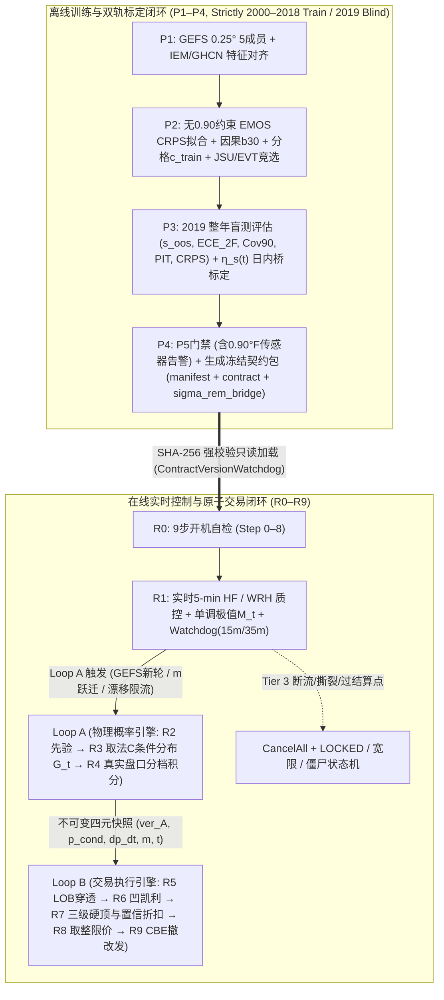

# P8 算法全链路对照复核：核心逻辑判定、自顶向下完整算法过程与差异矩阵

> **文档性质**：B 线治理/审计对照基线文档（自检修订版，供第三方独立复核与团队讨论）
> **核验时点**：2026-11-12 18:10 CST
> **只读边界**：严格只读仓库源码、Git 历史、配置与文档，**未修改任何 `src/`、`tests/`、`scripts/`、`configs/`、`data/` 文件**，未 commit、未 push。
> **引用铁律**：本文每一条关于现状代码、归档历史或目标设计的主张均给出精确来源（`路径#L行号`、`commit SHA` 或文档精确行号）；未见源码或无实测标定的项显式标注 `【缺失】` / `【待标定】` / `【待裁决】`，绝不无据断言。

---

## 1. 对基本判断的核验结论（大逻辑是否成立？）

**待核验命题**：「当前算法的大逻辑是没有问题的，但在落地时有断档，存在前后不一致和缺乏细节的地方。」

**逐层核验后的明确结论：命题主体成立（宏观主干逻辑正确，无需推翻重构），但必须精确拆出「一处数学模型实质错误（不能按“缺细节”打补丁）」与「三类工程/口径病灶（断档、不一致、缺标定细节）」。**

### 1.1 宏观大逻辑为什么成立（有代码与 ADR 双重支撑）

从气象物理集合预报出发、经盘中观测单调约束、再到含费盘口穿透与对数效用风控配资的整条主干链路，在数理统计、气象物理与市场微观结构上是自洽的：

1. **物理集合先验 → 无气候底 CRPS 校准 → 独立 2-Level 容灾**：
   - `GEFS 0.25°` 固定 `M = 5` 成员保证自由度一致（[`ADR-0004`](../adr/ADR-0004：GEFS五成员严格对齐与离散度归一.md)、[`gefs_fetcher.py#L194-L197`](../../src/data_acquisition/gefs_fetcher.py#L194-L197)）；
   - 高斯 EMOS 最小化闭式 CRPS，Level 1 废除气候方差加法底（[`ADR-0015`](../adr/ADR-0015：废除高斯EMOS气候方差加法项、确立物理方差底座与离散校准门禁.md)、[`gaussian_emos.py#L46-L72`](../../src/modeling/gaussian_emos.py#L46-L72)、[`crps.py#L77-L119`](../../src/modeling/crps.py#L77-L119)）；
   - Level 2 仅在退化/失败时切至 31 日历史气候态（[`degradation.py#L78-L188`](../../src/modeling/degradation.py#L78-L188)、[`climate_floor.py#L357-L380`](../../src/modeling/climate_floor.py#L357-L380)）；
   - 样本外方差比前移为定价膨胀 $\sigma_{\text{adj}}$ 与资金折减 $\psi(s_{\text{oos}})$ 双防线（[`ADR-0019#L47-L54`](../adr/ADR-0019：物理模型参数向投注算法消费契约与解耦架构.md#L47-L54)、[`sigma_adj.py#L88-L109`](../../src/pricing/sigma_adj.py#L88-L109)）。
2. **盘中双源合流 → 硬质控不插补 → 不可逆单调极值折叠**：
   - `IEM ASOS` 高频流 + `NWS WRH` 影子核验，RMK `T-group` 优先（[`ADR-0011#L36-L44`](../adr/ADR-0011：双源单调合流架构、TMAX-TMIN对称截断与两维阶梯风控裁决.md#L36-L44)、[`observation_stream.py#L54-L145`](../../src/data_acquisition/observation_stream.py#L54-L145)）；
   - 异常报文丢弃禁止插补（[`temperature_sanitizer.py#L71-L277`](../../src/prediction/temperature_sanitizer.py#L71-L277)），日内极值单向折叠并对齐 `.5°F` Half-up 结算规则（[`monotonic_confluence.py#L74-L125`](../../src/prediction/monotonic_confluence.py#L74-L125)、[`discrete_bin_engine.py#L46-L53`](../../src/prediction/discrete_bin_engine.py#L46-L53)）。
3. **微观含费穿透 → 互斥分档对数效用 → 自由现金底座 + 三级顶 + 断流撤单**：
   - 胜方 5% 费率边际价格穿透（[`penetration_probe.py#L22, L159-L196`](../../src/pricing/penetration_probe.py#L22)）；
   - 互斥分档对数效用优化、自由现金底座与风险预算隔离、15m/35m 两维看门狗（[`SPEC#L292-L429`](P8-ALGO-DEF-SPEC_气象物理预测到投注端到端严谨数学模型规格书_20261108_v2.0.md#L292-L429)、[`stream_watchdog.py#L47-L206`](../../src/risk/stream_watchdog.py#L47-L206)）。

### 1.2 必须指出的唯一一处「非细节类实质错误」

现行代码在**盘中概率更新**这一步并不是“缺个参数或接线”，而是**数学算子本身方向错误**：

- **现行代码做法**：[`DynamicCorrector`](../../src/prediction/dynamic_corrector.py#L79-L115) 对静态先验高斯执行**不含时间参数 `t` 的零阶硬截断** $F_{\text{post}}(x) = \frac{F(x)-F(T_{\text{now}})}{1-F(T_{\text{now}})}\mathbf{1}_{x>T_{\text{now}}}$（[`observation_time`](../../src/prediction/dynamic_corrector.py#L51) 在 [`cdf()`](../../src/prediction/dynamic_corrector.py#L79-L115) 中从未被读取，且 [`PredictionPipeline`](../../src/prediction/prediction_pipeline.py#L203) 在传入字符串时间时直接将其丢弃为 `None`）；随后 [`ConstraintEnforcer`](../../src/prediction/constraint_enforcer.py#L81-L98, L183-L232) 用硬编码 `15:00/06:00` 把超界尾概率直接硬置 `1.0/0.0`。
- **为什么不是“缺细节”**：高斯分布尾概率不满足乘法可分性，截断条件均值 $\mathbb{E}[T \mid T \ge m]$ 随 $m$ 升高而**上升**（[`第三段条件分布#L59-L67`](P8-ALGO-DEF_第三段条件分布_20261110.md#L59-L67)）。脚本 [`audit_segment3_conditioning_20261110.py`](../../scripts/audit_segment3_conditioning_20261110.py) 基于仓库真实参数（`KORD_12h` 冬季 $\mu_0=37.6541^\circ\text{F}, \sigma_0=5.8146^\circ\text{F}$，13:00 已观测 `37.0°F`）实测证明：硬截断在近端 `[36,38)` 低估 **`−34.24pp`**（`24.91%` vs `59.15%`，导致 `0 股` vs `289 股` 漏投），在远端 `[44,46)` 高估 **`+10.43pp`**（`11.37%` vs `0.94%`，导致 `54 股` 假边际错投）（[`第三段条件分布#L16-L24, L145-L183`](P8-ALGO-DEF_第三段条件分布_20261110.md#L16-L24)）。
- **结论**：该处必须以“剩余增量过程 $T = m + \max(0, R_t)$ 条件分布 $G_t$（含 $m$ 处离散原子）”**整体替换**现行截断与硬钳代码，不能在原截断公式上修补。

### 1.3 其余问题确属「断档」、「前后不一致」与「缺乏细节」

- **断档（源码未接线或已归档）**：
  1. 线下训练脚本 [`retrain_p4_active10_matrix.py#L491-L531`](../../scripts/retrain_p4_active10_matrix.py#L491-L531) 与 [`train_p7_w1_pooled_phase.py#L380-L504`](../../scripts/train_p7_w1_pooled_phase.py#L380-L504) 产出 1200 个 `.pkl` 含 `c_train`、`JSU/EVT_Hybrid` 及 `b30`，但在线入口 [`ModelRegistry.predict()`](../../src/modeling/registry.py#L462-L510) 只从 [`DatasetPartitioner.get_station_lead_nodes()`](../../src/modeling/partitioner.py#L258-L330) 读取 2–3 个锚点 `GaussianEMOS(a,b,c,d)`，绕过非锚点与全部后校准参数；
  2. [`StreamConfluencePipeline`](../../src/pipeline/stream_confluence_pipeline.py#L61-L126) 未接入 [`PredictionPipeline`](../../src/prediction/prediction_pipeline.py#L140-L242)；
  3. [`SigmaAdj`](../../src/pricing/sigma_adj.py#L81-L85) 与 [`PenetrationProbe`](../../src/pricing/penetration_probe.py#L133-L137) 被 `F-2` 无条件抛错锁死且未接线；
  4. **交易、风控与执行源码当前不在现役目录**：Git `commit 2d8ba2e4`（2026-10-13，工单 `R-16`）已将早期 `src/bankroll/`、`src/execution/`、`src/risk/` 6 模块、`src/simulation/`、`src/pricing/ev_engine.py` 与 `scripts/run_paper_trading.py` 共 53 个文件整体归档至 [`docs/archive/trading_modules/`](../archive/trading_modules/README.md#L1-L70)（现役 `src/risk/__pycache__/` 与 `scripts/__pycache__/` 仅为其残留字节码），且归档版 [`multinomial_kelly.py#L1-L6`](../archive/trading_modules/src/bankroll/multinomial_kelly.py#L1-L6) 采用旧式固定价 `q_i` + 沉没成本 `N_i` + `SLSQP`，与新规格书不兼容、明令禁止回迁；
  5. [`MainPipeline`](../../src/pipeline/main_pipeline.py#L145-L250) 中特征、训练、验证全为 Stub，预测使用硬编码且吞异常返回 `SUCCESS`。
- **前后不一致 & 缺乏细节**：见第 4 章对比矩阵与第 5 章待标定/待裁决清单。

---

## 2. 现役仓库实存代码盘点（As-Is Inventory）

本节仅盘点**现役目录**实际存在的代码与工件（归档区 `docs/archive/trading_modules/` 仅作历史对照，不计入现役）：

| 阶段 | 现役代码 / 工件位置 | 当前实际在跑的逻辑（精确来源） |
| :--- | :--- | :--- |
| **数据提取** | [`src/pipeline/gefs_extract.py`](../../src/pipeline/gefs_extract.py) | 读 `0.25°` GRIB2 最近邻切片（`:196-213`），校验 `[213.15K, 333.15K]`（`:232-235`）、`TMAX>=TMIN-0.01`（`:349-367`）、写 Parquet + SHA-256 manifest（`:447-527`）。Gate V2（`:377-395`）仅查缺不拒多、且仅单测调用；`:226` 单消息 `step` 退化抛 `TypeError`（`:282` `np.atleast_1d` 修复仅在未提交工作树）。 |
| **实况采集与质控** | [`src/pipeline/iem_adapter.py`](../../src/pipeline/iem_adapter.py) [`src/data_acquisition/observation_stream.py`](../../src/data_acquisition/observation_stream.py) [`src/prediction/temperature_sanitizer.py`](../../src/prediction/temperature_sanitizer.py) [`src/prediction/monotonic_confluence.py`](../../src/prediction/monotonic_confluence.py) [`src/pipeline/stream_confluence_pipeline.py`](../../src/pipeline/stream_confluence_pipeline.py) | `iem_adapter` 批量拉历史 CSV 并以 RMK `T-group` 优先（`:139-170`）；本地 `data/raw/iem/` 5 分钟 `MADISHF` 归档截止 `2026-09-11`（[`SPEC#L804-L822`](P8-ALGO-DEF-SPEC_气象物理预测到投注端到端严谨数学模型规格书_20261108_v2.0.md#L804-L822)）。实时侧 `Sanitizer` 校验 `[-40, 135]°F`、`|body-rmk|<=1.8°F`、`|\Delta T|<=15°F`、`>15m` 迟到丢弃（`:127-264`）；`Confluence` 单调折算日极值（`:74-125`）。**但该流式管道完全未接入 `PredictionPipeline` 或 `MainPipeline`。** |
| **契约治理** | [`src/contract/parameter_contract.py`](../../src/contract/parameter_contract.py) [`src/contract/parameter_domains.py`](../../src/contract/parameter_domains.py) [`src/contract/param_table_converter.py`](../../src/contract/param_table_converter.py) [`src/contract/param_table_validator.py`](../../src/contract/param_table_validator.py) | 锁定 `AUTHORIZED_STATIONS=("KORD","KMIA")` 与 `AUTHORIZED_LEAD_HOURS=(12..72)` 共 22 格 `tmax`（`parameter_contract.py:26-28`）；14 项统计字段 Tier 1 域校验到位，Tier 2 `[F-2 LOCKED]`（`parameter_domains.py:36-38, 57-256`）。`data/contracts/physical_param_contract.json:3` 绑定的是 10-26 的 `manifest_sha256`（`fc2212a5...`），早于 11-10 的 `2.2.0-phase` 模型清单，且契约未接入预测与抓取代码。 |
| **模型训练与校准** | [`src/modeling/gaussian_emos.py`](../../src/modeling/gaussian_emos.py) [`src/modeling/crps.py`](../../src/modeling/crps.py) [`src/modeling/emos_trainer.py`](../../src/modeling/emos_trainer.py) [`src/modeling/matrix_trainer.py`](../../src/modeling/matrix_trainer.py) [`src/modeling/climate_floor.py`](../../src/modeling/climate_floor.py) [`scripts/retrain_p4_active10_matrix.py`](../../scripts/retrain_p4_active10_matrix.py) [`scripts/train_p7_w1_pooled_phase.py`](../../scripts/train_p7_w1_pooled_phase.py) | 存在多套不统一脚本：`EMOSOptimizer` 用 `l2=1e-3`、`MatrixTrainer` 仅训 200 锚点；`retrain_p4` 用 `l2=0.0`、无 `0.90` 下界训 960 节点，并用 `Max@18h` 计算 `b30` 与 `c_train∈[0.85,1.35]` 及 `JSU/EVT` 广播至全季全时效与 `Min`（`:304-531`）；`train_p7_w1` 加训 240 相位模型 + 80 个 `lead6h` 兜底模型使 `manifest.json` 达 1200 个（含 32 个 `sample_count=0`）；遗留 `fit_training_variance_factors.py:147` 仍锁 `c>=0.90`；`train_emos_matrix.py:72` 默认读禁用的 `wunderground.db`。 |
| **在线静态与动态预测** | [`src/modeling/registry.py`](../../src/modeling/registry.py) [`src/modeling/interpolator.py`](../../src/modeling/interpolator.py) [`src/prediction/static_predictor.py`](../../src/prediction/static_predictor.py) [`src/prediction/dynamic_corrector.py`](../../src/prediction/dynamic_corrector.py) [`src/prediction/constraint_enforcer.py`](../../src/prediction/constraint_enforcer.py) [`src/prediction/discrete_bin_engine.py`](../../src/prediction/discrete_bin_engine.py) [`src/prediction/prediction_pipeline.py`](../../src/prediction/prediction_pipeline.py) | `ModelRegistry.load_model` 已改为 PKL 优先（`:364-378`），但 `predict()`（`:462-489`）只拉 2–3 个锚点 `GaussianEMOS` 做插值/平钳（`D1-Max`/`D1-Min`），`interpolator.py:101-118` 仅当 `24 in anchors` 时乘 `√(L/24)`。`DynamicCorrector`（`:79-115`）无时间 `t` 纯硬截断；`ConstraintEnforcer`（`:81-98`）按 `15:00/06:00` 硬置 `1.0/0.0`；`DiscreteBinEngine`（`prediction_pipeline.py:225-228`）按静态 `static_res.mu` 生 11 个虚拟 `2°F` 档。 |
| **定价与看门狗** | [`src/pricing/sigma_adj.py`](../../src/pricing/sigma_adj.py) [`src/pricing/penetration_probe.py`](../../src/pricing/penetration_probe.py) [`src/pricing/coverage_dual_track.py`](../../src/pricing/coverage_dual_track.py) [`src/risk/stream_watchdog.py`](../../src/risk/stream_watchdog.py) | `SigmaAdj` 与 `PenetrationProbe` 算子实现完毕，但 `load_*_policy()` 无条件抛 `F2LockNotReleasedError` 且未接入主链；`StreamRiskWatchdog`（15m 滞后警告撤单 / 35m 物理超龄熔断 / 3 帧恢复）仅接在独立的 `StreamConfluencePipeline` 中。 |
| **仓位优化、资金风控、CLOB 执行与状态机** | **现役 `src/` 与 `scripts/` 均无源码** | 自 2026-10-13 `R-16` 归档至 `docs/archive/trading_modules/` 后，现役树中 Stage 6 凯利优化、Stage 7 三级额度风控、Stage 8 限价路由与异步审计、Stage 9 Loop A/B 与 CBE 原子状态机**全部为空白**。 |

---

## 3. 自顶向下（Top-Down）完整正确算法过程

本节不列零散建议，而是从**系统最高目标与硬不变量**出发，自顶向下展开为完整的、无二义性的可执行算法过程：**离线训练与标定流水线（Offline `P1–P4`）** + **在线实时双循环控制与交易流水线（Online `R0–R9`）**。

---

### Layer 0：系统最高数学目标与四条不可违背不变量

#### 0.1 顶层数学目标
对授权可交易市场集合 $\mathcal{M}$ 中的任意单市场 $m_{\text{mkt}}$（互斥完整气温结算分档 $\Omega = \{1,\dots,K\}$），在严格满足三级资金敞口硬顶（单档、事件、日度）与实时物理安全门禁的紧凸可行域内，寻找目标持仓向量 $\mathbf{x}^* \in \mathbb{R}_{\ge 0}^K$（对应调仓差量 $\boldsymbol{\delta}^* = \mathbf{x}^* - \mathbf{x}_{\text{held}}$），**最大化自由现金底座 $F \equiv W_{\text{free}}$ 下的条件期望对数财富效用**：
$$\max_{\mathbf{x} \in \mathbb{R}_{\ge 0}^K} \; G(\mathbf{x}) = \sum_{j=1}^K p_j^{\text{cond}}(t) \ln\!\left(F + x_j - \sum_{r \in \Omega^+} C_r\big(x_r - x_{\text{held}, r}\big)\right)$$
> 来源：[`SPEC#L294-L328`](P8-ALGO-DEF-SPEC_气象物理预测到投注端到端严谨数学模型规格书_20261108_v2.0.md#L294-L328)。

#### 0.2 四条全局硬不变量（任何模块不得越过）
1. **数据时间墙与单轨契约不变量**：训练集严格锁 `[2000, 2018]`、盲测锁 `2019`、禁用 `wunderground/legacy-v1-suspect`；抓取、建模、预测、定价共享同一授权宇宙与校验和契约（[`airgap.py#L104-L132`](../../src/utils/airgap.py#L104-L132)、[`partitioner.py#L71-L118`](../../src/modeling/partitioner.py#L71-L118)、[`ADR-0019#L66-L68`](../adr/ADR-0019：物理模型参数向投注算法消费契约与解耦架构.md#L66-L68)）。
2. **全概率公理与物理单调不可逆不变量**：条件概率必满足 $p_k^{\text{cond}} \in [0,1]$ 且 $|\sum_{k=1}^K p_k^{\text{cond}} - 1| \le 10^{-5}$；同一本地日内实测极大极小值 $M_t$（及结算整数下界 $m = \text{settle\_half\_up}(M_t)$）随观测单调锁定，**永不因缺测或断流而回退放宽**（[`ADR-0011#L76-L78`](../adr/ADR-0011：双源单调合流架构、TMAX-TMIN对称截断与两维阶梯风控裁决.md#L76-L78)、[`SPEC#L258-L260`](P8-ALGO-DEF-SPEC_气象物理预测到投注端到端严谨数学模型规格书_20261108_v2.0.md#L258-L260)）。
3. **五态资金守恒与 CBE 原子性不变量**：全程保持总权益守恒 $A + F \equiv E_0$（$A = A_{\text{held}} + \sum C_{\text{freeze}}$）；仅在 `CancelAll` 收到终态回执且 $\sum C_{\text{freeze}} \equiv 0$ 后，方可执行 Phase 2 求解与发单（[`SPEC#L330, L669-L708`](P8-ALGO-DEF-SPEC_气象物理预测到投注端到端严谨数学模型规格书_20261108_v2.0.md#L330)）。
4. **Fail-Closed 零异常吞噬不变量**：任意契约校验失败、观测物理撕裂、断流超限 `> T`、求解超轮停滞、或审计队列失败，均强制锁死发单闸（`local_order_valve = LOCKED`）并归零调仓输出，严禁吞异常报 `SUCCESS`（[`SPEC#L618-L626, L858-L878`](P8-ALGO-DEF-SPEC_气象物理预测到投注端到端严谨数学模型规格书_20261108_v2.0.md#L618-L626)）。

---

### Layer 1：双闭环总体拓扑（离线标定流 ↔ 在线运行流）

---

### Layer 2A：离线训练与标定闭环（`P1 → P4`）

#### `P1`：物理同口径特征抽取与双源时间对齐
- **输入**：`2000–2018` 与 `2019` NOAA GEFS v12 `0.25° (721×1440)` Reforecast、IEM ASOS/GHCN 真值、`configs/climate_floor_v2.json`。
- **算子**：
  1. **成员锁定 `M = 5`**：仅抽 `{c00, p01..p04}` 计算 $\mu_{\text{ens}}, \sigma_{\text{ens}}^2$（`ddof=1`），与实时 31 成员下抽样保持完全同自由度 $\nu=4$（[`SPEC#L155-L167`](P8-ALGO-DEF-SPEC_气象物理预测到投注端到端严谨数学模型规格书_20261108_v2.0.md#L155-L167)）。
  2. **空间算子单轨**：全仓离线提取与线上推理必须统一算子（现行离线 Parquet 为最近邻 [`gefs_extract.py#L196-L213`](../../src/pipeline/gefs_extract.py#L196-L213)，未完成双线性全量对照前线上同用最近邻）。
  3. **双向 Gate V2**：在 `gefs_extract` 生产路径强制核验 `present_fxx == AUTHORIZED_LEAD_HOURS`（既查缺也拒多，修复 `gefs_extract.py:282` `np.atleast_1d` 与 `:377-395` 单向漏洞）。
- **输出**：通过 V1/V2/V4/V5/V6 校验的 `calib-dataset-v2.0` Parquet。

#### `P2`：分格分布拟合、因果偏差与方差校准（2000–2018 隔离）
- **输入**：授权网格 `(station, season, variable, lead_hours)` 在 `2000–2018` 的 `(y_obs, ens_mean, ens_var)`。
- **算子**（禁止跨变量或全时效粗暴广播）：
  1. **高斯骨架（无 `0.90` 训练下界）**：最小化闭式高斯 `CRPS`（[`crps.py#L25-L119`](../../src/modeling/crps.py#L25-L119)，统一 `l2_lambda_d = 0.0`、`b > 0, d ≥ 0, c ≥ 0`，初猜 `c_0 = std(y_obs - ens_mean)` 消除 `c=0` 鞍点，[`P8-MODEL_重训裁决回执#L18-L25`](../handoffs/P8-MODEL_重训裁决回执_20261110.md#L18-L25)）。若本节点 $N < 100$，按定义池化相邻时效或标 `is_pooled_fallback`；触发硬/软退化则记录 Level 2 标记（[`degradation.py#L78-L139`](../../src/modeling/degradation.py#L78-L139)）。
  2. **严格因果 30 日偏差 $b_{30}$ 与分格缩放 $c_{\text{train}}$**：对每个 `(station, season, variable, lead)` 独立计算前 30 天（`shift(1).rolling(30, min_periods=10)`）滑动残差均值 $b_{30}$，得 $\mu_{\text{calib}} = \mu_{\text{raw}} + b_{30}$，进而估计 $c_{\text{train}} = \text{clip}(\sqrt{\text{Var}(y - \mu_{\text{calib}})/\overline{\sigma_{\text{raw}}^2}},\; [0.85, 1.35])$（修正 `retrain_p4_active10_matrix.py:319-328, 503` 将 `Max 18h` 单格数值广播给 `Min` 及全时效的问题）。
  3. **尾部形状家族竞选**：在同格标准化残差上检验偏度（`JSU`）与超额峰度（`EVT_Hybrid` 5%/95% GPD 尾，[`resampling.py#L588-L664, L691-L750`](../../src/modeling/resampling.py#L588-L664)），以 `ΔBIC < -10.0` 选定唯一 `distribution_family` 与形状参数持久化进 `.pkl`。

#### `P3`：2019 盲测评估与 Stage 3 日内桥标定
- **输入**：`P2` 冻结模型 + `2019` 盲测集 + `data/raw/iem/`（2016–2018 历史 5-min 过程，严禁渗入 2019）。
- **算子**：
  1. **2019 整年盲测**：在 `2019` 真实结算序列上（包含 `JSU` 与 `EVT_Hybrid` 精确 CDF 分支，修复 `reliability_v2.py:54-80` 缺失）按每格计算 14 项指标，**统一正交定义为 $s_{\text{oos}} = \text{Var}(e_{\text{oos}}) / \overline{\sigma_{\text{eff}}^2}$**（修复 `calibration_audit.py:374` 倒数问题）。
  2. **Stage 3 方差桥 $\eta_s(t)$ 标定（落盘 `sigma_rem_bridge.json`）**：利用 2000–2018 历史逐时/5 分钟日内极值过程 $M_t$，按 `(station, season, lead_horizon)` 计算 $\eta_s(t) = 1 - \text{Var}(M_t)/\sigma_0^2$（[`第三段条件分布#L108-L120`](P8-ALGO-DEF_第三段条件分布_20261110.md#L108-L120)）；按 `CONF-03` 精度公式 $N_{\min}(\varepsilon) = \lceil 1/(2\varepsilon^2)\rceil + 1$（初始 $\varepsilon = 10\% \implies N_{\min} = 51$）判定样本充分性，不足则回退同站同季并打标 `"稀疏降级"`（[`SPEC#L720, L829-L850`](P8-ALGO-DEF-SPEC_气象物理预测到投注端到端严谨数学模型规格书_20261108_v2.0.md#L720)）。
  3. **S_conf 容差标定（F-2 解锁前置实验）**：基于 `ADR-0019:41` 新核与样本外采样分布定义 `x_pit`、标定 `(w_ece, w_cov, w_pit)` 与 `(σ*_ece, σ*_cov, σ*_pit)`（见第 5 章待定项）。

#### `P4`：门禁验收与契约冻结发布
- **算子**：运行 P5 门禁（保留 `0.90°F` 作 ASOS 传感器精度告警红线而非阻塞异常，[`SPEC#L184`](P8-ALGO-DEF-SPEC_气象物理预测到投注端到端严谨数学模型规格书_20261108_v2.0.md#L184)）与三门校验（`TripleGate` 统一极值分位数基线为 `2000–2018` 训练分位，非劣效检验计入噪声半宽）；全部通过后同步生成最新版 `manifest.json`、`physical_param_contract.json`（匹配当前全部生产 `.pkl` 哈希）与 `sigma_rem_bridge.json`。

---

### Layer 2B：在线实时控制与原子交易闭环（`R0 → R9`）

#### `R0`：9 步开机自检（严格串行，前步不绿禁止开阀）
> 来源：[`SPEC#L614-L635`](P8-ALGO-DEF-SPEC_气象物理预测到投注端到端严谨数学模型规格书_20261108_v2.0.md#L614-L635)。
- `Step 0` 内存锁死 `local_order_valve = LOCKED`；
- `Step 1` 校验 $|\Delta t_{\text{clock}}| \le 5\text{s}$ 与站级 `ZoneInfo`；
- `Step 2` 运行 `ContractVersionWatchdog` 强核验 `manifest.json` / `.pkl` / `physical_param_contract.json` / `sigma_rem_bridge.json` SHA-256，并探测异步 JSONL 审计句柄；
- `Step 3` 连接 CLOB 私有 API 对账余额/持仓/开放挂单，若存在残留挂单先发 `CancelAll` 等待终态清零（超时 `30s` 维持 `LOCKED`）；
- `Step 4` 分类市场状态（`TRADEABLE` / 过结算期 / 过僵尸线 / 无盘口 / 已结算）并校验 `|end_date - T_settle| <= 24h`；
- `Step 5` 对 `TRADEABLE` 市场拉全当日 `[00:00 LT, now]` IEM + WRH 序列，校验 7 字段 `M_t^disk` 哈希与物理龄/派发龄（**撕裂优先于磁盘、双源严格低于磁盘才写 `MB_DISK_CORRECTION` 并重算、单源不一致挂起 `COR_CONFLICT`**）；
- `Step 6` 校验 `Watchdog == HEALTHY`、账本 $A+F \equiv E_0$、$\sum C_{\text{freeze}} \equiv 0$、僵尸率 $R_z$；
- `Step 7` 对每个 `TRADEABLE` 市场**执行一次 `R2→R8` 补算**（「补算一次，不补单」）；
- `Step 8` 全部通过后置 `local_order_valve = ARMED`，移交 `Loop A / Loop B`。

#### `R1`：实时观测摄取、三件套硬质检与两维看门狗
> 来源：[`SPEC#L196, L213-L236`](P8-ALGO-DEF-SPEC_气象物理预测到投注端到端严谨数学模型规格书_20261108_v2.0.md#L196)、[`ADR-0011#L57-L88`](../adr/ADR-0011：双源单调合流架构、TMAX-TMIN对称截断与两维阶梯风控裁决.md#L57-L88)、[`stream_watchdog.py`](../../src/risk/stream_watchdog.py)、[`v2.6退回单#L10-L18`](../handoffs/P8-ALGO-DEF_v2.6退回单_20261110.md#L10-L18)。
- **输入**：5 分钟 `IEM ASOS MADISHF` + `METAR/SPECI` + `NWS WRH`（`KBKF` 静态回落逐时）。
- **算子**：
  1. `TemperatureSanitizer` 执行 **范围 `[-40, 135]°F` + 跳变（单步 `≤15°F`、Body-RMK `≤1.8°F`）+ 同值重复卡死检查**；**坏值/迟到帧丢弃禁插补**，触发 Gate 1–3 物理撕裂立即按 `ADR-0014` 挂起台站并 `CancelAll`。
  2. `MonotonicConfluenceEngine` 按台站本地日折算单调极值 $M_t$ 并经 `settle_half_up(M_t)` 映射到法定整数下界 $m$（`D+1/D+2` 时 $M_t = \varnothing$）。
  3. **三档断流降级（按 `ADR-0011` 与 `v2.6退回单` 修正 `SPEC:65-67` 矛盾，统一 $T = 35\text{ min}, N = 7\text{ 槽}$）**：
     - 到包间隔 $> 15\text{ min}$（`Watchdog Tier 1`）：发 `WARNING` 并 `CancelAll` 防逆向选择，维持日内观测下界 $m$ 不回退；
     - 同日缺 $1 \le \text{slots} < 7$ 且断流 $\le 35\text{m}$（第 1 档）：保留上次 $m$，不触发重算；
     - 同日缺 $\ge 7$ 槽且断流 $\le 35\text{m}$（第 2 档）：死守已观测 $m$ 绝不回落，切至逐时 `METAR/SPECI` 兜底监测；
     - 跨日或连续无新观测 $> 35\text{m}$ / 报文物理龄 $> \text{physical\_age\_limit}$（第 3 档）：置 $M_t = \varnothing$ 退回先验、**锁死 `local_order_valve = LOCKED` 并 `CancelAll`**（恢复须新报龄期 $\le 20\text{m}$ 且连续 3 帧健康）。

#### `Loop A`（物理概率引擎：`R2 → R3 → R4`，绝对隔离盘口）
> 触发：GEFS 新轮次（`D+2` 限流 `4–6h`、`D+1` `1h`、`D+0` 无限制）、`D+0` 下 $m$ 严格上升/早锁/首报、或 `max_k |∂p_k/∂t|·Δt >= stage3_drift_threshold`（[`SPEC#L503-L537, L722-L733`](P8-ALGO-DEF-SPEC_气象物理预测到投注端到端严谨数学模型规格书_20261108_v2.0.md#L503-L537)）。

- **`R2` 先验分布与防线前移**：
  - 校验 `lead_hours ∈ AUTHORIZED_LEAD_HOURS`（越界硬拒）。直接加载对应 `(station, season, var, lead)` 的 `.pkl` 模型及因果 `b30`、`c_train`、`distribution_family`（仅在规范允许的未独立拟合节点使用 `LeadTimeInterpolator`，且不越界平钳）。
  - Level 1 计算校准后参数：$\mu_0 = a + b\mu_{\text{ens}} + b_{30}$，$\sigma_{\text{eff}} = c_{\text{train}}\sqrt{\max(10^{-8}, c^2 + d^2 \sigma_{\text{ens}}^2)}$，再前移第一道防线：
    $$\sigma_0 = \sigma_{\text{adj}} = \sqrt{\max(1.0,\; s_{\text{oos}})} \cdot \sigma_{\text{eff}}$$
  - 若触发 Level 2 退化（NWP 失效或模型退化），切至 $\mathcal{N}(\mu_{\text{clim}}, \sigma_{\text{clim}}^2)$（仅此分支消费 `climate_floor_v2.json`）。
- **`R3` 剩余增量条件分布（取法 C 替代纯硬截断）**：
  - 若 $M_t = \varnothing$：条件分布直接退化为 `R2` 先验分布 $F_0$。
  - 若 $M_t \ne \varnothing$（`D+0` TMAX，TMIN 镜像对称）：成对刷新同一 $(m, t)$ 下的条件参数（[`SPEC#L200-L210`](P8-ALGO-DEF-SPEC_气象物理预测到投注端到端严谨数学模型规格书_20261108_v2.0.md#L200-L210)、[`第三段条件分布#L85-L132`](P8-ALGO-DEF_第三段条件分布_20261110.md#L85-L132)）：
    $$\sigma_{\text{rem}}(t) = \max(\sigma_0 \cdot \sqrt{\eta_s(t)},\, 0.9^\circ\text{F}), \qquad \mu_R(t, m) = \frac{t_{\text{close}} - t}{t_{\text{close}} - t_{\text{open}}} \cdot \max(0, \mu_0 - m)$$
    $$F_{\text{cond}}(x \mid m, t) = \begin{cases} 0, & x < m \\ G_t(x - m) = \Phi\!\left(\dfrac{x - m - \mu_R(t, m)}{\sigma_{\text{rem}}(t)}\right), & x \ge m \end{cases}$$
    （有观测分支按 SPEC 取法 C 高斯桥执行；族形状经无观测分支与 A/B 升级接口生效）。同步解析求导 $\mathbf{dp/dt}$。
- **`R4` 真实盘口分档左极限积分与公理门禁**：
  - 从市场元数据读取实际互斥半开边界 $\{(L_k, U_k)\}_{k=1}^K$（首档 $(-\infty, U_1)$、末档 $[L_K, +\infty)$）。
  - 执行左极限积分，确保 $x = m$ 处点质量原子 $G_t(0^-) = \Phi(-\mu_R/\sigma_{\text{rem}})$ 完整落入 $L_k \le m < U_k$ 档位，越过上界 $U_k \le m$ 的档位瞬间严格置 $0$（[`SPEC#L245-L255`](P8-ALGO-DEF-SPEC_气象物理预测到投注端到端严谨数学模型规格书_20261108_v2.0.md#L245-L255)）：
    $$p_k^{\text{cond}} = F_{\text{cond}}(U_k^- \mid m, t) - F_{\text{cond}}(L_k^- \mid m, t)$$
  - 校验 $p_k^{\text{cond}} \in [0, 1]$ 且 $|\sum_{k=1}^K p_k^{\text{cond}} - 1| \le 10^{-5}$，不满足则 Level 1 熔断；输出不可变四元快照 `ver_A` 至 `Loop B`。

#### `Loop B`（交易优化与 CBE 原子执行：`R5 → R9`，绝对不改写 `p_cond`）
> 唤醒与冷却：由新 `ver_A`、订单终态、Watchdog 跃迁、开机单次补算或 L2 更新唤醒；满足最小串行间隔 $\tau_{\text{ack\_timeout}}$ 与 3 要素冷却（量纲封闭摩擦阈值 $\Delta q_{\text{fric}}(P) = \max(\Delta P_{\text{tick}} g'(P), f P(1-P))$ 持续 $\Delta t_{\text{confirm}}$、静默窗 $\Delta t_{\text{quiet}}$、连续空操作指数退避 $\Delta t_{B,\text{cool}}$）（[`SPEC#L538-L575`](P8-ALGO-DEF-SPEC_气象物理预测到投注端到端严谨数学模型规格书_20261108_v2.0.md#L538-L575)）。

- **`R5` 双向订单簿穿透定价**：
  - 对实时 L2 `AskBook` / `BidBook` 逐级构建含 $f = 0.05$ 胜方费率的分段线性凸总成本/回款 $T_k^{\text{ask}}(\delta)$、$T_k^{\text{bid}}(|\delta|)$ 与边际有效价 $\tau_k(x) = \pi_{\text{eff}} + f d^2/x^2$（[`SPEC#L266-L288, L744`](P8-ALGO-DEF-SPEC_气象物理预测到投注端到端严谨数学模型规格书_20261108_v2.0.md#L266-L288)、[`penetration_probe.py#L159-L196`](../../src/pricing/penetration_probe.py#L159-L196)）。剔除盘口交叉（`BestAsk <= BestBid`）或空盘口。
- **`R7（前置入约束）` 三级顶计算与置信折扣注入**：
  - 按 `ADR-0019:38-43, 76` 与 `SPEC:381-416` 合并对接：
    - $B_{\text{eff}} = W_{\text{free}} + \sum_{m \in \mathcal{M}_{\text{open}}}\min(V_m^{\text{cost}}, V_m^{\text{mark}})$（僵尸仓计 `0.0x`）；
    - 买侧可用总预算（同步修正 `m_max = 9` 下的两级分离条件 $\alpha \in (0.111, 0.75]$）：
      $$C_{\max} = \tau_{\text{conf}} \cdot \tau_z \cdot \tau_{\text{close}} \cdot \min\big(W_{\text{free}},\; \text{Headroom}_{\text{market}},\; C_{\text{risk\_limit}}\big)$$
      其中 $\tau_{\text{conf}} = \psi(s_{\text{oos}}) \cdot S_{\text{conf}}$（`ADR-0019:41` 零偏无惩罚核）、$\tau_z$ 由僵尸率 $R_z$（`>15%/30%/50%`）降档、$\tau_{\text{close}}$ 承接近关窗保护裁决（待定）。
    - 单档买侧盒上界 $\bar{X}_k^{\text{abs}}$：对负期望档（$p_k \le \tau_k^{\text{ask}}(0^+)$）死锁 $\bar{X}_k^{\text{abs}} = x_{\text{held}, k}$（严禁买入加仓）；对正期望档（$p_k > \tau_k^{\text{ask}}(0^+)$）取 $x_{\text{held}, k} + T_k^{\text{ask},-1}(\text{Headroom}_{\text{bin}, k})$（[`SPEC#L298, L328, L388`](P8-ALGO-DEF-SPEC_气象物理预测到投注端到端严谨数学模型规格书_20261108_v2.0.md#L298)）。
- **`R6` 严格凹目标一维 `Scalar-Γ` 闭式求解 + 确定性破平**：
  - 在可投域 $\Omega^+ = \{k \mid p_k > 0 \land \text{深度}>0\}$ 上利用双向分段线性凸成本，通过标量门槛 $\Gamma$ 一维二分寻根 + 逐档闭式反解 $x_k(C, \Gamma) = \frac{p_k F}{q_{k,m}\Gamma} - F + C$ 求得全局唯一最优目标仓位 $\mathbf{x}^*$（$\lambda=0$ 消元求根；$\lambda > 0$ 于 $C = C_{\max}$ 解耦二分至 $10^{-12}$；极罕见退化 $1 - Q_{\mathcal{A}} \le 10^{-12}$ 启用 Schur $2\times 2$ 自适应阻尼牛顿 + Armijo，$T_{\max}=200$，不收敛则 `SOLVER_MAX_ITER_HALT` 输出 $\boldsymbol{\delta}=\mathbf{0}$）（[`SPEC#L331-L362`](P8-ALGO-DEF-SPEC_气象物理预测到投注端到端严谨数学模型规格书_20261108_v2.0.md#L331-L362)）。
  - 执行破平 3 步：kink 台阶吸附 → 赔率优势比 $\rho_k = p_k/\pi_k$ 降序 → 最小出资 + 等分 + Hamilton 最大余数（再等留作现金缓冲）（[`SPEC#L363-L369`](P8-ALGO-DEF-SPEC_气象物理预测到投注端到端严谨数学模型规格书_20261108_v2.0.md#L363-L369)）。
- **`R8` 整数向零取整、死档守卫与异步审计**：
  - 统一差量取整 $\delta_k^{\text{exec}} = \lfloor |x_k^* - x_{\text{held}, k}| \rfloor$，最小单门禁 $X_{\min}^{\text{order}} = \max(5, \gamma.\text{minimum\_order\_size})$。
  - **死档双规则**：$p_k = 0 \land \delta_k^* > 0 \implies \texttt{REJECT\_DEAD\_BIN\_BUY}$；$p_k = 0 \land x_{\text{held}, k} > 0 \implies$ 只要 `BidBook` 合法深度 $\ge X_{\min}^{\text{order}}$ 即走无底价限价单清零（豁免 $\Delta\text{CE}$，**禁止市价**）。
  - 执行前再核 $\text{Total Exposure} \le \text{Cap}$，任何越界整单 `REJECT`（严禁二次打折）。
- **`R9` 经济可行性、两阶段 CBE 原子提交与结算/僵尸出口**：
  1. **Phase 1（只读预检）**：若无强制撤单信号（死档挂单/超顶/Watchdog 异常/陈旧报价），以虚拟自由现金预检；若需撤旧重下，要求确定性等价增益 $\Delta\text{CE}(\mathbf{x}_{\text{cand}}^* \mid \mathbf{x}_{\text{curr}}) > C_{\text{queue\_bound}}$（无旧单则 $> X_{\min}^{\text{order}}\cdot \Delta P_{\text{tick}}$），否则直接 `NO_OP_KEEP_QUOTES`（零撤单）。
  2. **Phase 2（CBE 原子执行）**：发送 `CancelAll` 置 `CANCEL_REQUESTED` → 等终态回执直至 $\sum C_{\text{freeze}} \equiv 0$（超时 $\tau_{\text{ack\_timeout}}$ 转 `SKIP_ROUND_PENDING_RECONCILE`） → 基于撤单后真实 $(F_{\text{post}}, \mathbf{x}_{\text{held}}^{\text{post}}, \text{L2})$ **二次重算 `R5–R8`** → 通过阻塞门禁（`idempotency_key` 唯一、`dispatch_age <= dispatch_age_limit`）并将 Top 10 档 8 项快照无阻塞投递给异步 JSONL 队列（每行 `record_sha256`） → 发出纯限价单。
  3. **结算与僵尸边界**：过本地次日 00:00 `T_settle_expected_utc` 立即 `CancelAll` 并关闭 Loop A/B，持仓进只读 `Active Locked`；超过 `+12h` 未清算转 `Zombie Margin`（凯利分母 `0.0x`、NAV 计 `0.90 × E[V]` 并按 $R_z$ 降档）；存续期无盘口时转 `ORDERBOOK_SUSPENDED` 撤单停 Loop B、保留持仓与单调 $M_t$ 积累（[`SPEC#L643-L663`](P8-ALGO-DEF-SPEC_气象物理预测到投注端到端严谨数学模型规格书_20261108_v2.0.md#L643-L663)、[`ADR-0012#L36-L49`](../adr/ADR-0012：法定结算真值源（NWS%20WRH）、僵尸仓位双轨估值与舍入闭环裁决.md#L36-L49)）。

---

## 4. 现状 vs 目标：逐项差异矩阵（(a) 冲突 / (b) 需补充 / (c) 沿用并修改）

### 4.1 (a) 冲突项（Conflicts — 必须废止旧代码或统一互相打架的双轨口径）

| # | 冲突点 | 现状代码 / 文档写法（精确来源） | 目标正确算法（精确来源） | 冲突实质与处置 |
| :-: | :--- | :--- | :--- | :--- |
| **C1** | **盘中条件分布** | [`dynamic_corrector.py#L79-L115`](../../src/prediction/dynamic_corrector.py#L79-L115) 无时间 `t` 零阶硬截断；[`constraint_enforcer.py#L81-L98, L183-L232`](../../src/prediction/constraint_enforcer.py#L81-L98) 硬编码 `15:00/06:00` 强制置 `1.0/0.0` | [`SPEC#L198-L210`](P8-ALGO-DEF-SPEC_气象物理预测到投注端到端严谨数学模型规格书_20261108_v2.0.md#L198-L210)、[`第三段条件分布#L85-L132`](P8-ALGO-DEF_第三段条件分布_20261110.md#L85-L132) 取法 C 剩余增量条件化 $G_t$ + 成对 $(\sigma_{\text{rem}}, \mu_R)$ | **数学方向错误**：硬截断导致近端 `-34.24pp`、远端 `+10.43pp` 错向偏移，必须整块替换 |
| **C2** | **在线推理绕过校准成果** | [`registry.py#L462-L510`](../../src/modeling/registry.py#L462-L510) 只从 [`partitioner.py#L258-L330`](../../src/modeling/partitioner.py#L258-L330) 加载 2–3 个锚点 `GaussianEMOS`，丢弃 [`retrain_p4#L491-L531`](../../scripts/retrain_p4_active10_matrix.py#L491-L531) 产出的 `c_train`、`b30`、`JSU/EVT` 及非锚点模型 | [`ADR-0019#L87-L91`](../adr/ADR-0019：物理模型参数向投注算法消费契约与解耦架构.md#L87-L91) 必须消费 `mu_calib`、`sig_eff`（含 `c_train`）及分布族（JSU/Gaussian/EVT） | 线上完全未消费任何尾部或方差缩放参数；必须统一模型加载架构 |
| **C3** | **`c_train` 广播与拟合口径分裂** | [`retrain_p4#L319-L328, L503`](../../scripts/retrain_p4_active10_matrix.py#L319-L328) 仅用 `Max@18h` 算带 `b30` 的 `c_train∈[0.85,1.35]` 并广播至全时效及 `Min`；[`train_p7_w1#L380-L384`](../../scripts/train_p7_w1_pooled_phase.py#L380-L384) 不扣 `b30`；[`resampling.py#L574-L577`](../../src/modeling/resampling.py#L574-L577) 裁剪 `[0.8,1.4]`；[`fit_training_variance_factors.py#L247-L250`](../../scripts/fit_training_variance_factors.py#L247-L250) 不裁剪 | 统一按独立节点（或经检验的合法分格）执行因果 `b30` 与同口 `c_train` 校准，严禁 `Max` 参数广播覆写 `Min` | 不同脚本产生 4 套不兼容的 `c_train` 与 `L2`（`1e-3` vs `0.0`）设定 |
| **C4** | **`√(L/24)` 短时效收缩** | [`interpolator.py#L101-L118`](../../src/modeling/interpolator.py#L101-L118) 仅当 `24 in anchors` 时对 `min or max` 乘 `√(L/24)`，使东部 `KMIA`（无 24h 锚点）静默平钳；[`static_predictor.py#L181`](../../src/prediction/static_predictor.py#L181) 仅标 `min` | [`P0缺陷单#L35-L39`](../handoffs/P8-ALGO-DEF_短时效路由P0缺陷单_20261110.md#L35-L39) 指出该式为无数据支撑的设计断言；未过 2019 CRPS/PIT 对照前禁止盲目触发 | 同一条短时效规则在不同时区与变量间行为分裂且缺实证 |
| **C5** | **`0.90°F` 约束/红线混淆** | [`fit_training_variance_factors.py#L147, L182, L235`](../../scripts/fit_training_variance_factors.py#L147) 训练强锁 `c>=0.90`；[`p5_gate.py#L106-L110`](../../src/verification/p5_gate.py#L106-L110) 遇 `σ<0.90` 直接抛异常崩溃 | [`SPEC#L182-L184, L206`](P8-ALGO-DEF-SPEC_气象物理预测到投注端到端严谨数学模型规格书_20261108_v2.0.md#L182-L184)、[`重训裁决回执#L16-L25, L35-L42`](../handoffs/P8-MODEL_重训裁决回执_20261110.md#L16-L25) 三轨分离 | 现 `manifest.json` 已有 `|c|=0` 模型会直接撞碎 `p5_gate` |
| **C6** | **`MainPipeline` 吞异常与假成功** | [`main_pipeline.py#L145-L250`](../../src/pipeline/main_pipeline.py#L145-L250) 含 Stub；`:222-L226` `except Exception` 只 `logger.debug` 并返回 `SUCCESS`（D2） | [`SPEC#L858-L878`](P8-ALGO-DEF-SPEC_气象物理预测到投注端到端严谨数学模型规格书_20261108_v2.0.md#L858-L878) Fail-Closed 零静默 | 异常被吞并掩盖为成功零产出（P0 D2） |
| **C7** | **Gate V2 单向 & 契约断链** | [`gefs_extract.py#L377-L395`](../../src/pipeline/gefs_extract.py#L377-L395) 只查缺不拒多、生产零调用；[`parameter_contract.py#L27`](../../src/contract/parameter_contract.py#L27) 未接入 `gefs_fetcher.py`、`registry.py`、`run_predictions.py`（D3） | 双向强核验（缺与多余均拒）并接入抓取、抽取、预测全入口 | 契约外 `lead=6/78` 静默穿透至下游；`contract.json` 哈希已过期 |
| **C8** | **`s_oos` 与 `f_stat` 倒置** | [`calibration_audit.py#L374`](../../src/metrics/calibration_audit.py#L374) 计算 `mean(σ_f²)/Var(e)`；[`reliability_v2.py#L137`](../../scripts/audit_v2/reliability_v2.py#L137) 与 [`parameter_domains.py#L66`](../../src/contract/parameter_domains.py#L66) 定义 `Var(e)/mean(σ_eff²)` | 统一 `s_oos = Var(e) / mean(σ_eff²)` | 互为倒数会使欠自信保护 $\sqrt{\max(1, s_{\text{oos}})}$ 失效 |
| **C9** | **人工分档 vs 真实盘口边界** | [`prediction_pipeline.py#L225-L228`](../../src/prediction/prediction_pipeline.py#L225-L228) 按静态 `static_res.mu` 固定生 11 个虚拟 `2°F` 档 | [`SPEC#L243-L255`](P8-ALGO-DEF-SPEC_气象物理预测到投注端到端严谨数学模型规格书_20261108_v2.0.md#L243-L255) 消费实际 Polymarket 合约分档边界 | 实况偏离静态均值时虚拟档位与实盘合约脱靶 |
| **C10** | **SPEC `T/N` 违反 ADR-0011** | [`SPEC#L65-L67`](P8-ALGO-DEF-SPEC_气象物理预测到投注端到端严谨数学模型规格书_20261108_v2.0.md#L65-L67) 写 `T=15m, N=3` | [`ADR-0011#L107-L108`](../adr/ADR-0011：双源单调合流架构、TMAX-TMIN对称截断与两维阶梯风控裁决.md#L107-L108) & [`v2.6退回单#L10-L18`](../handoffs/P8-ALGO-DEF_v2.6退回单_20261110.md#L10-L18) 明确 `T=0.5833h (35m), N=7`，15m 仅是到包告警 | 把到包延迟提醒 15m 误用作断流熔断上限 35m |
| **C11** | **SPEC `m_max=4` 漏同步** | [`SPEC#L401-L409`](P8-ALGO-DEF-SPEC_气象物理预测到投注端到端严谨数学模型规格书_20261108_v2.0.md#L401-L409) 仍留 `m_max=4` (`α∈(0.25,0.75]`) | [`P8-项目复盘#L259-L266`](P8-项目复盘_模型复核与连锁返工_20261112.md#L259-L266) 按 `σ_raw≈6.43°F` 算得 **`m_max=9`** (`α∈(0.111,0.75]`) | 规格常量与实测误差分布不匹配 |
| **C12** | **遗留黑名单与门禁不一致** | [`train_emos_matrix.py#L72`](../../scripts/train_emos_matrix.py#L72) 默认读 `wunderground.db`；[`report_generator.py#L213, L303-L328`](../../src/modeling/report_generator.py#L213) 写错单位 `°F²` 并用当年分位数 + `<= +1e-4`（[`triple_gate.py#L240`](../../src/validation/triple_gate.py#L240) 用训练集分位 + 严格 `<`） | 废除黑名单入口；统一单位为 `°F` 与训练基线分位口径；[`reliability_v2.py#L54-L80`](../../scripts/audit_v2/reliability_v2.py#L54-L80) 补齐 `evt_hybrid` | 同批模型跨校验脚本结论不一 |

### 4.2 (b) 需补充项（Additions — 现役代码库空白、已归档待重建或欠标定）

1. **Stage 6 严格凹推广凯利优化引擎**：实现可投域 $\Omega^+$ 预筛（含禁止负期望加仓、死档归零）、`Scalar-Γ` 一维二分求根 + 分段闭式反解、Schur $2\times 2$ 自适应阻尼兜底（`T_max=200`）与置换不变破平 3 步（依据 [`SPEC#L292-L375`](P8-ALGO-DEF-SPEC_气象物理预测到投注端到端严谨数学模型规格书_20261108_v2.0.md#L292-L375)；现役零源码）。
2. **Stage 7 金融头寸风控引擎（重建 `src/risk/` 金融侧能力）**：实现 $B_{\text{eff}} / W_{\text{free}}$ 核算、三级预算交集 $C_{\max}$、求解内缩容与执行前越界整单 `REJECT`、账户回撤阶梯限流、`ADR-0019` $\tau_{\text{conf}} = \psi(s_{\text{oos}})\cdot S_{\text{conf}}$ 与 $\tau_z$ 接入（现役 `src/risk/` 除 `stream_watchdog.py` 外其余已于 `commit 2d8ba2e4` 归档）。
3. **Stage 8–9 执行路由器、CBE 状态机与运行主循环**：实现 Polymarket CLOB 接口、纯限价路由（含死档无底价限价清仓 `REJECT_DEAD_BIN_BUY` / `有盘就卖`）、Loop A / Loop B 解耦与 3 要素冷却、`ΔCE` 门禁、两阶段 CBE、9 步开机自检、结算/僵尸状态机与新版 `run_paper_trading.py`。
4. **Stage 8 阻塞前门与异步旁路 JSONL 审计**：实现 `idempotency_key`、`dispatch_age <= dispatch_age_limit` 及无锁环形缓冲 Top 10 档 8 项快照 + `record_sha256` 异步刷盘（[`SPEC#L456-L475`](P8-ALGO-DEF-SPEC_气象物理预测到投注端到端严谨数学模型规格书_20261108_v2.0.md#L456-L475)）。
5. **Stage 3 取法 C 条件增量引擎与 `sigma_rem_bridge.json`**：实现 $G_t(x-m)$（含 $m$ 处原子）、解析 $\mathbf{dp/dt}$、并与 3 档断流降级对接；用 2000–2018 历史日内极值标定落盘 `η_s(t)`。
6. **模型多家族在线加载器**：扩展 `ModelRegistry.load_model()` 与推理包装器以完整消费 `JSU`、`EVT_Hybrid`（[`resampling.py#L691-L750`](../../src/modeling/resampling.py#L691-L750)）、因果 `b30` 与 `c_train`。
7. **实时 5-min HF 采集通道**：恢复并验证 `2026-09-11` 之后的实时 `IEM ASOS MADISHF` + `NWS WRH` 流（[`v2.6退回单#L27-L29`](../handoffs/P8-ALGO-DEF_v2.6退回单_20261110.md#L27-L29) 明确列为上线前置条件）。
8. **待标定插槽的实证实验与校准脚本**（见第 5 章清单）。

### 4.3 (c) 沿用但需修改或部分修改项（Retain with Modifications）

| # | 现役模块（精确路径） | 保留骨架 | 精确改造要求 |
| :-: | :--- | :--- | :--- |
| **M1** | [`src/modeling/gaussian_emos.py`](../../src/modeling/gaussian_emos.py) & [`crps.py`](../../src/modeling/crps.py) | 闭式 `CRPS` 与零气候底平方尺度公式 | 封装为底层分布族之一，与 `JSU` / `EVT_Hybrid` 并列暴露统一 `cdf / ppf` 接口 |
| **M2** | [`src/modeling/climate_floor.py`](../../src/modeling/climate_floor.py) & [`configs/climate_floor_v2.json`](../../configs/climate_floor_v2.json) | 11 站 366 日平滑 $\sigma_{\text{clim}}$ 与 `[1.5, 15.0]°F` 校验 | 严禁进入 Level 1，严格限定于 Stage 2 Level 2 容灾与风险审计 |
| **M3** | [`src/pipeline/gefs_extract.py`](../../src/pipeline/gefs_extract.py) | `cfgrib` 解析、`0.25°` 索引切片、V1/V4/V5/V6 审计 | 正式提交 `:282` `np.atleast_1d`；Gate V2（`:370-L403`）改双向核验并接入批处理主路径；失败状态不可静默吞掉 |
| **M4** | [`src/pipeline/iem_adapter.py`](../../src/pipeline/iem_adapter.py)、[`temperature_sanitizer.py`](../../src/prediction/temperature_sanitizer.py)、[`monotonic_confluence.py`](../../src/prediction/monotonic_confluence.py)、[`stream_confluence_pipeline.py`](../../src/pipeline/stream_confluence_pipeline.py) | RMK `T-group` 优先解析、范围/跳变/迟到质控、不插补、单调极大极小值折叠 | 补齐同值卡死检查；接入 `Loop A`；将撤单信号接通真实 `CancelAll` |
| **M5** | [`src/risk/stream_watchdog.py`](../../src/risk/stream_watchdog.py) | 15m 滞后警告 / 35m 物理超龄 / 3 帧恢复滞后 | 与 `R1` 三档断流规则对齐，Tier 2/3 绑定 `local_order_valve = LOCKED` 与不可逆 $m$ 保护 |
| **M6** | [`src/pricing/sigma_adj.py`](../../src/pricing/sigma_adj.py) & [`penetration_probe.py`](../../src/pricing/penetration_probe.py) | $\sigma_{\text{adj}}$ 幂指数外展与 `f=0.05` 订单簿阶梯穿透计算 | 对接有效标定契约解锁 `F-2`（取消无条件抛错）；暴露阶梯 $(\pi, d)$ 给 `R6` 求解器 |
| **M7** | [`src/modeling/registry.py`](../../src/modeling/registry.py) & [`interpolator.py`](../../src/modeling/interpolator.py) | PKL 优先与 SHA-256 `manifest` 校验器 | `predict()` 强制先运行 `verify_and_load_manifest`；修复 `D1-Max/D1-Min` 平钳与锚点绕过（授权节点直接读取对应模型）；删除未实证的 `√(L/24)` 隐式触发 |
| **M8** | [`src/prediction/discrete_bin_engine.py`](../../src/prediction/discrete_bin_engine.py) & [`src/settlement/rounding_simulator.py`](../../src/settlement/rounding_simulator.py) | `settle_half_up`（`ROUND_HALF_UP`）与 `.45/.55` 哨兵 | 生产路径改为对真实市场边界积分并加 `|∑p - 1| <= 1e-5` 致命门禁；2°F 自动生成格仅限离线回测 |
| **M9** | [`src/contract/`](../../src/contract/parameter_contract.py) 四文件 | 不可变契约冻结、14 域 Tier 1 校验与规范哈希校验 | 重建匹配当前 `manifest.json` 的 `physical_param_contract.json`，并接入抓取与在线预测入口 |
| **M10** | [`scripts/retrain_p4_active10_matrix.py`](../../scripts/retrain_p4_active10_matrix.py) | 无 `0.90` 地板多起点拟合与家族 BIC 竞选 | 取消 `Max@18h` 粗暴跨变量/跨时效广播；移除硬编码 `cv_pit_p_mean=0.50`（`:443`）；同步将重训检验改为噪声半宽非劣效门禁（[`第三步整改核验#L47-L57`](P8-MODEL_第三步整改核验_20261110.md#L47-L57)） |

---

## 5. 供第三方复核与讨论的待定/待标定清单（不预填拍脑袋数字）

1. **【未定项 1】`6h` 节点身份（甲/乙/丙）与试点范围**：是否将 `6h` 纳入授权契约（22→24 格）并完成 `52 GiB` 补录，还是彻底删除/仅留诊断？试点期是否严格维持 `KORD / KMIA` 2 站（[`SPEC#L45, L786`](P8-ALGO-DEF-SPEC_气象物理预测到投注端到端严谨数学模型规格书_20261108_v2.0.md#L45)）？
2. **【未定项 2】`S_conf` 的 `(w_ece, w_cov, w_pit, σ*)` 与 `x_pit` 定义（[`ADR-0019#L40-L43`](../adr/ADR-0019：物理模型参数向投注算法消费契约与解耦架构.md#L40-L43)、[`P8-项目复盘#L119-L123, L173-L175`](P8-项目复盘_模型复核与连锁返工_20261112.md#L119-L123)）**：新核 `exp(-∑ w_i (x_i/σ*_i)^2)` 的 `x_pit` 统计量定义、权重、尺标与实际取值域尚未定义与标定，需决定标定方法及未解锁前模拟盘的过渡策略。
3. **【未定项 3】`τ_2D` 删后的近关窗风控取舍（[`SPEC#L73`](P8-ALGO-DEF-SPEC_气象物理预测到投注端到端严谨数学模型规格书_20261108_v2.0.md#L73) vs [`P8-项目复盘#L255`](P8-项目复盘_模型复核与连锁返工_20261112.md#L255)）**：是否用 $\tau_{\text{close}}$ 承接“临近关窗 + 残差异常 $\to 0.2\times$ 缩容”保护，还是永久废除并同步修订 `ADR-0019:76`？
4. **【未定项 4】Stage 3 `η_s(t)` 标定、`dispatch_age_limit`、`hourly_METAR` 物理龄上限与 Loop B 冷却参数（[`SPEC#L60, L64, L67, L68`](P8-ALGO-DEF-SPEC_气象物理预测到投注端到端严谨数学模型规格书_20261108_v2.0.md#L60)）**：必须通过历史数据（`η_s(t)`）与纸面盘/观察期实测遥测（`dispatch_age_limit`、`τ_ack_timeout`、Loop B 三要素）填入，严禁拍数。
5. **【未定项 5】业主风险偏好定值（[`SPEC#L69-L71, L791-L798`](P8-ALGO-DEF-SPEC_气象物理预测到投注端到端严谨数学模型规格书_20261108_v2.0.md#L69-L71)）**：`B_eff` 实际配置资金、`c_bin_cap`、`c_market_cap`、`c_daily_cap`（在 `m_max=9` 下 $\alpha \in (0.111, 0.75]$），以及 `§4.1` 二级仓位爬升写法（甲 vs 乙）的最终取舍。
6. **【未定项 6】现役工作树 269 项未提交改动与双空间算子统一（[`SPEC#L158-L161`](P8-ALGO-DEF-SPEC_气象物理预测到投注端到端严谨数学模型规格书_20261108_v2.0.md#L158-L161)）**：动手重构前需先盘点基线化当前工作树（防 `np.atleast_1d` 等有效修复丢失），并锁定离线与线上统一的空间提取算子（最近邻 vs 双线性）。
