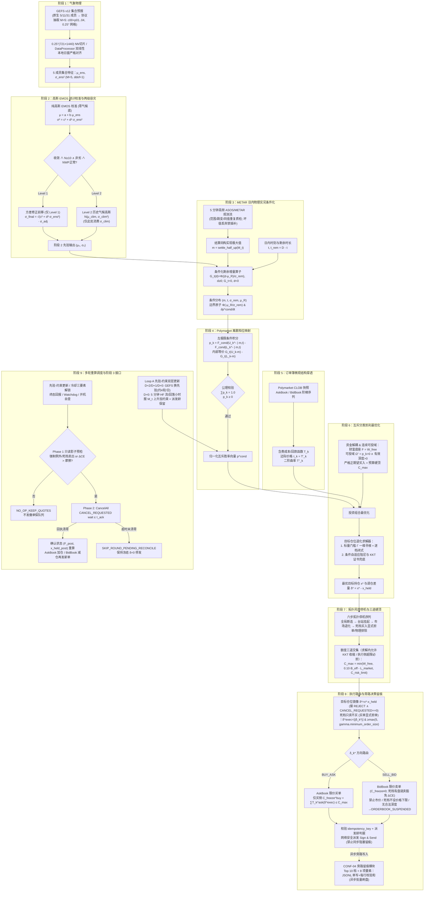

# P8-ALGO-DEF-SPEC · 气象物理预测到投注端到端严谨数学模型规格书（v2.6）

> **文档性质**：端到端数学模型与工程架构规格书（`v2.6`，在 `v2.5` 完整合入 2026-11-10 业主 7 条裁决中 6 条可落地项与 `#3 第二层` 待确认保留的基础上，依据《[v2.6 退回单](file:///Users/ericlin/SynologyDrive/Project/Poly%20Way2/docs/handoffs/P8-ALGO-DEF_v2.6%E9%80%80%E5%9B%9E%E5%8D%95_20261110.md)》补全 `§1.2` 四项时效与断流受控参数、`阶段 3 断流降级规则` 三档条件式与 `§4.2` 历史归档性质声明；保留 `v2.4` 补证核验与七条裁决并入全量口径）  
> **文档版本**：`v2.6`（2026-11-10，已对齐 `2026-11-10` 业主裁决与 `v2.6` 收口：`CONF-02` 首站试点 `KORD/KMIA`、`CONF-01` 改接 5 分钟高频数据＋三件硬质检禁插补＋派发龄保留＋覆盖表、`CONF-05` 求解允许 KKT 收缩＋执行超限必拒、`CONF-03` 精度反解 $\varepsilon=10\% \to N_{\min}=51$、`CONF-04` Top 10 档 JSONL 异步批量旁路留痕、物理死档只卖不买豁免 $\Delta\text{CE}$、最小单读取 `gamma.minimum_order_size`，并补齐断流参数 `T / N / physical_age_limit_for_source / dispatch_age_limit`、三档 `if/then` 断流降级规则与 `§4.2` 截至 `2026-09-11` 历史归档性质标注；文件名保留 `_v2.0` 以维持全仓链接稳定）  
> **阶段定位**：`v2.6` 业主七条裁决并入＋断流降级规则闭环版（仅 `c_bin_cap / c_market_cap / c_daily_cap` 数值、`hourly_METAR` 物理龄 / `dispatch_age_limit` 待标定插槽与 `4.1` 仓位爬升实现写法待业主另行定值/回话；运行前置条件单列交付清单，不纳入本规格书）。  
> **合规铁律**：零代码修改、零杜撰数据；推演算例仅检验连续求解器数学一致性，不作为生产参数依据；未裁决之仓位爬升实现方式严禁私自选型或注入分批比例常数。

---

## 目录
1. [现实数据资产与受控参数总表（客观现实与零杜撰声明）](#一-现实数据资产与受控参数总表客观现实与零杜撰声明)
2. [全链路系统架构与数据流图](#二-全链路系统架构与数据流图)
3. [端到端九阶段严谨数学模型与工程算法](#三-端到端九阶段严谨数学模型与工程算法)
   - [阶段 1：NWP 气象物理集合预报特征提取与时空几何对齐](#阶段-1nwp-气象物理集合预报特征提取与时空几何对齐)
   - [阶段 2：高斯 EMOS 统计校准、方差修正前移与两级容灾](#阶段-2高斯-emos-统计校准方差修正前移与两级容灾)
   - [阶段 3：METAR 日内物理实况条件化与剩余增量分布算子](#阶段-3metar-日内物理实况条件化与剩余增量分布算子)
     - [断流降级规则](#断流降级规则)
   - [阶段 4：Polymarket 互斥阶梯档位条件积分与全概率公理闭合](#阶段-4polymarket-互斥阶梯档位条件积分与全概率公理闭合)
   - [阶段 5：订单簿微观结构穿透定价与二阶曲率保留](#阶段-5订单簿微观结构穿透定价与二阶曲率保留)
   - [阶段 6：互斥分类凯利优化、目标仓位口径与财富基数/预算硬顶严格解耦](#阶段-6互斥分类凯利优化目标仓位口径与财富基数预算硬顶严格解耦)
   - [阶段 7：风控硬顶三级金字塔、参数可识别性与拓扑停机序列](#阶段-7风控硬顶三级金字塔参数可识别性与拓扑停机序列)
   - [阶段 8：执行路由整数量化、目标仓位镜像与异步旁路留痕闭环](#阶段-8执行路由整数量化目标仓位镜像与异步旁路留痕闭环)
   - [阶段 9：多轮重算调度与阶段 3 条件分布接口](#阶段-9多轮重算调度与阶段-3-条件分布接口)
4. [现实约束与已裁决/待确认议题清单（Open Confirmation Registry）](#四-现实约束与已裁决待确认议题清单open-confirmation-registry)
   - [4.1 仓位爬升实现方式（待业主确认）](#41-仓位爬升实现方式待业主确认)
   - [4.2 新增数据与精度反解证据表（2026-11-10 七条裁决并入）](#42-新增数据与精度反解证据表2026-11-10-七条裁决并入)
5. [全链路异常降级与故障安全（Fail-Safe）矩阵](#五-全链路异常降级与故障安全fail-safe矩阵)
6. [讨论阶段小结与后续工作](#六-讨论阶段小结与后续工作)
   - [6.1 SPEC ↔ 重训裁决回执 口径对照表](#61-spec--重训裁决回执-口径对照表)

---

## 一、 现实数据资产与受控参数总表（客观现实与零杜撰声明）

### 1.1 客观数据资产边界（实测存在性核准）
1. **GEFS 数值集合预报**：
   - **已实测验证资产（Reforecast `2000–2019`）**：NOAA GEFS v12 Reforecast（`2000-01-01` 至 `2019-12-31`，AWS `noaa-gefs-retrospective`），于 `Days 1–10` 原生为 **`0.25°` (`721 × 1440`) 网格**，日常 `00Z` 原生含 **5 集合成员**（`c00, p01..p04`）、周三原生含 **11 集合成员**（`c00, p01..p10`）。本地 Parquet 特征库（`calib-dataset-v2.0`）按全仓统一度量协议固定提取 **`M = 5` 成员**（`c00, p01..p04`；如 `KORD/2018.parquet` 全 `8760/8760` 组均为 5 成员），`2000–2018` 用于模型拟合，`2019` 严格隔离作整年盲测。
   - **实盘与待补预报资产（Operational `2020-09-23+`）**：NOAA Operational GEFS v12（AWS `noaa-gefs-pds` `pgrb2sp25`）原生含 **31 个物理成员**（`gec00` + `gep01..gep30`）及 **`0.25°` (`721 × 1440`) 网格**（`2026-10-11 00Z` S3 实测确认；另存在独立 `0.50°` `pgrb2ap5` 产品但全仓禁用）。全仓代码因刻意与历史日常 5 成员同自由度提取（[`gefs_fetcher.py#L194-L197`](file:///Users/ericlin/SynologyDrive/Project/Poly%20Way2/src/data_acquisition/gefs_fetcher.py#L194-L197) `VALID_MEMBERS=(0,1,2,3,4)`、[`config.py#L18`](file:///Users/ericlin/SynologyDrive/Project/Poly%20Way2/src/pipeline/config.py#L18) `ALLOWED_5_MEMBERS=[0,1,2,3,4]`、[`gefs_extract.py#L373`](file:///Users/ericlin/SynologyDrive/Project/Poly%20Way2/src/pipeline/gefs_extract.py#L373) `expected_members`），实盘固定仅抽 **`M = 5` 成员**（`data/cache/gefs/*.json` 全 `3/3` 实测 `len=5`）。`2020–2026` 历史补全已登记于 `P8-ALGO-PENDING`，**初版上线不阻塞，严禁用于 `2000–2018` 训练或污染 `2019` 盲测**。
2. **气象地面观测（METAR / CF6 与 5 分钟高频 ASOS 流）**：
   - 官方结算真值源：NWS 每日气候报表（Time Series Tabular / CF6）；
   - 日内动态更新源（`CONF-01` 裁决选 B，已落地）：改接 **5 分钟高频数据**（归档口径：`IEM ASOS MADISHF` `report_type=1` 联合 Routine METAR/SPECI `report_type=2`，并以 `NWS WRH 5-min` 交叉核验；`ACTIVE_10_STATIONS` 均于 `data/raw/iem/` 实测保存截至 `2026-09-11` 的静态历史归档覆盖 `2016-04-30 ~ 2026-09-11` 5 分钟流——**不代表实时流可用，实时流可用性以运行时 `max(valid_utc)` 及 [断流降级规则](#断流降级规则) 为准**；唯 **`KBKF`** 5 分钟缺失率 `100.00%` **必须静态回落小时报**，详见 [§4.2 历史归档 5 分钟数据覆盖表](#42-新增数据与精度反解证据表2026-11-10-七条裁决并入)）。
3. **台站宇宙定义**：
   - 全集宇宙：`ACTIVE_11_STATIONS`（含 KBKF）；
   - 模型宇宙：`ACTIVE_10_STATIONS`（剔除存在结算站位争议的 KBKF）；
   - **生产法定契约生效台站**：**`AUTHORIZED_STATIONS = ("KORD", "KMIA")`**（**业主已裁决，首批上线范围**；`CONF-02` 选 A 已落地，仅该 2 站共 `22` 个有效提前量格位完成参数契约校验）。**其余 8 站保持「待正式定参后接入，严禁外推」**。

### 1.2 受控参数三分类法定字典
系统参数严格收敛为法定三类，杜绝非受控常数：

| 类别 | 符号 | 物理含义与定义公式 | 样本要求与可识别性 | 来源依据 / 失败降级 |
| :-- | :-- | :-- | :-- | :-- |
| **解析可算** | $\mu, \sigma^2$ | 高斯 EMOS 预测分布均值与方差 | 输入实时 NWP 特征代入闭式解 | 阶段 2 闭式公式 |
| **解析可算** | $\sigma_{\text{rem}}(t),\, \mu_R(t, m)$ | 阶段 3 剩余增量标准差与均值锚（强制成对刷新） | $\sigma_{\text{rem}}=\sigma_0\sqrt{\max(\eta_s(t),(\sigma_{\text{inst}}/\sigma_0)^2)}$；$\mu_R=\rho(t)\max(0,\mu_0-m)$ | 阶段 3 / 阶段 9.7；$M_t=\varnothing$ 退回先验 |
| **解析可算** | $\mathbf{p}^{\text{cond}}$ | 日内条件化后的各档互斥胜率向量（含 $m$ 处原子） | 输入 $(\mu_0,\sigma_0,m,t)$ 与 $G_t$ 左极限闭式积分 | 阶段 3–4 条件分布与积分算子 |
| **解析可算** | $T_k(x),\, \tau_k(x)$ | CLOB 穿透含费成本/回款与边际价格（`AskBook` / `BidBook` 同构） | 实时 L2 盘口阶梯序列积分及其一阶导 | 阶段 5 / 阶段 9.8 边际函数 |
| **解析可算** | $\mathbf{x}^*,\, \boldsymbol{\delta}^*$ | 互斥凯利最优目标持仓与调仓差量（$\delta_k^* \equiv x_k^* - x_{\text{held}, k}$） | 可投域 $\Omega^+$ 预筛 + 标量门槛 $\Gamma$ 一维寻根 + 逐档闭式反解 | 阶段 6 优化器 / 9.8 减仓镜像 |
| **须标定** | $a, b, c, d$ | EMOS 均值与平方尺度方差校准权重（$\mu=a+b\mu_{\text{ens}},\, \sigma^2=c^2+d^2 S_{\text{ens}}^2$） | `2000–2018` 历史训练集基于 `M=5` 特征 CRPS 最小化拟合；$c$ 无 `0.90` 训练下界，取残差标准差 `std(y_obs - ens_mean)` 初猜 | `00–18` 拟合（PKL 优先），失败退化 Level 2 |
| **须标定** | $\sigma_{\text{adj}}$ | 样本外方差过紧膨胀系数 | 历史覆盖率对齐标定（$\ge 1.0$，仅作用于 Level 1） | 配置文件固定标定值 |
| **须标定** | $\sigma_{\text{clim}}^2$ | **仅 Level 2 降级使用**的历史气候学方差（Level 1 气候方差下限已废除） | 31 天滑动窗历史气候实测方差（2000–2018 同源） | **仅 Level 2 降级消费**（Level 1 不设气候底） |
| **须标定** | $\eta_s(t)$ | 阶段 3 归一化剩余方差比例曲线（22 格位标定插槽） | 由历史日内极大值过程估 $1-\mathrm{Var}(M_t)/\sigma_0^2$，按 `(station, season, lead_horizon)` 检 $n \ge N_{\min}(\varepsilon)$ 并打标 | 阶段 3 / 9.7（`未标定占位` / `稀疏降级` / `已标定`）；低于 $N_{\min}(\varepsilon)$ 回退同站同季 |
| **可调参数** | $\varepsilon$（衍生 $N_{\min} = \lceil 1/(2\varepsilon^2) \rceil + 1$） | `CONF-03` 稀疏格样本精度容忍阈值（初始 **$\varepsilon = 10\% \implies N_{\min} = 51$**；调的是 $\varepsilon \in \{7\%, 10\%, 13\%\}$，不是拍定 $N_{\min}$） | 依据 $\sigma$ 相对标准误 $\approx 1/\sqrt{2(n-1)}$（`n=30→13.1%`、`n=50→10.1%`、`n=100→7.1%`）精度反解 | 调整方向：尾部误判多 $\to$ 收 $\varepsilon$；合并过多、几乎不下注 $\to$ 放 $\varepsilon$（[§4.2 验算表](#42-新增数据与精度反解证据表2026-11-10-七条裁决并入)） |
| **设计常数** | $f$ | Polymarket 胜方出资费率（0.05） | 外生交易所协议常数 | 平台合约规范 |
| **限流阀** | `stage3_drift_threshold` | `D+0` 无新事件时纯时间推进引发的分布漂移重算**限流阀** | 仅检验 $\max_k|\partial p_k^{\text{cond}}/\partial t|\cdot\Delta t$，严禁消费盘口字段 | 阶段 9.1 / 9.2 / 9.7（纯算力限流，不影响结果正确性） |
| **标定插槽** | $\Delta t_{\text{confirm}},\, \Delta t_{\text{quiet}},\, N_{\text{noop}},\, \Delta t_{B,\text{cool},\max}$ | Loop B 冷却防抖三要素时间与退避参数（含倍乘常数 $k \ge 1$） | 由观察期实盘 CLOB L2 tick 自相关衰减、静默期分位数与流动性半衰期实测标定 | 阶段 9.2（标定完成前严禁人工拍数） |
| **可调参数** | `T` | **断流判定连续超时时间阈值**：定义式为同日连续无新有效观测超过 `T` 即触发第 3 档锁闸；与槽数阈值满足 $T = N \times 5\text{ min}$（**初始值：`15 min`，可调**；正文一律只写符号 `T`，严禁写死数字） | 5 分钟高频主源与 `physical_age_limit_for_source` **同源取等**（`physical_age_limit_for_source(5min_HF) ≡ T`）；**与 `dispatch_age_limit` 完全正交独立** | **出处**：照抄本规格书原 `v2.5` 正文阶段 9.2 / 9.7（`v2.5 L512、L699` 之 `StreamRiskWatchdog` 断流撤单超时；另 `L485` 提及 `StreamRiskWatchdog`）。降级：[断流降级规则](#断流降级规则) 第 3 档 `> T` 置 $M_t = \varnothing$ 退回先验并**锁死发单闸** |
| **可调参数** | `N` | **5 分钟高频流连续缺槽切换阈值**：定义式 **$N = T / 5\text{ min}$**（按 [§4.2](#42-新增数据与精度反解证据表2026-11-10-七条裁决并入) 300 秒槽宽与 `T` 严格自洽；**初始导出值：`3`，单位：个 5 分钟槽，可调**，随 `T` 自动联动；正文只写符号 `N`） | 同一本地日内缺测达到 `N` 个 5 分钟槽触发 [断流降级规则](#断流降级规则) 第 2 档；必与 `T` 同步更新，杜绝二者矛盾 | **出处**：由参数 `T`（原 `v2.5 L512、L699`）÷ 5 分钟槽宽自洽导出。第 2 档守住当日极值下界 `m` **绝不回落**，不因缺测放宽下界，同步切换监测逐时 `METAR/SPECI` 回落 |
| **可调参数** | `physical_age_limit_for_source` | **按观测源类型划分的物理观测龄上限**：阶段 9.4 `latest_obs_age > physical_age_limit_for_source` 锁闸门限（物理时间差 $t_{\text{now}} - t_{\text{obs}}$）。① **5 分钟 HF 主源**：与 `T` **同源取等**（$\equiv T$，**初始值：`15 min`，可调**）；② **逐时 `METAR/SPECI` 回落分档**（含 `KBKF` 静态逐时与切换逐时后）：**`待标定`（可调，按站/回落场景放宽；正文无既往数值，严禁新造数字）** | 与 `T` 关系：**5min_HF 主源下与 `T` 同源取等（永不互相打架）**；`hourly_METAR` 在未完成标定前按 Fail-Closed 保守承接 `T`；绝不放宽 `dispatch_age_limit` | **出处**：`5min_HF` 同源承接 `T`（原 `v2.5 L512、L699`）及阶段 9.4（原 `v2.5 L608` 伪码）；`hourly_METAR` 见阶段 3（原 `L210`）、阶段 9.1（原 `L475②、L482`）、阶段 9.4（原 `L598、L608`）（正文仅定性“按站/回落场景放宽”而无固定数值，故记 `待标定`）。超限维持 `SAFE_MODE / LOCKED` |
| **可调参数** | `dispatch_age_limit` | **本地派发处理滞后硬上限**：定义式为本地处理端从「拿到手」到「发出去」耗时上限（`dispatch_age = t_send - t_received <= dispatch_age_limit`，**初始值：`待标定`，可调**；正文无既往数值，严禁新造数字） | **完全独立于 `T`、`N` 及断流降级三档**，不随 `T` 或 `physical_age_limit_for_source` 放宽或取消；属发单前阻塞门禁 | **出处**：阶段 3（原 `v2.5 L210`）、阶段 8（原 `L436、L441、L450`）、阶段 9.1（原 `L475②、L482`）、阶段 9.4（原 `L598、L608、L653、L676`）、`§五`（原 `L839`）（正文仅定性独立保留、无既往定值，故记 `待标定`）。超限直接阻断派发 |
| **风控配置** | $c_{\text{bin\_cap}}$ | 单档位出资上限比例（待业主定值） | Level 1 集中度配置项 | 严禁代码硬编码；见阶段 7 |
| **风控配置** | $c_{\text{market\_cap}}$ | 单一市场出资上限比例（待业主定值） | Level 2 集中度配置项 | 严禁代码硬编码；见阶段 7 |
| **风控配置** | $c_{\text{daily\_cap}}$ | 全局日度总出资上限比例（待业主定值） | Level 3 日度限额配置项 | 严禁代码硬编码；见阶段 7 |

> **注（冗余参数剔除与断流四参数正交说明）**：原 ADR-0019 遗留的 $\tau_{\text{2D}}$ 跨期衰减乘子，因在现行阶段 6–7 优化目标、约束与三道交集风控中已无任何算式消费点（No Consumption Point），现已从受控参数表中**彻底删除**；在 2026-11-10「先验—约束」定位下，先验与约束参数正交作用于 $(\mu_0,\sigma_0)$ 与 $m$，参数账净消冗余模式状态与多余分路权重，仅保留 `stage3_drift_threshold` 充当 `D+0` 纯概率域**限流阀**。同时，新登记的 4 项时效与断流受控参数严格维持如下自洽与正交关系：① **`N = T / 5 min`**（第 2 档缺槽数随连续超时时间 `T` 自洽导出）；② **`physical_age_limit_for_source(5min_HF) ≡ T`**（同源取等，保证 [断流降级规则](#断流降级规则) 第 3 档与阶段 9.4 `latest_obs_age` 锁闸判据绝不冲突；`hourly_METAR` 回落分档标为 **`待标定`**）；③ **`dispatch_age_limit`（`待标定`，可调）** 仅守本地「拿到手 → 发出去」延迟，**完全独立于 `T` 与断流三档**。


---

## 二、 全链路系统架构与数据流图



---

## 三、 端到端九阶段严谨数学模型与工程算法

### 阶段 1：NWP 气象物理集合预报特征提取与时空几何对齐
1. **输入、原生资产规格与 `M = 5` 同尺度对齐协议（代码实读取证，非读取缺陷）**：
   - **输入清单**：NOAA GEFS v12 **`0.25°` 全球等经纬网格 `(721, 1440)`** 的 2 米日极值预报场（实时拉取锁定 `product="atmos.25"`／`pgrb2sp25`，禁止降格至 `0.50°` `atmos.5`，依据 [`gefs_fetcher.py#L492-L516`](file:///Users/ericlin/SynologyDrive/Project/Poly%20Way2/src/data_acquisition/gefs_fetcher.py#L492-L516)）；台站经纬度坐标 $(\lambda_{\text{st}}, \phi_{\text{st}})$ 与 IANA 时区映射；及合法成员索引集合。
   - **原生资产 vs 全仓固定 `M = 5` 提取协议**：
     - 离线训练资产 GEFS v12 Reforecast（`2000–2019`，AWS `noaa-gefs-retrospective`）原生于 `Days 1–10` 为 `0.25°` `(721, 1440)` 网格（`temp/gefs-sample/README.md#L11, L35`），日常 `00Z` 原生含 **5 成员**（`c00, p01..p04`）、周三原生含 **11 成员**（`c00, p01..p10`）；
     - 实盘资产 Operational GEFS v12（`2020-09-23` 起，AWS `noaa-gefs-pds` `pgrb2sp25`）原生含 **31 个物理成员**（`gec00` + `gep01..gep30`；`2026-10-11 00Z` S3 全页列举 33 个文件前缀即 31 成员 + `geavg`/`gespr`）及 `0.25°` `(721, 1440)` 网格；
     - **刻意设计下抽样（非读取故障）**：为严格维持离线训练（日常仅 5 成员）与在线推理之间集合样本方差 $S_{\text{ens}}^2$ 自由度及分散度尺度同口径（`ADR-0004`），全仓代码**刻意硬锁仅提取 `M = 5` 成员 `{c00, p01, p02, p03, p04}`**（索引 `(0, 1, 2, 3, 4)`）：[`gefs_fetcher.py#L194-L197`](file:///Users/ericlin/SynologyDrive/Project/Poly%20Way2/src/data_acquisition/gefs_fetcher.py#L194-L197) 定义 `VALID_MEMBERS = (0, 1, 2, 3, 4)` 并在 `#L676-L681` 对其它成员编号抛 `GEFSValidationError`；[`config.py#L18, L44-L48`](file:///Users/ericlin/SynologyDrive/Project/Poly%20Way2/src/pipeline/config.py#L18-L48) 锁定 `ALLOWED_5_MEMBERS = [0, 1, 2, 3, 4]`；[`gefs_extract.py#L373`](file:///Users/ericlin/SynologyDrive/Project/Poly%20Way2/src/pipeline/gefs_extract.py#L373) 定义 `expected_members = ("c00", "p01", "p02", "p03", "p04")`；[`gefs_backfill_2020_2026.py#L56`](file:///Users/ericlin/SynologyDrive/Project/Poly%20Way2/scripts/gefs_backfill_2020_2026.py#L56) 定义 `DEFAULT_MEMBERS = 5`。本地磁盘 `data/processed/calib-dataset-v2.0/gefs_factors/`（在全链路中的角色：**训练侧特征源**，含 `member` 维度；例如 `data/processed/calib-dataset-v2.0/gefs_factors/KORD/2018.parquet` 共 `43,800` 行、`8760/8760` 组均为 `5` 成员，区别于同级无成员维度的 `features/` 目录）与 `data/cache/gefs/*.json`（全 `3/3` 实盘缓存均为 `len=5`）均与代码口径完全一致。
2. **网格到台站空间提取（全仓均为 `0.25°` 网格，区分离线最近邻切片与在线双线性模块）**：
   - **离线 Parquet 特征提取与 `2020–2026` 回填主路径**（[`gefs_extract.py#L196-L207`](file:///Users/ericlin/SynologyDrive/Project/Poly%20Way2/src/pipeline/gefs_extract.py#L196-L207) `_slice_stations_grid`、[`gefs_backfill_2020_2026.py#L281-L296`](file:///Users/ericlin/SynologyDrive/Project/Poly%20Way2/scripts/gefs_backfill_2020_2026.py#L281-L296) `nearest_indices`）：在 `0.25°` `(721, 1440)` 全球网格直接执行向量化最近邻格点索引切片：
     $$T_m(\text{st}) = T_m\!\left(\arg\min_{\phi_i}|\phi_i - \phi_{\text{st}}|,\; \arg\min_{\lambda_j}|\lambda_j - \lambda_{\text{st}}|\right)$$
   - **区域 NetCDF / Dataset 精细插值模块**（[`spatial_interpolator.py#L3-L111`](file:///Users/ericlin/SynologyDrive/Project/Poly%20Way2/src/data_processing/spatial_interpolator.py#L3-L111) `SpatialInterpolator`、[`data_processor.py#L109, L180`](file:///Users/ericlin/SynologyDrive/Project/Poly%20Way2/src/data_processing/data_processor.py#L109-L180)）：在同一 `0.25°` 网格围绕台站 $(\lambda_{\text{st}}, \phi_{\text{st}})$ 的 4 个邻近格点执行双线性内插 $T_m(\text{st}) = \sum_{i=1}^2 \sum_{j=1}^2 w_{ij} T_m(\lambda_i, \phi_j)$。两者均严格工作在 `0.25°`（全仓无 `0.50°` 主路径；两种空间提取算子的同批实测对照待补，生产上线前需锁定训练与推理使用同一空间提取算子）。
3. **结算时间窗严格对齐**：
   按台站本地时间（IANA `ZoneInfo`）严格提取目标自然日 $[00:00, 23:59]$ LT 内完全包含的 6h 预报时间步（`select_contained_6h_windows`，如 `t_0+12h ... t_0+36h` / 锚点 `6..72h`），对已抽取的 **`M = 5` 个成员**分别提取当日极值：
   $$T_{m, \max} = \max_{t \in \text{Day}} T_m(\text{st}, t), \quad m \in \{0, 1, 2, 3, 4\}\ (\text{对应 }\texttt{c00, p01..p04},\ M = 5)$$
4. **未加权集合物理特征提取（`M = 5`, `ddof = 1`）与 `ens_var` 量级差异量化**：
   $$\mu_{\text{ens}} = \frac{1}{M} \sum_{m \in \{0..4\}} T_{m, \max}, \qquad \sigma_{\text{ens}}^2 = \frac{1}{M-1} \sum_{m \in \{0..4\}} (T_{m, \max} - \mu_{\text{ens}})^2 \quad (M = 5,\; \texttt{ddof=1})$$
   - **5 vs 31 成员 `ens_var` 量化影响**：虽无偏样本方差在可交换假设下期望相等 $\mathbb{E}[S_5^2] = \mathbb{E}[S_{31}^2]$，但因自由度 $\nu = M-1$ 从 `30` 降至 `4`，5 成员无偏方差抽样 $\text{CV}(S_M^2) = \sqrt{2/(M-1)}$ 为 `70.71%`（对比 31 成员 `25.82%`），**5 成员无偏方差抽样 CV 约为 31 成员的 `2.74` 倍**（同批样本的实测对照待补）。由于当前 EMOS 模型全部在 `M = 5` `S_ens²` 口径下拟合参数 $d$，实时推理必须维持同一 `M = 5` 成员提取，不得未经重训直接喂入 31 成员方差；若未来评估扩展至 31 成员以降低 `S_ens²` 抽样噪声，须配套 `2020+` Operational 数据资产统一口径重训并过 2019/样本外闭环门禁。
5. **输出与降级/失败路径（对接阶段 2 与阶段 9）**：
   - **输出清单**：$(\mu_{\text{ens}},\, \sigma_{\text{ens}}^2,\, M = 5,\, \text{gefs\_round\_id},\, \text{lead\_hours})$ 输出至阶段 2 EMOS 与阶段 9.1 先验刷新；
   - **降级与失败路径**：成员编号超出 `(0, 1, 2, 3, 4)` 由 `GEFSValidationError` 直接硬拒；若 `0.25°` GRIB2 拉取失败、6h 窗覆盖缺失、`value_K` 越过 `[-60, +60]°C`（`213.15–333.15 K`）或有效成员 `< 2` 导致无法计算无偏方差，则置 `NWP_UNAVAILABLE` 并**自动切换至阶段 2 Level 2 历史气候学高斯分布 $\mathcal{N}(\mu_{\text{clim}}, \sigma_{\text{clim}}^2)$**（若连同气候学基线亦不可用，则触发 Safe Hold 输出 $f^* = \mathbf{0}$）。

---

### 阶段 2：高斯 EMOS 统计校准、方差修正前移与两级容灾
1. **输入与输出清单（对接阶段 1 与阶段 3 / 阶段 8）**：
   - **输入清单**：从阶段 1 接收 **`M = 5` 成员**（`c00, p01..p04`）提取的集合特征 $(\mu_{\text{ens}},\, \sigma_{\text{ens}}^2,\, M = 5)$、目标预报提前量 `lead_hours` 与台站 ID；由 [`ModelRegistry.load_model`](file:///Users/ericlin/SynologyDrive/Project/Poly%20Way2/src/modeling/registry.py#L356-L385) 按 **`.pkl` 优先、`.json` 兜底** 顺序读取对应 `(station, season, target_type, lead_hours)` 已校准参数 $(a, b, c, d)$（含 2°F/0–78h 稠密插值网格与样本外膨胀系数 $\sigma_{\text{adj}}$；旧版含 `clim_var` 加法项的 200 份 `.json` 模型已整体归档至 `data/models/archive_legacy_climvar_20261110/` 仅作 2019 盲测对照，严禁再用于实盘覆盖 `.pkl`）。
   - **输出清单**：面向阶段 3 的纯先验高斯参数 $(\mu_0, \sigma_0)$（Level 1 为 $(\mu, \sigma_{\text{final}})$；触发 Level 2 降级时切换为 $(\mu_{\text{clim}}, \sigma_{\text{clim}})$）、容灾层级标记 `degradation_level ∈ {1, 2}`、模型校验元数据 `Model ID` 与 `lead_hours`。
2. **正态分布假设与非齐次高斯回归主式（平方参数化 + 零气候底，依据 [`ADR-0015 §2.1`](file:///Users/ericlin/SynologyDrive/Project/Poly%20Way2/docs/adr/ADR-0015%EF%BC%9A%E5%BA%9F%E9%99%A4%E9%AB%98%E6%96%AF%E6%B0%99%E6%B0%94%E6%96%B9%E5%B7%AE%E5%8A%A0%E6%B3%95%E9%A1%B9%E3%80%81%E7%A1%AE%E7%AB%8B%E7%89%A9%E7%90%86%E6%96%B9%E5%B7%AE%E5%BA%95%E5%BA%A7%E4%B8%8E%E7%A6%BB%E6%95%A3%E6%A0%A1%E5%87%86%E9%97%A8%E7%A6%81.md#L1-L71) 与 [`P8-MODEL 重训裁决回执`](file:///Users/ericlin/SynologyDrive/Project/Poly%20Way2/docs/handoffs/P8-MODEL_%E9%87%8D%E8%AE%AD%E8%A3%81%E5%86%B3%E5%9B%9E%E6%89%A7_20261110.md)）**：
   极端最高气温经统计校准后服从高斯分布 $T \sim \mathcal{N}(\mu, \sigma_{\text{final}}^2)$（`Active 10` 美国站原生以 **`°F`** 与默认升温速率 **`°F/h`** 训练拟合、输出并直投 `2°F` 结算档，单位一致性不变；`ZSPD / KDEN` 保持 Phase-1 `°C` 测试契约）：
   $$\mu = a + b \cdot \mu_{\text{ens}}$$
   $$\sigma^2 = c^2 + d^2 \cdot \sigma_{\text{ens}}^2, \qquad \sigma = \sqrt{\max\!\big(10^{-8},\; c^2 + d^2 \cdot \sigma_{\text{ens}}^2\big)}$$
   - **参数训练边界与鞍点消除（`c` 无训练下界 + 残差标准差初猜）**：参数在 **`2000-01-01` 至 `2018-12-31`** 严格隔离训练窗（[`verify_year_whitelist`](file:///Users/ericlin/SynologyDrive/Project/Poly%20Way2/src/utils/airgap.py#L104-L132) 锁死 `2019` 整年盲测不进训练）内，基于同一 `M = 5` 成员 `ddof = 1` 特征 `S_ens²` 对闭式高斯 CRPS 最小化拟合，满足 $b > 0,\, d \ge 0$、**优化器对 $c$ 不设任何硬编码下界**（重训裁决 §1.2 已删训练脚本中的 `c >= 0.90` 与 `SIGMA_INST_PHYSICAL_FLOOR = 0.90` 约束，并禁止以 `0.90` 作 `c` 初值）；改以样本残差标准差 **`std(y_obs - ens_mean)` 作为 `c` 的数据驱动初猜**消除 $c = 0$ 零梯度鞍点（[`gaussian_emos.py#L5-L76`](file:///Users/ericlin/SynologyDrive/Project/Poly%20Way2/src/modeling/gaussian_emos.py#L5-L76)、[`crps.py#L91-L108`](file:///Users/ericlin/SynologyDrive/Project/Poly%20Way2/src/modeling/crps.py#L91-L108)、[`emos_trainer.py#L165-L178`](file:///Users/ericlin/SynologyDrive/Project/Poly%20Way2/src/modeling/emos_trainer.py#L165-L178)、[`retrain_p4_active10_matrix.py#L203-L207`](file:///Users/ericlin/SynologyDrive/Project/Poly%20Way2/scripts/retrain_p4_active10_matrix.py#L203-L207)）。
   - **彻底取消 Level 1 气候方差下限（重训裁决 §3.2(a)）**：[`gaussian_emos.py#L60-L69`](file:///Users/ericlin/SynologyDrive/Project/Poly%20Way2/src/modeling/gaussian_emos.py#L60-L69) 推理主链与 `crps.py` 训练主链**已永久废除 `σ_clim²` 加法项与运行期地板**，`Level 1` 直接由纯高斯 EMOS 计算 $\sigma = \sqrt{\max(10^{-8}, c^2 + d^2 \sigma_{\text{ens}}^2)}$，不再设立「物理气候方差底 / $\sigma_{\text{clim}}^2 \ge 1.5^\circ\text{F}^2$」。
   - **`0.90°F` 的「训练删约束 / 验收留红线」分离口径（重训裁决 §1.2 & §2）**：训练阶段零 `0.90` 约束；[`calibration_audit.py#L23`](file:///Users/ericlin/SynologyDrive/Project/Poly%20Way2/src/metrics/calibration_audit.py#L23)（`ASOS_PRT_ACCURACY_REDLINE_F = 0.90`）与 [`p5_gate.py#L106`](file:///Users/ericlin/SynologyDrive/Project/Poly%20Way2/src/verification/p5_gate.py#L106) 保留 `0.90°F` 仅作为离线/P5 验收层的 **「ASOS 1088 PRT 传感器精度红线」**——若无约束 EMOS 自然学出 `σ < 0.90°F`，判定为拟合噪声并触发告警/门禁拦截（不再称「方差下限」；阶段 3 关窗保护独立保留 $\sigma_{\text{inst}} = 0.9^\circ\text{F}$）。
3. **方差修正前移（$\sigma_{\text{adj}}$ 架构定位确立，仅作用于 Level 1）**：
   将外生样本外方差膨胀系数 $\sigma_{\text{adj}} \ge 1.0$ 直接作用于纯 EMOS 标准差，使下游阶段 3–4 积分直接消费校准后分布：
   $$\sigma_{\text{final}} = \sqrt{\max\!\big(10^{-8},\; c^2 + d^2 \cdot \sigma_{\text{ens}}^2\big)} \cdot \sigma_{\text{adj}}$$
4. **两级容灾退化与失败路径（`ADR-0003` & [`degradation.py#L78-L186`](file:///Users/ericlin/SynologyDrive/Project/Poly%20Way2/src/modeling/degradation.py#L78-L186)）**：
   - **Level 1（基准生产路径）**：纯高斯 EMOS 分布 $\mathcal{N}(\mu, \sigma_{\text{final}}^2)$（[`degradation.py#L176-L183`](file:///Users/ericlin/SynologyDrive/Project/Poly%20Way2/src/modeling/degradation.py#L176-L183)，`σ_clim` 不参与计算）；
   - **Level 2（`σ_clim` 唯一法定归属路径）**：当出现硬触发（优化器不收敛、参数非有限、训练样本 $N < 10$、阶段 1 NWP 缺失/成员不足）或软触发（校验样本配对 CRPS 显著劣于气候基准，$p < 0.05$）时，退化为台站 31 天滑动窗历史气候学经验高斯分布 $\mathcal{N}(\mu_{\text{clim}}, \sigma_{\text{clim}}^2)$（仅该分支消费 $\sigma_{\text{clim}}$）；若气候学档案亦缺失或无法加载模型契约，则置 `MODEL_UNAVAILABLE` 并由阶段 7 / Step 2 `BOOT_HALT` 阻断发单（$f^* = \mathbf{0}$）。

---

### 阶段 3：METAR 日内物理实况条件化与剩余增量分布算子
1. **输入清单与输出清单（对接阶段 2 与阶段 4 / 阶段 9.7）**：
   - **输入清单**：阶段 2 输出先验参数 $(\mu_0, \sigma_0)$（Level 1 为纯 EMOS $(\mu, \sigma_{\text{final}})$；**仅当触发 Level 2 降级时 $(\mu_0, \sigma_0) = (\mu_{\text{clim}}, \sigma_{\text{clim}})$，其中 $\sigma_{\text{clim}}$ 仅供 Level 2 降级备用、Level 1 不消费且不作为气候方差底**）；阶段 3 关窗保护独立仪表物理精度底 $\sigma_{\text{inst}} = 0.9^\circ\text{F}$；当前观测窗口时刻 $t$ 与距日终关窗剩余时长 $t_{\text{rem}} = D - t$；以及按 `CONF-01` 裁决（选 B 已落地）接入的 **5 分钟高频实况流**（`IEM ASOS MADISHF` `report_type=1` 联合 METAR/SPECI；`KBKF` 等无 5 分钟源站或断流场景回落逐时 METAR/SPECI，见 [§4.2 覆盖表](#42-新增数据与精度反解证据表2026-11-10-七条裁决并入)）经 [`TemperatureSanitizer`](file:///Users/ericlin/SynologyDrive/Project/Poly%20Way2/src/prediction/temperature_sanitizer.py#L71-L277) **硬质检三件套（范围检查、跳变检查、同值重复检查）** 过滤并由 [`MonotonicConfluenceEngine`](file:///Users/ericlin/SynologyDrive/Project/Poly%20Way2/src/prediction/monotonic_confluence.py#L74-L125) 单调折叠的日内已实现最高温 $M_t = \max_{s \le t} T_{\text{obs}}(s)$ 与对齐 NWS `.5°F` Half-up 结算网格的整数下界 $m = \text{settle\_half\_up}(M_t)$（`D+1` / `D+2` 无目标日实况时 $M_t = \varnothing$）。**凡未通过硬质检的坏值只能丢弃，禁止插补成假观测（理由：假观测会把截断点 `m` 带偏，整条条件分布跟着错）。**
   - **输出清单**：条件累积分布 $F_{\text{cond}}(x \mid m, t)$ 与剩余增量分布 $G_t(d)$、强制成对刷新的条件参数对 $(\sigma_{\text{rem}}(t),\, \mu_R(t, m))$、实现极值下界 $m$ 及其边界原子概率质量 $\Phi(-\mu_R/\sigma_{\text{rem}})$、以及供阶段 9.7 纯概率域漂移限流消费的解析时间偏导向量 $\mathbf{dp/dt} \equiv \{\partial p_k^{\text{cond}} / \partial t\}_{k=1}^K$。
2. **条件分布主式（剩余增量随机过程构造，依据 [`第三段条件分布 v1.5 §2.1`](file:///Users/ericlin/SynologyDrive/Project/Poly%20Way2/docs/audit/P8-ALGO-DEF_%E7%AC%AC%E4%B8%89%E6%AE%B5%E6%9D%A1%E4%BB%B6%E5%88%86%E5%B8%83_20261110.md)）**：
   设目标日终结算最高温 $T = \max_{s \in [0, D]} X_s$。在给定已实现极大值 $m = \text{settle\_half\_up}(M_t)$ 与当前时刻 $t$（剩余时间 $t_{\text{rem}} = D - t$）下，将剩余过程写作剩余增量 $R_t = \max_{s > t} X_s - m$，物理不可逆单调约束给出条件分布构造：
   $$T = m + \max(0, R_t) \quad \Longrightarrow \quad F_{\text{cond}}(x \mid m, t) = \begin{cases} 0, & x < m \\ G_t(x - m), & x \ge m \end{cases}$$
   其中 $G_t(d) = \mathbb{P}(R_t \le d)$ 为随时刻 $t$ 单调收紧的剩余增量条件分布，并在 $x = m$ 处显式保留“日内不再突破新高极值”的有限离散概率原子 $G_t(0^-)_{\text{atom}} = \mathbb{P}(R_t \le 0) > 0$（即 $F_{\text{cond}}(m^- \mid m, t) = 0$ 而 $F_{\text{cond}}(m \mid m, t) = G_t(0) \ge 0$）。在当前定型落地的高斯参数化桥（取法 C：$R_t \sim \mathcal{N}(\mu_R(t, m),\, \sigma_{\text{rem}}^2(t))$）下：
   $$G_t(d) = \Phi\!\left(\frac{d - \mu_R(t, m)}{\sigma_{\text{rem}}(t)}\right) \quad (d \ge 0), \qquad G_t(0^-)_{\text{atom}} = \Phi\!\left(-\frac{\mu_R(t, m)}{\sigma_{\text{rem}}(t)}\right)$$
   > **三种 $G_t$ 构造与标定升级路径（§2.2）**：当前唯一定型可执行取法为 **C（参数化 $\sigma_{\text{rem}}(t)$ + 均值锚 $\mu_R$）**；待逐小时/3 小时 GEFS 剩余时段集合成员（**取法 A**，首选生产升级态）或历史逐时同站同时段升温经验分位（**取法 B**）数据资产就位后，直接将 $G_t$ 替换为对应经验分布，上游条件结构与下游阶段 4 主积分式保持完全不变。
3. **方差桥 $\sigma_{\text{rem}}(t)$ 与均值锚 $\mu_R(t, m)$（强制成对定义与同化，依据 `v1.5 §2.3–2.4`）**：
   - **全方差分解剩余标准差 $\sigma_{\text{rem}}(t)$**：由全方差定理 $\text{Var}(T) = \mathbb{E}[\text{Var}(T \mid M_t)] + \text{Var}(\mathbb{E}[T \mid M_t])$ 推导归一化剩余方差比例 $\eta_s(t) = 1 - \frac{\text{Var}(M_t)}{\sigma_0^2}$（当前占位形式 $\eta(t) = \big(\frac{t_{\text{close}} - t}{t_{\text{close}} - t_{\text{open}}}\big)^2$ 标明未标定，正式标定表按 `(station, season, lead_horizon)` 一对一映射 22 格位落盘并打标 `stage3_calibration_tag`，见阶段 9.7）；关窗前受物理仪表噪声下限保护，**严禁在 `15:00` 硬跳归零（`ADR-0011 §D2`）**：
     $$\sigma_{\text{rem}}(t) = \max\!\left(\sigma_0 \cdot \sqrt{\eta_s(t)},\; 0.9^\circ\text{F}\right) \equiv \sigma_0 \sqrt{\max\!\left(\eta_s(t),\; \left(\frac{\sigma_{\text{inst}}}{\sigma_0}\right)^2\right)}, \qquad \sigma_{\text{inst}} = 0.9^\circ\text{F}$$
   - **零新参剩余升温均值锚 $\mu_R(t, m)$**：
     $$\mu_R(t, m) = \rho(t) \cdot \max\!\big(0,\; \mu_0 - m\big), \qquad \rho(t) = \frac{t_{\text{close}} - t}{t_{\text{close}} - t_{\text{open}}}$$
     随时刻 $t \to t_{\text{close}}$ 或实测迫近/超过先验（$m \ge \mu_0$），$\mu_R \to 0$，保证“观测越靠后、已实现值越接近先验，剩余预期升温越小”（不添加额外均值偏置双变量重算系数 $\beta_s$，保持零新参）。
   - **强制成对规则与基准核验（[`audit_segment3_conditioning_20261110.py`](file:///Users/ericlin/SynologyDrive/Project/Poly%20Way2/scripts/audit_segment3_conditioning_20261110.py)）**：每次更新必须成对提取同一时刻同一状态下的 $(\sigma_{\text{rem}}(t),\, \mu_R(t, m))$，严禁只收紧方差却保留原先验均值 $\mu_0$。以 `KORD_12h` 冬季基准参数（$\mu_0 = 37.6541^\circ\text{F},\, \sigma_0 = 5.8146^\circ\text{F}$）于 `13:00` 实测 $M_t = 37.0^\circ\text{F}$（$m = 37$）为例：$\sigma_{\text{rem}} = 2.9073^\circ\text{F},\, \mu_R = 0.3271^\circ\text{F}$，产出 `[36,38) = 59.15%`、`[44,46) = 0.94%`（修正了旧式静态归一化在 `[36,38)` 低估 `−34.24pp` 与在 `[44,46)` 高估 `+10.43pp` 的方向性错误）。
4. **降级、失败路径与架构纪律**：
   - 无日内实况约束（$M_t = \varnothing$，如早间开盘前或 `D+1`/`D+2` 市场）：$F_{\text{cond}}$ 无损退化为阶段 2 先验高斯分布 $\mathcal{N}(\mu_0, \sigma_0^2)$；
   - **5 分钟高频硬质检三件套、坏值禁插补与双时延分离**：
     - **三件硬质检**：① **范围检查**（Range Check：现行代码 [`SanitizerConfig`](file:///Users/ericlin/SynologyDrive/Project/Poly%20Way2/src/prediction/temperature_sanitizer.py#L17-L24) 气候边界 `[-40.0, +135.0]°F`）；② **跳变检查**（Jump Check：相邻观测步进 $|\Delta T| \le 15.0^\circ\text{F}$，并保留 Body vs RMK $\le 1.8^\circ\text{F}$）；③ **同值重复检查**（Stuck / Repeated-Value Check：检测连续高频帧冻结卡死/传感器持续同值重复，随 5 分钟工程改造合入 `TemperatureSanitizer`，以真实日极值平台期持续时长门槛避免正常平台期误杀）。
     - **坏值处理铁律**：凡未通过上述任一硬质检（或缺测/`None`/迟到乱序）的异常报文，**坏值只能丢弃，禁止插补成假观测**——**原因：一旦向 $M_t = \max_{s \le t} T_{\text{obs}}(s)$ 注入插补假观测，会把单向不可逆的截断点 `m = settle_half_up(M_t)` 永久带偏，导致整条剩余增量条件分布 $G_t$ 与全概率向量 $\mathbf{p}^{\text{cond}}$ 跟着错。**若触发范围/跳变/物理撕裂（Gate 1–3），按 `ADR-0014` 挂起该台站并置 `LOCKED / INVALIDATED`（Fail-Closed 输出 $f^* = \mathbf{0}$，Level 1 Fatal，详见§五）；若为高频流短时缺槽、同日断流或单站回落小时报，严格按本节末尾 [断流降级规则](#断流降级规则) 与 [§1.2](#12-受控参数三分类法定字典) 参数 `T`、`N`、`physical_age_limit_for_source` 逐档处置，而**本地派发龄上限 [`dispatch_age_limit`](#12-受控参数三分类法定字典)（只守从「拿到手」到「发出去」的处理滞后）完全独立于 `T` 与断流三档照旧保留，不得随物理龄一并取消或放宽**；
   - **架构纪律**：日内条件化作为**前置纯数学分布算子**，只给出 $\mathbf{p}^{\text{cond}}$ 与解析偏导 $\mathbf{dp/dt}$（$G_t$ 对 $t$ 的封闭偏导，不用数值差分），绝对不消费任何 CLOB 盘口价格字段，禁止向后传递两套相互冲突的概率。

#### 断流降级规则

本节统一定义 5 分钟高频观测流的**三档参数化断流降级规则**（消费 [§1.2](#12-受控参数三分类法定字典) 已登记受控参数 `T`、`N`、`physical_age_limit_for_source` 与独立派发门限 `dispatch_age_limit`；正文一律仅引用符号，**严禁将任何断流阈值写成固定数字**）：

- **参数关系与正交边界**：
  1. **槽数—时长自洽关系**：$N = T / 5\text{ min}$（`N` 由连续超时时间 `T` 除以 `5 min` 槽宽自洽导出，二者同步调节、绝不矛盾；初始取值见 `§1.2`）；
  2. **`T` 与 `physical_age_limit_for_source` 关系（同源取等、互不冲突）**：对 5 分钟高频主源（`IEM ASOS MADISHF`），令 **`physical_age_limit_for_source(5min_HF) ≡ T`**（同源取等，二者在同一边界重合，绝不出现“第 3 档已锁闸但阶段 9.4 `latest_obs_age` 仍未触发”或相反的打架局面）；对逐时 `METAR/SPECI` 回落分档（含 `KBKF` 静态逐时及切换逐时后），`physical_age_limit_for_source(hourly_METAR)` 在 `§1.2` 标定前为 **`待标定`**（未完成标定前按 Fail-Closed 保守承接 `T`）；
  3. **`dispatch_age_limit` 独立正交于断流三档**：`dispatch_age_limit`（`§1.2` 标为 **`待标定`**）仅守本地处理链 **「拿到手 → 发出去」** 延迟（`dispatch_age = t_send - t_received <= dispatch_age_limit`），**完全独立于 `T` 与下述断流降级三档**，任何断流回落或物理龄放宽均不得放宽或免除 `dispatch_age_limit`。
- **三档降级语义与阈值归属**：
  - **第 1 档（缺 1 个 5 分钟槽，及不足 `N` 个槽，仍在同一本地日）**：继续沿用上一条有效观测，已实现整数下界 `m` 不动，不触发 Loop A/B 重算；
  - **第 2 档（阈值落在参数 `N`：缺 `N` 个槽且仍在同一本地日）**：严格沿用**当日已观测极大值**作为 `m`（$m = \text{settle\_half\_up}(M_t)$），**`m` 绝不回落**，严禁因缺测放宽下界；并按 [§4.2](#42-新增数据与精度反解证据表2026-11-10-七条裁决并入) 切换监测逐时 `METAR/SPECI` 回落源（`report_type=2`；若收到同日更高有效逐时极值，单调上调 `m`）；
  - **第 3 档（阈值落在参数 `T`：跨日，或无新观测连续超过 `T`）**：运行态置条件集合 $M_t = \varnothing \implies$ 按 `§1.2` 退回阶段 2 先验 $\mathcal{N}(\mu_0, \sigma_0^2)$ $\implies$ **发单闸锁死（`local_order_valve = LOCKED`，同步 `CancelAll` 撤销在途挂单，严禁拿先验直接下单）**；该判据与阶段 9.4 `latest_obs_age > physical_age_limit_for_source` 严格对齐（当同一本地日断流恢复且通过 3 帧迟滞恢复校验时，依据阶段 9.4 `Step 5` 从当日 `[00:00 LT, now]` 完整实况与 $M_t^{\text{disk}}$ 恢复真实不可逆 `m`，不抹除物理事实）。

```text
# 断流降级三档唯一条件式（消费 §1.2 受控参数 T、N = T/5min、physical_age_limit_for_source；dispatch_age_limit 独立于三档在发单门禁执行）
if same_local_date and (missed_5min_slots == 1 or (1 < missed_5min_slots < N)) and no_new_obs_duration <= T then keep_last_valid_obs() and keep_m_unchanged() and do_not_trigger_recompute()
if same_local_date and missed_5min_slots >= N and no_new_obs_duration <= T then keep_today_observed_max_as_m_never_rollback() and do_not_relax_lower_bound_on_missing() and switch_to_hourly_metar_speci_fallback_watch()
if (target_local_date != today_local_date) or (no_new_obs_duration > T) or (latest_obs_age > physical_age_limit_for_source) then set_M_t_empty_fallback_to_prior_1_2() and lock_order_valve_and_cancel_all()
```

---

### 阶段 4：Polymarket 互斥阶梯档位条件积分与全概率公理闭合
1. **输入清单与离散合约梯子定义（保留半开端点与首末开放端）**：
   - **输入清单**：从阶段 3 接收条件分布参数组 $(m, t, \sigma_{\text{rem}}(t), \mu_R(t, m))$（或经验剩余分布函数 $G_t$）及离散合约边界约定义。
   - **离散阶梯定义**：Polymarket 气温市场通常按 $2^\circ\text{F}$ 步长划分 $K$ 个互斥且完备的区间档位（满足首档包含 $m$ 或 $L_1 = -\infty$、末档开放到 $+\infty$）：
     $$\text{Bin}_1: (-\infty, U_1), \quad \text{Bin}_k: [L_k, U_k), \quad \text{Bin}_K: [L_K, +\infty)$$
2. **基于 $G_t$ 左极限测度的闭式条件积分方程**：
   为确保离散概率原子 $G_t(0^-)_{\text{atom}} = \Phi(-\mu_R/\sigma_{\text{rem}})$ **在任意整数边界（含 $m = L_k$ 恰好落于半开左端点）下唯一、零遗漏地计入满足 $L_k \le m < U_k$ 的 $m$ 所在档位**，定义端点左极限条件分布：
   $$F_{\text{cond}}(x^- \mid m, t) = \begin{cases} 0, & x \le m \\ G_t(x - m), & x > m \end{cases}, \qquad p_k = F_{\text{cond}}(U_k^- \mid m, t) - F_{\text{cond}}(L_k^- \mid m, t)$$
   对任意已实现下界 $m = \text{settle\_half\_up}(M_t)$ 与档位 $k \in \{1, \dots, K\}$，等价展开为闭式三分支：
   - 若 $U_k \le m$：该档位已被物理极值彻底越过，不可能成为最终最高温：
     $$p_k \equiv 0.000000$$
   - 若 $L_k \le m < U_k$：已实现极值 $m$ 落入该半开档位内，该档**完整包含离散边界原子 $\Phi(-\mu_R/\sigma_{\text{rem}})$ 与 $m$ 至 $U_k$ 的增量概率**（若 $m$ 已直接落入末档 $k = K$ 且 $U_K = +\infty$，则收拢全部尾概率 $1.000000$）：
     $$p_k = \begin{cases} G_t(U_k - m) = \Phi\!\left(\dfrac{U_k - m - \mu_R(t, m)}{\sigma_{\text{rem}}(t)}\right), & U_k < +\infty \\[6pt] 1.000000, & k = K \ (U_K = +\infty) \end{cases}$$
   - 若 $m < L_k$：当前气温尚未触及该档下界，积分区间完整按 $G_t$ 差分保留（开放末档 $k = K$ 取上尾概率 $1 - G_t(L_K - m)$）：
     $$p_k = \begin{cases} G_t(U_k - m) - G_t(L_k - m) = \Phi\!\left(\dfrac{U_k - m - \mu_R(t, m)}{\sigma_{\text{rem}}(t)}\right) - \Phi\!\left(\dfrac{L_k - m - \mu_R(t, m)}{\sigma_{\text{rem}}(t)}\right), & U_k < +\infty \\[6pt] 1 - G_t(L_K - m) = 1 - \Phi\!\left(\dfrac{L_K - m - \mu_R(t, m)}{\sigma_{\text{rem}}(t)}\right), & k = K \ (U_K = +\infty) \end{cases}$$
   （注：当 $M_t = \varnothing$ 时，直接按先验 $\mathcal{N}(\mu_0, \sigma_0^2)$ 在同一半开区间梯子上计算 $\Phi((U_k - \mu_0)/\sigma_0) - \Phi((L_k - \mu_0)/\sigma_0)$；当 $m$ 跃升突破某档上界时，$p_k$ 瞬间归零属于物理跃迁边界条件，下游不得人工平滑。）
3. **输出清单、全概率公理检验与失败降级（保留校验形式并补齐契约）**：
   - **全概率公理校验与输出**：由左极限望远镜求和与末档 $U_K = +\infty$ 封闭上尾自然保证（无任何人工打补丁或有限端强赋 `1.0` 行为）：
     $$\sum_{k=1}^K p_k = 1.000000, \quad \forall k, \, p_k \in [0, 1]$$
     计算结果直接向量化封装为归一化互斥胜率向量 $\mathbf{p}^{\text{cond}} = (p_1, \dots, p_K)^T$ 连同各档边界 $\{[L_k, U_k)\}_{k=1}^K$ 输出至阶段 6 与阶段 9。
   - **降级或失败路径**：若 $\left|\sum_{k=1}^K p_k - 1.0\right| > 10^{-5}$ 或存在 $p_k < 0$（如档位边界未闭合或数值溢界违背公理），立即触发 Level 1 (Fatal) 终止当前市场概率派发、写入异常快照并强制拒单（详见§五）。

---

### 阶段 5：订单簿微观结构穿透定价与二阶曲率保留
1. **订单簿阶梯与累计成本**：
   目标档位挂单深度序列按价格升序排列 $\{(P_m, Q_m)\}_{m=1}^M$。设买入累计份额为 $x$。若 $x$ 穿透至第 $k$ 级台阶（累计份额区间 $(S_{k-1}, S_k]$，其中 $S_k = \sum_{j=1}^k Q_j$），定义台阶偏移量 $d = P_k S_{k-1} - V_{k-1} \ge 0$（其中 $V_{k-1} = \sum_{j=1}^{k-1} P_j Q_j$）。
2. **精确非线性含费成本函数**：
   按 Polymarket 协议，费率 $f = 0.05$ 仅向胜方出资部分收取。名义成交金额为 $V(x) = P_k x - d$，真实资金支出函数为：
   $$T(x) = (\pi x - d)(1 + f) - f \frac{(\pi x - d)^2}{x}$$
3. **边际执行价格（一阶导）**：
   $$\tau(x) = T'(x) = \pi_{\text{eff}} + \frac{f d^2}{x^2}$$
   其中 $\pi_{\text{eff}} = \pi(1 + f(1 - \pi))$ 为无冲击基准边际成本。
4. **二阶曲率权重与保留必要性证明**：
   $$|T''(x)| = \frac{2 f d^2}{x^3}$$
   > **注（实盘物理导数与解析拟合副产品说明）**：在实盘离散台阶订单簿下，挂单价格单调非递减，真实成本 $T(x)$ 为分段线性凸函数（在每个台阶内部 $T''(x) = 0$，跨台阶处 $T''(x) \ge 0$）。此处出现的解析导数 $|T''(x)| = \frac{2fd^2}{x^3}$ 系将台阶离散累计成本用双曲均价 $\bar{P}(x) = \pi - \frac{d}{x}$ 拟合展开带入费率项后产生的**数学解析副产品**，用于在一阶展开中刻画台阶边界偏移对边际价格的二阶微扰权重，绝不代表实盘存在负成本或凹成本。实盘真实成本严格为凸，保证效用目标函数严格为凹。

   令 $s = \frac{T(x)}{B_{\text{eff}}}$ 为仓位资金比例。在台阶有效域内，将成本近似为线性主项 $T(x) \approx \pi_{\text{eff}} x$，可得 $x \approx \frac{s B_{\text{eff}}}{\pi_{\text{eff}}}$。将该代换代入二阶相对权重式，得显式解析式：
   $$\varphi(s) = \frac{|T''(x)| x}{\tau(x)} = \frac{\frac{2 f d^2}{x^2}}{\pi_{\text{eff}} + \frac{f d^2}{x^2}} = \frac{2}{1 + \left(\frac{B_{\text{eff}}^2}{\pi_{\text{eff}} f d^2}\right) s^2}$$
   - **数值验证与可复算物（以独立可执行脚本为准，剔除不闭合近似推导）**：
     针对最优份额相对偏差 $\delta = \left|\frac{x^*_{\text{full}} - x^*_{\text{affine}}}{x^*_{\text{full}}}\right|$，为杜绝解析近似展开中因忽略台阶常数偏移而引起的因子偏差，**本规格书严格以独立可复现脚本 `scratch/verify_second_order_bound.py` 的精确计算为唯一客观依据**。
     将方案 B §2.3 穿透算例参数（$\pi=0.70, d=120.0, f=0.05, p=0.75, B_{\text{eff}}=4997.07, s=0.10$）代入实际订单簿台阶：
     1. $\pi_{\text{eff}} = \pi(1 + f(1 - \pi)) = 0.70 \times (1 + 0.05 \times 0.30) = 0.7105$；
     2. 台阶展开成本 $T(x) = 0.7105 x - 117.6 - \frac{720}{x}$；
     3. 设定 $s = 0.10$ 对应出资 $T = 0.10 \times 4997.07 = 499.707$，解二次方程 $0.7105 x^2 - 617.307 x - 720 = 0$ 得真实份额 $x = 869.72$；
     4. 台阶内部实际边际价格 $\tau(x) = 0.7105 + \frac{720}{869.72^2} = 0.711452$；
     5. **实测点偏差**：在真实台阶工作点 $x = 869.72$ 处，一阶扰动真实相对偏差为 $\mathbf{2.272\%}$；若按渐近主项式代入计算点偏差为 $\mathbf{3.458\%}$；
     6. **全区间理论下界**：取边际价格物理下界 $\tau \to \pi_{\text{eff}} = 0.7105$，导出理论下界为 $\mathbf{3.359\%}$。
   - **结论**：无论采用台阶精确工作点实测值（$2.272\%$）还是渐近理论下界（$3.359\%$），在全区间最松的 $s=0.10$ 硬顶处，其相对偏差均**显著超越 1.000% 误差门槛**。因此二阶曲率项绝非高阶小量，优化求解必须显式保留。

---

### 阶段 6：互斥分类凯利优化、目标仓位口径与财富基数/预算硬顶严格解耦
1. **多档互斥期望对数效用形式（目标仓位底座与连续可投域 $\Omega^+$）**：
   依据《[决策记录：禁止"负期望档作对冲"（2026-11-09）](file:///Users/ericlin/SynologyDrive/Project/Poly%20Way2/docs/audit/P8-ALGO-DEF_%E5%86%B3%E7%AD%96_%E7%A6%81%E6%AD%A2%E8%B4%9F%E6%9C%9F%E6%9C%9B%E5%AF%B9%E5%86%B2_20261109.md)》与 2026-11-10 连续形式定稿：在单市场 $K$ 档互斥事件 $\Omega = \{1,\dots,K\}$ 上（从阶段 4 接收归一化胜率向量 $\mathbf{p}^{\text{cond}}$ 及对应半开区间边界 $\{[L_k, U_k)\}_{k=1}^K$），**法定决策变量统一为目标持仓向量 $\mathbf{x} = (x_1, \dots, x_K)^T \in \mathbb{R}_{\ge 0}^K$**（shares，禁止裸空），相对既有有效持仓 $\mathbf{x}_{\text{held}}$ 的净调仓差量记为 $\delta_k \equiv x_k - x_{\text{held}, k}$（$\delta_k > 0$ 为买入加仓，$\delta_k < 0$ 为阶段 9.8 镜像卖出减仓）。
   - **可投域预筛 $\Omega^+$（仅物理与可交易性排除，不含任何经济门槛）**：
     $$\Omega^+ \equiv \big\{k \in \Omega \;\big|\; p_k > 0 \;\land\; \text{目标侧盘口有效深度} > 0\big\}$$
     物理死档（$p_k = 0$，如 $m \ge U_k$）或零流动性档位仅因物理/盘口不可交易被排除出优化域 $\Omega^+$：对物理死档执行 **「死档只卖不买（`死档买入显式拒单` `REJECT_DEAD_BIN_BUY`）」** 铁律——即使任何上游路径绕过 $\Omega^+$ 过滤亦在执行前显式拒买；若物理死档尚有既有持仓 $x_{\text{held}, k} > 0$，其理论目标仓位强制归零 $x_k^* \equiv 0$（对应全额减仓差量 $\delta_k^* = -x_{\text{held}, k} < 0$），只要 `BidBook` 存在买盘深度即按阶段 8 / 9.8 **「有盘就卖」** 通道挂限价单清仓；仅无有效深度的非死档不可交易档维持 $x_k = x_{\text{held}, k}$；**彻底废除基于固定常数 $e_{\min}$ 的单档二值经济切分闸门**，所有 $k \in \Omega^+$ 一律进入阶段 6 统一连续优化求解。
   - **禁止负期望加仓建仓铁律与连续自然退化**：系统只买自认为便宜的正期望档，**绝对禁止为 $p_k < q_k^{\text{eff}}$（含 $q_k^{\text{eff}} \equiv \tau_k^{\text{ask}}(0^+)$）的档主动建仓或买入加仓（无论其是否抬高尾部效用，无例外条款）**；该约束以严格正期望条件（$\delta_k > 0 \implies p_k > q_k^{\text{eff}}$）与全域凹目标一阶 KKT 条件联合实现：任意单档是否实际买入（$\delta_k^* > 0$）、保持不动（$\delta_k^* = 0$）或镜像减仓（$\delta_k^* < 0$）均由求解器逐档闭式反解 + 唯一标量门槛 $\Gamma$ 内生连续给出（$\delta_k^* = 0$ 是优化求解**结果**，而非人拍阈值开关的事前硬剔除）。
   - 财富底座严格取纯净自由现金 $F \equiv W_{\text{free}}$（首轮零持仓冷启动时 $\mathbf{x}_{\text{held}} = \mathbf{0}$ 且 $F = B_{\text{eff}}$），严格保持全空间 $\sum_{j \in \Omega} p_j \equiv 1.000000$ 完整闭合。
2. **核心资金符号严格定义与解耦**：
   为杜绝同名异名与无定义问题，核心资金量定义如下：
   - **$B_{\text{eff}}$（有效权益总资产）**：
     $$B_{\text{eff}} = W_{\text{free}} + \sum_{m \in \mathcal{M}_{\text{open}}} \min\left(V_m^{\text{cost}}, V_m^{\text{mark}}\right)$$
     系统有效总资产（可用现金加上在途未平仓头寸按成本与市价取小的保守估值），作为单市场对数效用内部的抗破产财富底座分母，以及各级集中度硬顶的基数；
   - **$W_{\text{free}}$（自由可用现金）**：
     $$W_{\text{free}} = \text{Total Cash} - \sum \text{Frozen Cash (Pending Orders)}$$
     系统可用结算现金余额（已扣除所有未撮合挂单预冻结现金），作为出资不可穿透的硬上限；
   - **$C_{\text{risk\_limit}}$（风控动态限额）**：
     $$C_{\text{risk\_limit}}(t) = \max\left(0, \, C_{\text{daily\_budget}} - \sum_{k \in \mathcal{E}_{\text{today}}(t)} T_k(x_k) - \sum_{j \in \mathcal{P}(t)} C_{\text{freeze}, j}\right)$$
     由全局风控服务（`CentralArbiter`）根据每日预算、当日已成交出资与在途冻结资金动态扣减计算，作为全局风控注入单市场的出资硬顶。
     - **$C_{\text{daily\_budget}}$（全局日度总预算）**：定义式 $C_{\text{daily\_budget}} = c_{\text{daily\_cap}} \cdot B_{\text{eff}}$（$c_{\text{daily\_cap}}$ 待业主定值），由风控配置表静态注入；
     - **重置周期与日切时区**：严格采用**日历日（Calendar Day）**模式，以 **UTC 00:00:00** 为系统内部风控记账日切点。此选型为纯工程风控记账口径，核心客观依据为：①消除美国本土跨时区冬令时/夏令时（CST/CDT/EST/EDT）换季交替产生的 23/25 小时日历日时间伸缩异常；②与 Polymarket 官方 API 的 ISO-8601 UTC 时间戳基准一致，消除时区换算歧义（注：合约实际结算时点随气象预报发布发生，并不集中于 UTC 零点）；
     - **$\sum\text{Allocated Today}$ 计入口径**：严格按实际出资成本 $T(x)$ 统计（严禁按名义份额面值），必须包含全系统当前处于在途未撮合挂单状态集合 $\mathcal{P}(t)$ 的预冻结现金 $\sum C_{\text{freeze}, j}$；撤单实时释放回拨，当日已结算回款盈利在 UTC 24:00 日切前不冲抵、不反向增加预算（保守防爆仓）。
   - **$L_{\text{market}}$（本市场已占用出资存量）**：
     $$L_{\text{market}} = \sum_{k \in \text{Positions}} T_k(x_k^{\text{held}})$$
     本市场所有已持仓合约的历史实际累计出资占用总额（**仅用于阶段 7 风控可用额度 $\text{Headroom}_{\text{market}}$ 核算；阶段 6 效用优化与阶段 9.8 减仓决策严禁读取或对比 $T_k(x_{\text{held}, k})$**）；
   - **符号解耦与自由现金底座原则**：财富底座严格定义为**纯净未占用自由现金 $F \equiv W_{\text{free}} = \text{Total Cash} - \sum C_{\text{freeze}}$**（在首轮零持仓冷启动时 $F = B_{\text{eff}}$），负责度量真实状态财富基数（对数分母）；出资预算 $M = C_{\max} \le W_{\text{free}}$ 负责管控当前新增买入冻结出资（外部不等式）。二者严格解耦，**严禁将已沉没持仓成本与冻结资金重复加回对数分母**。
3. **目标仓位退化求解主路径：可投域 $\Omega^+$ + 标量门槛 $\Gamma$ 一维寻根与逐档闭式反解（Scalar-$\Gamma$ Root-Finding + Piecewise Closed-Form）**：
   - **双向净支出函数的全域凸性与严格凹目标唯一性证明**：
     定义单档双向调仓净现金支出函数 $C_k(\delta_k)$（其中 $\delta_k = x_k - x_{\text{held}, k} \in [-x_{\text{held}, k},\, \bar{X}_k^{\text{buy}}]$）：当 $\delta_k \ge 0$ 时按阶段 5 `AskBook` 含费买入支出取 $C_k(\delta_k) = T_k^{\text{ask}}(\delta_k)$；当 $\delta_k < 0$ 时按阶段 9.8 `BidBook` 同构含费卖出回款取 $C_k(\delta_k) = -T_k^{\text{bid}}(-\delta_k) < 0$。在实盘正常双边盘口 $\text{BestBid} < \text{BestAsk}$ 下，$T_k^{\text{ask}}$ 逐级递增 convex、$-T_k^{\text{bid}}(-\delta)$ 在原点左极限斜率 $\tau_k^{\text{bid}}(0^+) < \tau_k^{\text{ask}}(0^+)$ 且向负方向斜率单调不增，故 $C_k(\delta_k)$ **全域严格单调递增且为分段线性凸函数**（弱二阶导 $C_k'' \ge 0$）。从而各状态终值财富 $W_j(\mathbf{x}) = F + x_j - \sum_{r \in \Omega^+} C_r(x_r - x_{\text{held}, r})$ 关于目标仓位向量 $\mathbf{x}$ 联合为凹函数；对数效用目标 $G(\mathbf{x}) = \sum_{j \in \Omega} p_j \ln W_j(\mathbf{x})$ 在紧凸可行域上严格为**凹函数（Concave）**。因此，KKT 最优性条件对全局最大值**充分且必要**；在严格凹性与 Slater 规范条件满足下，任意 KKT 驻点即唯一全局最优目标仓位 $\mathbf{x}^*$（除分段折点 Kink 线性平台外无异值解）。**【凸性与解集规范统一口径】在实盘分段凸双向成本下，目标效用函数关于 $\mathbf{x}$ 全域严格为凹；原“非凹判定”“局部解定性”与“多峰退化回退”表述正式废除。**
   - **优化问题严格表述（全空间目标仓位口径 $\mathbf{x}$、不依赖买入成本）**：
     $$\begin{aligned}
     \max_{\mathbf{x} \in \mathbb{R}_{\ge 0}^K} \quad & G(\mathbf{x}) = \sum_{j \in \Omega} p_j \ln \!\left( F + x_j - \sum_{r \in \Omega^+} C_r\big(x_r - x_{\text{held}, r}\big) \right) \\
     \text{s.t.} \quad & \sum_{j \in \Omega^+} T_j^{\text{ask}}\big(\max(0,\, x_j - x_{\text{held}, j})\big) \le C_{\max} \quad & (\text{新增买侧预算 KKT 乘子 } \lambda \ge 0) \\
     & 0 \le x_k \le \bar{X}_k^{\text{abs}}, \quad \forall k \in \Omega^+ \quad & (\text{单档盒约束与 } p_k \le q_k^{\text{eff}} \text{ 禁买入界}) \\
     & x_u \equiv 0,\ \forall u \text{ 满足 } p_u = 0 \text{（有买盘则 9.8 有盘就卖；严格 `死档买入显式拒单`）；其余无有效深度非死档维持 } x_u \equiv x_{\text{held}, u}
     \end{aligned}$$
     - **盒约束物理与风控上界定标**：对 $k \in \Omega^+$，若 $p_k \le q_k^{\text{eff}}$（负期望/零超额收益档），依据 2026-11-09 业主决策禁止主动开买仓，上界自然设为 $\bar{X}_k^{\text{abs}} = x_{\text{held}, k}$（仅保留减仓方向 $x_k \in [0, x_{\text{held}, k}]$ 连续可调，无任何例外买单）；若严格正期望 $p_k > q_k^{\text{eff}}$，则全区间 $x_k \in [0,\, x_{\text{held}, k} + T_k^{\text{ask},-1}(\text{Headroom}_{\text{bin}, k})]$ 开放参与连续 KKT 竞争，绝不再以固定常数开关滤除正期望低边际档位。
     - **禁止负期望对冲的精度与归因根因（[2026-11-09 业主决策](file:///Users/ericlin/SynologyDrive/Project/Poly%20Way2/docs/audit/P8-ALGO-DEF_%E5%86%B3%E7%AD%96_%E7%A6%81%E6%AD%A2%E8%B4%9F%E6%9C%9F%E6%9C%9B%E5%AF%B9%E5%86%B2_20261109.md)）**：①精度边界方面，$n \approx 365$ 下 $p=0.30$ 单点 95% 半宽约 `4.70` 个百分点、双点最小可分辨差约 `9.49` 个百分点，分布分辨率不足以分辨精细负期望垫单差额；②耦合透明性方面，对冲腿依赖尾部边际效用与全盘耦合，会搅浑输出方向解释；③可归因性方面，混入负期望垫单会彻底打掉“判断准”与“垫得巧”的盈亏归因拆分。
     - **资金与在途状态不变量**：$x_{\text{held}, k}$ 仅以数量（shares）进入状态财富 $W_k$ 与差量 $\delta_k$，其历史买入花费不参与任何优化比较；$F \equiv W_{\text{free}}$ 为自由现金底座。在途挂单**唯一采纳主路径 `Cancel-Before-Evaluate`**（彻底废除将 $C_{\text{freeze}, k}$ 记入 $W_k$ 的异步兜底式）：仅当撤单/终态等待 $t_{\text{wait}} \le \tau_{\text{ack\_timeout}}$ 且活跃挂单清零（$\sum C_{\text{freeze}, j} \equiv 0, \mathbf{x}_{\text{pending}} \equiv \mathbf{0}$）方可求解；否则跳过阶段 6 输出 $\boldsymbol{\delta}_{\text{new}} = \mathbf{0}$（维持 $\mathbf{x}_{\text{out}} = \mathbf{x}_{\text{curr}}$、状态 `SKIP_ROUND_PENDING_RECONCILE`），五态挂单全程严格维持占用守恒与临界零跳变：$A = A_{\text{held}} + \sum C_{\text{freeze}}$、$A(\tau_{\text{ack\_timeout}}^-) \equiv A(\tau_{\text{ack\_timeout}}^+)$、$F \equiv E_0 - A$（`CANCEL_REQUESTED` 回执未达前严禁释放 $C_{\text{freeze}}$）。
   - **耦合退化、双向无交易死区与标量门槛 $\Gamma$ 精确定义**：
     令无量纲状态财富相对比值 $R(j; \mathbf{x}) \equiv \frac{W_j(\mathbf{x})}{F}$。定义统一标量门槛：
     $$\Gamma(\mathbf{x}) \equiv \sum_{j \in \Omega} \frac{p_j}{R(j; \mathbf{x})}$$
     则在预算未绑定时（$\lambda = 0$），任意内点活跃档 $k \in \Omega^+$ 的一阶精确 KKT 条件为（在 $\delta_k = 0$ 处因 $\tau_k^{\text{bid}}(0^+) < \tau_k^{\text{ask}}(0^+)$ 自然形成**无交易死区 $[\tau_k^{\text{bid}}(0^+),\, \tau_k^{\text{ask}}(0^+)]$**）：
     $$\begin{cases}
     \dfrac{p_k}{\tau_k^{\text{ask}}(\delta_k^*) \cdot R(k; \mathbf{x}^*)} = \Gamma(\mathbf{x}^*) + \dfrac{\lambda F + \mu_k F}{\tau_k^{\text{ask}}(\delta_k^*)}, & \delta_k^* > 0\ (\text{加仓}) \\[6pt]
     \Gamma(\mathbf{x}^*) \cdot \tau_k^{\text{bid}}(0^+) \le \dfrac{p_k}{R(k; \mathbf{x}^*)} \le \Gamma(\mathbf{x}^*) \cdot \tau_k^{\text{ask}}(0^+), & \delta_k^* = 0\ (\text{保持 } x_k^* = x_{\text{held}, k}) \\[6pt]
     \dfrac{p_k}{\tau_k^{\text{bid}}(|\delta_k^*|) \cdot R(k; \mathbf{x}^*)} = \Gamma(\mathbf{x}^*) - \dfrac{\nu_k F}{\tau_k^{\text{bid}}(|\delta_k^*|)}, & \delta_k^* < 0\ (\text{9.8 减仓})
     \end{cases}$$
     （**单一连续算例验证（同一输入直接由求解器输出，无任何 $e_{\min}$ 二值分支或预过滤）**：取三档可投域 $\Omega^+ = \{0, 1, 2\}$，参数 $F = 1000.0,\,\mathbf{p} = [0.55,\, 0.35,\, 0.10],\, \mathbf{q}^{\text{ask}} = [0.25,\, 0.34,\, 0.50],\, \mathbf{q}^{\text{bid}} = [0.23,\, 0.32,\, 0.35],\, \mathbf{x}_{\text{held}} = [0.0,\, 200.0,\, 100.0],\, C_{\max} = 1000.0$。① 档 `0`：$p_0/q_0^{\text{ask}} = 2.200000 > 1$；② 档 `1`：$1 < p_1/q_1^{\text{ask}} = 1.029412 < 1 + 0.05$（若设旧式 5% 门槛本应被切掉，现保留在 $\Omega^+$ 内连续入算）；③ 档 `2`：$p_2/q_2^{\text{ask}} = 0.200000 < 1$（负期望档未被前置 $\Phi$ 滤除，同样保留现有持仓 $x_{\text{held},2}=100$ 完整进入一阶条件检验）。求解器直接寻根唯一解得：$\Gamma^* = 0.901713$（既有持仓情形允许代数 $\Gamma^* < 1$），**$\mathbf{x}^* = [2269.312195,\, 971.129842,\, 100.000000]$**，净调仓差量 **$\boldsymbol{\delta}^* = [+2269.312195,\, +771.129842,\, 0.000000]$**，新增花销 $C = 829.512195$，全空间 KKT 残差 $r_{\text{KKT}} = 4.44 \times 10^{-16}$。核验：档 `1` 买侧一阶比值 $= 0.901713 = \Gamma^*$ 连续获配 $\delta_1^* = +771.129842 > 0$；档 `2` 买侧一阶比值 $0.739405 < \Gamma^* = 0.901713 <$ 卖侧比值 $1.056293$，自然落在无交易死区内而由 KKT 直接给出 $\delta_2^* = 0$、$x_2^* = 100$，全程零需人拍 $e_{\min}$ 阈值开关。）
   - **目标仓位退化主求解器：标量 $\Gamma$ 一维寻根 + 逐档闭式反解（已整体删除原 54 轮 $\Delta$ 向量主循环）**：
     给定标量门槛 $\Gamma > 0$ 与候选净现金流出 $C$，令任一分段线性段上净支出记为 $C_k(\delta_k) = q_{k,m}(x_k - x_{\text{held}, k}) - \beta_{k,m}$（买侧 `AskBook` 取 $\beta_{k,m}^{\text{ask}} = q_{k,m}^{\text{ask}} s_{k,m-1}^{\text{ask}} - V_{k,m-1}^{\text{ask}} \ge 0$；卖侧 `BidBook` 取 $\beta_{k,m}^{\text{bid}} = V_{k,m-1}^{\text{bid}} - q_{k,m}^{\text{bid}} s_{k,m-1}^{\text{bid}} \ge 0$，避免与差量符号 $\delta_k$ 混淆），各档 $k \in \Omega^+$ 彼此解耦且拥有**统一逐档目标仓位闭式反解**（其中活跃内点段不再依赖 $x_{\text{held}, k}$ 历史成本）：
     $$x_k(C, \Gamma) = \begin{cases} x_{\text{held}, k} + \delta_{k,\text{bp}}^{-}, & \dfrac{p_k F}{\Gamma} \le q_{k,m}(F + x_{\text{held}, k} + \delta_{k,\text{bp}}^{-} - C)\ \text{（吸至左端点或 } 0\text{）} \\[4pt] \dfrac{p_k F}{q_{k,m} \Gamma} - F + C, & \text{开区间内点（}\delta_k > 0\text{ 用 } q_{k,m}^{\text{ask}}\text{；}\delta_k < 0\text{ 用 } q_{k,m}^{\text{bid}}\text{）} \\[4pt] x_{\text{held}, k} + \delta_{k,\text{bp}}^{+}, & \text{落入 } \delta_k=0 \text{ 无交易死区 / 台阶折点跳变区 / 触顶 } \bar{X}_k^{\text{abs}} \end{cases}$$
     1. **情形 A（预算松弛，$\lambda = 0$）**：在活跃开区间档位集合 $\mathcal{A} = \{k \in \Omega^+ \mid \delta_k^* \ne 0 \land x_k^* \text{ 处于价阶开区间内点}\}$ 上，设 $Q_{\mathcal{A}} \equiv \sum_{k \in \mathcal{A}} q_{k,m(k)}$、$P_{\mathcal{A}} \equiv \sum_{k \in \mathcal{A}} p_k$。当 $Q_{\mathcal{A}} < 1$ 时，$q_{k,m}$ 与 $1/q_{k,m}$ 严格相消，净支出由 $\Gamma$ 显式消元给出：
        $$C(\Gamma) = \frac{\frac{F P_{\mathcal{A}}}{\Gamma} - \sum_{k \in \mathcal{A}} q_{k,m(k)}(F + x_{\text{held}, k}) - \sum_{k \in \mathcal{A}} \beta_{k,m(k)} + \sum_{r \in \Omega^+ \setminus \mathcal{A}} C_r^{\text{fix}}}{1 - Q_{\mathcal{A}}}$$
        （跨多台阶折点的一般形式为在 $Q_{\mathcal{A}}(C) < 1$ 单调左支求解一维递减凸方程 $\Phi_\Gamma(C) = \sum_{k \in \Omega^+} C_k(x_k(C, \Gamma) - x_{\text{held}, k}) - C = 0$）。消元后得到唯一标量寻根方程：
        $$H(\Gamma) \equiv \Gamma\big(1 - Q_{\mathcal{A}}\big) - \sum_{u \in \Omega \setminus \mathcal{A}} \frac{p_u F}{F + x_u^{\text{fix}} - C(\Gamma)} = 0$$
        **单调性证明**：在任意 $Q_{\mathcal{A}} < 1$ 的开区间上，$C'(\Gamma) = -\frac{F P_{\mathcal{A}}}{\Gamma^2(1 - Q_{\mathcal{A}})} \le 0$ 且所有非活跃状态财富 $W_u(\Gamma) = F + x_u^{\text{fix}} - C(\Gamma)$ 关于 $\Gamma$ 单调不减，求导即得：
        $$H'(\Gamma) = (1 - Q_{\mathcal{A}}) + \sum_{u \in \Omega \setminus \mathcal{A}} \frac{p_u F}{W_u(\Gamma)^2}\big(-C'(\Gamma)\big) \ge 1 - Q_{\mathcal{A}} > 0$$
        由此在任意 $Q_{\mathcal{A}} < 1$ 区间上 $H(\Gamma)$ 严格单调递增、跨越折点连续，一维二分求根在有限步内（实测 `42` 步精度 $10^{-12}$）必唯一收敛。**收敛域与三类退化/失效边界**：(a) 某档跨过 $x_k = x_{\text{held}, k}$（$\delta_k = 0$）、触及 $0$ / $\bar{X}_k^{\text{abs}}$ 或跨台阶折点令 $\mathcal{A}$ 变更（按左支 $\Phi_\Gamma(C)=0$ 分段反演无缝穿越）；(b) 深穿透多台阶极罕见情形下累计斜率 $Q_{\mathcal{A}} \to 1^-$ 或 $\ge 1$ 令 $1 - Q_{\mathcal{A}}$ 趋零或反号（转入下文条件自适应阻尼数值兜底；KKT 恒等式确保任意全局最优点恒有 $Q_{\mathcal{A}}^* \le 1$）；(c) 算得无约束新增买方花费超出 $C_{\max}$（转入情形 B）或 $\Gamma \to 0^+$ 逼近未覆盖尾部破产极点 $C(\Gamma) \to \min_{p_u > 0}(F + x_u^{\text{fix}})$（一维括区时严格限制 $W_{\min} > 0$ 并以此自然锚定左括号端点 $\Gamma_{\text{lo}}$）。
     2. **情形 B（新增买侧预算绑定，$\lambda > 0 \implies \sum_{k:\delta_k>0} T_k^{\text{ask}}(\delta_k^*) = C_{\max}$）**：一旦无约束买侧总支出大于 $C_{\max}$，预算约束锁紧为已知常数 $C_{\max}$：在纯买入轮次下即总支出 $C = C_{\max}$，各档反解 $x_k(C_{\max}, \Gamma)$ **彻底失去互耦合**且随 $\Gamma$ 单调不增，直接一维二分求解严格单调递减标量方程：
        $$\sum_{k \in \Omega^+} T_k^{\text{ask}}\big(\max(0,\, x_k(C_{\max}, \Gamma) - x_{\text{held}, k})\big) = C_{\max}$$
        （若同轮并存 $\delta_r < 0$ 卖单，预算对偶乘子 $\lambda > 0$ 仅加载在买入侧等效门槛 $\Gamma_{\text{buy}} = \Gamma + \lambda F$ 上而卖侧维持 $\Gamma$，按同一单调二分同步解出）；对偶影子价格后验闭式还原为 $\lambda^* = \frac{1}{F}\left(\Gamma_{\text{buy}}^* - \sum_{j \in \Omega} \frac{p_j F}{W_j^*}\right) > 0$。
   - **数值层唯一保留位置：条件自适应阻尼兜底 + KKT 残差证书 + 超轮 Fail-Closed 保护**：
     原 54 轮常数 $\omega = 0.5$ 定点循环**整体废除为主算法**，仅在极罕见深穿透多台阶导致 $1 - Q_{\mathcal{A}} \le \varepsilon_Q$（取 $\varepsilon_Q = 10^{-12}$）或一维括区退化时作为**数值层条件兜底**激活：
     1. **为何废弃常数 $\omega = 0.5$ 并改用条件算式 $\omega(\rho_{\text{neg}})$**：定点投影映射雅可比 $J$ 的负特征值随支出占自由现金比例 $C/F$ 急剧恶化；实测经典零持仓算例（`p=[0.55,0.35,0.10], tau=[0.25,0.30]` 按标量缩放）在 $C/F = 77.268552\%$ 处 $\rho(\omega=1)=1.0$、在 **$C/F = 84.151466\%$ 处即突破 $\rho(\omega=0.5)=1.0$（$\lambda_- = -3.00000000$）**，而高置信小尾场景（`p=[0.58,0.40,0.02]`，$C/F = 95.5556\%$）处 $\lambda_- = -9.151183 \implies \rho(\omega=0.5) = 4.075591 > 1$ 直接发散。因此在兜底循环内采用 $O(|\mathcal{A}|)$ 封闭秩-2（Schur $2\times 2$）精确最负特征值公式计算：令活跃集合 $\mathcal{A}$ 内 $u_k = \frac{p_k F}{q_k \Gamma^2}$、$v_k = q_k$、$w_k = \frac{p_k F}{W_k^2}$、$S_2 = \sum_{j \in \Omega}\frac{p_j F}{W_j^2}$，构建 $2\times 2$ 矩阵 $m_{11}=\sum v_k,\ m_{12}=\sum v_k u_k,\ m_{21}=\sum w_k - S_2 m_{11},\ m_{22}=\sum w_k u_k - S_2 m_{12}$，解析求得 $\lambda_-^{(t)} = \frac{1}{2}\big((m_{11}+m_{22}) - \sqrt{(m_{11}+m_{22})^2 - 4(m_{11}m_{22}-m_{12}m_{21})}\big)$ 与 $\rho_{\text{neg}}^{(t)} = \max(0, -\lambda_-^{(t)})$，自适应定步长：
        $$\omega\big(\rho_{\text{neg}}^{(t)}\big) = \min\!\left(1.0,\; \frac{1.5}{1.0 + \rho_{\text{neg}}^{(t)}}\right)$$
        并配以防穿仓与凹目标 Armijo 回溯检验（每次 $\omega \leftarrow \omega/2$ 直至 $W_{\min} > 0$ 且 $G(\mathbf{x}^{(t+1)}) \ge G(\mathbf{x}^{(t)}) - 10^{-13}\max(1, |G(\mathbf{x}^{(t)})|)$）。
     2. **收敛双判据与 KKT 残差证书（仅检验正确性与最优性，不承担“局部解”识别）**：无论主路径或兜底路径，求解成功必须同时满足目标仓位步长相对收敛准则与标准化 KKT 残差证书：
        $$\frac{\|\mathbf{x}^{(t+1)} - \mathbf{x}^{(t)}\|_\infty}{\max\!\big(1,\; \|\mathbf{x}^{(t+1)}\|_\infty\big)} \le 10^{-12} \quad \land \quad r_{\text{KKT}}(\mathbf{x}^*, \Gamma^*, \lambda^*) \le 10^{-9}$$
        其中 $r_{\text{KKT}}$ 逐项核验原可行性（盒约束/总预算）、对偶非负性（$\lambda \ge 0$）、互补松弛及逐档双侧次微分一阶条件（主路径一维二分对 $\Gamma$ 精度取 $10^{-12}$ 且直接校验 $r_{\text{KKT}} \le 10^{-9}$）。
     3. **最大迭代轮数与超轮 Fail-Closed 熔断机制**：兜底迭代确定性硬顶设为 **$T_{\max} = 200$ 轮**（全工况测试集 17–147 轮收敛）；若至第 $T_{\max}$ 轮仍未同时满足上述收敛判据与 $r_{\text{KKT}} \le 10^{-9}$（或极近奇异 $Q_{\mathcal{A}} \to 1^-$ 致病态停滞），求解器立即**Fail-Closed 硬熔断**：输出零调仓差量 $\boldsymbol{\delta}_{\text{out}} = \mathbf{0}$（维持目标仓位退回既有 $\mathbf{x}_{\text{out}} = \mathbf{x}_{\text{held}}$）、状态码 `SOLVER_MAX_ITER_HALT`、告警级别 Level 1 (Fatal) 并写入审计留痕，在阶段 7–8 路由前硬性拦截（**零网络发单包**），账户账面严格维持既有占资与自由现金完全不变：$A_{\text{post}} \equiv A_{\text{pre}},\, F_{\text{post}} \equiv F_{\text{pre}} = E_0 - A_{\text{pre}}$。
   - **Kink 处与退化等值解集确定性客观无偏破平规则（置换不变性保障）**：
     1. **Kink 边界吸附**：若边际效用落入订单簿台阶交界点的次微分跳变区间 $[\tau(S_m^-), \tau(S_m^+)]$ 内，调仓量严格且唯一吸附在台阶分界点 $|\delta_k^*| = S_m$；
     2. **客观赔率优势比破平（Odds Advantage Ratio）**：在分段 facet 平坦区或离散取整处出现目标效用无差异的等值解集 $\mathcal{X}_{\text{optimal}}$ 时，优先按胜率与盘口基准价格比值 $\rho_k = \frac{p_k}{\pi_k}$ 降序分配份额。该指标完全由预测概率与盘口自发形成，与气温高低绝对排序解耦，彻底根除向低档倾斜的系统性方向偏差；
     3. **最小出资、置换不变最大余数法与无偏均分原则（Permutation-Invariant Remainder Allocation）**：
        若赔率优势比仍完全一致，选取净现金占用变化最优者降低风险敞口；若依然完全对称不可分，将可用调仓股数基数 $|\delta|$ 等权平分给各对称同分档（基准股数 $\delta_k^{\text{base}} = \lfloor |\delta| / K_{\text{tied}} \rfloor$）。对不可整除的余数 $R = |\delta| \pmod{K_{\text{tied}}} < K_{\text{tied}}$ 股，采用严格与编号解耦的确定性两级规则：
        - **第一级：最大余数法（Hamilton Quota）**：按连续松弛解目标差量的小数残差 $r_k = |\delta_k^*| - \lfloor |\delta_k^*| \rfloor \in [0, 1)$ 降序排列，排名前 $R$ 个档位各补配 1 股；其排序键为连续优化解的物理数值标量而非档位编号，在编号置换下严格不变；
        - **第二级：完全对称退化留存缓冲（Retained Cash Buffer）**：若小数残差亦严格相等（$r_1 = \dots = r_{K_{\text{tied}}}$），系统**放弃分配未整除的余数 $R$ 股，直接转化为未动用现金或持有缓冲**，各档实际获配调仓量均为 $\delta_k^{\text{base}}$。该规则在档位编号任意置换算子 $\sigma$ 下严格满足 $\sigma(\boldsymbol{\delta}) = \boldsymbol{\delta}$，绝不引入任何人为主观偏向。
   - **两级上限互不泄漏机制**：
     盒约束 $x_k \le \bar{X}_k^{\text{abs}}$ 强制限定单档绝对仓位不超过 $x_{\text{held}, k} + \Delta\bar{X}_k$（买侧新增占用不超过 $\text{Headroom}_{\text{bin}, k}$）；联合约束 $\sum_{j:\delta_j>0} T_j^{\text{ask}}(\delta_j) \le C_{\max}$ 强制限定本轮新增总买方支出绝对不超过 $\text{Headroom}_{\text{market}}$ 与全局瓶颈。单市场子问题可行域为紧凸交集，解必然同时满足逐档与合计约束，两层绝无可能互相漏网。
4. **零持仓线性无盒顶特例闭式解析解（$\lambda > 0$）**：
   一般分段台阶与既有持仓双向情形下的求解统一由上述 §6.3 一维标量寻根直接精确解出；仅当账户处于首轮零持仓（$\mathbf{x}_{\text{held}} = \mathbf{0}$）、单台阶线性买侧成本且无单档盒顶触界而全局预算绑定（$\lambda > 0$）时，各活跃买入档 $\mathcal{A} = \{k \in \Omega^+ \mid x_k^* > 0\}$ 的出资权重退化为经典线性封闭式：
   $$w_k^*(\lambda > 0) = p_k \left[ \frac{M_{\text{ratio}} + Q_{\mathcal{A}}(1 - M_{\text{ratio}})}{P_{\mathcal{A}}} \right] - q_k(1 - M_{\text{ratio}})$$
   其中 $M_{\text{ratio}} = C_{\max} / F$（零持仓冷启动时 $F = B_{\text{eff}}$），$P_{\mathcal{A}} = \sum_{j \in \mathcal{A}} p_j$，$Q_{\mathcal{A}} = \sum_{j \in \mathcal{A}} q_j$。（注：原“求解算法 B：离散边际增益贪心分配启发式算法”已按 2026-11-09 业主决策正式废除，由逐档闭式反解与 Hamilton 最大余数整数化完整取代。）

---

### 阶段 7：风控硬顶三级金字塔、参数可识别性与拓扑停机序列
1. **顶的形式要求三条与“缩”/“拒”法定边界（硬性结构约束）**：
   - **形式要求一（口径是合计）**：
     接收阶段 6 输出的目标仓位 $\mathbf{x}^*$、调仓差量 $\boldsymbol{\delta}^* = \mathbf{x}^* - \mathbf{x}_{\text{held}}$、预计新增买单出资 $T^{\text{ask}}(\boldsymbol{\delta}^+)$（含 9.8 减仓释放前校验）及冻结后现金 $F_{\text{post}}$。计算是否触碰各级上限时，口径必须为**全量风险敞口合计**，即“新增意图出资 $T(x_{\text{new}})$（对应买侧 $\delta_k^* > 0$）+ 既有已持有成交持仓成本 $L_{\text{held}}$ + 当前在途未撮合挂单预冻结资金 $L_{\text{in\_flight}}$”三者相加：
     $$\text{Total Exposure} = T(x_{\text{new}}) + L_{\text{held}} + L_{\text{in\_flight}} \le \text{Cap}$$
     严禁只看单笔新增！
   - **形式要求二（求解内允许收缩 / 执行侧超限必拒，落实 `CONF-05` 2026-11-10 业主裁决）**：
     - **机制定位（替代原上游旧条款）**：2026-11-10 业主已裁决将原上游《[重交答复](file:///Users/ericlin/SynologyDrive/Project/Poly%20Way2/docs/audit/P8-ALGO-DEF-SPEC_%E9%87%8D%E4%BA%A4%E7%AD%94%E5%A4%8D%E4%B8%8E%E5%BD%A2%E5%BC%8F%E4%B8%89%E6%9D%A1%E8%90%BD%E5%AE%9E_20261108.md#L93-L98)》之「形式要求二：动作是拒不是缩」标为历史留痕作废，确立 **「求解阶段允许 KKT 受限收缩，发单前/执行侧超限硬拒 `REJECT` 保留」** 的双向一致边界：求解器以各级上限构成的剩余额度（Headroom）作为优化预算约束，通过 KKT 对偶乘子 $\lambda > 0$ 在求解内统一收缩平衡各档边际效用（规范 Constrained Sizing），绝不作事后粗暴线性打折（Pro-rata Throttling）。
     - **三级架构中“缩”与“拒”的法定边界与可识别 Binding 区间**（统一最小可行买单门槛 $X_{\min}^{\text{order}} = \max(5, \gamma.\text{minimum\_order\_size})$，对应最低所需资金 $C_{\text{min\_order}}$）：
       - **Level 1（单档位上限 Bin Cap）**：**求解内允许收缩**（通过买侧盒约束 $x_k \le \bar{X}_k^{\text{abs}}$（其中 $\bar{X}_k^{\text{abs}} = x_{\text{held}, k} + \Delta\bar{X}_k$、$\Delta\bar{X}_k = T_k^{\text{ask},-1}(\text{Headroom}_{\text{bin}, k})$）贴边投影，释放资金给其他档位；**Binding 场景**：气温预报高概率档位贴近单档上限）；若买侧 $\text{Headroom}_{\text{bin}, k} < C_{\text{min\_order}, k}$（低于 $\max(5, \gamma.\text{minimum\_order\_size})$ 股买单最低资金），本轮封顶 $\delta_k \le 0$（禁止该档新增买入，但不妨碍按 9.8 目标仓位镜像执行卖出减仓 $\delta_k < 0$）；
       - **Level 2（单事件/单市场上限 Market Cap）**：**求解内允许联动收缩**（通过联合新增买入预算约束 $\sum_{j \in \Omega^+, \delta_j > 0} T_j^{\text{ask}}(\delta_j) \le \text{Headroom}_{\text{market}}$ 通过 KKT 乘子联合收紧贴边；**Binding 场景**：相邻多个属于可投域 $\Omega^+$ 且由 KKT 一阶条件给出正调仓量的严格正期望档位 $p_k > q_k^{\text{eff}}$ 联合加仓，单档均不超限但合计触及市场上限）；若可用买侧额度 $\text{Headroom}_{\text{market}} < C_{\text{min\_order}}$，**禁止该市场新增买入（REJECT 新开买单）**，不启动买单派发（减仓降敞口 $\delta_k < 0$ 路径见 9.8）；
       - **Level 3（全局日度限额 Global Risk Cap）**：在求解前作为 $C_{\text{risk\_limit}}$ 注入新增出资总预算参与前置收缩（**Binding 场景**：全天多站连续高频发单，全系统日度闸门生效）；若 $C_{\max} < C_{\text{min\_order}}$，**全局硬性拒绝新增买单（REJECT）**，终止本轮买侧派发；
       - **执行侧不变量（Execution Invariant，超限硬拒闸门保留）**：整数取整后严禁任何二次打折或比例截断；发单前最终校验若因舍入或滑点导致任一级别 $\text{Total Exposure} > \text{Cap}$，**执行侧绝对强制拒单（REJECT）**，触发 Level 1 告警。
       - *注（第二层仓位爬升暂不落地）*：`CONF-05` 仅第一层（「求解内允许收缩 / 执行侧超限必拒」）在本轮正式落地；第二层「仓位爬升实现方式（写法甲 vs 写法乙）」见 [§4.1](#41-仓位爬升实现方式待业主确认)，**业主尚未回话、本规格书暂不落地、全篇不引入任何分批比例常数**。
   - **形式要求三（有层级且取最紧，合并消除共线不可识别性与算术闭环）**：
     为消除原 $\text{Cap}_{\text{global}}$ 与日度限额 $C_{\text{risk\_limit}}$ 在日度结算市场中的重叠共线，将全局层级合并，实际生效可用额度严格取**三级最紧瓶颈交集**：
     $$C_{\max} = \min\left( W_{\text{free}}, \, \text{Headroom}_{\text{market}}, \, C_{\text{risk\_limit}} \right)$$
     其中 $\text{Headroom}_{\text{market}} = \max(0, \text{Cap}_{\text{market}} - L_{\text{held}, \text{mkt}} - L_{\text{in\_flight}, \text{mkt}})$。
     - **两级区间分离算术条件与 $m_{\max}$ 既有假设（F-2 / D2 登记）**：
       为防止 $c_{\text{bin\_cap}} = c_{\text{market\_cap}}$ 导致单档耗尽事件额度使第二级退化，对实际获配正净买量的活跃买入档位数 $m = |\{k \in \Omega^+ \mid \delta_k^* > 0\}| \ge 2$，严格强制两级分离充要条件：
       $$\frac{1}{m} < \frac{c_{\text{bin\_cap}}}{c_{\text{market\_cap}}} < 1 \quad \implies \quad c_{\text{bin\_cap}} = \alpha \cdot c_{\text{market\_cap}} \quad \left(\alpha \in \left(\frac{1}{m_{\max}}, \, 0.75\right]\right)$$
       - **连续可投域口径与 $m_{\max}$ 既定定值**：
         阶段 6 对全体物理与流动性可达可投域 $\Omega^+ = \{k \in \Omega \mid p_k > 0 \land \text{目标侧盘口有效深度} > 0\}$ 联合求解目标仓位 $\mathbf{x}^*$（**废除基于固定常数 $e_{\min}$ 的单档二值经济准入门禁**）。严格遵守[2026-11-09 业主决策](file:///Users/ericlin/SynologyDrive/Project/Poly%20Way2/docs/audit/P8-ALGO-DEF_%E5%86%B3%E7%AD%96_%E7%A6%81%E6%AD%A2%E8%B4%9F%E6%9C%9F%E6%9C%9B%E5%AF%B9%E5%86%B2_20261109.md)（只买自认为便宜的正期望档，**绝对禁止为 $p_k < q_k^{\text{eff}}$ 的负期望档主动建仓，无论是否抬高尾部效用，无例外条款**）：仅当严格正期望 $p_k > q_k^{\text{eff}}$ 且阶段 6 精确 KKT 一阶条件 $\frac{p_k}{q_k^{\text{eff}} \cdot R(k; \mathbf{x}^*)} > \Gamma(\mathbf{x}^*, \lambda^*)$ 成立时才内生得出 $\delta_k^* > 0$，无需人拍 $e_{\min}$ 数值开关切分单档。**原 $p_{\min} = 0.05$ 降级为诊断预警阈值（仅记录告警、不置 $\bar{X}_k^{\text{abs}} = x_{\text{held},k}$、不改变优化动作）**：经源码核查，`0.05` 并无从样本量 $n$ 或预报方差 $\sigma$ 解出的推导方程，且在既有每格 $n \approx 365$ 下 $p=0.05$ 处双点可分辨概率差达 `4.52` 个百分点（占阈值本身 `90.4%`），不足以支撑单档统计硬剔除；稀疏尾部格级可靠性由 `CONF-03` 历史样本门槛与 `ADR-0019` 校准门禁把关。在标准 $2^\circ\text{F}$ 档距与原定日最高温预报误差假设 $\sigma \le 3.5^\circ\text{F}$ 下，既有规格暂定单市场活跃建仓档位假设上限维持为（与 KLGA 实际 $\sigma_{\text{raw}}$ 错配已登记于「合入期发现 D2」，本轮不改动取值）：
         $$m_{\max} = 4 \quad \implies \quad \frac{1}{m_{\max}} = \frac{1}{4} = 0.25$$
       - **法定可调开区间直接算得**：
         $$\alpha \in (0.25, \, 0.75]$$
       - **各候选容量下的严格分离充要条件**：
         当单事件实际候选档位数为 $m \in \{2, 3, 4\}$ 时，两级严格分离的充要条件为 $\alpha \in (1/m, 0.75]$：
         - 若 $m = 2$ 档：分离条件为 $\alpha \in (1/2, 0.75] = (0.50, 0.75]$；
         - 若 $m = 3$ 档：分离条件为 $\alpha \in (1/3, 0.75] = (0.333, 0.75]$；
         - 若 $m = 4$ 档：分离条件为 $\alpha \in (1/4, 0.75] = (0.25, 0.75]$。
       - **全局基准推荐定值**：推荐取 $\alpha = 0.60 \in (0.50, 0.75]$，保证对任意 $m \in \{2, 3, 4\}$ 两级金字塔均 $100\%$ 严格分离，绝不退化；严格保证单档不耗尽事件额度，且多档合计必能触发事件顶；
     - **第三级日预算单轮最小触发市场数算式与试点期约束**：
       $$n_{\min} = \left\lfloor \frac{c_{\text{daily\_cap}}}{c_{\text{market\_cap}}} \right\rfloor + 1$$
       - *试点期承认*：在首发试点 $N=2$ 站下，两站全天合计最高出资恒为 $2 \times \$750 = \$1500$（按存量合并口径次轮额度为零），恰等于日预算下限 \$1500。因此第三级在**试点期内不严格 binding（至多取等号），不参与实际紧缩约束，其数值不可识别**；
       - *全量拓展生效*：按 $c_{\text{market\_cap}}=10\%$ 门槛为 4 站，按 $15\%$ 为 3 站，全量拓展至 $N \ge n_{\min}$ 站后方具备独立宏观约束力。
   - **取值排在形式之后**：
     在上述三条形式要求全面落定前，具体数值（5%、10%、2% 等）均不进入讨论；形式落定后，各层级上限比例由业主直接定值，实施方不预设选项、不提供取值多选。

2. **六步拓扑停机序列**：
   所有风控规则严格按作用域拓扑自上而下求值，上一级阻断立即截断下游所有计算：
   - **Step 1（全局致命断连）**：数据流/网络断连，立即中止整轮派发；
   - **Step 2（台站级安全挂起）**：台站观测异常（ADR-0014），挂起该台站所有市场；
   - **Step 3（市场级状态检查）**：市场关闭或已达结算日，跳过该市场；
   - **Step 4（活跃档位物理一致性校验）**：检验档位是否已被物理排除（$p_k = 0$ 且不可交易）。若在撮合执行前有更新观测到达导致物理击穿，禁止就地单档置零，必须触发状态回退并重新调用阶段 3–4 重新标定归一化概率分布；
   - **Step 5（订单簿微观门禁）**：盘口倒挂或无流动性，剔除该档位交易资格；
   - **Step 6（出资硬顶与预算截断）**：若净可用额度 $\le 0$，安全退出。

3. **诊断底座与硬停机解耦**：
   - **Stage A（全局硬停机）**：仅在净额度 $\le 0$、观测致命失真或关键断连时触发，输出 $f^* = \mathbf{0}$；
   - **Stage B（诊断底座与自适应缩放）**：可用流动性偏低或价差略宽仅用于缩减基础出资上限并记录预警日志，不使系统无故停机。

---

### 阶段 8：执行路由整数量化、目标仓位镜像与异步旁路留痕闭环
1. **输入与前置状态校验（对接阶段 7 与阶段 9 CBE Phase 2）**：
   - **输入清单**：从阶段 6–7 与阶段 9 CBE 撤单清零后接收理论目标持仓 $\mathbf{x}^* \ge \mathbf{0}$、确认已持仓 $\mathbf{x}_{\text{held}}$、单档调仓差量 $\delta_k^* \equiv x_k^* - x_{\text{held}, k}$、各档条件胜率 $p_k^{\text{now}}$、三道交集买侧现金硬顶 $C_{\max}$、市场元数据 `gamma.minimum_order_size`、阶段 7 `REJECT` 整轮执行阻断标记（或仅买侧封顶 `REJECT_NEW_BUY`）、五态生命状态标志（**必含 `CANCEL_REQUESTED == 0` 与在途挂单清零确认 $\sum C_{\text{freeze}}^{\text{old}} = 0$**），以及最新瞬时 L2 盘口 `AskBook` / `BidBook`。若阶段 7 触发整轮执行阻断 `REJECT` 或前置挂单仍未清零，本阶段立即零发单安全退出；若仅触发买侧额度封顶（`REJECT_NEW_BUY`），仍允许按 9.8 执行减仓或物理死档卖出单（$\delta_k^* < 0$）释放敞口。
2. **目标仓位镜像调仓整股化、动态最小单门禁与双边路由（与 9.8 逐项严格同式）**：
   - **双向净调仓与不看成本铁律**：以 $\delta_k^* \equiv x_k^* - x_{\text{held}, k}$ 唯一确定执行方向——$\delta_k^* > 0$ 走买侧（`side = BUY_ASK`，路由 `AskBook`）；$\delta_k^* < 0$ 走卖侧（`side = SELL_BID`，路由 `BidBook`，物理约束 $|\delta_k^*| \le x_{\text{held}, k}$，禁止裸空）；$\delta_k^* = 0$ 无动作。**全阶段严禁引入止盈、止损或历史买入成本价比较**。
   - **物理死档双边硬守卫（2026-11-10 业主裁决，零绕过漏洞）**：
     - **`死档买入显式拒单`（`REJECT_DEAD_BIN_BUY`）**：在执行路由入口显式校验——只要 $p_k^{\text{now}} = 0$（物理死档）且 $\delta_k^* > 0$（任何试图绕过 $\Omega^+$ 集合过滤的买单意图），**强制显式拒单（`REJECT_DEAD_BIN_BUY`，不豁免任何门槛）**；
     - **死档只卖不买与`有盘就卖`**：当 $p_k^{\text{now}} = 0$ 且 $x_{\text{held}, k} > 0$（$x_k^* = 0,\, \delta_k^* = -x_{\text{held}, k} < 0$），只要实时 `BidBook` 存在买盘深度（倒挂除外），无条件走下述死档限价卖单路径清仓（仅该「物理死档的卖出」分支豁免 9.3 $\Delta\text{CE} > C_{\text{queue\_bound}}$，详见 9.8）。
   - **统一差量下取整（向零保守取整，完全消除减仓多卖）**：
     $$\delta_k^{\text{exec}} = \lfloor |\delta_k^*| \rfloor \in \mathbb{Z}_{\ge 0}$$
     买侧对应新增申报 $\lfloor \delta_k^* \rfloor$ 股，卖侧对应减仓申报 $\lfloor |\delta_k^*| \rfloor$ 股（与 `9.3`、`9.6`、`9.8` 逐字同一算式；彻底废除旧式按 `⌊x_k^*⌋` 取整导致减仓多卖的缺陷）。
   - **最小单门禁（读取 `gamma.minimum_order_size`，按调仓差量 $\delta_k^{\text{exec}}$ 判定，绝不以目标残余仓位误杀清仓）**：
     $$X_{\min}^{\text{order}} \equiv \max\!\big(5,\; \gamma.\text{minimum\_order\_size}\big) \quad\Big(\text{即 }\max(\text{网关阈值},\, \text{市场最小单量})\Big)$$
     $$\text{if }\; \delta_k^{\text{exec}} = \lfloor |\delta_k^*| \rfloor < \max\!\big(5,\; \gamma.\text{minimum\_order\_size}\big) \quad \Longrightarrow \quad \text{该档位本轮不发单（拦截记录 } \texttt{BELOW\_MIN\_ORDER\_SIZE}\text{）}$$
     - **制度定位（读事实，零新增受控参数）**：平台 CLOB 网关物理下限 `5 shares` 与 Gamma 市场元数据字段 `gamma.minimum_order_size` 均属外生合约事实；门禁按运行时实际读取的 `gamma.minimum_order_size` 与网关阈值取极大值 **属「读事实」，不属新增规则、不向 `§1.2` 引入任何新受控参数**（已裁决落地）。
     - 凡拟减仓/清仓股数达标（如 `10 -> 0` 得 $\delta_k^{\text{exec}} = 10$，或 `10 -> 2.5`“减 7.5 股”得 $\delta_k^{\text{exec}} = 7$），即使减仓后剩余目标持仓为 `0` 或 `2.5 < max(5, gamma.minimum_order_size)`，因门禁只查 $\delta_k^{\text{exec}} \ge \max(5, \gamma.\text{minimum\_order\_size})$ 而**照常放行**，不再因目标残余仓位被误撤；若既有存量本身不足 $X_{\min}^{\text{order}}$（如 `3 -> 0`“清仓 3 股”，$\delta_k^{\text{exec}} = 3$），则由 `max(5, gamma.minimum_order_size)` 硬阈值诚实拦截（`gate_pass = False`、`C_freeze = $0`），严禁发送无流动性市价单或杜撰碎单通道。
   - **双边 `AskBook / BidBook` 路由与仅买侧 `C_freeze` 现金冻结闭合**：
     - **买侧路径（$\delta_k^* > 0 \land p_k^{\text{now}} > 0$，`BUY_ASK`）**：按 `AskBook` 逐档构造含保护价上限 `limit_price`（基于 `AskBook` 吃单最深档价）与唯一幂等键 `idempotency_key` 的限价买单（**`禁止市价`**）；现金预冻结**严格仅限买侧计算**：
       $$C_{\text{freeze}}^{\text{buy}} = \sum_{k:\, \delta_k^* > 0} T_k^{\text{ask}}\big(\delta_k^{\text{exec}}\big) \le C_{\max}$$
     - **卖侧路径（$\delta_k^* < 0$，`SELL_BID`）**：
       - *正常减仓（$p_k^{\text{now}} > 0$）*：按 `BidBook` 逐档构造含保护价下限 `limit_price`（基于 `BidBook` 承接最浅档价）与 `idempotency_key` 的限价卖单（**`禁止市价`**）；若 `BidBook` 为空、可承接深度 $< \max(5, \gamma.\text{minimum\_order\_size})$ 或盘口倒挂（$\text{BestAsk} \le \text{BestBid}$），比照 9.5 情形 B 转入 `ORDERBOOK_SUSPENDED` 保留 `x_held`；
       - *物理死档卖出（$p_k^{\text{now}} = 0 \land x_{\text{held}, k} > 0$）*：只要 `BidBook` 有合法买盘深度（可承接量 $\ge \max(5, \gamma.\text{minimum\_order\_size})$ 且未交叉倒挂），**有盘就卖**：按 `BidBook` 最优买价（`BestBid`）挂限价卖单逐档往下吃，**禁止市价**（不许市价砸穿），且**不设价格下限**（理论终值已为 `0`，任何正价格成交皆为净增益）；仅物理死档的卖出分支豁免 9.3 $\Delta\text{CE} > C_{\text{queue\_bound}}$ 门槛（死档买入不豁免、非死档正常减仓不豁免）。
       - **持仓锁与零现金冻结**：**卖单仅在五态账本中锁定拟卖持仓份额 $\delta_k^{\text{exec}} \le x_{\text{held}, k}$，现金预冻结严格恒为零 $C_{\text{freeze}}^{\text{sell}} \equiv 0$（不占用买侧现金硬顶 $C_{\max}$）**。
3. **决策留痕模块（`CONF-04` 裁决选 B：Top 10 档 JSONL 异步旁路留痕，发单路径零同步阻塞）**：
   依据 2026-11-10 `CONF-04` 业主裁决（选 B 已落地），决策留痕严格遵循 **「异步写、批量刷盘，禁止同步阻塞在发单路径上」** 的旁路架构（**原因：存储再快，同步等待也会拖慢下单**）：
   - **存储格式与无数据库迁移架构**：采用 **JSONL 单写 + 每行校验和（`record_sha256`）** 持久化，快照订单簿深度截取双边 **`Top 10 档`**；**本版本不做数据库迁移**，发单派发路径仅向内存队列作非阻塞 JSONL 异步投递（JSONL 每行自包含完整校验和，后续可直接离线批量导入 SQLite 留作分析，与实盘下单链路物理隔离）。
   - **异步旁路与发单前阻塞门禁清晰边界**：
     - *非阻塞旁路投递*：构造 8 项快照后以非阻塞内存无锁/有界环形队列提交给独立后台 I/O 线程异步批量刷盘，**禁止在真实发单前等待磁盘同步 `fsync`/flush 返回**；仅当后台写入器已报告句柄失效、环形队列溢出或校验和构造异常时触发硬停机 **`HARD_HALT_AUDIT_IO`**；
     - *发单前阻塞门禁保留*：**`idempotency_key` 唯一性生成与去重校验**以及 **本地派发龄判据**（从「拿到手」到「发出去」的延迟红线）**仍为发单前的阻塞门禁项**，严禁省略或异步化。
   - **必须成对记录的 8 项要素**：
     - **输入侧（当时看到了什么）**：
       1. 各档归一化胜率向量 $\mathbf{p}^{\text{cond}}$（含来自 Loop A 快照的四元标签 `(m, gefs_round_id, t, trigger_source)`）；
       2. 双边订单簿 **`Top 10 档`** 深度快照 `AskBook` / `BidBook` $\{(P_m, Q_m)\}_{m=1}^{\min(M, 10)}$（绝不允许仅记最优价）；
       3. 当时物理观测值 $T_{\text{obs}}$ / $M_t$ 与观测时间戳（含物理龄期与派发龄期毫秒数）；
       4. 距结算剩余时间 $t_{\text{rem}}$（Time-to-Maturity）；
       5. 模型标识、降级层级（`Level 1/2`）与预报提前量（Model ID & Lead Hours）。
     - **决策侧（据此决定了什么）**：
       6. 各档理论目标持仓 $\mathbf{x}^*$、既有持仓 $\mathbf{x}_{\text{held}}$ 与调仓差量 $\boldsymbol{\delta}^* = \mathbf{x}^* - \mathbf{x}_{\text{held}}$；
       7. 最终拟发单方向 `side ∈ {BUY_ASK, SELL_BID}`、实际差量股数 $\boldsymbol{\delta}^{\text{exec}} = \lfloor |\boldsymbol{\delta}^*| \rfloor$（含读入的 `gamma.minimum_order_size`）、限价保护 `limit_price`、预期成交均价 VWAP、**仅买侧预冻结现金 $C_{\text{freeze}}^{\text{buy}}$** 及唯一阻塞校验的 **`idempotency_key`**；
       8. 拦截、挂起或豁免原因（如 `BELOW_MIN_ORDER_SIZE` / `ORDERBOOK_SUSPENDED` / `REJECT` / `REJECT_DEAD_BIN_BUY` / `DEAD_BIN_LIQUIDATION_EXEMPT`）。
4. **输出与降级/失败路径（对接阶段 9）**：
   - **输出清单**：可发单队列 `{side, δ_k^{exec}, limit_price, idempotency_key}`、买侧预冻结总现金 $C_{\text{freeze}}^{\text{buy}}$ 及旁路 JSONL 队列投递回执（含每行校验和）；
   - **失败路径**：阶段 7 传入 `REJECT`、物理死档试图买入（`REJECT_DEAD_BIN_BUY`）、发单前二次 Exposure 超限、派发龄超限、`idempotency_key` 冲突、或后台审计句柄故障（`HARD_HALT_AUDIT_IO`）均零发单中断；卖侧无深度/倒挂走 9.5 `ORDERBOOK_SUSPENDED` 保全持仓；差量全数 $<\max(5, \gamma.\text{minimum\_order\_size})$ 股走 `NO_OP` / `ABORT_SEND_AFTER_CANCEL`。

---

### 阶段 9：多轮重算调度与阶段 3 条件分布接口

> **段定位与职责隔离**：本阶段统筹系统启动自查、循环解耦节拍、经济可动性门控、撤单重算原子时序、结算与失液边界，以及与阶段 3 日内条件分布的消费接口。**所有日内概率与分布参数均在阶段 3 内部闭式定义与标定，本阶段只读消费，绝不重复定义或另造分布符号；本阶段亦严格不改动阶段 6 准入/凯利数学主体与未决常数归属。**

#### 9.1 信息源定位与触发（先验—约束结构，块 1，业主 2026-11-10 定值）

> **业主定值原话（2026-11-10，照录不得改写）**：
> 「我说的就是 GEFS 轮次变更新。这个是主动的。」
> 「至于天气预报实况，只有最后一点时间才会对我们起作用，前期对我们不起作用的。」
>
> 业主反馈（2026-11-10）：「方向是对的，但处理似乎略显粗糙，它就相当于是两类数据的综合。」

1. **「先验—约束」两层定位与统一后验合成**：
   两类物理信息处于分布推导的不同数学位置，**不构成竞争关系**，可同时独立更新、合并求解：
   - **`PRIOR`（先验层）**：目标日最高温的分布 $\mathcal{N}(\mu_0, \sigma_0^2)$（即阶段 2 EMOS 校准输出的 $(\mu, \sigma_{\text{final}})$），来自 GEFS 集合预报。GEFS 新轮次到达（每日约 4 轮、约 6h 一次）= **主动更换先验**；
   - **`CONSTRAINT`（约束层）**：目标日内已观测并经 `TemperatureSanitizer` 对齐的最高温下界 $M_t$（结算同构值 $m = \text{settle\_half\_up}(M_t)$）是不可逆既成事实，形式为 $T_{\text{final}} \ge M_t$。新实况突破到达 = **添加/更新硬下界约束**；
   - **合成方式（解耦在参数层、统一在求值层）**：约束以**乘性 `0/1` 似然**作用于剩余增量过程 $R_t$，与上文阶段 3–4（依据[`第三段条件分布 v1.5 §2.1`](file:///Users/ericlin/SynologyDrive/Project/Poly%20Way2/docs/audit/P8-ALGO-DEF_%E7%AC%AC%E4%B8%89%E6%AE%B5%E6%9D%A1%E4%BB%B6%E5%88%86%E5%B8%83_20261110.md)）的条件分布构造 $T = m + \max(0, R_t)$ 及左极限积分式 $p_k = F_{\text{cond}}(U_k^- \mid m, t) - F_{\text{cond}}(L_k^- \mid m, t)$（内部按阶段 4 三分支唯一以 $G_t$ 求值，$L_k \le m < U_k$ 档显式含原子 $G_t(0^-)_{\text{atom}} = \Phi(-\mu_R/\sigma_{\text{rem}})$）为同一唯一参数化求值式（**严禁在日极值先验上作无时间核的静态截断重整——二者数值不等价**）。**解耦在参数层（先验与约束可分别更新、分别落盘、分别归因），统一在求值层（一次积分给出一个条件后验 $\mathbf{p}^{\text{cond}}$）**。
2. **结构化纪律四条**：
   - ① 换先验修改 $(\mu_0, \sigma_0)$，加约束修改硬下界 $m$——二者作用于正交参数，互不竞争，**不设模式状态机、不设权重系数、不设位置划分边界**（参数账上已彻底消除多余模式状态与权重参数；仅保留既有 `stage3_drift_threshold` 作 `D+0` 纯概率域**限流阀**）；
   - ② 任一合法先验轮次或实况突破事件到达即触发 `Loop A` 重算一次，重算时**同步拉取全部最新输入（当前 $m$、最新 `gefs_round_id`、当前时刻 $t$ 同批装配）**，严禁只刷新一半；每条产出 $\mathbf{p}^{\text{cond}}$ 快照必须显式携带四元标签 **`(m, gefs_round_id, t, trigger_source)`**；
   - **③ 结算同构变量边界**：Polymarket 气温市场按 CF6 整数 `°F` 结算，故约束下界 $m$ 必须落在结算同构变换（`.5°F` Half-up）后的整数格值上（注：`IEM ASOS MADISHF` 高频报文常呈 `1°C` 整数分辨率而 Routine `AO2` METAR / `NWS WRH` 达 `0.1°C`，一律统一经 `settle_half_up(M_t)` 对齐结算网格），**严禁将未做结算同构舍入的原始观测值直接作为硬下界**；
   - **④ 同源约束与 5 分钟高频硬质检前提边界（落实 `CONF-01` 选 B）**：硬约束合法性严格以「日内实况源（`IEM ASOS MADISHF` 5 分钟高频流联合 METAR/SPECI，并用 `NWS WRH` 核验；无 5 分钟源站如 `KBKF` 或触发 [断流降级规则](#断流降级规则) 第 2 档时切换监测逐时 METAR/SPECI）与法定结算真值源（CF6）**同源**」为前提，并受三条附加硬条款管辖：① `TemperatureSanitizer` 执行 **范围检查、跳变检查、同值重复检查** 三件套，**坏值只能丢弃，禁止插补成假观测（理由：假观测会把截断点 `m` 带偏，整条条件分布跟着错）**；② **派发龄判据单独保留**：`physical_age_limit_for_source` 可按站/回落场景标定（见 [§1.2](#12-受控参数三分类法定字典)），而**从「拿到手」到「发出去」的 `dispatch_age_limit` 照旧独立于 `T` 保留，不得随物理龄一并取消**；③ 若接入非同源辅助传感器，硬约束必须降级为软约束。
3. **分提前量触发源表、剩余升温势头与 Loop B / 禁触隔离**：

   | 市场 | 先验更新（`PRIOR`） | 约束更新（`CONSTRAINT`） | 限流 / 调度边界 |
   | :--- | :--- | :--- | :--- |
   | **`D+2`（后天）** | **GEFS 新轮次 $\implies$ 主动重算** | 无（$M_t = \varnothing$） | 最短限流 `4–6h`（硬下限 `1h`） |
   | **`D+1`（明天）** | **GEFS 新轮次 $\implies$ 主动重算** | 无（$M_t = \varnothing$） | 最短限流 `1h`（硬下限 `1h`） |
   | **`D+0`（今日）** | **GEFS 新轮次 $\implies$ 主动重算**（全天接受，无时段屏蔽、无轮次上限） | 接入 **5 分钟高频数据**（`KBKF` 与 [断流降级规则](#断流降级规则) 第 2 档按 `N` 槽切换逐时 METAR/SPECI，守住当日 `m` 绝不回落），经 **范围/跳变/同值重复检查** 且**坏值只能丢弃禁止插补**，任一通过报文使 $m$ 严格上升（或 `ADR-0011 §D2` 早锁、或首报）$\implies$ 立即重算 | **`stage3_drift_threshold`**（纯概率域限流阀，不消费盘口字段）；按 `§1.2` 参数 `T / N / physical_age_limit_for_source` 执行断流三档（超 `T` 置 $M_t=\varnothing$ 并锁死发单闸），**`dispatch_age_limit`（从「拿到手」到「发出去」）完全独立于 `T` 保留** |

   - **剩余升温势头（第二层信息，不另开一路，零新参数）**：$\mu_R(t, m) = \rho(t) \cdot \max(0, \mu_0 - m)$——$m$ 越接近先验峰值 $\mu_0$，剩余上行空间越小；$\sigma_{\text{rem}}(t) = \sigma_0 \sqrt{\eta_s(t)}$ 在当前定版中维持纯时间函数（不随实况瞬时升温速率动态重估方差，避免新增趋势窗与权重标定破坏零新参原则）。
   - **Loop B 合法唤醒源**：仅由 ① Loop A 新版本快照 `(m, gefs_round_id, t, trigger_source)`；② 订单终态回报（`PARTIAL` / `FILLED` / `CANCELLED`）；③ 通过 9.2 冷却三要素的 L2 `AskBook / BidBook` 更新；④ `StreamRiskWatchdog` 状态跃迁；⑤ 重启自查「补算一次」驱动——且 **Loop B 绝对禁止反向修改物理概率 $\mathbf{p}^{\text{cond}}$**。
   - **明确禁触（Blocklist，严格拦截）**：① 未通过 `TemperatureSanitizer` 的乱序迟到帧、物理撕裂帧或跨日错配观测（昨日/他站/今日观测喂给 `D+1`/`D+2`）；② 9.2 冷却静默窗与结构摩擦防抖带内的高频 `1-tick` 闪烁；③ 关机/断线期间漏掉历史观测的逐条回放补单；④ 物理不可信帧一律按 [`ADR-0014`](file:///Users/ericlin/SynologyDrive/Project/Poly%20Way2/docs/adr/ADR-0014%EF%BC%9A%E7%BB%9F%E4%B8%80%E5%BC%82%E5%B8%B8%E4%BB%B2%E8%A3%81%E4%B8%AD%E6%9E%A2%E4%B8%8E%E5%8F%B0%E7%AB%99%E7%BA%A7%E5%AE%89%E5%85%A8%E6%8C%82%E8%B5%B7%E5%8D%8F%E8%AE%AE%EF%BC%88%E6%9E%B6%E6%9E%84%E5%8E%9F%E5%88%99%E4%B8%8E%E7%AB%99%E4%BD%8D%EF%BC%89.md#L50-L60) 走 `INVALIDATED` 或丢弃，绝不触发补算下单。

```text
if event_type == NWP_GEFS_NEW_ROUND then
    trigger_loop_a_paired(m_latest_or_none, latest_gefs_round_id, t_now, trigger_source="GEFS_ROUND")  # D+2/D+1/D+0 全天法定主动先验刷新
if event_type == OBSERVATION_PACKET and target_local_date != today_local_date then
    drop_from_intraday_loop()  # 禁止跨日误将今日 METAR 喂入明天/后天市场
if event_type == OBSERVATION_PACKET and (obs_failed_sanity or obs_out_of_order) then
    halt_or_discard_without_recompute()  # 物理不可信触发 INVALIDATED，迟到乱序帧直接丢弃
if event_type == OBSERVATION_PACKET and market_horizon == TODAY and (m_increased_or_early_lock_or_first_obs) then
    trigger_loop_a_paired(m_latest, latest_gefs_round_id, t_now, trigger_source="OBS_CONSTRAINT")
else if market_horizon == TODAY and stage3_drift_crossed(stage3_drift_threshold) then
    trigger_loop_a_paired(m_latest, latest_gefs_round_id, t_now, trigger_source="STAGE3_DRIFT_LIMITER")
if event_type == CLOB_PRICE_TICK and within_loop_b_cooling_or_debounce then
    return NO_OP_KEEP_QUOTES  # 冷却期内既不重解 Loop B，也绝对禁止触碰 Loop A
```

---

#### 9.2 双循环拆解、先验—约束速率与 Loop B 冷却三要素（块 2）

系统强制拆分为两个频率与职责正交的独立循环：**分布循环（Loop A，阶段 1–4）** 与 **仓位与执行循环（Loop B，阶段 5–8）**，通过不可变版本化四元快照 $(\text{ver}_A,\; \mathbf{p}^{\text{cond}},\; \partial\mathbf{p}^{\text{cond}}/\partial t,\; m,\; \text{gefs\_round\_id},\; t_{\text{valid}},\; \text{trigger\_source})$ **单向通信**（`Loop A -> Loop B`）。

1. **分布循环（Loop A）触发与限流节奏（按提前量分工）**：
   - **预测后天（$D_{\text{target}} = D_0 + 2$，$M_t = \varnothing$）**：由 GEFS 新轮次到达主动更新先验 $(\mu_0, \sigma_0)$，最低限流 $\Delta t_{A, D+2} \in [4\text{h}, 6\text{h}]$、**硬下限 $\Delta t_{A, D+2,\min} = 1\text{ 小时}$**；
   - **预测明天（$D_{\text{target}} = D_0 + 1$，$M_t = \varnothing$）**：由 GEFS 新轮次到达主动更新先验，最低限流 $\Delta t_{A, D+1} = 1\text{ 小时}$、**硬下限 $\Delta t_{A, D+1,\min} = 1\text{ 小时}$**；
   - **预测今日（$D_{\text{target}} = D_0$，处于目标日观测窗 $[00:00\text{ LT}, \text{close}]$）**：① GEFS 新轮次到达时**全天开放主动重算先验**（无时段屏蔽、无轮次上限）；② 由 **5 分钟高频流**（`KBKF` 与按 [断流降级规则](#断流降级规则) 第 2 档 `N` 槽切换回落的逐时 METAR/SPECI）经 [`TemperatureSanitizer`](file:///Users/ericlin/SynologyDrive/Project/Poly%20Way2/src/prediction/temperature_sanitizer.py#L71-L277) **范围检查、跳变检查、同值重复检查**（**坏值只能丢弃，禁止插补成假观测**）通过的新实况使结算同构极大值 $m$ 严格上升（或触发 `ADR-0011 §D2` 降温早锁、或当日首报）时**立即更新约束下界 $m$ 并零延迟重算**（同时发单前独立强制执行独立于 `T` 的从「拿到手」到「发出去」 **`dispatch_age_limit`** 派发龄判据）；③ 两实况之间无新事件仅 $t$ 推进时（含第 1 档缺单槽不触发重算期间），以 `stage3_drift_threshold`（纯概率域解析漂移门槛，**仅作限流阀，不消费盘口字段**）约束重算速率；**不将 [`StreamRiskWatchdog`](file:///Users/ericlin/SynologyDrive/Project/Poly%20Way2/src/risk/stream_watchdog.py#L28) 的断流撤单超时参数 `T`（见 [§1.2](#12-受控参数三分类法定字典)）当作无条件重算时钟**。
2. **仓位与执行循环（Loop B）串行正确性下限与冷却三要素**：
   - **串行正确性下限（非节拍、不限制 churn）**：
     $$\Delta t_{B, \min\_\text{correctness}} \equiv \tau_{\text{ack\_timeout}}$$
     $\tau_{\text{ack\_timeout}}$ 仅刻画单个串行 `Cancel -> Terminal ACK -> Solve -> Send` 链路的通信耗时下限（受 [`ADR-0014 §1.2`](file:///Users/ericlin/SynologyDrive/Project/Poly%20Way2/docs/adr/ADR-0014%EF%BC%9A%E7%BB%9F%E4%B8%80%E5%BC%82%E5%B8%B8%E4%BB%B2%E8%A3%81%E4%B8%AD%E6%9E%A2%E4%B8%8E%E5%8F%B0%E7%AB%99%E7%BA%A7%E5%AE%89%E5%85%A8%E6%8C%82%E8%B5%B7%E5%8D%8F%E8%AE%AE%EF%BC%88%E6%9E%B6%E6%9E%84%E5%8E%9F%E5%88%99%E4%B8%8E%E7%AB%99%E4%BD%8D%EF%BC%89.md#L21) `5–10 秒` 公差约束，正式取值由实盘 CLOB API P95/P99 RTT 遥测标定）；**它不是 Loop B 的冷却节拍，任何串行事务天然满足该不等式，绝不靠它抑制薄盘口高频撤挂 churn**。
   - **冷却抑制与防抖三要素（三项同时挂钩，缺一不可）**：
     - **① 摩擦门槛（量纲封闭 + 持续确认窗）**：消费阶段 5 含费函数 $g(P) = P\big(1 + f(1 - P)\big)$（$f = 0.05$，导数 $g'(P) = 1 + f(1 - 2P)$）与最小价差 $\Delta P_{\text{tick}} = 0.01\text{ USD/份}$，严格随式锁定前提约定：**$P \in [0, 1]$ 为无量纲概率，每份合约面值为 $\$1$**，定义单位份额最小结构摩擦刻度：
       $$\Delta q_{\text{fric}}(P) \equiv \max\!\Big(\Delta P_{\text{tick}} \cdot g'(P),\;\; f \cdot P(1 - P)\Big)$$
       前项即 1 个原始 tick 在含费有效价上的镜像（数值分布在 $[0.95\text{¢}, 1.05\text{¢}]$，**实现侧严禁硬编码为常数 `0.01 USD`**），后项对应真实绝对美元胜方费宽（$P=0.50$ 处峰值 `1.25¢`）。盘口价格驱动解锁必须同时满足含费最优参考价（买侧 `AskBook` / 卖侧 `BidBook`）累计偏离 $\left|q_k^{\text{now}} - q_k^{\text{ref}}\right| \ge \Delta q_{\text{fric}}(P_{k,1}^{\text{now}})$ **且连续保持 $\ge \Delta t_{\text{confirm}}$**（单帧毛刺不解锁）；
     - **② 静默窗（时间量，非 RTT 量）**：设盘口静默时间窗 $\Delta t_{\text{quiet}}$（时间域长度，独立于通信时延 $\tau_{\text{ack\_timeout}}$）。若最近 $\Delta t_{\text{quiet}}$ 内无任何订单终态回报（`PARTIAL` / `FILLED` / `CANCELLED`）、无新 Loop A 条件分布快照（`ver_A` 未更新）且无 9.3 强制撤单信号，则本轮 Loop B 直接返回 `NO_OP_KEEP_QUOTES`，不进入阶段 6 求值；
     - **③ 连续无操作退避（上限截断与复位条件）**：连续 $N_{\text{noop}}$ 轮返回 `NO_OP_KEEP_QUOTES` 后，冷却时间窗按指数退避并受 $\Delta t_{B,\text{cool},\max}$ 上限截断：
       $$\Delta t_{B,\text{cool},0} = \max\!\big(\Delta t_{\text{quiet}},\; k \cdot \Delta t_{\text{confirm}}\big) \quad (k \ge 1), \qquad \Delta t_{B,\text{cool}} = \min\!\Big(\Delta t_{B,\text{cool},\max},\;\; \Delta t_{B,\text{cool},0} \cdot 2^{\lfloor \text{consecutive\_noop} / N_{\text{noop}} \rfloor}\Big)$$
       当 $t_{\text{now}} - t_{\text{last\_loop\_b}} < \Delta t_{B,\text{cool}}$（且无 9.3 强制撤单例外、无新 Loop A 快照与成交回报）时直接返回 `NO_OP_KEEP_QUOTES`；**复位条件**：一旦发生订单真实成交回报（`PARTIAL` / `FILLED`）或收到新 Loop A 快照，立即复位 `consecutive_noop = 0`（恢复 $\Delta t_{B,\text{cool}} = \Delta t_{B,\text{cool},0}$）。
     - **标定可追溯性（严禁人工拍数）**：$\Delta t_{\text{confirm}}, \Delta t_{\text{quiet}}, k, N_{\text{noop}}, \Delta t_{B,\text{cool},\max}$ 全部定义为**实测/标定插槽**——由观察期实盘 CLOB L2 tick 自相关特征衰减时长、非交互静默期分位数与阶段 8 留痕无操作连长/流动性半衰期实测分布标定填入，未完成标定前严禁代码中写入经验拍脑袋数字。

```text
if market_horizon == DAY_AFTER_TOMORROW then
    loop_a_trigger_on(NWP_GEFS_NEW_ROUND) with min_interval = clip(configured_d2_interval, 4h, 6h) and hard_floor >= 1h
else if market_horizon == TOMORROW then
    loop_a_trigger_on(NWP_GEFS_NEW_ROUND) with min_interval = 1h (hard_floor == 1h)
else if market_horizon == TODAY then
    loop_a_run on (NWP_GEFS_NEW_ROUND or m_t_state_change_flag or stage3_drift_crossed(stage3_drift_threshold))

Δt_B_cool_0 = max(Δt_quiet, k * Δt_confirm)
Δt_B_cool   = min(Δt_B_cool_max, Δt_B_cool_0 * (2 ** (consecutive_noop // N_noop)))

if forced_cancel_9_3_active or loop_b_event in {NEW_LOOP_A_VERSION, ORDER_PARTIAL_OR_FILLED_TERMINAL, WATCHDOG_TRANSITION, BOOT_SINGLE_PASS} then
    if loop_b_event in {NEW_LOOP_A_VERSION, ORDER_PARTIAL_OR_FILLED_TERMINAL} then consecutive_noop = 0
    schedule_loop_b_immediately()  # 强制撤单、物理分布更新、真实成交或 Watchdog 跃迁不受冷却静默阻止
else if (t_now - t_last_loop_b < Δt_B_cool) or (no_terminal_and_no_new_loop_a_and_no_forced_within(Δt_quiet)) then
    consecutive_noop += 1
    return NO_OP_KEEP_QUOTES  # 静默窗与冷却退避生效，不进入阶段 6 求值
else if loop_b_event == CLOB_L2_BOOK_UPDATE and (t_now - t_last_loop_b >= Δt_{B,min_correctness}) and BestAsk > BestBid then
    if (bin_crossed_pos_ev_with_depth >= max(5, gamma.minimum_order_size)) or (|q_k^now - q_k^ref| >= Δq_fric(P_{k,1}^now) for >= Δt_confirm) or (open_order_quote_stale) then
        schedule_loop_b()
    else then
        consecutive_noop += 1
        return NO_OP_KEEP_QUOTES
```

---

#### 9.3 一次重算的动手判据（块 3）

重算得出候选整数目标方案 $\mathbf{x}_{\text{cand}}^*$ 与调仓差量 $\boldsymbol{\delta}^* \equiv \mathbf{x}_{\text{cand}}^* - \mathbf{x}_{\text{curr}}$（覆盖 $\delta_k^* > 0$ 加仓与 9.8 $\delta_k^* < 0$ 减仓）后，系统必须区分「**强制纠偏/安全撤销**」与「**经济增减调仓**」，严禁在经济收益微薄时反复撤挂缴付无谓摩擦与队列丢失：

1. **强制动手例外（跳过经济对比，无条件动作）**：凡满足以下任一条，无论预期净增额多少均必须立刻动作——① 在途挂单所在档位被物理击穿（$p_k^{\text{now}} = 0$）；② 任一在途挂单落在 $p_k^{\text{now}} = 0$ 的物理死档，或使全量风险敞口合计（$T(x_{\text{new}}) + L_{\text{held}} + L_{\text{in\_flight}}$）突破阶段 7 三级风控硬顶；③ `Watchdog != HEALTHY`；④ 在途限价挂单已落后当前盘口构成逆向被打穿敞口（`open_order_quote_stale`）。（注：本强制例外不含任何 $e_{\min}$ 触发条件；对于 $p_k^{\text{now}} = 0$ 且尚持仓 $x_{\text{held}, k} > 0$ 的**物理死档**，依据 2026-11-10 业主裁决遵循「死档只卖不买（`死档买入显式拒单`）」与「`有盘就卖`」，**仅物理死档的卖出分支豁免下述 $\Delta\text{CE}$ 经济门槛**，死档买入不豁免，非死档正常减仓亦不豁免，详见 9.8 已裁决边界。）
2. **经济可动性比较基准（同一美元确定性等价尺度，零虚构参数闭合）**：
   设当前保持既有在途与持仓不动时的状态效用为 $G_{\text{curr}}$、当前自由现金基数为 $F_{\text{curr}}$，执行 $\mathbf{x}_{\text{cand}}^*$ 后的期望对数效用为 $G_{\text{cand}}$（由阶段 6 凹目标直接给出，含买侧 `AskBook` $T_k^{\text{ask}}$ 与 9.8 卖侧 `BidBook` 镜像 $T_k^{\text{bid}}$），定义无自由参数的**期望确定性等价收益增量（USD）**：
   $$\Delta\text{CE}\big(\mathbf{x}_{\text{cand}}^* \mid \mathbf{x}_{\text{curr}}\big) \equiv F_{\text{curr}} \cdot \Big(\exp\!\big(G_{\text{cand}} - G_{\text{curr}}\big) - 1\Big)$$
   在**当前仓库零真实成交与零滑点/撤单队列流失记录**的客观资产约束下，可比较摩擦项严格以交易所物理/契约确定量闭合（**严禁杜撰任何经验队列流失百分比或经验滑点 bps**；`q_eff` 胜方费 $f=0.05$ 与多档吃单穿透成本/回款已内置于 $G_{\text{cand}}$，不重复扣除）：
   - 若执行本轮调整须先撤销并重下在途挂单集合 $\mathcal{O}_{\text{replace}} \ne \varnothing$，按每张待撤单未成交余量 $q_{\text{rem}, o}$ 因丢失队列而保守多跨 **1 个最小 tick（$\Delta P_{\text{tick}} = 0.01\text{ USD}$）** 构造**确定性排队重排成本界**：
     $$C_{\text{queue\_bound}} \equiv \sum_{o \in \mathcal{O}_{\text{replace}}} q_{\text{rem}, o} \cdot \Big[g\big(P_o + \Delta P_{\text{tick}}\big) - g\big(P_o\big)\Big]$$
   - 若 $\mathcal{O}_{\text{replace}} = \varnothing$（当前无在途单需要撤重挂），仅受阶段 8 动态最小可发单股数（$X_{\min}^{\text{order}} \equiv \max(5, \gamma.\text{minimum\_order\_size})$）与单笔最小名义刻度价值（$\Delta\text{CE} > X_{\min}^{\text{order}} \cdot \Delta P_{\text{tick}}$ 仅作为无在途情形微单噪点下界保护；连续配置裕度常数 $e_{\min}$ 仅允许作本节整轮行动经济代价比较项，严禁下沉为单档准入或强制撤单条件；待后续通过阶段 8 留痕积累真实重排流失率 $\Delta\mathbb{P}_{\text{miss}}$ 与滑点后，可按接口槽平滑替换 $C_{\text{queue\_bound}}$ 权重）。

```text
X_min_order = max(5, gamma.minimum_order_size)
if any(p_k == 0 and δ_k* > 0 for k) then
    return REJECT_DEAD_BIN_BUY  # 死档买入显式拒单（零豁免）
else if any(open_order_bin_physically_dead or open_order_breaches_stage7_cap or watchdog_unhealthy or open_order_quote_stale) then
    return ACTION_REQUIRED_FORCED_CANCEL_AND_RECONCILE
else if any(p_k == 0 and x_held,k >= X_min_order and bidbook_valid_depth(k) >= X_min_order for k) then
    return ACTION_DEAD_BIN_SELL_EXEMPT_CE  # 仅物理死档的卖出分支豁免 ΔCE，按 BestBid 限价有盘就卖、禁止市价、不设价格下限
else if all(floor(|δ_k*|) < X_min_order for changed_bins) then
    return NO_OP_KEEP_QUOTES  # 变动差量全数低于 max(5, gamma.minimum_order_size) 最小单门禁，不值得动手
else if open_orders_to_replace != empty and ΔCE(x_cand* | x_curr) <= C_queue_bound then
    return NO_OP_KEEP_QUOTES  # 效用增量不足覆盖重排 1-tick 队列损失保守界，保留原挂单
else if open_orders_to_replace == empty and (max(floor(|δ_k*|)) < X_min_order or ΔCE(x_cand* | x_curr) <= X_min_order * ΔP_tick) then
    return NO_OP_NO_NEW_ORDER
else then
    return ACTION_WORTHY_EXECUTE
```

---

#### 9.4 程序关机重启后的固定开机自查顺序与硬禁令（块 4）

系统按现实边界运行：**程序会被关闭，无法保证 24 小时持续在线；断线或关机重启后严格执行「补算一次，不补单」**。每次进程启动必须按如下 **9 步固定拓扑顺序** 串行执行（前一步未通过严禁跨入下一步）：

| 步骤 | 名称 | 核心输入 | 必需产物 | 失败终止方式（Fail-Closed） |
| :--- | :--- | :--- | :--- | :--- |
| **Step 0** | **本地发射硬关阀锁定** | 进程启动入口 | 内存级 `local_order_valve = LOCKED` | 初始化异常 $\implies$ 进程非零退出 `EXIT_VALVE_INIT_FAIL` |
| **Step 1** | **时钟偏差与 IANA 时区锚定** | 系统 UTC 时钟、Polymarket 服务器时间、台站 IANA `ZoneInfo` | 时钟偏置 $\Delta t_{\text{clock}}$、各站 `local_date` 与预期结算点 $T_{\text{settle\_expected\_utc}}$ | $|\Delta t_{\text{clock}}| > 5\text{s}$ 或时区加载失败 $\implies$ `BOOT_HALT_CLOCK_SKEW` |
| **Step 2** | **静态契约与异步留痕基础设施自检** | `manifest.json`、`.pkl` 二进制、22 格位参数契约（[`ContractVersionWatchdog.check`](file:///Users/ericlin/SynologyDrive/Project/Poly%20Way2/src/contract/version_watchdog.py#L123-L154)）、本地 JSONL 留痕目录权限（[`HealthChecker`](file:///Users/ericlin/SynologyDrive/Project/Poly%20Way2/src/pipeline/health.py#L24-L147)）及 `CONF-04` 异步批量写入器句柄探针（仅 JSONL 异步队列，不做数据库迁移） | 22 格位契约校验全绿报告 + 可用异步 JSONL 留痕队列句柄 | 任一哈希不匹配或异步留痕句柄不可写 $\implies$ `BOOT_HALT_CONTRACT_OR_AUDIT` |
| **Step 3** | **CLOB 账户与挂单双向对账** | 交易所私有 API（余额、已持仓 $\mathbf{x}_{\text{held}}$、全部开放挂单 $\mathcal{O}_{\text{open}}$、成交历史）及本地末笔 JSONL 留痕 | 对齐五态账本（$A_{\text{held}}, \sum C_{\text{freeze}}, F=E_0-A$）与日限额实耗；若存前序残留开放挂单（含买/卖单），先发 `CancelAll` 等待终态清零 | 私有 API 超时越 30s 控制面预算或仍有未清零残留挂单 $\implies$ 维持 `LOCKED` 挂起 `BOOT_BLOCKED_RECONCILE` |
| **Step 4** | **市场生命周期与盘口存活性分类**（前置吸收块 5） | Gamma/CLOB 市场状态、`end_date_iso`、实时 L2 `AskBook / BidBook`、Step 1 结算锚点 | 按市场打标：`TRADEABLE` / `PAST_SETTLEMENT_WAIT_ORACLE` / `PAST_ZOMBIE_THRESHOLD` / `ORDERBOOK_ABSENT_HOLD` / `RESOLVED_SETTLED`；校验 `\|end_date - T_settle\| ≤ 24h` | 非 `TRADEABLE` 市场**永久剥离出下步发单队列**，直接路由块 5 处置分支；元数据偏差 $>24\text{h}$ $\implies$ 报 `MARKET_METADATA_MISMATCH` 人工挂起 |
| **Step 5** | **当前自然日实况一次性拉齐、`M_t^disk` 校验与 NWP 就绪检查** | 对 `TRADEABLE` 市场：① 最新可用 `GEFS` 轮次（先验）；② 若属`今日`，向 `IEM ASOS`（5 分钟 `MADISHF` + METAR/SPECI；`KBKF`/按 [断流降级规则](#断流降级规则) 切换逐时）与 `NWS WRH` 一次拉全 `[00:00 LT, now]` 序列经 [`TemperatureSanitizer`](file:///Users/ericlin/SynologyDrive/Project/Poly%20Way2/src/prediction/temperature_sanitizer.py#L71-L277) **范围/跳变/同值重复三件硬质检（坏值丢弃禁插补）** 与 [`MonotonicConfluenceEngine`](file:///Users/ericlin/SynologyDrive/Project/Poly%20Way2/src/prediction/monotonic_confluence.py#L74-L125) 折叠得 $M_t^{\text{pull}}$；③ 同日落盘 7 元记录 **`M_t^disk` 哈希（`raw_obs_sha256_chain` + `record_sha256`）与 `sanitizer_version`** | 逐条重算链哈希并复验每条源报文 `TemperatureSanitizer` 通过标记（任一不符视同 $M_t^{\text{disk}} = \varnothing$，严禁降级使用）；产出当前状态 `(M_t, m=settle_half_up(M_t), t_boot, gefs_round_id)`、`MB_DISK_CORRECTION` 留痕及 `force_step7_recompute` 标记 | ① **撕裂优先于磁盘**：若 `[00:00 LT, now]` 拉取触发 Gate 1–3 物理撕裂 $\implies$ 不采用本次结果，且**即使 `M_t^disk` 校验有效也绝不放行交易**，市场保持 `LOCKED`、台站标 `INVALIDATED`；② **错高双源纠正**：仅当 `IEM ASOS` 与 `NWS WRH` 双源一致且均严格低于 $M_t^{\text{disk}}$ 时许可下调为 $M_t^{\text{disk\_corrected}}$，强制写留痕 `MB_DISK_CORRECTION` + Level 1 告警 + 置 `force_step7_recompute = True`（严禁静默下调）；双源不一致则维持原 $M_t^{\text{disk}}$ 并挂起 `COR_CONFLICT / INVALIDATED`；③ 超过 `physical_age_limit_for_source`（`5min_HF ≡ T`，`hourly_METAR` 待标定）或触发 [断流降级规则](#断流降级规则) 第 3 档（跨日或无新观测连续 `> T` $\implies M_t=\varnothing$ 退回先验），或**从「拿到手」到「发出去」的 `dispatch_age > dispatch_age_limit`**（独立于 `T`，见 `§1.2`）或未过迟滞恢复锁 $\implies$ 置 `SAFE_MODE` 保持 `LOCKED` |
| **Step 6** | **风控与账面不变量总检** | Step 1–5 汇总状态 | 验证 `Watchdog == HEALTHY`、未挂起/作废、$A + F \equiv E_0$ 守恒、$\sum C_{\text{freeze}} \equiv 0$、僵尸率 $R_z$ 降档系数已生效 | 任一风控或守恒失败 $\implies$ 维持 `LOCKED` 切只读降级模式并触发 Level 1 告警 |
| **Step 7** | **开机单次对齐补算（「补算一次，不补单」）** | 仅向通过 Step 6 的 `TRADEABLE` 市场（及收到 `force_step7_recompute = True` 强刷信号的市场）输入四元状态 `(m, gefs_round_id, t_boot, "BOOT_RECONCILE_SINGLE_PASS")` + 实时 L2 `AskBook / BidBook` + 实时账户 $\mathbf{x}_{\text{held}}, F$ | 在当下盘口与当下条件概率上完整执行**一次**阶段 1–8，异步投递 Top 10 档 JSONL 留痕 | 求解不收敛 / 异步留痕异常 $\implies$ `SOLVER_MAX_ITER_HALT` / `HARD_HALT_AUDIT_IO` 零发单 |
| **Step 8** | **开阀与稳态循环移交** | Step 0–7 全绿回执与校验和成功 | 置 `local_order_valve = ARMED`，允许就 Step 7 结果决定发单或 `NO_OP`，正式启动 Loop A / Loop B | 任一步未闭合 $\implies$ 永不开阀 |

- **开机与断线重启法定禁令清单（全条刚性禁止）**：
  1. `if process_resumed_after_shutdown then 禁止` 将关机/断线期间漏掉的观测帧逐条回放并以当前盘口补下“当时本该下过的历史单”；
  2. `if local_disk_cache_present then 禁止` 不经 CLOB 挂单/持仓/现金对账与当日 `[00:00 LT, now]` 完整实况重组就直接拿关机前磁盘 $\mathbf{p}^{\text{cond}}$ 与 $F$ 开跑；
  3. `if verified_disk_M_t_same_local_day exists then`: ① `if disk_hash_or_sanitizer_check_fails then` 视为 $M_t^{\text{disk}} = \varnothing$，禁止降级使用未经 `{station, local_date, M_t, raw_obs_sha256_chain, sanitizer_version, write_timestamp_utc, record_sha256}` 全链验签的磁盘记录；② `if today_pull_triggers_gate1_3_tear then 禁止` 因 $M_t^{\text{disk}}$ 校验有效而放行交易（市场维持 `LOCKED`、台站标 `INVALIDATED`）；③ `if pulled_M_t < disk_M_t then 禁止` 静默向下回退 $M_t^{\text{disk}}$——仅当 `IEM ASOS` 与 `NWS WRH` 双源独立复算一致且均严格低于 $M_t^{\text{disk}}$ 时，方许可更新至 $M_t^{\text{disk\_corrected}}$ 并强制同时写留痕 `MB_DISK_CORRECTION`、发 Level 1 告警与置 `force_step7_recompute = True` 立即重算 Step 7；双源不一致则死锁原物理不可逆下界并挂起 `COR_CONFLICT`；
  4. `if CLOB_has_unreconciled_open_orders then 禁止` 在前序残留挂单未获终态清零确认前进入新配置求值；
  5. `if latest_obs_age > physical_age_limit_for_source or dispatch_age > dispatch_age_limit or recovery_frames < 3_after_degraded then 禁止` 凭迟滞超龄报文、从「拿到手」到「发出去」超时报文或单帧恢复报文直接解锁交易（两参数均已登记 [§1.2](#12-受控参数三分类法定字典)：`5min_HF` 主源 `physical_age_limit_for_source ≡ T` 与 [断流降级规则](#断流降级规则) 第 3 档严格对齐，回落小时报暂标 `待标定`；**`dispatch_age_limit`（`待标定`）完全独立于 `T` 与断流三档照旧保留**；滞后恢复帧门限对齐 [`StreamRiskWatchdog`](file:///Users/ericlin/SynologyDrive/Project/Poly%20Way2/src/risk/stream_watchdog.py#L164-L195)）；
  6. `if production_env then 禁止` 跳过 `ContractVersionWatchdog` 或在留痕模块失败时降级发单；
  7. `if post_settlement then 禁止` 将 IEM 实况或未清算结果当作法定终值向自由现金 $W_{\text{free}}$ 自动兑付释放资金（[`ADR-0012 §D1`](file:///Users/ericlin/SynologyDrive/Project/Poly%20Way2/docs/adr/ADR-0012%EF%BC%9A%E6%B3%95%E5%AE%9A%E7%BB%93%E7%AE%97%E7%9C%9F%E5%80%BC%E6%BA%90%EF%BC%88NWS%20WRH%EF%BC%89%E3%80%81%E5%83%B5%E5%B0%B8%E4%BB%93%E4%BD%8D%E5%8F%8C%E8%BD%A8%E4%BC%B0%E5%80%BC%E4%B8%8E%E8%88%8D%E5%85%A5%E9%97%AD%E7%8E%AF%E8%A3%81%E5%86%B3.md#L36-L38)）。

---

#### 9.5 与结算时点的边界：过结算时点与盘口消失（块 5）

本节规则作为**运行态与开机自查 Step 4 的共有硬门禁**，严格区分两种表面相似但物理/账面完全不同的“不能继续交易”状态（均严禁依靠“再等一轮 Loop A/B 重算”应付）：

1. **情形 A：已过结算时点（但账上仍挂有目标仓位 `x_held > 0` 或残单）**：
   - 依 [`ADR-0012 §D2`](file:///Users/ericlin/SynologyDrive/Project/Poly%20Way2/docs/adr/ADR-0012%EF%BC%9A%E6%B3%95%E5%AE%9A%E7%BB%93%E7%AE%97%E7%9C%9F%E5%80%BC%E6%BA%90%EF%BC%88NWS%20WRH%EF%BC%89%E3%80%81%E5%83%B5%E5%B0%B8%E4%BB%93%E4%BD%8D%E5%8F%8C%E8%BD%A8%E4%BC%B0%E5%80%BC%E4%B8%8E%E8%88%8D%E5%85%A5%E9%97%AD%E7%8E%AF%E8%A3%81%E5%86%B3.md#L40-L49) 定义物理结算锚点 $T_{\text{settle\_expected\_utc}}$（标的本地自然日次日 `00:00:00` 经 `ZoneInfo` 转 UTC）及僵尸触发线 $T_{\text{zombie\_trigger\_utc}} = T_{\text{settle\_expected\_utc}} + 12\text{h}$：
   - **宽限待结算态（$T_{\text{settle\_expected\_utc}} \le t_{\text{now}} \le T_{\text{zombie\_trigger\_utc}}$ 且 `resolved == False`）**：立即全撤在途未成交挂单、永久关闭该市场 Loop A 与 Loop B 调度；已持有 `x_held` 保持只读 `Active Locked` 等候官方预言机清算（可拉 NWS WRH 执行只读影子核对，严禁自动向 `W_free` 释放资金）；
   - **僵尸违约态（$t_{\text{now}} > T_{\text{zombie\_trigger\_utc}}$ 且 `resolved == False`）**：无条件将全部未清算持仓迁入 `Zombie Margin`（在下注凯利母数轨中对 $B_{\text{eff}}$ 与 $F$ 强制 `0.0x` 全额清零扣除；仅在财务 NAV 轨按 $0.90 \times \mathbb{E}[V]$ 估值并重算名义僵尸率 $R_z$，依 `>15% / >30% / >50%` 触发阶梯熔断），注销高频调度，仅保留低频链上清算状态轮询与人工告警。
2. **情形 B：未过结算时点，但盘口消失（`AskBook` / `BidBook` 为空 / 深度不足 / 市场暂停，且仓位仍在）**：
   - 属存续期流动性真空，**绝非结算结束，禁止移入 `Zombie Margin`，亦严禁对已有持仓 `x_held` 发送无流动性市价抛单**（[`ADR-0014 原则四`](file:///Users/ericlin/SynologyDrive/Project/Poly%20Way2/docs/adr/ADR-0014%EF%BC%9A%E7%BB%9F%E4%B8%80%E5%BC%82%E5%B8%B8%E4%BB%B2%E8%A3%81%E4%B8%AD%E6%9E%A2%E4%B8%8E%E5%8F%B0%E7%AB%99%E7%BA%A7%E5%AE%89%E5%85%A8%E6%8C%82%E8%B5%B7%E5%8D%8F%E8%AE%AE%EF%BC%88%E6%9E%B6%E6%9E%84%E5%8E%9F%E5%88%99%E4%B8%8E%E7%AB%99%E4%BD%8D%EF%BC%89.md#L62-L66)；9.8 目标仓位减仓及物理死档卖出场景遇 `BidBook` 深度不足 `< max(5, gamma.minimum_order_size)` 股或倒挂时同样比照本条处置，保留 `x_held` 不发送市价单）；
   - 立即发送 `CancelAll` 撤销自身全部挂起订单（避免盘口重建瞬间旧报价被逆向打穿）；将市场标记为 **`ORDERBOOK_SUSPENDED`** 暂停 Loop B 求值发单；保持既有持仓 `x_held` 记入在途有效占资与 $L_{\text{market}}$；**同时持续维持 `MonotonicConfluenceEngine` 对今日 $M_t$ 的只读单调积累（绝不遗失今日真实物理极值）**，待市场重开且有效深度连续恢复后执行 1 次对齐重算恢复 Loop B。

```text
if market_resolved == True then
    transition_to(RESOLVED_SETTLED) and reconcile_realized_payout_to_cash()
else if t_now >= T_zombie_trigger_utc then
    cancel_all_open_orders() and halt_loops_a_b()
    move_positions_to(Zombie_Margin)  # B_eff 与 F 中按 0.0x 扣除，触发 R_z 阶梯检查
else if t_now >= T_settle_expected_utc then
    cancel_all_open_orders() and freeze_loops_a_b()
    hold_positions_read_only_in(Active_Locked)  # 仅异步影子核对 WRH，禁止 IEM/WRH 自动解锁现金
else if t_now < T_settle_expected_utc and (market_status != ACTIVE or target_books_empty_or_crossed for >= Δt_confirm) then
    cancel_all_open_orders() and set_market_state(ORDERBOOK_SUSPENDED)
    suspend_loop_b_execution() and keep_monotonic_Mt_accumulation_only()  # 保留持仓不抛售、禁发市价单；盘口恢复后先 1 次现算再解锁
```

---

#### 9.6 与撤单的先后、防白撤预检与中途异常处置（块 6）

本节在零例外沿用阶段 6.3 **唯一 `Cancel-Before-Evaluate (CBE)` 主路径**的同时，通过 **Phase 1（只读预检）$\rightarrow$ Phase 2（原子撤单-回执-二次重算-发单）** 两阶段解耦消除「判定不值得动手却先白撤单」与 TOCTOU 竞态漏洞（未进入正式改单提交前绝不发撤单；一旦触发正式改单提交，100% 相关在途挂单先归零后求值，与阶段 6.3 五态账本守恒无任何会计例外；买入加仓 $\delta_k > 0$ 与 9.8 卖出减仓 $\delta_k < 0$ 共用同一流程）：

1. **Phase 1：唤醒只读预检（`CancelAll` 之前，零撤单成本与零 RTT 消耗）**：
   - 若存在任意 9.3 强制撤单条件 $\implies$ 直接转入 Phase 2 执行 `CancelAll`；
   - 若当前**无开放挂单**（$\mathcal{O}_{\text{open}} = \varnothing$）$\implies$ 无撤单成本，直接以当前 $(F, \mathbf{x}_{\text{held}})$ 进入阶段 6–8 正式求值并按 9.3 决定是否发单；
   - 若当前**存在开放挂单**（$\mathcal{O}_{\text{open}} \ne \varnothing$）且无强制撤单信号 $\implies$ 在**完全不发网络撤单**的前提下，用虚拟无冻结底座（买侧归零后虚拟现金 $F_{\text{shadow}} = E_0 - A_{\text{held}}$、卖侧归零后可用持仓 $\mathbf{x}_{\text{held}}^{\text{shadow}}$）执行**9.3 判据只读影子目标预检**并与 $\mathbf{x}_{\text{curr}}$ 对比（扣减 $C_{\text{queue\_bound}}$）：若判不值得动手 $\implies$ 直接返回 **`NO_OP_KEEP_QUOTES`**，撤单**尚未发生**，交易所排队优先零损；仅当判定值得动手方触发 Phase 2。
2. **Phase 2：唯一 CBE 提交序列（`CancelAll -> Wait Terminal ACK -> Re-Solve -> Sign&Send (阻塞校幂等/派发龄) + 异步旁路留痕`）与五态守恒**：
   - 发起 `CancelAll` 瞬间将全部相关开放挂单置为 **`CANCEL_REQUESTED`**，**回执未达终态前严禁提前释放 $C_{\text{freeze}}$（或挂单锁仓卖单份额）至可用余额**，全程维持 $A(t) \equiv A_{\text{held}}(t) + \sum C_{\text{freeze}}(t)$ 与临界零跳变 $A(\tau^-) \equiv A(\tau^+)$；
   - 等候终态回执直至全部挂单进入 `FILLED` / `CANCELLED` 且 $\sum C_{\text{freeze}} \equiv 0$（等待时长 $t_{\text{wait}} \le \tau_{\text{ack\_timeout}}$）；
   - **回执后防 TOCTOU 二次求值**：拿到确认清零后的真实 $(F_{\text{post}}, \mathbf{x}_{\text{held}}^{\text{post}})$ 与**最新瞬时 L2 `AskBook / BidBook`**，再次正式运行阶段 6–8 求解、目标仓位差量整股化（$\lfloor |\delta_k^*| \rfloor$）、最小单筛选（$\ge \max(5, \gamma.\text{minimum\_order\_size})$）、三级 Exposure 硬检，并以**非阻塞异步队列向 `CONF-04` 旁路留痕提交 Top 10 档 JSONL 快照（含每行校验和，异步写、批量刷盘、禁止同步阻塞在发单路径上、不做 SQLite 落盘）**，同时在发单前**阻塞完成 `idempotency_key` 唯一性与本地派发龄校验**后执行原子发单。
3. **中途五类异常处置规约**：
   - **异常 1（撤单回执超时 $t_{\text{wait}} > \tau_{\text{ack\_timeout}}$）**：立即置 **`SKIP_ROUND_PENDING_RECONCILE`**、输出调仓差量 $\boldsymbol{\delta}_{\text{new}} = \mathbf{0}$、保持 `CANCEL_REQUESTED` 冻结不释放、本地硬关阀阻断一切发单并异步轮询对账；连续超时越控制面 30s 预算则升格 `EXCHANGE_DOWN` 挂起市场；
   - **异常 2（`Cancel/Fill` 竞态部分或全部成交）**：在回执到来瞬间先把已确认成交额平滑记入 $A_{\text{held}}$ 与 $\mathbf{x}_{\text{held}}^{\text{post}}$（买单价格改善余款或卖单回款按实结算入 $F_{\text{post}}$），再基于更新后的状态执行二次重算；
   - **异常 3（回执等待期间盘口跳走致可执行差量归零或 $< \max(5, \gamma.\text{minimum\_order\_size})$ 股）**：二次重算判定无合法可执行单，直接安全输出 `ABORT_SEND_AFTER_CANCEL`（零新单、异步留痕记录取消后市场已变）；
   - **异常 4（阶段 8 异步留痕队列投递异常、校验和构建失败或后台句柄报错）**：立即硬件级熔断本地发射阀（`HARD_HALT_AUDIT_IO`），零发单包；
   - **异常 5（发单 HTTP/WS 抛错或响应未知）**：立即锁定本市场并携幂等客户端订单号向交易所执行 `OPEN_ORDERS / TRADES` 对账确认实际状态后，方许可开启下一轮（绝对禁止盲目重试并发重复订单）。

```text
if forced_cancel_signal_active then
    enter_phase2_cancel_all()
else if open_orders == empty then
    run_stage6_to_8_eval_and_apply_gate_9_3()
else then
    run_readonly_shadow_target_precheck(F_shadow = E0 - A_held, x_held_shadow)
    if not worthy_to_act_9_3(shadow_target, current_state, C_queue_bound) then
        return NO_OP_KEEP_QUOTES  # 撤单未发生，零排队损失
    else then
        enter_phase2_cancel_all()

# Phase 2 严格串行提交门禁:
if wait_terminal_acks(t_wait <= τ_ack_timeout) and sum(C_freeze) == 0 then
    re_solve_stage6_to_8_on(F_post, x_held_post, latest_askbook, latest_bidbook)  # 防 TOCTOU 二次求值（含加/减仓/死档清仓）
    if executable_orders != empty and exposure_invariant_ok and idempotency_key_ok and dispatch_age_ok and audit_async_enqueue_ok then
        enqueue_top10_jsonl_async_bypass(checksum_per_line)  # 异步写、批量刷盘，禁止同步阻塞发单
        sign_and_send_with_idempotency_key()
    else then
        halt_send_and_enqueue_audit()
else then
    return SKIP_ROUND_PENDING_RECONCILE  # 输出 δ = 0，冻结不提前释放，挂起待异步对账清零
```

---

#### 9.7 与阶段 3 日内条件分布的接口契约（D2，仅消费不重定义）

> **符号与版本对齐声明**：本节严格且唯一消费上文阶段 3–4（依据[`P8-ALGO-DEF_第三段条件分布_20261110.md`](file:///Users/ericlin/SynologyDrive/Project/Poly%20Way2/docs/audit/P8-ALGO-DEF_%E7%AC%AC%E4%B8%89%E6%AE%B5%E6%9D%A1%E4%BB%B6%E5%88%86%E5%B8%83_20261110.md) `v1.5`）确立的条件分布算子与法定符号 **`σ_rem`**（即 $\sigma_{\text{rem}}(t)$）、**`μ_R`**（即 $\mu_R(t, m)$）、**`M_t`**（及其对齐 NWS `.5°F` Half-up 结算整数网格的实现下界 $m = \text{settle\_half\_up}(M_t)$）及 **`t_rem`**（$= D - t$），**不在此处重复定义剩余增量分布构造方法，亦不另造第二套并行符号**。

1. **阶段 3 向阶段 9 暴露的只读四项契约接口**：
   - `p_cond_vec(m, t, μ_0, σ_0)`：由条件剩余增量分布 $G_t$ 经阶段 4 闭式积分给出的归一化各档胜率向量（含 $m$ 所在档离散原子 $\Phi(-\mu_R/\sigma_{\text{rem}})$ 及末端开放档 $[L_K, +\infty)$ 完整尾概率，严格满足 $\sum p_k = 1.000000$）；
   - `dp_dt_vec(m, t, μ_0, σ_0)`：阶段 3 解析给出的时间演化偏导 $\left\{\dfrac{\partial p_k^{\text{cond}}(m, t)}{\partial t}\right\}_{k=1}^K$（反映固定 $m$ 下 $t_{\text{rem}}$ 缩短引起的 $\sigma_{\text{rem}}(t)$ 与 $\mu_R(t, m)$ 耦合变化，禁止使用数值差分）；
   - `m_t_state_change_flag`：由观测同化侧基于 `.5°F` Half-up 整数结算格给出的布尔信号（指示 $M_t$ / $m$ 是否严格上升或跨过 `ADR-0011 §D2` 连续 3 报降温早锁条件，或属当日首报）；
   - `stage3_calibration_tag`：标定溯源标签，采用三元坐标系 **`(station, season, lead_horizon)`**（其中 `(station, lead_horizon)` **一对一映射到 `AUTHORIZED_STATIONS × lead` 的 22 个法定有效提前量格位**）。标定表落盘验证前按 22 格位各自显式打标 `"未标定占位"`；若某 `(station, season, lead_horizon)` 格位日内实测样本低于 `CONF-03` 精度反解门槛 $N_{\min}(\varepsilon) = \lceil 1/(2\varepsilon^2) \rceil + 1$（**A 档已裁决落地**：初始 **$\varepsilon = 10\% \implies N_{\min} = 51$**，依据 $\sigma$ 相对标准误 $\approx 1/\sqrt{2(n-1)}$ 反解；可调参数为 $\varepsilon \in \{7\%, 10\%, 13\%\}$，尾部误判多 $\to$ 收紧 $\varepsilon$、合并过多几乎不下注 $\to$ 放宽 $\varepsilon$），按稀疏格降级规则回退至同站同季 `(station, season)` 合并曲线并同步显式打标 **`"稀疏降级"`**（**严禁静默合并或无标记覆盖**）；实测表验证通过后更新为 **`"已标定"`**。
2. **阶段 9 对第三段符号的调度消费判据（对齐「先验—约束」定位、限流阀与单向绝缘）**：
   - 遵循 9.1「先验—约束」定位：GEFS 新轮次到达时按先验层主动更新 $(\mu_0, \sigma_0)$ 并重算一次；而在今日（`D+0`）连续无新 `M_t` 突破且无新 GEFS 轮次期间，仅 $t$ 推进引发的分布漂移由 `stage3_drift_threshold` 充当**纯概率域限流阀**——阶段 9 仅消费第三段输出的解析偏导累积量 $\Delta p_{\text{decay}}(t) \equiv \max_{k} \left|\frac{\partial p_k^{\text{cond}}}{\partial t}\right| \cdot (t - t_{\text{last\_A}})$ 与 `stage3_drift_threshold` 比对（**严禁将 Loop B 盘口 `edge` 反向引入 Loop A 触发门控**，保持物理分布单向绝缘）；
   - 依据第三段结果：若 `σ_rem` 收缩未同步耦合 `μ_R` 同化会造成方向性错误，故每次阶段 9 唤醒阶段 3，**必须强制同步更新并成对提取同一 $(m, \text{gefs\_round\_id}, t)$ 下的 `σ_rem(t)` 与 `μ_R(t, m)`**，同时将全部四元元数据 `(m, gefs_round_id, t, trigger_source)` 写入快照；严禁仅刷新先验或仅刷新约束的一半，亦严禁跨时刻混用 `σ_rem(t_1)` 与 `μ_R(t_0)`；
   - [`StreamRiskWatchdog`](file:///Users/ericlin/SynologyDrive/Project/Poly%20Way2/src/risk/stream_watchdog.py#L28) 的断流撤单超时参数 `T`（见 [§1.2](#12-受控参数三分类法定字典)）触发 [断流降级规则](#断流降级规则) 第 3 档时，运行态置 $M_t = \varnothing$ 按 `§1.2` 退回先验分布，并同步**锁死发单闸（`local_order_valve = LOCKED`、`CancelAll`，严禁凭先验在断流期间静默发单）**，且 **`T` 严禁充当无条件重算分布时钟**；同时不抹除当日 `[00:00 LT, now]` 已落盘物理极大值日志，待同日断流恢复且通过 3 帧迟滞恢复校验后按阶段 9.4 `Step 5` 接续单向不可逆 `m` 下界。

```text
if trigger_event in {NWP_GEFS_NEW_ROUND} or (market_horizon == TODAY and m_t_state_change_flag == True) then
    trigger_stage3_update_paired(m, gefs_round_id, t, trigger_source, σ_rem, μ_R) and push_new_p_cond_to_loop_b()
else if market_horizon == TODAY and stage3_time_decay_crossed(dp_dt_vec * Δt >= stage3_drift_threshold) then
    trigger_stage3_update_paired(m, gefs_round_id, t, "STAGE3_DRIFT_LIMITER", σ_rem, μ_R) and push_new_p_cond_to_loop_b()
else then
    reuse_cached_stage3_snapshot_with_paired(σ_rem, μ_R, m, gefs_round_id, t_rem)  # 禁止拆对刷新或重算历史序列
```

#### 9.8 减仓与目标仓位镜像（块 7）

当新条件概率 $\mathbf{p}^{\text{cond}}$、盘口买盘深度或账面持仓变化使目标仓位下降至低于现有持仓（$\delta_k^* \equiv x_k^* - x_{\text{held}, k} < 0$）时，阶段 9 按目标仓位镜像对称执行减仓调仓，严格遵守以下五项规则：

1. **目标仓位与差量口径（严禁止盈/止损/成本价概念）**：
   全链路仓位优化的法定决策变量统一为**目标持仓向量** $\mathbf{x}^*$（shares，$\mathbf{x}^* \ge \mathbf{0}$，禁止裸空），单档调仓差量定义为 $\delta_k^* \equiv x_k^* - x_{\text{held}, k}$。$\delta_k^* > 0$ 为买入加仓，$\delta_k^* < 0$ 为**卖出减仓**（目标减仓份额为 $|\delta_k^*| \le x_{\text{held}, k}$，经阶段 8 整数下取整得拟卖单股数 $\lfloor |\delta_k^*| \rfloor$，最小单门禁读市场元数据 `gamma.minimum_order_size` 并取 **`max(5, gamma.minimum_order_size)`**，属「读事实」不引入新参数）。减仓属于新条件后验与实时盘口下的再最优分配，**严禁引入「止盈」「止损」或「持仓成本价」概念**。
2. **不看买入成本铁律**：
   减仓决策判据与目标函数构建中**严格禁止引用**既有持仓的历史买入支出、历史加权成交价、建仓成本或账面浮盈亏比对。$x_{\text{held}, k}$ **仅作为既有持有份额数量**进入状态终值 $W_k(\mathbf{x})$ 与目标差额 $\delta_k$（历史买入所耗资金已沉没并早已从自由现金 $F$ 中扣除）。
3. **成交侧成本与 `BidBook` 同构穿透**：
   当 $\delta_k < 0$ 时，减仓卖单打入实时 **`BidBook`**（按买盘委托价降序排布的对手盘阶梯序列 $\{(P_m^{\text{bid}}, Q_m^{\text{bid}})\}$）而非 `AskBook`；采用与阶段 5 买侧函数同构的平台契约定义与同一胜方出资费率函数 $g(P) = P\big(1 + f(1 - P)\big)$（$f = 0.05$），构建卖出累计回款函数 $T_k^{\text{bid}}(|\delta_k|)$ 与卖出边际有效得款 $\tau_k^{\text{bid}}(|\delta_k|) = (T_k^{\text{bid}})'(|\delta_k|)$。令净支出分段函数在减仓支取 $C_k(\delta_k) = -T_k^{\text{bid}}(-\delta_k)$（$\delta_k < 0$），在实盘 `BestBid < BestAsk` 下满足 $\tau_k^{\text{bid}}(0^+) < \tau_k^{\text{ask}}(0^+)$，天然保持阶段 6 目标效用 $G(\mathbf{x})$ 全域严格凹性并在 $\delta_k = 0$ 形成无交易死区 $[ \tau_k^{\text{bid}}(0^+),\, \tau_k^{\text{ask}}(0^+) ]$（只有当边际条件效用 $p_k / R(k)$ 跌破 $\Gamma \cdot \tau_k^{\text{bid}}(0^+)$ 时方触发 $\delta_k^* < 0$ 连续减仓）。
4. **与 CBE 原子序列及五态账本完全一致**：
   减仓方向零例外沿用 9.6 规定的 **Phase 1 只读预检 $\rightarrow$ Phase 2 唯一 `Cancel-Before-Evaluate (CBE)`** 串行提交顺序、阶段 8 动态最小订单门禁（$\ge \max(5, \gamma.\text{minimum\_order\_size})\text{ shares}$）及阻塞 `idempotency_key` + 异步旁路 JSONL 留痕：
   - Phase 1 只读预检先核算组合确定性等价增益 $\Delta\text{CE}(\mathbf{x}_{\text{cand}}^* \mid \mathbf{x}_{\text{curr}})$（已内含 `BidBook` 穿透得款与胜方费率）并对比 9.3 队列重排与摩擦门槛（**仅物理死档的卖出分支按已裁决规则豁免 $\Delta\text{CE}$**）；
   - 判定值得调仓（或物理死档卖出触达）后切入 Phase 2：向交易所发送 `CancelAll` 撤销相关在途挂单（含买单与旧卖单）并置 **`CANCEL_REQUESTED`** $\rightarrow$ 等待终态回执直至 $\sum C_{\text{freeze}} \equiv 0$ 且所有挂单冻结份额释放 $\rightarrow$ 在确认清零后的 $(F_{\text{post}}, \mathbf{x}_{\text{held}}^{\text{post}})$ 与**最新瞬时 L2 `AskBook / BidBook`** 上执行二次全量求解（阶段 6–8） $\rightarrow$ 阻塞校验 `idempotency_key` 与派发龄并异步旁路投递 Top 10 档 JSONL（每行校验和）8 项留痕 $\rightarrow$ 下发限价卖单（卖出成功回款记入自由现金与五态账本；五态状态机生命周期流转不区分买卖方向）。
5. **无深度不抛售保留持仓原则（`禁止市价` 绝无破例）**：
   若拟减仓或物理死档待清仓档位对应 `BidBook` 为空、可执行买盘深度不足（累计可承接 `< max(5, gamma.minimum_order_size)` 股）或出现盘口交叉倒挂（$\text{BestAsk} \le \text{BestBid}$），严格比照 9.5 情形 B 处置：置市场为 **`ORDERBOOK_SUSPENDED`**、撤除在途挂单并暂停 Loop B，保留既有持仓 $\mathbf{x}_{\text{held}}$ 与今日 $M_t$ 只读积累——**`禁止市价`（严禁为执行减仓或死档清仓而发送无流动性市价单）**，亦不得移入 `Zombie Margin`。

> **已裁定边界（物理死档卖出例外，2026-11-10 业主裁决选 A + 两条收紧）**：当已持仓档位因今日物理极值 $m$ 上升击穿而沦为物理死档（$p_k^{\text{now}} = 0$）时，全链路严格执行四条已裁定边界：① **`死档买入显式拒单`**（`REJECT_DEAD_BIN_BUY`）：除集合过滤外于执行入口显式拒单，防止任何路径绕过 $\Omega^+$ 过滤后买入；② **`有盘就卖`**：只要 `BidBook` 有合法买盘深度（$\ge \max(5, \gamma.\text{minimum\_order\_size})$）即发限价卖单清仓（$x_k^* = 0$）；③ **挂单策略写死**：按最优买价（`BestBid`）挂限价单往下吃，**`禁止市价`**（不许市价砸穿），且**`不设价格下限`**（死档理论终值已为 `0`，任何正价格成交都是净增益）；④ **豁免严格限定范围**：**$\Delta\text{CE}$ 豁免仅「物理死档的卖出」分支生效**（免除 9.3「$\Delta\text{CE} > C_{\text{queue\_bound}}$」经济门槛）；死档买入不豁免（显式拒单），非死档正常减仓（$p_k^{\text{now}} > 0,\, \delta_k^* < 0$）仍严格受 9.3 $\Delta\text{CE}$ 经济门槛约束，**不豁免**。

```text
X_min_order = max(5, gamma.minimum_order_size)  # 读事实：max(网关阈值, 市场最小单量)，零新受控参数

if p_k_now == 0 and δ_k* > 0 then
    return REJECT_DEAD_BIN_BUY  # 死档只卖不买：死档买入显式拒单（不豁免）
else if p_k_now == 0 and x_held,k > 0 then
    x_k* = 0; δ_k* = -x_held,k  # 物理死档强制全额待清仓
    if bidbook_empty_or_crossed_or_depth_lt(k, X_min_order) then
        route_to_9_5_case_b_orderbook_suspended_keep(x_held, k)  # 无深度保留持仓，禁止市价
    else if floor(|δ_k*|) >= X_min_order then
        # 有盘就卖（仅物理死档的卖出分支豁免 ΔCE > C_queue_bound）：按 BestBid 限价单往下吃，禁止市价，不设价格下限
        execute_phase2_cbe_limit_sell_walk_bestbid_no_price_floor(k, floor(|δ_k*|))
    else then
        return NO_OP_BELOW_MIN_ORDER_SIZE  # 存量 < max(5, gamma.minimum_order_size)，不发碎单
else if δ_k* = x_k* - x_held,k < 0 then  # 非死档 (p_k_now > 0) 正常减仓：不豁免 ΔCE
    if bidbook_empty_or_crossed_or_depth_lt(k, X_min_order) then
        route_to_9_5_case_b_orderbook_suspended_keep(x_held, k)  # 无深度保留持仓，禁止市价
    else if floor(|δ_k*|) >= X_min_order and (forced_signal_active or worthy_to_act_9_3(ΔCE(x_cand* | x_curr), O_replace)) then
        execute_phase2_cbe_cancel_wait_resolve_on(F_post, x_held_post, BidBook, AskBook)  # 不比较买入成本，x_held 仅作数量差
    else then
        return NO_OP_KEEP_QUOTES
```

---

## 四、 现实约束与已裁决/待确认议题清单（Open Confirmation Registry）

依据 `2026-11-10` 业主口头裁决及《[七条裁决并入单](file:///Users/ericlin/SynologyDrive/Project/Poly%20Way2/docs/handoffs/P8-ALGO-DEF_%E4%B8%83%E6%9D%A1%E8%A3%81%E5%86%B3%E5%B9%B6%E5%85%A5%E5%8D%95_20261110.md)》，以下 5 项现实约束与治理插槽第一层已全部裁决并入 `v2.5`（仅 `§4.1` 仓位爬升第二层写法及具体硬顶比例数值待业主另行回话/定值）：

| 议题编号 | 议题名称 | 客观工程现实 | 最终落地方案设计（`v2.5`） | 业主裁决与落地状态（2026-11-10） |
| :-- | :-- | :-- | :-- | :-- |
| **CONF-01** | **观测新鲜度与高频质检**<br>(5 分钟 HF + 三件硬质检) | 逐时 METAR（~53 分发报）无 SPECI 时滞后；磁盘 `ACTIVE_10_STATIONS` 均归档 5 分钟 `MADISHF` 流（唯 `KBKF` 缺失 `100%`），需硬质检与双时延分离。 | 改接 **5 分钟高频数据**（`IEM ASOS MADISHF` + METAR/SPECI，`NWS WRH` 核验；`KBKF`/断流回落逐时）；强制执行 **范围检查、跳变检查、同值重复检查** 且 **坏值只能丢弃，禁止插补成假观测（理由：假观测会把截断点 `m` 带偏，整条条件分布跟着错）**；放宽物理龄门槛并**单独保留从「拿到手」到「发出去」的派发龄判据**。 | **已裁决（选 B 已落地，含三条附加硬要求）**：已写入 `§1.1`、阶段 3 与阶段 9.1 / 9.4；11 站覆盖表见 [§4.2](#42-新增数据与精度反解证据表2026-11-10-七条裁决并入)。 |
| **CONF-02** | **台站准入范围**<br>(KORD / KMIA 试点) | 仅 KORD 与 KMIA 2 个站完成生产级 22 格位参数契约校验；其余 8 站尚待完成定参与防污染盲测。 | 硬锁 **`AUTHORIZED_STATIONS = ("KORD", "KMIA")`** 试点上线；其余 8 站维持「待正式定参后接入，严禁外推」，无新增台站进入可交易路径。 | **已裁决（选 A 已落地）**：首站范围锁定 `KORD / KMIA` 2 元组，已标定于 `§1.1`。 |
| **CONF-03** | **稀疏格样本门槛**<br>(精度反解 `ε` 档) | 极端气温档位样本稀疏；直接人拍固定天数样本数缺乏统计标尺且难以调优。 | 放弃固定拍数，采用样本标准差相对标准误 $\text{RSE}(\hat\sigma) \approx 1/\sqrt{2(n-1)}$（`n=30→13.1%`、`n=50→10.1%`、`n=100→7.1%`）反解公式 **$N_{\min} = \lceil 1/(2\varepsilon^2) \rceil + 1$**；初始取 **$\varepsilon = 10\% \implies N_{\min} = 51$**，登记为**可调参数**（调整对象是 **$\varepsilon \in \{7\%, 10\%, 13\%\}$** 而非 $N_{\min}$：尾部误判多 $\to$ 收 $\varepsilon$；合并过多几乎不下注 $\to$ 放 $\varepsilon$）。 | **已裁决（A 档已落地）**：公式与 `ε = 7%/10%/13%` 对照验算表已写入 `§1.2`、阶段 9.7 与 [§4.2](#42-新增数据与精度反解证据表2026-11-10-七条裁决并入)。 |
| **CONF-04** | **决策留痕落盘规格**<br>(Top 10 JSONL 异步旁路) | 留痕是合规底线，但下单路径上同步等待磁盘或数据库会直接拖慢派发时延。 | 记录双边订单簿 **`Top 10 档`**，采用 **JSONL 单写 + 每行校验和**；硬要求：**「异步写、批量刷盘，禁止同步阻塞在发单路径上」**（理由：**存储再快，同步等待也会拖慢下单**）；不做数据库迁移（发单路径仅投递异步 JSONL 队列、零 SQLite 持久化，JSONL 可直接导入 SQLite 留作后续）；**`idempotency_key` 仍为发单前阻塞门禁项**。 | **已裁决（选 B + 异步旁路硬要求，已落地）**：已重构阶段 8 与阶段 9.6 / 9.8，零同步阻塞留痕、仅异步 JSONL 旁路。 |
| **CONF-05** | **硬顶形式三条与求解收缩**<br>(第一层落地 / 第二层见 4.1) | 三级集中度管控既要防止求解后粗暴打折撕裂最优性，也必须在执行侧守住发单不超限底线。 | 第一层确立 **「合计口径 + 求解内允许 KKT 收缩 / 执行侧超限必拒 `REJECT` + 三级取最紧交集」**：阶段 6–7 求解器内允许受限 KKT 收缩（上游《[重交答复](file:///Users/ericlin/SynologyDrive/Project/Poly%20Way2/docs/audit/P8-ALGO-DEF-SPEC_%E9%87%8D%E4%BA%A4%E7%AD%94%E5%A4%8D%E4%B8%8E%E5%BD%A2%E5%BC%8F%E4%B8%89%E6%9D%A1%E8%90%BD%E5%AE%9E_20261108.md#L93-L98)》原 `L93–L96` 禁缩条款已加作废留痕），发单前 `Total Exposure > Cap` 仍强制 `REJECT`；`C_max` 与三级取最紧不变。上限比例具体数值待业主另行定值。 | **已裁决（第一层「允许收缩 + 执行硬拒」已落地；第二层见 `§4.1`）**。 |

### 4.1 仓位爬升实现方式（待业主确认）

> **状态标注：业主尚未在这两种写法间回话，本节暂不落地。**（全规格书正文及其他章节均严格禁止写入任何分批比例常数或提前选型。）

针对随日内确定性逐步提高时的仓位爬升机制，以下仅客观对比两种实现写法之结构差异，不作定论、不纳入阶段 1–9 现行执行规则：

- **写法甲（我方推荐）**：`仓位 = 全 Kelly 目标 × 置信折扣`，其中折扣因子由该档当前概率估计不确定度 $\sigma_p$ 内生决定——随着实况观测累积，$\sigma$ 逐步收缩、置信折扣自然抬升，仓位随之平滑爬升；**不新增任何分批比例参数**。
- **写法乙**：采用显式分批时间表（即「第 $N$ 小时投 $x\%$」之阶段性上限日程），工程侧需要额外维护一张分批时间日程表与一组外生分批比例常数。

### 4.2 新增数据与精度反解证据表（2026-11-10 七条裁决并入）

#### 证据一：截至 2026-09-11 的历史归档 5 分钟数据覆盖表（静态磁盘 parquet 归档，不代表实时流可用）

**历史归档覆盖核查**仅依据本地静态历史归档索引 [`data/raw/iem/manifest.json`](file:///Users/ericlin/SynologyDrive/Project/Poly%20Way2/data/raw/iem/manifest.json)（`version = 1.0`，`total_station_years = 297`，`total_rows = 13,453,074`，`SHA-256 = 54cb2466fb6380563468025b1a56c29b6c4ec1d6f690e8ecb5bd6fa2a3a5ff37`），其归档提取采用主库查询参数 [`report_type=["1","2"]`](file:///Users/ericlin/SynologyDrive/Project/Poly%20Way2/src/pipeline/iem_adapter.py#L274) 联合 IEM `MADISHF` 5 分钟流与常规 METAR/SPECI，并辅以 [`NwsWrhAdapter`](file:///Users/ericlin/SynologyDrive/Project/Poly%20Way2/src/data_acquisition/nws_wrh_collector.py#L32-L76) 作为核验参照。下表由本地静态核查命令逐文件扫描已落盘 `11` 站 Parquet 归档计算（**非当前实时接入状态**；全历史归档缺失率定义：自站首次出现有效 `MADISHF` 的 5 分钟槽至归档末次出现之间的 300 秒理论总槽数中，缺失有效 `MADISHF` 温度值的槽位占比；2017 / 2020 年存在数月历史归档断档，故同列近一年 `2026` 截至 `09-11` 归档实测缺失率作参考）：

> **表注（历史归档性质声明，非实时流状态）**：
> - **截至 `2026-09-11` 的历史归档覆盖，不代表实时流可用**。
> - **实时流可用性以运行时 `max(valid_utc)` 为准**（运行期持续依 [断流降级规则](#断流降级规则) 与 [§1.2](#12-受控参数三分类法定字典) 参数 `T`、`N`、`physical_age_limit_for_source` 校验；缺位或超时即锁死发单闸）。

| 站 | 历史归档报文口径（非实时流） | 历史归档起止区间（止于 `2026-09-11`） | 历史归档缺失率 |
| :--- | :--- | :--- | :--- |
| **`KORD`**（首批试点） | 归档 `IEM ASOS MADISHF`（`report_type=1` 联合 METAR/SPECI；`NWS WRH` 核验） | `2016-04-30 ~ 2026-09-11`（历史归档） | 全历史 5 分钟 **`12.88%`**（`2026` 至 `09-11` **`1.41%`**） |
| **`KMIA`**（首批试点） | 归档 `IEM ASOS MADISHF`（`report_type=1` 联合 METAR/SPECI；`NWS WRH` 核验） | `2016-04-30 ~ 2026-09-11`（历史归档） | 全历史 5 分钟 **`13.95%`**（`2026` 至 `09-11` **`6.62%`**） |
| `KATL`（待后续定参） | 归档 `IEM ASOS MADISHF`（`report_type=1` 联合 METAR/SPECI） | `2016-04-30 ~ 2026-09-11`（历史归档） | 全历史 5 分钟 **`12.40%`**（`2026` 至 `09-11` **`0.72%`**） |
| `KAUS`（待后续定参） | 归档 `IEM ASOS MADISHF`（`report_type=1` 联合 METAR/SPECI） | `2016-04-30 ~ 2026-09-11`（历史归档） | 全历史 5 分钟 **`12.86%`**（`2026` 至 `09-11` **`1.28%`**） |
| **`KBKF`**（**必须静态回落小时报**；不在 `ACTIVE_10_STATIONS`） | 无 5 分钟流；**静态回落逐时 METAR/SPECI**（`report_type=2`） | `2000-01-01 ~ 2026-09-11`（历史小时报归档） | 5 分钟 **`100.00%`**（**必须回落小时报**；小时报缺失 `1.82%`） |
| `KDAL`（待后续定参） | 归档 `IEM ASOS MADISHF`（`report_type=1` 联合 METAR/SPECI） | `2016-04-30 ~ 2026-09-11`（历史归档） | 全历史 5 分钟 **`12.82%`**（`2026` 至 `09-11` **`0.83%`**） |
| `KHOU`（待后续定参） | 归档 `IEM ASOS MADISHF`（`report_type=1` 联合 METAR/SPECI） | `2016-04-30 ~ 2026-09-11`（历史归档） | 全历史 5 分钟 **`13.38%`**（`2026` 至 `09-11` **`1.48%`**） |
| `KLAX`（待后续定参） | 归档 `IEM ASOS MADISHF`（`report_type=1` 联合 METAR/SPECI） | `2016-04-30 ~ 2026-09-11`（历史归档） | 全历史 5 分钟 **`13.68%`**（`2026` 至 `09-11` **`2.74%`**） |
| `KLGA`（待后续定参） | 归档 `IEM ASOS MADISHF`（`report_type=1` 联合 METAR/SPECI） | `2016-04-30 ~ 2026-09-11`（历史归档） | 全历史 5 分钟 **`13.44%`**（`2026` 至 `09-11` **`3.21%`**） |
| `KSEA`（待后续定参；缺测期回落小时报） | 归档 `IEM ASOS MADISHF`（`report_type=1` 联合 METAR/SPECI） | `2016-04-30 ~ 2026-09-11`（历史归档） | 全历史 5 分钟 **`21.06%`**（`2026` 至 `09-11` **`4.03%`**） |
| `KSFO`（待后续定参） | 归档 `IEM ASOS MADISHF`（`report_type=1` 联合 METAR/SPECI） | `2016-04-30 ~ 2026-09-11`（历史归档） | 全历史 5 分钟 **`13.19%`**（`2026` 至 `09-11` **`2.81%`**） |

- *注（归档物理特性与运行时断流降级）*：磁盘 `MADISHF` 归档报文温度多呈 `1.0°C` 整数分辨率（不同于 Routine `AO2` METAR 的 `0.1°C`），全量统一经 `settle_half_up(M_t)` 对齐 NWS 整数结算网格；**`KBKF` 为必须静态回落小时报的唯一台站**，其余站（含 `KSEA` 等短时缺测场景）运行期遇 5 分钟源缺槽或断流时严格按 [断流降级规则](#断流降级规则) 三档执行（同日缺 `1` 个 5 分钟槽至 `< N` 槽沿用上一有效观测且 `m` 不动、不触发重算；同日缺 `N` 个槽守住当日已观测极大值作为 `m` **绝不回落**并切换监测逐时 `METAR/SPECI` 回落；跨日或连续无新观测 `> T` 即 `latest_obs_age > physical_age_limit_for_source` 则置 $M_t = \varnothing$ 退回先验并**锁死发单闸**；且发单路径 **`dispatch_age_limit` 派发龄判据完全独立于 `T` 与三档照旧保留**）。
- *单行可复现命令*：
  `python3 -c 'import glob,pyarrow.parquet as pq,pyarrow.compute as pc; exec("for s in [\"KORD\",\"KMIA\",\"KATL\",\"KAUS\",\"KBKF\",\"KDAL\",\"KHOU\",\"KLAX\",\"KLGA\",\"KSEA\",\"KSFO\"]:\n hf,hr=[],[]\n for fp in sorted(glob.glob(f\"data/raw/iem/{s}/*.parquet\")):\n  t=pq.read_table(fp,columns=[\"valid_utc\",\"temp_f\",\"raw_metar\"])\n  vhf=pc.filter(t[\"valid_utc\"],pc.and_(pc.match_substring(t[\"raw_metar\"],\"MADISHF\"),pc.is_finite(t[\"temp_f\"])))\n  vok=pc.filter(t[\"valid_utc\"],pc.is_finite(t[\"temp_f\"]))\n  if len(vhf): hf.append((pc.min(vhf).as_py(),pc.max(vhf).as_py(),{int(x.timestamp())//300 for x in vhf.to_pylist()}))\n  if len(vok): hr.append((pc.min(vok).as_py(),pc.max(vok).as_py(),{int(x.timestamp())//3600 for x in vok.to_pylist()}))\n if not hf:\n  lo,hi=min(x[0] for x in hr),max(x[1] for x in hr); exp=int(hi.timestamp())//3600-int(lo.timestamp())//3600+1; print(f\"{s}: HF=0 miss=100.00% hr={lo:%Y-%m-%d}~{hi:%Y-%m-%d} hr_miss={(1-len(set().union(*(x[2] for x in hr)))/exp)*100:.2f}%\")\n else:\n  lo,hi=min(x[0] for x in hf),max(x[1] for x in hf); exp=int(hi.timestamp())//300-int(lo.timestamp())//300+1; e26=int(hf[-1][1].timestamp())//300-int(hf[-1][0].timestamp())//300+1; print(f\"{s}: range={lo:%Y-%m-%d}~{hi:%Y-%m-%d} all_miss={(1-len(set().union(*(x[2] for x in hf)))/exp)*100:.2f}% 2026_miss={(1-len(hf[-1][2])/e26)*100:.2f}%\")")'`

#### 证据二：`ε` 精度反解与相对标准误验算表（`CONF-03`）

基于正态总体样本标准差相对标准误渐近解析式 $\text{RSE}(\hat\sigma) \approx \frac{1}{\sqrt{2(n-1)}}$，反解样本门槛式为：
$$N_{\min}(\varepsilon) = \left\lceil \frac{1}{2\varepsilon^2} \right\rceil + 1$$

1. **可调精度档 $\varepsilon \in \{7\%, 10\%, 13\%\}$ 反解 $N_{\min}$ 对照表**：

| 可调精度参数 $\varepsilon$ | 档位用途与调参方向 | 精确解 $1/(2\varepsilon^2)$ | 法定衍生门槛 $N_{\min} = \lceil 1/(2\varepsilon^2) \rceil + 1$ | 该样本下实际 $\text{RSE}(\hat\sigma)$ |
| :--- | :--- | :--- | :--- | :--- |
| **`7%`**（收紧档） | 尾部误判偏多时向此档收紧 $\varepsilon$ | `102.0408` | **`104`** | `6.97%` |
| **`10%`**（**初始默认值**） | 生产上线初始基准档（A 档已落地） | `50.0000` | **`51`** | `10.00%` |
| **`13%`**（放宽档） | 合并过多、几乎不下注时向此档放宽 $\varepsilon$ | `29.5858` | **`31`** | `12.91%` |

2. **对应样本规模 $n = 30 / 50 / 100$ 正向相对标准误参照表**：

| 样本量 $n$ | 理论计算式 $1/\sqrt{2(n-1)}$ | 精确相对标准误（`RSE`） | 保留 1 位小数展示值 |
| :--- | :--- | :--- | :--- |
| `n = 30` | $1/\sqrt{58}$ | `13.13%` | **`13.1%`** |
| `n = 50` | $1/\sqrt{98}$ | `10.10%` | **`10.1%`** |
| `n = 100` | $1/\sqrt{198}$ | `7.11%` | **`7.1%`** |

- *单行可复现命令*：
  `python3 -c 'import math; print([f"eps={int(e*100)}%->raw={1/(2*e*e):.4f},N_min={math.ceil(1/(2*e*e))+1},rse={100/math.sqrt(2*math.ceil(1/(2*e*e))):.2f}%" for e in (0.07,0.10,0.13)]); print([f"n={n}->RSE={100/math.sqrt(2*(n-1)):.2f}%({100/math.sqrt(2*(n-1)):.1f}%)" for n in (30,50,100)])'`

---

## 五、 全链路异常降级与故障安全（Fail-Safe）矩阵

系统在任一环节遭遇数学或物理异常时，严格按下表执行预设故障安全逻辑，杜绝不可控行为：

| 异常事件 | 触发条件 | 拦截阶段 | 系统动作 | 故障安全输出 | 告警级别 |
| :-- | :-- | :-- | :-- | :-- | :-- |
| **物理观测反常与硬质检拦截** | $T_{\text{obs}} < -40.0^\circ\text{F}$ 或 $> 135.0^\circ\text{F}$（[`SanitizerConfig`](file:///Users/ericlin/SynologyDrive/Project/Poly%20Way2/src/prediction/temperature_sanitizer.py#L17-L24) 范围检查）、相邻跳变 $> 15.0^\circ\text{F}$（跳变检查）或触发同值重复检查 | 阶段 3 | **坏值仅丢弃、严禁插补成假观测**（防截断点 $m$ 偏移）；触发 Gate 1–3 物理撕裂则挂起该台站并冻结下单 | 丢弃坏值 / 撕裂时 $f^* = \mathbf{0}$ | Level 1 (Fatal) |
| **5 分钟高频观测流断流降级（三档）** | [断流降级规则](#断流降级规则)：① 同日缺 `1` 个 5 分钟槽至 `< N` 槽；② 同日缺 `N` 个槽且未超 `T`；③ 跨日，或无新观测连续 `> T`（同源等价 5min 主流 `latest_obs_age > physical_age_limit_for_source`） | 阶段 3 / 阶段 9.4 | ① 沿用上一条有效观测、`m` 不动、不触发重算；② 沿用当日已观测极大值作 `m`（**绝不回落**、不因缺测放宽下界）并切换监测逐时 `METAR/SPECI` 回落；③ 置 $M_t = \varnothing$ 按 `§1.2` 退回先验并**锁死发单闸**（同步 `CancelAll`） | 保持稳态 / 锁闸 `LOCKED` 零发单 | Level 3 / Level 2 / Level 1 |
| **公理违背** | $\left\|\sum p_k - 1.0\right\| > 10^{-5}$ 或 $\exists p_k < 0$ | 阶段 4 | 终止当前市场概率派发，记录分布异常快照 | 拒绝本轮下单 | Level 1 (Fatal) |
| **盘口价差倒挂** | Best Ask $\le$ Best Bid | 阶段 5 | 标记微观结构异常，跳过该档位撮合 | 剔除异常档位 | Level 2 (Warning) |
| **订单簿 Kink 次微分跳变** | 边际效用落入台阶分界次微分跳变区间 $[\tau(S_m^-), \tau(S_m^+)]$ | 阶段 6 | 触发逐档闭式次微分吸附（已废除“多峰退化回退”与“局部解”表述） | $x_k^* = x_{\text{held}, k} + S_m$ | Level 3 (Info) |
| **兜底数值求解超轮停滞** | 条件自适应阻尼兜底突破 $T_{\max} = 200$ 轮未达双收敛判据（$10^{-12}$ 步长 $\land\ r_{\text{KKT}} \le 10^{-9}$） | 阶段 6 | Fail-Closed 硬熔断（阶段 7–8 前拦截，零发单，维持 $A, F$ 不变） | $\boldsymbol{\delta}_{\text{out}} = \mathbf{0}$ (`SOLVER_MAX_ITER_HALT`) | Level 1 (Fatal) |
| **Facet 交界处等值解集** | 存在多个互异离散解效用严格无差异 | 阶段 6 | 触发确定性无偏破平规则，取等值最优解中的最小出资者 | 最小出资稳健解 | Level 3 (Info) |
| **物理死档买入或持仓死档清仓** | $p_k^{\text{now}} = 0$ 试图买入；或 $p_k^{\text{now}} = 0 \land x_{\text{held}, k} > 0$ 且 `BidBook` 有合法深度 | 阶段 6–9.8 | 买单执行 **`死档买入显式拒单`**（`REJECT_DEAD_BIN_BUY`，零豁免）；卖单执行 **`有盘就卖`**（仅死档卖出豁免 $\Delta\text{CE}$、按 BestBid 限价清仓、**禁止市价**、**不设价格下限**） | 买单 `REJECT` / 卖单限价清仓或 `ORDERBOOK_SUSPENDED` | Level 1 (买越界) / Level 2 |
| **出资额度违规** | 求解前可用额度不足最小单资金 或 发单前校验 $\text{Exposure} > \text{Cap}$ | 阶段 7–8 | 求解内允许受限 KKT 收缩；发单前若因舍入/滑点超限仍触发直接拒单（`REJECT`），严禁事后二次线性打折 | $f^* = \mathbf{0}$ | Level 1 (Fatal) |
| **异步留痕异常 / 派发龄或幂等键拦截** | `CONF-04` 异步 JSONL 队列溢出、后台句柄故障、校验和异常；或`idempotency_key`冲突 / **`dispatch_age > dispatch_age_limit`（独立于 `T` 与断流三档，见 `§1.2`）** | 阶段 8 | 发单路径不作同步等盘亦不落 SQLite 持久化；异步句柄/幂等/派发龄任一失败立即硬性熔断阻断发单 | `HARD_HALT_AUDIT_IO` / 终止派发 | Level 1 (Fatal) |
| **开机时钟偏差 / 契约或留痕探针失败** | $|\Delta t_{\text{clock}}| > 5\text{s}$、参数校验和失配或 `CONF-04` 异步 JSONL 句柄不可写 | 阶段 9 (Step 1–2) | 维持 `local_order_valve = LOCKED`，阻断进入实盘调度循环 | `BOOT_HALT_*`（零发单） | Level 1 (Fatal) |
| **磁盘 $M_t^{\text{disk}}$ 来源或哈希校验失效** | 7 元磁盘记录缺失、`record_sha256`/报文链校验不符或 `sanitizer` 复验失败 | 阶段 9 (Step 5) | 视同 $M_t^{\text{disk}} = \varnothing$，严禁降级使用未过检磁盘值 | 丢弃无效磁盘记录 | Level 2 (Warning) / Level 1 |
| **本次实况物理撕裂与磁盘并存** | 本次 `[00:00 LT, now]` 触发 Gate 1–3 物理撕裂（无论 $M_t^{\text{disk}}$ 是否有效） | 阶段 9 (Step 5) | 不采用本次结果且**绝不**因 $M_t^{\text{disk}}$ 有效而放行交易 | `LOCKED / INVALIDATED`（零发单） | Level 1 (Fatal) |
| **开机同日物理极值倒退冲突与双源纠偏** | 拉全当日实况得 $M_t^{\text{pull}} < M_t^{\text{disk}}$（7 元记录过检） | 阶段 9 (Step 5) | 若 `IEM ASOS` 与 `NWS WRH` 双源一致且均严格低于 $M_t^{\text{disk}}$，下调为 $M_t^{\text{disk\_corrected}}$ 并写 `MB_DISK_CORRECTION` + Level 1 告警 + 置 `force_step7_recompute = True` 立即重算 Step 7；双源不一致则严禁静默下调，维持原下界挂起人工核查 | `MB_DISK_CORRECTION`+重算 / 挂起 `COR_CONFLICT` | Level 1 (Fatal) |
| **撤单终态回执超时 (`CBE`)** | $t_{\text{wait}} > \tau_{\text{ack\_timeout}}$ 且 $\sum C_{\text{freeze}} > 0$ | 阶段 9 (Loop B Phase 2) | 维持 `CANCEL_REQUESTED` 冻结零跳变，关阀切只读对账；越 30s 升级 `EXCHANGE_DOWN` | $\boldsymbol{\delta}_{\text{new}} = \mathbf{0}$ (`SKIP_ROUND_PENDING_RECONCILE`) | Level 2 (Warning) / Level 1 |
| **撤单回执后盘口跳走或差量不足** | `Cancel/Fill` 后二次重算无可发单档位（$\lfloor |\delta_k| \rfloor < \max(5, \gamma.\text{minimum\_order\_size})$ 股） | 阶段 9 (Loop B Phase 2) | 终止本轮下单，异步投递 `ABORT_SEND_AFTER_CANCEL` JSONL 留痕快照 | 零新单 | Level 3 (Info) |
| **Loop B 冷却退避触及上限** | 连续 `NO_OP_KEEP_QUOTES` 使 $\Delta t_{B,\text{cool}}$ 触及 $\Delta t_{B,\text{cool},\max}$ | 阶段 9 (9.2 Loop B) | 维持静默守候、不主动发撤单（真实成交、新 Loop A 快照或 9.3 强制信号立即唤醒并复位 `consecutive_noop = 0`） | `NO_OP_KEEP_QUOTES` + 上限静默日志 | Level 3 (Info) |
| **已过结算时点 / 僵尸仓位迁出** | $t_{\text{now}} \ge T_{\text{settle}}$ 或 $> T_{\text{settle}} + 12\text{h}$ 且 `resolved == False` | 阶段 9 (Step 4 / 9.5) | 全撤未成交挂单、永久停止 Loop A/B；宽限期入 `Active Locked`，越 12h 迁入 `Zombie Margin`（凯利底座 `0.0x`） | 零新单；重算 $R_z$ 阶梯熔断 | Level 2 (Warning) / Level 1 |
| **存续期盘口消失 / 减仓无深度或倒挂** | $t_{\text{now}} < T_{\text{settle}}$ 且目标 `AskBook`/`BidBook` 为空、可执行买盘 $< \max(5, \gamma.\text{minimum\_order\_size})$ 股或交叉倒挂越确认窗 | 阶段 9 (Step 4 / 9.5 / 9.8) | `CancelAll` 撤在途挂单、暂停 Loop B；保留 `x_held` **`禁止市价`**（包含 $\delta_k < 0$ 减仓与物理死档卖出场景），维持 $M_t$ 只读单调积累 | `ORDERBOOK_SUSPENDED`（保留 `x_held`） | Level 2 (Warning) |

---

## 六、 讨论阶段小结与后续工作

本规格书（`v2.6`，2026-11-10 在 `v2.5` 依据《[七条裁决并入单](file:///Users/ericlin/SynologyDrive/Project/Poly%20Way2/docs/handoffs/P8-ALGO-DEF_%E4%B8%83%E6%9D%A1%E8%A3%81%E5%86%B3%E5%B9%B6%E5%85%A5%E5%8D%95_20261110.md)》完整落地业主 7 条口头裁决中 6 条可落地项并保留 [§4.1 仓位爬升实现方式](#41-仓位爬升实现方式待业主确认)（暂不落地）的基础上，进一步按《[v2.6 退回单](file:///Users/ericlin/SynologyDrive/Project/Poly%20Way2/docs/handoffs/P8-ALGO-DEF_v2.6%E9%80%80%E5%9B%9E%E5%8D%95_20261110.md)》补全 `§1.2` 时效/断流四项受控参数（`T / N / physical_age_limit_for_source / dispatch_age_limit`）、[阶段 3 断流降级规则](#断流降级规则) 三档条件式与 [§4.2 截至 `2026-09-11` 历史归档覆盖表](#42-新增数据与精度反解证据表2026-11-10-七条裁决并入) 性质声明；文件名保留 `_v2.0` 以维持全仓链接稳定；仅 `c_bin_cap / c_market_cap / c_daily_cap` 上限比例、`hourly_METAR` 物理龄 / `dispatch_age_limit` 标定插槽与 `§4.1` 仓位爬升写法待业主后续定值/回话）核心口径闭合如下：
1. **禁止负期望对冲、连续可投域 $\Omega^+$、目标仓位求解与阶段 8/9.8 双向同构执行**：严格落实 2026-11-09 业主决策（仅买严格正期望档 $p_k > q_k^{\text{eff}}$、绝对禁止为 $p_k < q_k^{\text{eff}}$ 档主动加仓建仓、无例外条款）与 2026-11-10 连续形式及 7 条裁决并入成果——阶段 6 废除单档 $e_{\min}$ 二值门禁，由分段凸成本下严格凹目标 KKT 求解连续给出 $\mathbf{x}^*$ 与 $\boldsymbol{\delta}^* \equiv \mathbf{x}^* - \mathbf{x}_{\text{held}}$；阶段 7 落实 **`CONF-05`「求解内允许收缩 / 执行侧超限必拒」**（上游《重交答复》原 `L93–L96` 现 `L95–L98` 已加作废留痕，`C_max` 与三级取最紧不变）；阶段 8 / 9.8 统一以 $\delta_k^{\text{exec}} = \lfloor |\delta_k^*| \rfloor$ 取整、读取市场元数据 **`gamma.minimum_order_size`** 令最小单门禁取 **`max(5, gamma.minimum_order_size)`**（属「读事实」，零新受控参数）、严格执行 **`死档买入显式拒单`** 与物理死档 **`有盘就卖`**（仅「物理死档的卖出」豁免 $\Delta\text{CE}$、按 BestBid 限价往下吃、**禁止市价**、**不设价格下限**；非死档正常减仓不豁免）、并按 `CONF-04` 采用 **Top 10 档 + JSONL 单写 + 每行校验和异步批量旁路留痕**（禁止同步阻塞在发单路径上、不做数据库迁移仅投递异步 JSONL 队列；`idempotency_key` 与派发龄保持发单前阻塞门禁）。
2. **阶段 1 GEFS 事实统一与阶段 2 纯 EMOS 归位（对齐重训裁决）**：阶段 1 统一写明 GEFS 原生特征（2000–2019 Reforecast 日常 `5`/周三 `11` 成员 `0.25°`、2020-09-23+ Operational `31` 成员 `0.25°`）与全仓刻意实行的 `M = 5`（`c00, p01..p04`）/ `0.25° (721, 1440)` 对齐提取协议（区分离线 `_slice_stations_grid` 最近邻切片与 `SpatialInterpolator` 双线性模块），并量化 $S_5^2$ 相对 $S_{31}^2$ 的抽样方差代价；阶段 2 按重训裁决 §3.2(a) 彻底删除 Level 1 气候方差底（不再设 `≥ 1.5°F²` 与运行期加法底），确立 Level 1 = 纯高斯 EMOS（$\sigma^2 = c^2 + d^2 S_{\text{ens}}^2$、`c` 无训练下界且取残差标准差初猜）、$\sigma_{\text{clim}}$ 仅属 Level 2 降级备用、`0.90°F` 仅保留为验收层 ASOS 1088 PRT 传感器精度红线（与阶段 3 关窗 $\sigma_{\text{inst}}=0.9^\circ\text{F}$ 职责独立）、`.pkl` 优先加载与 Active 10 `°F` / `°F/h` 及 2000–2018 隔离边界。
3. **阶段 3 日内条件化、5 分钟高频质检、断流降级规则、阶段 4 级联积分与 `9.1` 唯一 `G_t` 求值式闭合**：全面采用 [`P8-ALGO-DEF_第三段条件分布_20261110.md`](file:///Users/ericlin/SynologyDrive/Project/Poly%20Way2/docs/audit/P8-ALGO-DEF_%E7%AC%AC%E4%B8%89%E6%AE%B5%E6%9D%A1%E4%BB%B6%E5%88%86%E5%B8%83_20261110.md) `v1.5` 的条件剩余增量算子 $T = m + \max(0, R_t)$（$m = \text{settle\_half\_up}(M_t)$ 对齐 `.5°F` Half-up 结算整数格，$G_t(d)$ 在 $m$ 处保留离散原子 $\Phi(-\mu_R/\sigma_{\text{rem}})$，$\sigma_{\text{rem}}(t)$ 与 $\mu_R(t,m)$ 强制成对刷新）；依据 **`CONF-01`（选 B）** 日内接入 **5 分钟高频数据**（`KBKF` 与按 [断流降级规则](#断流降级规则) 切换逐时 METAR/SPECI；[§4.2](#42-新增数据与精度反解证据表2026-11-10-七条裁决并入) 明确标注为截至 `2026-09-11` 的历史归档覆盖、不代表实时流可用，实时流可用性以运行时 `max(valid_utc)` 为准）、完备 **范围检查、跳变检查、同值重复检查** 且 **坏值只能丢弃，禁止插补成假观测**，并按参数 `T`、`N = T / 5 min`、`physical_age_limit_for_source`（`5min_HF ≡ T`）规范三档断流降级与锁闸，单列 **`dispatch_age_limit`（独立于 `T` 与三档）派发龄判据保留**；`9.1` 与第三段统一以 `0/1` 似然作用于 $R_t$ 并由 $G_t$ 左极限三分支求值，维持 $\sum_{k=1}^K p_k = 1.000000$。
4. **台站试点锁定、精度反解门槛与全议题已决归口**：依据 **`CONF-02`（选 A）** 首批上线范围严格锁定 `AUTHORIZED_STATIONS = ("KORD", "KMIA")`（其余 8 站严禁外推）；依据 **`CONF-03`（A 档）** 将稀疏格样本门槛确立为精度反解可调参数 $\varepsilon \in \{7\%, 10\%, 13\%\}$（初始 **$\varepsilon = 10\% \implies N_{\min} = 51$**，全篇剔除旧定值拍数）；原 `CONF-01`–`CONF-05`、物理死档卖出（豁免 $\Delta\text{CE}$、只卖不买、有盘就卖、限价无下限、禁止市价）与最小单读取 **`gamma.minimum_order_size`**（原「3 股清仓」议题）**均已由业主正式裁决落地，全部完成正式裁决与规格闭环**；后续仅余 `c_bin_cap / c_market_cap / c_daily_cap` 百分比取值与 `§4.1` 仓位爬升写法待业主回话后补齐。
5. **阶段 9 多轮重算调度、「先验—约束」定位、Loop B 冷却与减仓镜像**：保持 9.1–9.8 全闭环（`PRIOR`/`CONSTRAINT` 四元快照、`stage3_drift_threshold` 纯概率域限流、Loop B 冷却三要素、7 元哈希/撕裂优先/双源纠偏 `MB_DISK_CORRECTION`、22 格位坐标系及 9.8 目标仓位减仓镜像与阶段 8 100% 同构执行）。

### 6.1 SPEC ↔ 重训裁决回执 口径对照表

| 位置 | 现文 | 应按哪条改 | 改后状态 |
| :--- | :--- | :--- | :--- |
| `SPEC` 目录 `L15` & 阶段 2 标题 `L166`（`v2.3 L151`） | 含「与气候底座」表述 | [`重训裁决回执`](file:///Users/ericlin/SynologyDrive/Project/Poly%20Way2/docs/handoffs/P8-MODEL_%E9%87%8D%E8%AE%AD%E8%A3%81%E5%86%B3%E5%9B%9E%E6%89%A7_20261110.md) 一.1（`§3.2(a)` 取消 Level 1 气候方差下限） | **已对齐**（改为「高斯 EMOS 统计校准、方差修正前移与两级容灾」） |
| `SPEC §1.2` 参数表 `L54` ($a,b,c,d$) & 阶段 2 方程 `L172–L175`（`v2.3 L156–L157`） | $\sigma^2 = c + d\sigma_{\text{ens}}^2$，$c \ge 0, d \ge 0$ | [`重训裁决回执`](file:///Users/ericlin/SynologyDrive/Project/Poly%20Way2/docs/handoffs/P8-MODEL_%E9%87%8D%E8%AE%AD%E8%A3%81%E5%86%B3%E5%9B%9E%E6%89%A7_20261110.md) 一.1、一.2、二（平方参数化 $\sigma^2 = c^2 + d^2 S_{\text{ens}}^2$；删训练 $c \ge 0.90$ 下界与初值；残差标准差初猜） | **已对齐**（采用平方参数化、残差标准差初猜、无 `0.90` 训练约束） |
| `SPEC §1.2` 参数表 `L56` ($\sigma_{\text{clim}}^2$) | 「历史气候学方差托底｜物理下限 $\ge 1.5^\circ\text{F}^2$」 | [`重训裁决回执`](file:///Users/ericlin/SynologyDrive/Project/Poly%20Way2/docs/handoffs/P8-MODEL_%E9%87%8D%E8%AE%AD%E8%A3%81%E5%86%B3%E5%9B%9E%E6%89%A7_20261110.md) 一.1（`§3.2(a)` `σ_clim` 只属降级后 Level 2，删气候方差底） | **已对齐**（明标「仅 Level 2 降级使用」，删 `>= 1.5°F²` 与「方差托底」） |
| `SPEC` Mermaid `S2` `L79–L86` | `S2["阶段 2：统计校准与物理底座"]`；含 `Clim` / `Floor` / `SetFloor`（$\sigma_{\text{clim}}^2 \ge 1.5^\circ\text{F}^2$） | [`重训裁决回执`](file:///Users/ericlin/SynologyDrive/Project/Poly%20Way2/docs/handoffs/P8-MODEL_%E9%87%8D%E8%AE%AD%E8%A3%81%E5%86%B3%E5%9B%9E%E6%89%A7_20261110.md) 一.1（`§3.2(a)` 删除 Level 1 方差底判断分叉，直连纯 EMOS 至 $\sigma_{\text{adj}}$） | **已对齐**（`Clim`/`Floor`/`SetFloor` 已删，仅 Level 2 分支消费 $\sigma_{\text{clim}}$） |
| `SPEC` 阶段 2 `L175–L182`（`v2.3 L158–L166`） | 设 `§2.3` 气候方差底座 $\sigma_{\text{floored}}^2 = \max(\dots,\sigma_{\text{clim}}^2)$；Level 1 写「EMOS + 气候方差底」 | [`重训裁决回执`](file:///Users/ericlin/SynologyDrive/Project/Poly%20Way2/docs/handoffs/P8-MODEL_%E9%87%8D%E8%AE%AD%E8%A3%81%E5%86%B3%E5%9B%9E%E6%89%A7_20261110.md) 一.1（Level 1 即纯 EMOS，不再消费 $\sigma_{\text{clim}}^2$；Level 2 专走 $\mathcal{N}(\mu_{\text{clim}}, \sigma_{\text{clim}}^2)$） | **已对齐**（废除 `§2.3` Level 1 地板，Level 1 = 纯高斯 EMOS） |
| `SPEC` 阶段 2–3 `0.90°F` 口径 `L174, L176, L188, L197`（`v2.3 L157, L172, L182`） | 未区分训练约束与验收红线语义 | [`重训裁决回执`](file:///Users/ericlin/SynologyDrive/Project/Poly%20Way2/docs/handoffs/P8-MODEL_%E9%87%8D%E8%AE%AD%E8%A3%81%E5%86%B3%E5%9B%9E%E6%89%A7_20261110.md) 一.2、二（训练侧删 `0.90` 约束；验收侧留 `0.90°F` 为「ASOS 1088 PRT 传感器精度红线」；阶段 3 关窗保护独立保留 $\sigma_{\text{inst}}=0.9^\circ\text{F}$） | **已对齐**（阶段 2 写明「约束删/红线留」三轨分离边界） |
| `SPEC` 阶段 2 模型加载、单位与盲测不变量 `L168, L171, L174` | 未明示加载优先级、归档状态与单位/盲测边界 | [`重训裁决回执`](file:///Users/ericlin/SynologyDrive/Project/Poly%20Way2/docs/handoffs/P8-MODEL_%E9%87%8D%E8%AE%AD%E8%A3%81%E5%86%B3%E5%9B%9E%E6%89%A7_20261110.md) 一.3、一.4、三、四（`load_model` `.pkl` 优先/JSON 兜底；200 份旧 JSON 归档 `archive_legacy_climvar_20261110` 附 `DEPRECATED.md`；Active 10 `°F`/`°F/h` 与 ZSPD-KDEN `°C` 契约并存；`2000–2018` 训练 / `2019` 盲测隔离） | **已对齐**（已纳入阶段 2 输入清单与合规约束；`AUTHORIZED_STATIONS` 试点门禁由 `CONF-02` 管辖，互不冲突） |
| `SPEC` 阶段 3 输入清单 `L188`（`v2.3 L172`） | 写「与气候底座 $\sigma_{\text{clim}}$（含仪表物理精度底 $\sigma_{\text{inst}} = 0.9^\circ\text{F}$）」 | [`重训裁决回执`](file:///Users/ericlin/SynologyDrive/Project/Poly%20Way2/docs/handoffs/P8-MODEL_%E9%87%8D%E8%AE%AD%E8%A3%81%E5%86%B3%E5%9B%9E%E6%89%A7_20261110.md) 一.1（$\sigma_{\text{clim}}$ 仅供 Level 2 降级使用，不作为 Level 1 底座） | **已对齐**（已改标「$\sigma_{\text{clim}}$ 仅 Level 2 降级使用」） |

> 注：本表当前 **`"待改"` 行数 = `0`**（共 8 项核对条目均已对齐）。
