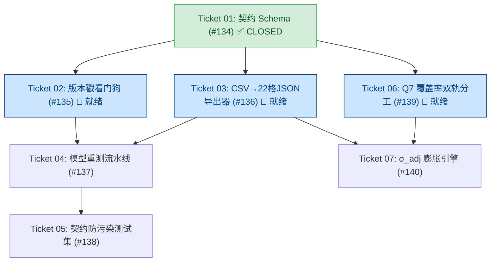

# P8-CLASS1-LAUNCH・Ticket 01 交付闭环与系统现状综合汇报

- **报告编号**：`P8-CLASS1-LAUNCH-SUMMARY-REPORT`
- **生成日期**：2026-10-26
- **工单对账**：
  - **父工单（B 线）**：`P8-CLASS1-LAUNCH`
  - **Spec 主工单**：`Spec: Phase 2 Task 08 - 第一类投注定价算法与只读纸面盘落地` ([#133](https://github.com/oasislin/Poly2/issues/133))
  - **首张交付切片**：`Phase 2 Task 08 - Ticket 01: feat(contract): 定义物理模型参数消费契约数据模型与格级配置 Schema` ([#134](https://github.com/oasislin/Poly2/issues/134)) —— **CLOSED (已闭环验收)**
- **最新代码基线**：`main` 分支（与 `origin/main` 保持一致）
- **现役测试基线**：`125 passed in 1.34s`（`tests/unit/prediction` + `tests/unit/risk` + `tests/unit/contract`）

---

## 一、 Ticket 01 实施与交付闭环全貌

Ticket 01 作为 Phase 2 Task 08 的首张 Frontier 工单，承担了物理模型向交易算法注入参数的法定消费契约建模任务。历经初版实现、双轴审查、零硬编码重构及审计方复核，现已全面达成生产级验收要求：

### 1. 核心交付物与架构契约
- [`src/contract/parameter_contract.py`](file:///Users/ericlin/SynologyDrive/Project/Poly%20Way2/src/contract/parameter_contract.py)：
  - **时空网格结构契约**：严格按 2 站（KORD/KMIA）× 11 提前期（12h~72h）= 22 格字典组织，防范全局均值化；
  - **全量参数消费矩阵对账（ADR-0019 §三）**：
    - `CellCalibrationRecord`：封装 `s_oos`、`fstd_lo/hi/in`、`ece_2f`、`v1_coverage_90/pass`、`pit_mean/var`、`reject_uniform`、`neff`、`cvm_stat/p`、`ece_range`；
    - `PhysicalForecastOutput`：封装动态推理预测量 `mu_calib`、`sig_eff`、`distribution_family`，以及全链路 `Decimal` 精度的离散档位概率向量 `p_j`；
    - `PhysicalParamContract`：封装 22 格容器、`contract_version`、`manifest_sha256` 与 `model_weights_sha256`。
- [`src/contract/__init__.py`](file:///Users/ericlin/SynologyDrive/Project/Poly%20Way2/src/contract/__init__.py)：暴露受控类型与网格常量。
- [`tests/unit/contract/test_parameter_contract.py`](file:///Users/ericlin/SynologyDrive/Project/Poly%20Way2/tests/unit/contract/test_parameter_contract.py)：12 项专属单元测试（涵盖不可变性、Fail-Closed、外层键一致性、Decimal 精度与防全局均值化）。

### 2. 双轴 Code Review 审查与关键裁决落地
针对初版实现（`2a3af76`）中预设的合成默认值问题，落实用户核心裁决：“**不能有任何门限类的硬编码常量，请检查。如果有需要赋值的缺失，那么这是设计方案的问题，反推问题回到评审委员会**”：
- **零默认值（Zero Defaults）**：移除所有 14 处合成门限/默认值赋值，全部改为纯类型声明；未显式传参直接引发 `TypeError`；
- **Fail-Closed 零容错回退**：`from_dict()` 彻底移除所有 `.get(..., default)`，全部采用直接索引 `data["..."]`；缺少任何法定字段直接抛出 `KeyError`；
- **零门限判定**：契约层纯粹作为强类型容器与 Schema，不包含任何业务或统计门限数值比较逻辑；
- **外层键一致性强校验**：反序列化时严格核验外层字典键（如 `KORD_12h`）是否与内层记录物理标识完全匹配，不符抛 `ValueError`。

### 3. 自动化测试验证
- **Ticket 01 专属单测**：`python -m pytest tests/unit/contract/test_parameter_contract.py -v` → **12 passed in 0.02s** (exit code 0)；
- **现役全量交易与契约回归**：`python -m pytest tests/unit/prediction tests/unit/risk tests/unit/contract -q` → **125 passed in 1.34s** (exit code 0)。

### 4. 审计签注与工单关闭
- 审核方已签发复核单：[`docs/audit/P8-CLASS1-LAUNCH-CHK-09_Ticket01交付复核单_20261022.md`](file:///Users/ericlin/SynologyDrive/Project/Poly%20Way2/docs/audit/P8-CLASS1-LAUNCH-CHK-09_Ticket01交付复核单_20261022.md)，结论判定为“**Ticket 01（#134）验收：通过**”；
- GitHub Issue [#134](https://github.com/oasislin/Poly2/issues/134) 已正式打入 **Closed** 状态并附注验收依据。

---

## 二、 仓储资产增补与全貌更新

除 Ticket 01 交付物外，本次同步还包含以下关键治理与架构文档资产：

1. **新增 Code Wiki 百科（[`docs/CODE_WIKI.md`](file:///Users/ericlin/SynologyDrive/Project/Poly%20Way2/docs/CODE_WIKI.md)）**：
   - 建立全仓 6 层架构字典（L1 气象采集 → L2 清洗衍生 → L3 概率建模 → L4 预测与离散化 → L5 验证与审计 → L6 交易契约与风控）；
   - 明确定位了 Active 10 站点宇宙、训练/盲测时空隔离墙（2000-2018 训练 vs 2019 独立盲测）、960 格模型库与 ADR 决策映射。
2. **规范文件状态更新（[`specs/phase2-task08-class1-pricing-betting-spec.md`](file:///Users/ericlin/SynologyDrive/Project/Poly%20Way2/specs/phase2-task08-class1-pricing-betting-spec.md)）**：
   - 将 Ticket 01 状态标记为 `✅ 已完成 (Closed / CHK-09 通过)`；
   - 将依赖 Ticket 01 的下游工单（Ticket 02, Ticket 03, Ticket 06）统一置为 `Frontier 就绪 / 依赖已解除`。
3. **盲测报告留存图档入库**：
   - 补充归档 `docs/audit/v2-blindtest-report/_shots/V2_2019双城盲测_尺子升级报告_20261021_desktop.jpg`。

---

## 三、 Phase 2 Task 08 切片依赖拓扑与下一步执行计划

当前已解锁并就绪的 Frontier 切片工单共 3 张：

### 推荐波次推进顺序：

1. **优先推进 Ticket 02（[#135](https://github.com/oasislin/Poly2/issues/135)）**：
   - **工单目标**：`feat(contract): 实现物理模型与 manifest SHA256 版本戳强校验看门狗`；
   - **交付路径**：`src/contract/version_watchdog.py`；
   - **核心职责**：比对 `data/models/manifest.json` 与各 `.pkl` 模型的实际 SHA256，不符时抛出 `StaleModelParametersError` 阻断交易引擎启动；
   - **前置依赖解除后收益**：为 Ticket 04（重测流水线）提供直接底层门禁。
2. **随后推进 Ticket 03（[#136](https://github.com/oasislin/Poly2/issues/136)）**：
   - **工单目标**：`feat(contract): 实现从 V2 盲测 CSV 自动导出 22 格静态参数表的转换器与校验器`；
   - **交付路径**：`src/contract/param_extractor.py` + `data/processed/calibration/active10_v2r01_betting_params.json`；
   - **关键承接**：落实 CHK-09 §四“恰好 22 格且严禁第 23 格混入”的强边界校验。
3. **并行推进 Ticket 06（[#139](https://github.com/oasislin/Poly2/issues/139)）**：
   - **工单目标**：`feat(pricing): 实现 Q7 覆盖率双轨分工与 exact / gaussian_proxy 计算解耦`；
   - **交付路径**：`src/pricing/coverage_dual_track.py`。
