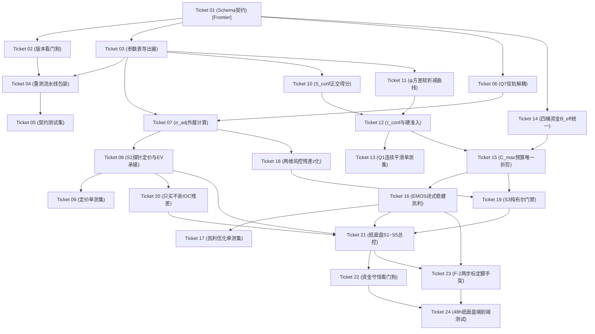

# P8-CLASS1-LAUNCH-TICKETS-PLAN · Phase 2 Task 08 切片拆票定稿方案（24 票去 Group 层）

> **工单（B 线）**：`P8-CLASS1-LAUNCH`（治理批次 8）  
> **核验单**：`P8-CLASS1-LAUNCH-CHK-07`（定稿收尾指令）  
> **编制角色**：开发组 Agent  
> **依据规范**：《项目编号与命名规范_20261021.md》§1（三层工作层级：Phase → Task → Ticket）、用户裁决 U-5/U-10（去 Group 层级、立项 Task 08）  
> **交付主工单（A 线）**：[`Spec: Phase 2 Task 08 - 第一类投注定价算法与只读纸面盘落地`](https://github.com/oasislin/Poly2/issues/133) (`#133`)  
> **状态**：**已正式发布（GitHub Issue #133 ~ #157）**

---

## 一、 24 票依赖拓扑与前沿（Frontier）

拆票方案彻底删除 Group 编号层级，24 张票直接挂在 `Phase 2 Task 08` 之下。分组仅作为阅读辅助。

- **初始就绪 Frontier 票（无依赖，可立即开工）**：
  - `Phase 2 Task 08 - Ticket 01`

---

## 二、 24 张切片 Tickets 全量明细表

> **命名纪律**：所有 Issue 标题严格采用 `Phase 2 Task 08 - Ticket ZZ: <type>(<scope>): <描述>` 全拼格式；各票均定义独立交付物、单测验证标准与 Blocked by 依赖。

| Ticket 标识 | GitHub Issue 链接 | 模块与核心算法实现 | 交付代码路径 | Blocked by |
| :--- | :--- | :--- | :--- | :--- |
| **Ticket 01** | [#134](https://github.com/oasislin/Poly2/issues/134) | 定义 `PhysicalParamContract` 与 `CellCalibrationRecord` 数据模型；落实 ADR-0019 参数消费矩阵定义的必须消费字段（$\mu_{\text{calib}}, \sigma_{\text{eff}}, p_j, s_{\text{oos}}, F_{\text{std}}, \text{reject\_uniform}, \text{ECE}_{\text{2F}}, \text{Cov}_{90}, \text{PIT}_{\text{mean}}, \text{PIT}_{\text{var}}$），按 22 格字典组织。 | `src/contract/parameter_contract.py` | 无 (Frontier) |
| **Ticket 02** | [#135](https://github.com/oasislin/Poly2/issues/135) | 实现启动期模型版本强校验，比对 `data/models/manifest.json` 与 `.pkl` 文件 SHA256；若版本不符抛出 `StaleModelParametersError` 阻断交易。落实 ADR-0019 §二.6。 | `src/contract/version_watchdog.py` | Ticket 01 (#134) |
| **Ticket 03** | [#136](https://github.com/oasislin/Poly2/issues/136) | 读取 `p4blind_v2r01_metrics.csv` 与 `comparison.csv`（按精准列名读取），自动提取生成 22 格静态配置 JSON，校验 22 格完整性与数值边界。 | `src/contract/param_extractor.py` `data/processed/calibration/active10_v2r01_betting_params.json` | Ticket 01 (#134) |
| **Ticket 04** | [#137](https://github.com/oasislin/Poly2/issues/137) | **新建包装脚本** `scripts/trigger_model_retest.py`：封装包装 `scripts/evaluate_p4_2019_settlement.py`，与 V2R01 复现命令保持严格一致；在模型更新后自动驱动重测、更新参数表并记录版本审计。 | `scripts/trigger_model_retest.py` | Ticket 02, 03 (#135, #136) |
| **Ticket 05** | [#138](https://github.com/oasislin/Poly2/issues/138) | 验证版本戳篡改阻断断言、22 格参数映射完整性、防全局均值化断言及物理模型只读不可变保护测试。 | `tests/unit/contract/test_parameter_contract.py` | Ticket 04 (#137) |
| **Ticket 06** | [#139](https://github.com/oasislin/Poly2/issues/139) | 实现事后审计 `exact`（经验 5/95 分位）与在线实时 `gaussian_proxy`（$\mu \pm 1.64485\cdot\sigma_{\text{eff}}$）双轨独立类；内嵌三不混用防御断言。落实 裁决-R2。 | `src/pricing/coverage_dual_track.py` | Ticket 01 (#134) |
| **Ticket 07** | [#140](https://github.com/oasislin/Poly2/issues/140) | 依据 ADR-0019 实现 $\sigma_{\text{adj}} = \sqrt{\max(1.0, s_{\text{oos}})} \cdot \sigma_{\text{eff}}$，仅在欠自信时外展定价区间防虚报 Edge，过自信时不人为缩窄（$\sigma_{\text{adj}} = \sigma_{\text{eff}}$）。 | `src/pricing/adaptive_variance.py` | Ticket 03, 06 (#136, #139) |
| **Ticket 08** | [#141](https://github.com/oasislin/Poly2/issues/141) | **承接 Task 04 未完成的交易 EV 引擎**：注入 Polymarket M-2 动态费率契约 $q=p[1+\text{base}(1-p)]$，按 DR-2026-1014-01 达标深度 $S_{\text{target}}$ 自动穿透计算加权保护均价 $\bar{P}$ 与有效成本 $q_{\text{eff}}$。 | `src/pricing/order_probe_evaluator.py` | Ticket 07 (#140) |
| **Ticket 09** | [#142](https://github.com/oasislin/Poly2/issues/142) | 测试双轨计算精度、三不混用边界异常、$\sigma_{\text{adj}}$ 外展特性及探针均价 $\bar{P}$ 与达标深度自洽性。 | `tests/unit/pricing/test_order_probe_evaluator.py` | Ticket 08 (#141) |
| **Ticket 10** | [#143](https://github.com/oasislin/Poly2/issues/143) | 依据 ADR-0019 G-1 裁决，剔除 $x_s$，基于 $\text{ECE}_{\text{2F}}$、$\text{Cov}_{90}$ 偏离、$\text{PIT}_{\text{var}}$ 偏离计算平方高斯连续得分 $S_{\text{conf}}$；参数标记 `[F-2 LOCKED]`。 | `src/bankroll/confidence_scorer.py` | Ticket 03 (#136) |
| **Ticket 11** | [#144](https://github.com/oasislin/Poly2/issues/144) | 实现绿区平坦带、余弦升降平滑过渡带、底仓衰减带与硬熔断带；消除 $1.11$ 与 $1.15$ 断崖效应；参数标记 `[F-2 LOCKED]`。 | `src/bankroll/soft_shrinkage_curve.py` | Ticket 03 (#136) |
| **Ticket 12** | [#145](https://github.com/oasislin/Poly2/issues/145) | 计算 $\tau_{\text{conf}} = \psi(s_{\text{oos}}) \cdot S_{\text{conf}}$；核验硬准入极值熔断门槛与 `reject_uniform`，不合格输出 0；输出 $\tau_{\text{conf}} \in [0, 1]$。 | `src/bankroll/credibility_gate.py` | Ticket 10, 11 (#143, #144) |
| **Ticket 13** | [#146](https://github.com/oasislin/Poly2/issues/146) | 验证余弦过渡带二阶平滑性、1.11 与 1.15 微变特性、极值硬阻断及信号正交无双重惩罚。 | `tests/unit/bankroll/test_credibility_gate.py` | Ticket 12 (#145) |
| **Ticket 14** | [#147](https://github.com/oasislin/Poly2/issues/147) | 统一利用率分母为 $B_{\text{eff}} = \text{Free} + \text{Active}$，剔除 Zombie/Disputed；全链路 Decimal 实现资金出入、锁定与守恒核算。 | `src/bankroll/four_bucket_manager.py` | Ticket 01 (#134) |
| **Ticket 15** | [#148](https://github.com/oasislin/Poly2/issues/148) | 依据 DR-2026-1014-02 实现 $C_{\max} = \tau_{\text{conf}} \cdot \tau_z \cdot \tau_{\text{2D}} \cdot \min(0.10 B_{\text{eff}}, 0.70 B_{\text{eff}} - \text{Active}, W_{\text{free}})$ 前置预算注入，S3 仅布尔放行。 | `src/bankroll/budget_controller.py` | Ticket 12, 14 (#145, #147) |
| **Ticket 16** | [#149](https://github.com/oasislin/Poly2/issues/149) | 替代点估计，重构为基于 EMOS 闭式不确定集 $\mathcal{P}$ 的稳健多项凯利（SLSQP 求解）；凹优化预算自动集中；$\theta/\eta$ 挂 `[F-2 LOCKED]`。 | `src/bankroll/robust_multinomial_kelly.py` | Ticket 15 (#148) |
| **Ticket 17** | [#150](https://github.com/oasislin/Poly2/issues/150) | 验证压缩预算下资金向最高 Edge 档位自动集中特性、跨过 `minimum_order_size` 门槛断言及单市场 10% 硬顶约束。 | `tests/unit/bankroll/test_robust_kelly.py` | Ticket 16 (#149) |
| **Ticket 18** | [#151](https://github.com/oasislin/Poly2/issues/151) | 依据 DR-2026-1014-04，残差阈值统一为 $z = \|\Delta T\| / \sigma_{\text{EMOS}}$，消解温标差异；输出两维调制乘数 $\tau_{\text{2D}}$；$z$ 阈值列入待标定。 | `src/risk/dimension_two_controller.py` | Ticket 07 (#140) |
| **Ticket 19** | [#152](https://github.com/oasislin/Poly2/issues/152) | 检查 $\tau > 0$ 有效性、点差、流动性与哨兵文件，输出纯布尔放行信号，彻底消除 S3/S4 后置乘法折剪。 | `src/risk/pre_buy_boolean_gate.py` | Ticket 15, 18 (#148, #151) |
| **Ticket 20** | [#153](https://github.com/oasislin/Poly2/issues/153) | 移除违宪的反向对冲与市价卖出，严格在只买不卖框架下实现未成交敞口的残差补单评估与资金原路释放。 | `src/execution/residual_state_machine.py` | Ticket 08 (#141) |
| **Ticket 21** | [#154](https://github.com/oasislin/Poly2/issues/154) | 串联天气更新驱动、ADR-0019 参数装载、S1 探针定价、S2 稳健凯利、S3 布尔门禁、S4/S5 仿真撮合与资金出入。 | `src/simulation/paper_trading_pipeline.py` | Ticket 08, 16, 19, 20 |
| **Ticket 22** | [#155](https://github.com/oasislin/Poly2/issues/155) | 记录每笔决策的连续校准量、$\tau_{\text{conf}}$、资金变动；严格核验资金守恒 $\sum \text{Buckets} = \text{Initial}$，发现撕裂立即熔断。 | `src/simulation/capital_watchdog.py` | Ticket 21 (#154) |
| **Ticket 23** | [#156](https://github.com/oasislin/Poly2/issues/156) | 基于纸面盘自产数据，提供网格搜索与两步标定离线分析脚手架，求解 $\theta/\eta/\psi$ 生产推荐值。 | `scripts/calibrate_kelly_parameters.py` | Ticket 16, 21 (#149, #154) |
| **Ticket 24** | [#157](https://github.com/oasislin/Poly2/issues/157) | 模拟 48h 观测输入，验证 KMIA 欠自信自动折减、KORD 正常运行、零非物理撮合与资金守恒连续观测通过。 | `tests/integration/test_paper_trading_end_to_end.py` | Ticket 22, 23 (#155, #156) |

---

## 三、 合规自检确认

1. **三层工作层级**：彻底移除 Group 层级，严格遵守 `Phase 2` $\to$ `Task 08` $\to$ `Ticket 01~24` 三层架构；
2. **Issue 命名全拼**：每票全拼前缀 `Phase 2 Task 08 - Ticket ZZ: <type>(<scope>): <描述>`，绝不留孤立简称；
3. **Task 04 EV 承接**：Ticket 08 明确标注承接 Task 04 未完成的交易 EV 引擎；
4. **重测流水线标注**：Ticket 04 明确标注 `trigger_model_retest.py` 为新建包装脚本；
5. **ADR 引用统一**：全量代码与测试文档统一引用 **ADR-0019**。
