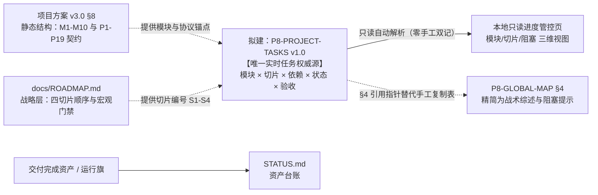

# P8-CONTROL-INFRA-PROPOSAL：全量任务分解与可视化管控方案（讨论提案稿 `v0.1` · 2026-11-19）

> **坐标声明**：管控基础设施批·第一步（方案设计轮 · `2026-11-19`）；**本批贡献** = 确立 `M1–M10` 全量任务唯一事实源台账规范、四维单行骨架（含 4 项算法单验收标准留白标记）、切片 2 被动录盘推荐站表、以及零外部依赖本地只读进度看板选型提案；**离实钱步数** = `3` 步（切片 2 录盘与 `D-6` $\to$ 切片 3 `T8` 与带延迟假盘/`GATE-LIVE` $\to$ 切片 4 实盘与月度复检）。  
> **性质与边界铁律（`2026-11-19`）**：本档为 **第一步设计方案书（纯文档提案，不创建正式全量分解台账文件、不编写 HTML/JS/Python 看板代码、不修改 `src/` 或 `tests/`、不提前生成算法单验收标准、不开启被动录盘）**；文中全部机制与选型建议均属 **`2026-11-19` 当前设计提案 / 首期选择（待用户与架构侧审阅拍板，月度复检可替换）**，不含绝对化承诺用语。

---

## §1 问题诊断、文件增殖判据与单一事实源设计

### 1.1 现状缺口（为什么需要全量任务分解台账）

切片 1（`S1-01 ~ S1-06`）已闭合，系统进入多模块并行拆解与依赖管理密集期。当前仓库的任务信息分散在三处，存在明显视觉与管理盲区：

1. [`docs/ROADMAP.md`](../ROADMAP.md)：按战略层定位，只展示 4 个切片的宏观顺序（`§3.4`）与切片 1 静态任务表（`§3.5`），**`M1–M10` 后续切片（切片 2–4）的模块级工单尚未拆至可调度粒度**；
2. [`docs/audit/P8-GLOBAL-MAP_项目全局图谱_v1.0_20261113.md`](P8-GLOBAL-MAP_项目全局图谱_v1.0_20261113.md)：`§4 / §4.1` 以自然语言摘要列出活队列与十模块动态状态，但缺少**标准化前置依赖图、统一状态枚举、可机读字段及逐单验收口**，且遗留早期 `W1–W3` 过渡叙事；
3. [`项目方案 (v3.0) §8.1–§8.2`](../项目方案和执行文档/项目方案%20(v3.0)：Polymarket%20温度市场量化投注系统.md#8-模块地图与协议层总索引v30-后-α-十模块静态结构与-p1p19-契约--2026-11-18-当前决策)：定义静态十模块与 `P1–P19` 契约索引，天然不承载实时进度跳变。

### 1.2 文件增殖判据逐条核验（对标 `AGENTS.md §项目管理纪律`）

拟在第二步新建单一权威任务台账 [`docs/audit/P8-PROJECT-TASKS_全量任务分解台账.md`（拟定）](P8-GLOBAL-MAP_项目全局图谱_v1.0_20261113.md)（*注：第二步获批后创建，本草案先引用既有图谱锚点，保证零断链*），满足 `AGENTS.md` “无既有文档可合理承载 / 强行塞入将导致职责混杂” 两项判据：

| 候选既有载体 | 为何不能直接强塞 35–40 项跨切片任务明细 | 规范依据 |
| :--- | :--- | :--- |
| **`docs/ROADMAP.md`** | `P8-GLOBAL-MAP §5.2` 明文禁止 `ROADMAP.md` 承载高密实时进度表与运行期跟踪细节；`ROADMAP` 仅保留四切片宏观路线与 `§3.5` 级切片总表 | [`P8-GLOBAL-MAP §5.2`](P8-GLOBAL-MAP_项目全局图谱_v1.0_20261113.md#52-roadmapmd-角色收窄四条制度暂存待迁项目编号与命名规范) |
| **`P8-GLOBAL-MAP`** | 现已承载策略演进叙事（`§3`）、ECE 三层管辖（`§6`）、一个天平（`§7`）与版本综述（`§9–§10`）；若再嵌入结构化全量机器可解析台账，会混杂治理论证与实时调度数据，且阻碍后续看板脚本无歧义解析 | [`P8-GLOBAL-MAP §1`](P8-GLOBAL-MAP_项目全局图谱_v1.0_20261113.md#一-文档定位与三层分工) |
| **`STATUS.md`** | 定位为资产台账（模型权重、台站运行旗、数据集与现役代码资产），非工单 DAG 调度表 | [`STATUS.md`](../../STATUS.md) |

### 1.3 四层单一事实源边界（杜绝多处手动同步漂移）

第二步落地后，各文档职责按“结构 / 战略 / 任务进度 / 资产”严格单点切分：

- **彻底解决 `ROADMAP` / `GLOBAL-MAP` / 任务表三处漂移问题**：
  1. `P8-PROJECT-TASKS_全量任务分解台账.md` 成为全仓**唯一实时任务明细与状态权威源**；
  2. `P8-GLOBAL-MAP §4 / §4.1` 在第二步收窄为**高阶摘要 + 指针**（不再维护第二份独立状态明细表；如保留十模块概览，标明由任务台账汇总导出或直接指针跳转）；
  3. `docs/ROADMAP.md` 不再向下延展逐个 Ticket 细节，保持战略切片指针；
  4. **建议在 `AGENTS.md §项目管理纪律` 新增一条提交检查清单条款（第二步同步合入）**：  
     > **“任务状态联动条款（建议新增）**：凡涉及任务状态迁移（`READY → IN_PROGRESS → DONE / BLOCKED`）或新开/关闭任务的 Git 提交，必须在同一提交内更新唯一权威源 `P8-PROJECT-TASKS`，并运行看板解析校验脚本确认 `0` 解析告警与 `0` 断链后方可提交。”

---

## §2 全量任务分解设计规范（Step 2 蓝图）

### 2.1 编号规则、状态枚举与四要素强约束

1. **统一单号规范**：采用 **`S<切片号>-<两位序号>`**（延续切片 1 `S1-01 ~ S1-06` 已生效前缀），例如 `S2-01`、`S3-01`、`S4-01`。跨阶段专项如 `G-5` 在台账中保留原治理编号映射标签（如 `S2-06 [G-5]`），兼顾历史引用连续性与切片归位。
2. **模块状态映射口径（对齐 [`项目方案 v3.0 §8.1`](../项目方案和执行文档/项目方案%20(v3.0)：Polymarket%20温度市场量化投注系统.md#81-模块地图m1m10-十模块静态架构--2026-11-18-当前决策) 与 [`P8-GLOBAL-MAP §4.1`](P8-GLOBAL-MAP_项目全局图谱_v1.0_20261113.md#41-十模块当前动态状态表m1m10--每轮随活队列同步刷新)）**：
   - 看板首层将十模块收拢为四类健康状态徽章：`已就绪` / `待实现` / `待修复` / `待改造`（详见 §2.2）。
3. **任务状态枚举（机读受控词表）**：
   - `DONE`（已完成闭合）
   - `PENDING_APPROVAL`（可启动，强依赖业主或架构侧显式放行，如录盘开关、真盘切换门）
   - `READY`（前置依赖已全绿，工程随时可领单）
   - `BLOCKED`（前置阻塞：含“缺 `D-A1` 实测值”、“缺 `D-6` 合龙条款”、“缺架构侧供给验收标准”）
   - `PLANNED`（后序切片正常排期中）
4. **每条任务强制四要素**（缺失任一项即判定为解析校验失败）：
   - ① **`模块归属`**：严格取自 `M1` ~ `M10`（跨模块标主责模块并注协同方）；
   - ② **`法定文档锚点`**：精确到文件与节号（无锚点不开单，对标 `AGENTS.md`）；
   - ③ **`前置依赖`**：显式任务 ID 列表（`depends_on`）+ 外部签发门；
   - ④ **`验收标准`**：工程/治理单给出可验证判定条件；**4 项算法核心改造单强制保留占位 `"待架构侧供给"`**，绝不由开发侧越权代拟！

### 2.2 十模块（`M1–M10`）现状对齐快照（`2026-11-19`）

| 模块 | 模块名称 | 建议模块徽章 | 当前事实状态对齐（`S1-06` 闭合后） | 主责待推进切片与单号 |
| :---: | :--- | :---: | :--- | :--- |
| **`M1`** | 气象数据管道 | **`待改造`** | `S1-06` 已锁喂桥同构流与 `T8` 五项输入，现役仅含静态解析，缺 `AWC`/全量双流抽象层 | 切片 3：`S3-01`（算法单） |
| **`M2`** | 预测引擎 | **`待改造`** | `v1` 冻结线已建；`P5 rc` 已披露 `TruncatedDistribution` 点质量恒零与 `.5°F` 边界两缺口 | 切片 3：`S3-02`（算法单）、`S3-03` |
| **`M3`** | 盘口数据 | **`已就绪`** | `S1-01 D-A2` + `S1-05` [`passive_book_recorder.py`](../../src/data_acquisition/passive_book_recorder.py)（77 测试 + 66 tokens 干跑通过），待批复开录 | 切片 2：`S2-01`（待批开录） |
| **`M4`** | 决策引擎 | **`待修复 / 待联调`** | `S1-04` 已交 `T4` 规格与 `edge_math.py`（74 测试全绿）；缺双钟调度、`w(τ)` 与门槛决策主链路及 `P16` 消费 | 切片 3：`S3-04`（算法单） |
| **`M5`** | 执行器 | **`待实现`** | `S1-04` 已交 `P2 / P18` 规格与 `φ` 签名，`src/execution/` 目录尚未建成，缺真实 `FAK` 与延迟撮合代码 | 切片 3：`S3-05`（算法单） |
| **`M6`** | 资金风控 | **`待实现`** | `P7 / P14 / P15 / P16` 与本地 `25%`/`$500` 硬闸设计已立，`src/bankroll/` 未建成，且缺 `D-6` 细则 | 切片 2：`S2-03`；切片 3：`S3-06` |
| **`M7`** | 日志审计 | **`待实现`** | `S1-03 T2`（`P1/P3/P12/P13/P17/P19`）正文已成文，`P13` 录制写入器已就位，四元组全链路聚合未建成 | 切片 2：`S2-04`；切片 3：`S3-07` |
| **`M8`** | 校准复检 | **`待实现 / 阻塞`** | 参数账本与 `P6` 规格已立；`D-A1 friction_median=None` 阻塞上线，且缺 `D-6` 月度例程与 `P16` 细则 | 切片 2：`S2-02`、`S2-03`；切片 3：`S3-08`；切片 4：`S4-01` |
| **`M9`** | 结算对账 | **`待实现`** | `S1-06 G-15` 法律/世界事实已闭环，待固化待成文协议 **`P9`** 并实现 `AWC / WU` 抓取对账代码 | 切片 3：`S3-09`（含 `P9` 成文） |
| **`M10`** | 前台管理界面 | **`待实现`** | 只读铁律与 `P10` 目录兼容性已锚，待成文 **`P10`** 渲染细则；独立进度管控工具建议先于 `v0` 外挂实施 | 切片 2：`S2-04`、`S2-05`；切片 3：`S3-10` |

### 2.3 全量任务分解设计草案总表（覆盖切片 1–4 × 全十模块 × 关键治理门）

> **边界提示**：下列 4 项高亮 **`【算法改造单 · 验收标准：待架构侧供给】`** 条目（`S3-01`、`S3-02`、`S3-04`、`S3-05`），第二步建台账时将严格保留 **`"待架构侧供给"`**，直至架构侧下发定量/形态验收细则后方予回填。

#### A. 切片 1：阶段 0 并行筹备（已全单闭合 `DONE` ✅）

| 单号 | 任务名称 | 模块归属 | 法定文档锚点 | 前置依赖 | 验收标准 | 拟定状态 |
| :--- | :--- | :---: | :--- | :--- | :--- | :---: |
| **`S1-01`** | `D-A2` 五组实证调研收口 | `M3` | [`P8-FACTS-LEDGER v0.3`](P8-FACTS-LEDGER_静态事实档案_v0.1.md)、[`P8-ALGO-REVIEW G-19`](P8-ALGO-REVIEW_待确认事项登记册_20261113.md) | 无 | 五组调研实证归档、`tick/min_size/feeRate/neg_risk` 入库 | **`DONE`** |
| **`S1-02`** | `T1 G-15` 结算口径外核三查 | `M9` 前置 | [`P8-KERNEL-CONSENSUS v1.1 §六`](P8-KERNEL-CONSENSUS_内核讨论定稿_v1.0_20261116.md) | 无 | 三分叉核查记录归档、`T_settle_close_utc` 锚定 | **`DONE`** |
| **`S1-03`** | `T2` 日志与审计协议正文成文 | `M7` | [`P8-T2-M7-LOGGING v1.0`](P8-T2-M7-LOGGING_日志与审计协议规格_v1.0.md) | `S1-01` | `P1/P3/P12/P13/P17/P19` schema 成文且 `§8.2` 指针闭合 | **`DONE`** |
| **`S1-04`** | `T4` 接口文档 + `edge_math.py` | `M4 / M5` | [`P8-T4-M4M5-INTERFACE v1.0`](P8-T4-M4M5-INTERFACE_决策与执行接口规格.md)、[`edge_math.py`](../../src/pricing/edge_math.py) | `S1-01` | `P2/P5/P6/P7/P8` 成文、`edge_math` 74 项单测通过、`F-2` 零改动 | **`DONE`** |
| **`S1-05`** | 只读被动盘口采集器交付 | `M3` | [`passive_book_recorder.py`](../../src/data_acquisition/passive_book_recorder.py)、[`§8.4 P4`](../项目方案和执行文档/项目方案%20(v3.0)：Polymarket%20温度市场量化投注系统.md#a1-p4-marketbooksnapshot-v10-rcm3--m4--m5--m7) | `S1-01`, `S1-03` | `P4+P13` 采集器单测 + 真实 66-token 干跑全过，处于未开机就绪态 | **`DONE`** |
| **`S1-06`** | `G-15` 裁决落盘、`M_now` 定义域与费率回放 | `M1 / M4 / M5 / M9` | [`ADR-0009 §4`](../adr/ADR-0009：芝加哥%2008-31%20特报（SPECI）结算语义裁决与截断层规则.md#4-2026-11-19-s1-06--g-15-修订节--世界事实变更跟随当前决策)、[`ADR-0012 §5`](../adr/ADR-0012：法定结算真值源（NWS%20WRH）、僵尸仓位双轨估值与舍入闭环裁决.md#5-2026-11-19-s1-06--g-15-修订节--世界事实变更跟随当前决策)、[`KERNEL §七`](P8-KERNEL-CONSENSUS_内核讨论定稿_v1.0_20261116.md#七-s1-06-g-15-裁决事实增补max-恒等式定义域论证与-t8-m1-规格输入2026-11-19-当前决策) | `S1-02` | `G-15/G-20` 闭环、`max` 定义域论证、`P18` 帧费率规则落盘 | **`DONE`** |

#### B. 切片 2：基线录盘、制度合龙、待成文协议 `P10` 与管控基建

| 单号 | 任务名称 | 模块归属 | 法定文档锚点 | 前置依赖 | 验收标准 | 拟定状态 |
| :--- | :--- | :---: | :--- | :--- | :--- | :---: |
| **`S2-01`** | **【待批复关键节点】多日被动录盘建盘口基线** | `M3` | [`ROADMAP §3.4`](../ROADMAP.md#34-已对齐-2026-11-17-p8-kernel-consensus-v11-改版四阶段路线真盘切换门与四切片顺序v120--v130)、[`passive_book_recorder.py`](../../src/data_acquisition/passive_book_recorder.py) | `S1-05` + **用户批准开录** | 连续录盘 ≥3–5 天（覆盖 **`2026-11-20T23:59Z`** 后 `0.01` 新费率时代样本），`P13` JSONL 完整无未解释长缺口；具体站表见 **§2.4** | **`PENDING_APPROVAL`** |
| **`S2-02`** | `D-A1` 走簿滑点拟合与 `friction_median` 填实 | `M8` (`M3` 协同) | [`P8-T4-M4M5-INTERFACE §3.4`](P8-T4-M4M5-INTERFACE_决策与执行接口规格.md#34-p6-executionpolicybundle-v10m8--m4--m5--m7--由-rc-正式成文)、[`P8-CAPITAL-CONFIG §7`](P8-CAPITAL-CONFIG_资金参数配置_v1.0.md#7-参数账本全案占位参数统一登记表--2026-11-17) | `S2-01`（`0.01` 时代录盘样本） | 用典型切片吃深走簿模拟计算 `median(slippage_vs_best_ask)`（不含 spread）签入账本与 `P6`，解除 `None` 上线阻塞 | **`BLOCKED`** |
| **`S2-03`** | **`D-6` 制度合龙会议与规则成文**（`T6 / T7` 核心制度） | `M6 / M8` | [`P8-KERNEL-CONSENSUS §六 G`](P8-KERNEL-CONSENSUS_内核讨论定稿_v1.0_20261116.md#g下一桌-d-6-制度合龙议程登记只登记不开桌--2026-11-17) | `S1-06`（可与 `S2-01` 并行开桌） | 九项全闭合成文：抽检/亮灯/灯→钱映射（含分叉 3 三检）、月度三层防遗忘、真盘切换门三条件定量阈值、`ECE` 临界锚、黄灯分型与 `yellow_multiplier` 作用点、破冻/`A`类扩充/首期全额确认 | **`READY`** |
| **`S2-04`** | **待成文协议 `P10` 正文成文**（`M7 → M10` 读取与渲染约定） | `M7 / M10` | [`项目方案 v3.0 §8.2 P10`](../项目方案和执行文档/项目方案%20(v3.0)：Polymarket%20温度市场量化投注系统.md#82-协议清单p1p19-十九条--2026-11-18-当前决策)、[`P8-T2-M7-LOGGING §3.2`](P8-T2-M7-LOGGING_日志与审计协议规格_v1.0.md#32-p10m7--m10-前台只读视图兼容约束) | `S1-03` | 固化日志查询过滤契约、缺失/空日志降级呈现与 `M10` 纯只读不写回校验清单，同步刷新 `§8.2` | **`READY`** |
| **`S2-05`** | **管控基础设施批第二步落地**：建唯一任务台账 + 本地进度可视化看板 | `工具链 / M10` 参考 | 本提案 `§1–§3`、[`ROADMAP §3.4`](../ROADMAP.md) | **用户批复本方案** | ① 建 [`P8-PROJECT-TASKS v1.0`] 并收窄 `GLOBAL-MAP §4`；② 零依赖生成离线可读 HTML 看板并设提交校验钩子 | **`PENDING_APPROVAL`** |
| **`S2-06`** | **`G-5` 历史工作区 263 项文件盘点分流与治理文档入库** | 跨模块（治理） | [`P8-ALGO-REVIEW G-5`](P8-ALGO-REVIEW_待确认事项登记册_20261113.md#g-5-待办项273-项在途与未追踪文件56-m--217-的盘点分流--待办后续安排--2026-11-18-切片-1-开工前置已盘点对账-263-项) | `S1-06`（待专项窗口，不阻塞 `S2-01/S2-03`） | 53 `M`（含 `D6` P0 四文件、`项目编号与命名规范` `§5.2` 合入、`ROADMAP` 越权项迁出）与 210 `??` 完成「提交 / `.gitignore` / 清理」三去向处置 | **`PLANNED`** |

#### C. 切片 3：阶段 2 改版实施（`T8` + `P9` + `M10 v1`）、带延迟假盘（`T9`）与真盘切换门（`GATE-LIVE`）

| 单号 | 任务名称 | 模块归属 | 法定文档锚点 | 前置依赖 | 验收标准 | 拟定状态 |
| :--- | :--- | :---: | :--- | :--- | :--- | :---: |
| **`S3-01`** | **【算法改造单 · `T8 M1`】气象数据抽象层、结算同构流与双流并行落盘** | **`M1`** | [`KERNEL §七 C`](P8-KERNEL-CONSENSUS_内核讨论定稿_v1.0_20261116.md#c模型-m1-与协议字段联动输入)、[`P8-T2-M7-LOGGING §2.5`](P8-T2-M7-LOGGING_日志与审计协议规格_v1.0.md#25-p12-气象-coverageledgerlogm1--m7) | `S1-06`、`S2-03` | **`待架构侧供给`** | **`BLOCKED`** |
| **`S3-02`** | **【算法改造单 · `T8 M2`】`TruncatedDistribution` 点质量修复与整数格点刻度统一** | **`M2`** | [`P8-T4-M4M5-INTERFACE §3.3`](P8-T4-M4M5-INTERFACE_决策与执行接口规格.md#33-p5-forecastdistributionsnapshot-v10m2--m4--m7--由-rc-正式成文)、[`§8.4 A.2`](../项目方案和执行文档/项目方案%20(v3.0)：Polymarket%20温度市场量化投注系统.md#a2-p5-forecastdistributionsnapshot-v10-rcm2--m4--m7) | `S1-06`、`S3-01`（`P11` 契约对接） | **`待架构侧供给`** | **`BLOCKED`** |
| **`S3-03`** | **`T8` 并入之 `2019` 最小形态影子冒烟**（替代独立 `T5`） | `M2 / 审计` | [`KERNEL §六 A.1`](P8-KERNEL-CONSENSUS_内核讨论定稿_v1.0_20261116.md#a分叉决议更新2026-11-17)、[`ROADMAP §3.4`](../ROADMAP.md) | `S3-01`、`S3-02` + **人工触发封跑许可** | 严格遵循 `2019 封跑制度` 并记《2019 消费台账》；零资金影子模式只验气象形态收敛方向，**严禁用于 `w / φ` 拟合或刷榜** | **`PLANNED`** |
| **`S3-04`** | **【算法改造单 · `T8 M4`】双钟决策引擎、`w(τ)` 额制、`edge_math` 门槛链路与 `P16` 消费** | **`M4`** | [`P8-T4-M4M5-INTERFACE §2.1–2.2`](P8-T4-M4M5-INTERFACE_决策与执行接口规格.md)、[`P8-EXECUTION-DESIGN v1.0`](P8-EXECUTION-DESIGN_w与phi设计与决策记录_v1.0.md) | `S1-04`、`S2-03`（`P16` 消费语义）、`S3-02` | **`待架构侧供给`** | **`BLOCKED`** |
| **`S3-05`** | **【算法改造单 · `T8 M5`】执行器 `φ` 逐档切片、CLOB `FAK` 网关与 `P18` 延迟撮合/滑点采样** | **`M5`** | [`P8-T4-M4M5-INTERFACE §2.2–2.4`](P8-T4-M4M5-INTERFACE_决策与执行接口规格.md)、[`P8-FACTS-LEDGER v0.3`](P8-FACTS-LEDGER_静态事实档案_v0.1.md) | `S1-04`、`S2-01`、`S3-04` | **`待架构侧供给`** | **`BLOCKED`** |
| **`S3-06`** | **`T8 M6` 三层资金风控机、本地硬刹车（`25% / $500`）与 `P7/P14/P15/P16/P19` 实现** | `M6` | [`P8-CAPITAL-CONFIG v1.0`](P8-CAPITAL-CONFIG_资金参数配置_v1.0.md)、[`项目方案 v3.0 §8.3.4`](../项目方案和执行文档/项目方案%20(v3.0)：Polymarket%20温度市场量化投注系统.md#83-协议治理规则2026-11-18-当前决策) | `S2-03`（`D-6` 定量细节） | `P7` 超并发 `B_eff` 兜底（`N8`）、`P14` 买侧冻结回环与本地 `25%`/`$500` 硬刹车不依赖外部 `P16` 推送全测通过，`P19` 事件写盘 | **`BLOCKED`** |
| **`S3-07`** | **`T8 M7` 四元组全链路异步写入器、`P12`、`P8` 校准流与 `P18` 帧回放检索器** | `M7` | [`P8-T2-M7-LOGGING v1.0`](P8-T2-M7-LOGGING_日志与审计协议规格_v1.0.md)、[`P8-T4-M4M5-INTERFACE §3.2`](P8-T4-M4M5-INTERFACE_决策与执行接口规格.md#32-p8-校准样本流协议m7--m8--v10) | `S1-03`、`S2-01` | 四元组（`P1/P3/P17/P19`）与 `P12` 同构写盘无丢帧，正确区分 `"PAPER" \| "LIVE"`、`P18` gap 触发 `PAPER_MATCH_ABORTED_GAP` | **`PLANNED`** |
| **`S3-08`** | **`T8 M8` 参数账本管理、`P6` 政策包工厂签发与 `P16` 广播器** | `M8` | [`P8-T4-M4M5-INTERFACE §3.4`](P8-T4-M4M5-INTERFACE_决策与执行接口规格.md#34-p6-executionpolicybundle-v10m8--m4--m5--m7--由-rc-正式成文)、[`P8-CAPITAL-CONFIG §7`](P8-CAPITAL-CONFIG_资金参数配置_v1.0.md#7-参数账本全案占位参数统一登记表--2026-11-17) | `S2-02`（`friction_median`）、`S2-03` | `config_hash` 签发、`friction_median is None` 时强制阻断上线包签发、`is_overdue=True` 保守续持不降级契约全测通过 | **`BLOCKED`** |
| **`S3-09`** | **待成文协议 `P9` 固化与 `M9` 结算真值抓取/对账/`P15` 回写实现** | `M9` | [`ADR-0012 §5`](../adr/ADR-0012：法定结算真值源（NWS%20WRH）、僵尸仓位双轨估值与舍入闭环裁决.md#5-2026-11-19-s1-06--g-15-修订节--世界事实变更跟随当前决策)、[`§8.2 P9`](../项目方案和执行文档/项目方案%20(v3.0)：Polymarket%20温度市场量化投注系统.md#82-协议清单p1p19-十九条--2026-11-18-当前决策) | `S1-06`、`S3-06`、`S3-07` | 正式固化 `P9` schema 并同步 `§8.2`；实现 `AWC routine METAR`（`T`-group、`SPECI` 剔除、`WU` 回退、DST 日界、`floor(x+0.5)`）及 `P15` 释放 | **`PLANNED`** |
| **`S3-10`** | **`M10 v1` 前台全只读监控与结算对账视图实现** | `M10` | [`§8.1 M10 铁律`](../项目方案和执行文档/项目方案%20(v3.0)：Polymarket%20温度市场量化投注系统.md#81-模块地图m1m10-十模块静态架构--2026-11-18-当前决策)、`P10` | `S2-04`（`P10`）、`S3-07`、`S3-09`（`P9`） | 纯从 `M7` JSONL 渲染投决全过程、双哈希与 `M9` 已实现盈亏对账，零独立业务库、零任何写操作按钮 | **`BLOCKED`** |
| **`S3-11`** | **`T9` 占位参数带延迟假盘冻结运行**（`model_hash` 冻结） | `全链路` | [`ROADMAP §3.4`](../ROADMAP.md)、[`KERNEL §六 C`](P8-KERNEL-CONSENSUS_内核讨论定稿_v1.0_20261116.md#c模型-m1-与协议字段联动输入) | `S3-01` ~ `S3-09`、`S2-02` | `model_hash` 上线日冻结，`execution_mode="PAPER"` 消费 `P13` 实时录盘并注入真实延迟帧撮合，零 `LIVE` 发单 | **`PLANNED`** |
| **`S3-12`** | **【待批复关键节点】`GATE-LIVE` 真盘切换门检验与切实盘签发** | `M6 / M8 / 业主` | [`KERNEL §六 C.2`](P8-KERNEL-CONSENSUS_内核讨论定稿_v1.0_20261116.md#c模型-m1-与协议字段联动输入)、`D-6` 三条件 | `S3-11` + `S2-03`（三条件）+ **用户签发** | 三条件检验全过、确认 `friction_median` 已由实测填入、`A` 类变更不破冻维持原 `model_hash` 切真盘 | **`PENDING_APPROVAL`** |

#### D. 切片 4：阶段 3 首月复检与闭环审计

| 单号 | 任务名称 | 模块归属 | 法定文档锚点 | 前置依赖 | 验收标准 | 拟定状态 |
| :--- | :--- | :---: | :--- | :--- | :--- | :---: |
| **`S4-01`** | **`T10` 首个 1 个月周期月度复检**（方案 B 续冻结 + 参数人工签发） | `M8` | [`KERNEL §六 A.2 / B.2`](P8-KERNEL-CONSENSUS_内核讨论定稿_v1.0_20261116.md#a分叉决议更新2026-11-17)、[`P8-CAPITAL-CONFIG §7`](P8-CAPITAL-CONFIG_资金参数配置_v1.0.md#7-参数账本全案占位参数统一登记表--2026-11-17) | `S3-11 / S3-12`（满 1 月 blind pool）、`S2-03` | 三层防遗忘例程触发；消费 `P8 / P9` 重估 `sigma_delta_frozen`、`friction_median`、`M_now` 补偿三闸（`[0, 2°F]`）；完成分叉 3 三项首检并人工签发 `P6` | **`PLANNED`** |
| **`S4-02`** | **`T11 / T12` 下一周期推进与 `D-1` 盘口对价三假设审** | `M8 / 策略` | [`KERNEL §三 / 四`](P8-KERNEL-CONSENSUS_内核讨论定稿_v1.0_20261116.md)、[`ROADMAP §3.4`](../ROADMAP.md) | `S4-01` + 真盘沉淀 | 基于真盘四元组与结算记录定量审计 `D-1`（盈利来源三假设），输出单向收紧或升档/迭代决策 | **`PLANNED`** |

---

### 2.4 `S2-01` 被动录盘启动节点：推荐站表与开录前注意事项（实证采集）

为给用户批复 `S2-01`（启动 [`passive_book_recorder.py`](../../src/data_acquisition/passive_book_recorder.py)）提供直接决策依据，本批于 **`2026-11-19T03:15:08Z`** 调用 Gamma `/public-search` 只读实测 Active 10 城在盘市场：

1. **市场开启与生命周期共性（10 站一致）**：Active 10 全部分站当前均**同时挂牌 3 个并发日市场**（`2026-11-18`、`2026-11-19`、`2026-11-20`，即单站单时刻覆盖约 **72 小时**可录生命周期；注意实证盘面并发 3 天高于 `P8-CAPITAL-CONFIG §1` 首期 `concurrent_days=2` 假设，已通过 `N8 B_eff` 兜底）。
2. **Active 10 实时流动性与成交量实测排行（`2026-11-19T03:15:08Z` 快照）**：

| 排名（按流动性） | ICAO 站点 | 城市 | 在盘市场数 | 并发活跃日期串 | 总流动性 `liquidity` (USD) | 总成交量 `volume` (USD) | 录盘角色建议 |
| :---: | :---: | :--- | :---: | :--- | :---: | :---: | :--- |
| 1 | **`KLGA`** | NYC | 3 | `2026-11-18,19,20` | `$168,540.06` | `$42,192.90` | 高深度代表站（推荐纳入拓展组） |
| 2 | **`KATL`** | Atlanta | 3 | `2026-11-18,19,20` | `$154,981.36` | `$33,563.88` | 高深度 + 气候原型 3 代表 |
| 3 | **`KLAX`** | Los Angeles | 3 | `2026-11-18,19,20` | `$154,516.15` | `$26,444.23` | 高深度海雾逆温代表 |
| 4 | **`KORD`** | Chicago | 3 | `2026-11-18,19,20` | `$123,013.57` | `$27,411.83` | **必录核心**（`W2` 先锋站，当前 YAML 已配） |
| 5 | **`KSEA`** | Seattle | 3 | `2026-11-18,19,20` | `$120,491.13` | `$26,630.91` | 中等深度备选 |
| 6 | **`KSFO`** | San Francisco | 3 | `2026-11-18,19,20` | `$119,115.00` | `$24,832.02` | 中等深度备选 |
| 7 | **`KHOU`** | Houston | 3 | `2026-11-18,19,20` | `$104,807.52` | `$45,198.17` | 次高成交量（亚热带沿海对照） |
| 8 | **`KDAL`** | Dallas | 3 | `2026-11-18,19,20` | `$101,912.88` | `$32,336.66` | 备选 |
| 9 | **`KAUS`** | Austin | 3 | `2026-11-18,19,20` | `$94,987.87` | `$41,429.55` | 高成交量备选 |
| 10 | **`KMIA`** | Miami | 3 | `2026-11-18,19,20` | `$89,008.82` | **`$60,440.16`** | **必录核心**（**全十城成交最活跃** + `W2` 先锋站，当前 YAML 已配） |

3. **三档推荐开录范围供用户拍板**：
   - **档 A（最小先锋 · `2 站`：`KORD + KMIA`）**：直接沿用 [`configs/passive_book_recorder.example.yaml`](../../configs/passive_book_recorder.example.yaml)（每轮 ~66 tokens），同时覆盖中高流动性内陆原型（`KORD $123.0k`）与全榜最高成交换手站（`KMIA $60.4k vol`），WS 吞吐极轻、即刻零改配置可起跑；
   - **档 B（深度 + 换手均衡 · `5 站`：`KORD + KMIA + KLGA + KATL + KLAX`，当前推荐）**：新增前三高流动性城（`$154k–$168k`），约 165 tokens 单连接可稳承（防仅用低流动性样本或仅高深度样本导致 `D-A1 friction_median` 估计偏差）；
   - **档 C（Active 10 全采 · `10 站`）**：约 330 tokens，完整沉淀全宇宙盘口分布，需确认单 WS 订阅帧率与本机磁盘日增量（~数百 MB/天可承受）。
4. **开录操作重要提醒（费率换代窗口）**：官方 Weather 降费时间点 **`2026-11-20T23:59:00Z`** 临近——若今日批准开录，**跨 `11-20T23:59Z` 前后的录制帧将携带不同 `fee_rate`（`0.05` vs `0.01`）**，消费 `S2-01` 计算 `D-A1` 与 `S3-11` 时须严格按 [`P8-FACTS-LEDGER v0.3 §2.1`](P8-FACTS-LEDGER_静态事实档案_v0.1.md#21-2026-11-19-s1-06-变费复核与-费率时代标记规则) **严禁混用两时代样本**，并将 `0.01` 时代样本作为主力标定池（同时提示届时检查配置中 `default_fee_rate_fallback: 0.05` 仅作极端缺失保底，正常走 `API_RUNTIME` 返回 `0.01`）。

---

## §3 可视化进度管控页面方案与架构选型

### 3.1 设计目标（面向所有者 / 研发日常推演）

1. **零外网依赖与零环境负担**：无 React/Vue 构建链、无 `npm`、无第三方 CDN 外链；本地离线双击 `file://` 或执行单条标准库脚本即可零报错打开；
2. **零手工状态同步（单一事实源解析）**：页面内所有任务状态、模块徽章、阻塞原因、依赖关系**100% 机读解析自拟建单一台账 `P8-PROJECT-TASKS_全量任务分解台账.md`**，严禁在 HTML/JS 中硬编码状态副本；
3. **只读安全性**：纯可视化展示与筛选跳转，没有任何写回文件、改状态、或触发交易/录盘的写入接口。

### 3.2 `M10 v0` 候选 vs 独立本地工具：架构对比与选型建议

| 维度 | 方案 I：作为 `M10 v0` 只读日志/项目视图底座 | 方案 II：独立本地静态看板生成器（`scripts/` 只读生成器 → 单体离线 HTML） |
| :--- | :--- | :--- |
| **数据源边界合规性** | **存在边界张力**：[`项目方案 v3.0 §8.1`](../项目方案和执行文档/项目方案%20(v3.0)：Polymarket%20温度市场量化投注系统.md#81-模块地图m1m10-十模块静态架构--2026-11-18-当前决策) 与 `P10` 明文规定 `M10` 为 **“M7 JSONL 审计日志的只读视图，非第二事实源”**；将工程研发管理台账塞入 `M10` 契约，会混淆 **研发项目管理面** 与 **实盘/假盘运行监控面** | **架构干净**：明确归属**工程治理工具链**（不占用也不污染 `P10 / M10` 契约），而界面组件骨架（卡片体系、只读徽章、状态过滤与离线单体 HTML 能力）可作为 `M10 v0` 的前端风格与无依赖模式先导验证 |
| **就绪速度与前置依赖** | 受 `S2-04 P10` 及 `S3-07 M7` 日志格式锁定制约，易拖慢管控工具交付 | **切片 2 即可独立先行交付**，不阻塞也不耦合实盘/假盘日志结构 |
| **运维复杂度** | 需提前搭建 Python Web 服务或与未来 `M10` 路由合并 | 仅 `1` 个 Python 标准库渲染脚本 + `1` 份自包含离线 HTML（约 ~250 行源码），零常驻进程，打开即看 |

- **本方案推荐（`2026-11-19` 当前设计提案）**：**采用方案 II（独立本地静态看板生成器）作为现役管控基础设施**，同时明确保留前端只读样式规范供切片 3 建设 `M10` 参考。若用户偏好在 `M10 v0` 名义下以“工程进度 + 运行日志”双标签页合并维护，本提案亦可无痛切换为方案 I（需同步放宽 `P10` 兼容性注记以接纳文档台账读取）。

### 3.3 技术实现与三维只读视图结构（第二步生成蓝图）

1. **解析与构建管线（零依赖标准库方案）**：
   - 台账格式化约定：在拟建 `P8-PROJECT-TASKS_全量任务分解台账.md` 中使用严格结构化 Markdown 表格（或受控 fenced JSON/YAML metadata 块），每行携带 7 列确定字段：`单号 | 切片 | 模块 | 任务名称 | 法定文档锚点 | 前置依赖 | 验收标准 | 当前状态`；
   - 生成脚本 `scripts/render_progress_board.py`（拟建，纯 Python `re / json / pathlib / html` 标准库）：
     1. 校验 4 要素完整性、合法状态枚举、合法模块编号 `M1–M10`、DAG 无环与悬空依赖引用；
     2. 校验 4 项算法单（`S3-01 / S3-02 / S3-04 / S3-05`）未被未授权擅填非 `"待架构侧供给"` 字样（除非显式标有架构签发引用）；
     3. 注入编译时间戳与源台账校验和，输出自包含单文件 `docs/audit/progress_board.html`（内置 CSS 与原生 Vanilla JS，本地打开即可交互过滤）。
2. **所有者视角三维度视图设计**：
   - **顶部态势总栏**：离实钱步数倒数（`3` 步）、切片 1–4 完成率进度条、高亮三大动作入口（① **待用户批复节点**：`S2-01` 录盘、`S3-12 GATE-LIVE`；② **待架构侧供给**：4 项算法验收标准；③ **核心阻塞项**：`S2-02 friction_median`）；
   - **视图 A · 按模块十宫格（`M1–M10`）**：每卡显示模块徽章（`已就绪 / 待实现 / 待修复 / 待改造`）、已闭合单数/总单数、核心阻塞摘要；点击展开该模块全部任务及关联协议边（`P1–P19`）；
   - **视图 B · 按切片泳道 × 依赖高亮（`切片 1–4`）**：按四切片横向分栏，悬停或点击任一任务卡片时，前端纯 JS 高亮其上游 `前置依赖` 链与下游受阻任务，直观识别关键路径；
   - **视图 C · 阻塞与待办队列（`Action Queue`）**：自动聚拢 `PENDING_APPROVAL`、`BLOCKED`、`待架构侧供给` 与 `READY` 四组清单，支持按模块/切片一键过滤及文档锚点路径一键复制。

---

## §4 需用户及架构侧拍板事项清单（审阅后启动第二步）

为严守“先方案后实现”纪律，本方案请您确认以下 4 项后即启动 **第二步（创建唯一任务台账 `v1.0`、修订 `GLOBAL-MAP §4`、合入 `AGENTS.md` 提交校验条款并产出零依赖离线进度看板）**：

1. **台账体系与分工认可**：同意新建 [`P8-PROJECT-TASKS_全量任务分解台账.md`] 作唯一实时任务权威源，同时收窄 `P8-GLOBAL-MAP §4` 为高阶综述指针，并在 `AGENTS.md` 追加提交同步检查条；
2. **看板架构归属裁决**：确认 **方案 II（独立本地只读工具，契约与 `M10 P10` 解耦）**，抑或要求 **方案 I（纳入 `M10 v0` 双标签底座）**；
3. **`S2-01` 被动录盘是否同步批准开录（及选档）**：请从 §2.4 三档推荐站表中拍板（**推荐档 B：`KORD + KMIA + KLGA + KATL + KLAX` 5 站**，或沿用现有 YAML 档 A `KORD + KMIA` 2 站，或档 C 10 站全采）；
4. **4 项算法改造单验收标准（`S3-01 / S3-02 / S3-04 / S3-05`）**：由架构侧在后续合适窗口定量供给并回填，第二步建账时将原样保持 **`"待架构侧供给"`** 占位。
