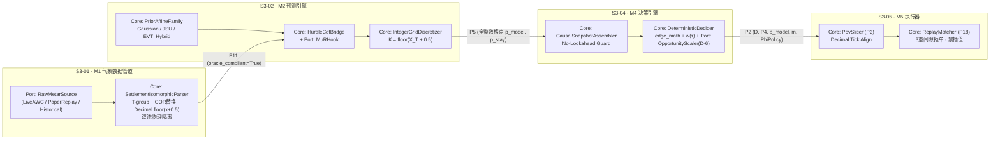

# P8-T8-ALGO4-DESIGN：`T8` 算法四单（`S3-01 / S3-02 / S3-04 / S3-05`）工程设计书（自检修订稿 `v0.2` · `2026-11-19`）

> **坐标声明**：`T8` 算法四单工程设计批（`2026-11-19` 当轮唯一主线批）；**本批贡献** = 对 `v0.1` 按“数学依据、零无据常数、零自说自话前提假设、上层一致、模块化高解耦”五条红线完成逐项自检修订，形成 `v0.2` 提交架构侧审核；**红线约束** = 设计期间**零触碰 `src/` 与 `F-2` 锁定区**、不启动被动录盘、不越权预填 `D-6` 或未标定运行阈值。  
> **表述纪律**：本文全部设计提案与参数接口均属 **`2026-11-19` 当前设计提案 / 首期选择（待架构侧审阅批准后于 `T8` 编码落地，月度复检可替换）**，不含绝对化承诺用语。

---

## §0 五项工程红线自检修正记录与模块化总图

### 0.1 对 `v0.1` 的逐条自检整改清单（诚实披露）

| 检查准则 | `v0.1` 检出缺陷 | `v0.2` 整改方案 |
| :--- | :--- | :--- |
| **1. 所有设计都有数学依据** | ① `§2.2` 对未开冷却钩子时曾臆测 `μ_R = μ_0 - m_now`；② `§2.3 #4` 对开放顶档 `p_stay = 1.0` 与物理原子概率 $\Phi(-\mu_R/\sigma_{\text{rem}})$ 关系表述含糊 | ① 废除臆测式，明确 `μ_R` 仅由架构批准之 `MuRHook`（[`SpecV2BaselineMuRHook`](../../src/prediction/dynamic_corrector.py#L133) 或后续标定钩子）注入，如实声明基线钩子含 $\Phi \le 0.5$ 上界及 `TMIN` `NotImplementedError` 现状；② 严格区分物理原子 $p_{\text{stay}}^{\text{phys}}$ 与 `P5 Q-B1 #4` 开放尾档“无法跨档逃逸 $\implies$ 仓位概率全落尾档 (`1.0`)”契约映射，并提交架构确认 |
| **2. 没有莫名其妙的常数参数** | `v0.1` 存在 6 处无依据手写常数：`0s`（`dispatch_ts` 缺失滞后）、`10^-12`（重放比对容差）、`round(..., 6)`、`{$5,$10,$25,$50}`、`[0.10, 0.85]`、`{250,500,1000}` / `500ms` / `30s` | **全部清零**：`dispatch_ts` 缺失改标不可用/禁止假设 `0s`；重放采用 JSON 最短往返表达下 **IEEE-754 位级精确相等（零人工容差）**；`tick_size` 改精确 `Decimal` 整数倍量化；`D` 网格严格由 `P4` 最小单与 `P6.b_budget_usd * w(τ)` 分位导出；`best_ask` 取全盘口 `(0,1)`；`max_match_frame_gap_sec` 绑定 `RecorderConfig`（`rest_fallback_interval_sec + heartbeat_timeout_sec`）；`latency_ms` 标明为外部实测注入配置（不编造 `500ms`） |
| **3. 无需要前提条件却自说自话的决定** | ① `§3.3` 默认假设 `s_base(edge)` 存在且 `GREEN → 1.0x` 直通；② `§1.2` 默认消费未标定 `freshness_ok` 阈值却未标其前置依赖 | ① 明确 `s(edge)` 中间曲线与 `P16 yellow_multiplier` 作用点均属 **`D-6` 前置条件**，在 `M4` 中抽象为注入式策略端口 `OpportunityScaler`（未获 `D-6` 成文前严禁硬编码常数）；② `M1` 双龄上限显式引用 [`P8-ALGO-DEF-SPEC §1.2`](P8-ALGO-DEF-SPEC_气象物理预测到投注端到端严谨数学模型规格书_20261108_v2.0.md#12-受控参数三分类法定字典) 标明 `待标定注入` |
| **4. 与上层设计文档保持一致** | `§2.3 #2` 在 `is_bridge_active=False` 时写成“纯先验连续高斯”，与 [`项目方案 v3.0 §3.4`](../项目方案和执行文档/项目方案%20(v3.0)：Polymarket%20温度市场量化投注系统.md#34-预测-结算分离架构方案-α2026-11-13-裁决) 先验三族 `F_family ∈ {Gaussian, JSU, EVT_Hybrid}` 冲突 | 修正为评估先验实际仿射族 CDF $F_Y(x) = F_{\text{family}}((x - \mu_0)/\sigma_{\text{adj}})$，仅当 `family=="Gaussian"` 时为高斯 |
| **5. 模块化、解耦** | 原稿按步骤流水叙述，端口与适配器边界、依赖倒置接口未显式正交化 | 在 §0.2 与 §1–§4 中将各模块拆为互不耦合的 **纯计算核（Core） + 只读协议端口（Ports）**，并给出完整依赖方向图 |

### 0.2 四单端到端依赖倒置与模块边界图

---

## §1 `S3-01` · `M1` 气象数据管道：结算同构流与抽象层设计

### 1.1 模块化港口设计（Port & Core 彻底分离）

1. **只读输入端口（`RawMetarSource` Protocol）**：
   - `fetch_window(station_id: str, start_utc: datetime, end_utc: datetime) -> tuple[RawMetarReport, ...]`
   - 三个独立适配器实现，共享同一解析核：
     - `LiveAwcMetarAdapter`：查询 `aviationweather.gov` 常规 `METAR`（并置全量留档采集器收集 `SPECI`）；
     - `PaperReplayMetarAdapter`：读取本地录盘/历史存档，按因果约束 **`dispatch_ts_utc <= as_of_ts_utc`** 切片过滤（若无 `dispatch_ts_utc` 则触发 §1.2 缺失处置，绝不猜测 `0s`）；
     - `HistoricalShadowMetarAdapter`：服务 `T8` 并入的 `2019` 最小形态影子验证，同样强制时间切片拦截未来报文。
   - **标准化只读值对象 `RawMetarReport`**：`station_id, obs_ts_utc, dispatch_ts_utc: Optional[datetime], report_type: Literal["METAR", "SPECI"], is_cor: bool, raw_text: str, source_channel: str`。
   - **WU 口径隔离边界（对齐 [`ADR-0012 §5`](../adr/ADR-0012：法定结算真值源（NWS%20WRH）、僵尸仓位双轨估值与舍入闭环裁决.md#5-2026-11-19-s1-06--g-15-修订节--世界事实变更跟随当前决策)）**：Weather Underground 仅作为 **`M9` 闭市终结对账（次日 `11:59 PM ET` 前 AWC 全天无常规报）的结算三级回退**，**严禁进入 `M1` 日内喂桥流 `m_now`**。

### 1.2 结算同构纯计算核与双流规则（落实 `T8 M1` 五项输入）

1. **温度提取与正无穷半度精确舍入**：
   - 提取优先级：`8` 位 `T`-group 组 `T([01])(\d{3})([01])(\d{3})`（$0.1^\circ\text{C}$）优先 $\to$ 缺失则回退报文体整度 `TT/TD`（`(M?\d{2})/(M?\d{2})`）；
   - **十进制零浮点偏移舍入（math basis）**：因 `°C → °F` 换算含分母 $5$（$T_F = \frac{9}{5}T_C + 32$），在 IEEE-754 二进制浮点下 $0.1 \times 9/5$ 不可精确表示，故先在 `Decimal` 精确十进制域运算 $d_F = d_C \times \text{Decimal}("9") / \text{Decimal}("5") + \text{Decimal}("32")$，再执行严格**向 $+\infty$ 半度进位**：
     $$\text{settle\_int}(d_F) := \lfloor d_F + \text{Decimal}("0.5") \rfloor \in \mathbb{Z}$$
     直接采用 `Decimal` 向 $-\infty$ 取整（`ROUND_FLOOR`）作用于 `d_F + Decimal("0.5")`。数学性质：对 `-8.5°F` 得 `floor(-8.0) = -8`；对 `68.5°F` 得 `floor(69.0) = 69`，彻底杜绝 `ROUND_HALF_UP` 负温错向与二进制浮点舍入偏移。
2. **`COR` 替换规则与因果缺失处理（杜绝“缺时间戳假定 `0s`”）**：
   - 在含 DST 自然日窗口 `[target_date 00:00:00 ZoneInfo(tz), min(as_of_ts_utc, T_settle_close_utc)]` 内，所有已入站常规 `METAR` 按 `(station_id, obs_ts_utc)` 建字典；同 `obs_ts_utc` 后到的 `COR`（`dispatch_ts_utc <= as_of_ts_utc`）**覆写**旧值。
   - **派发时间戳 `dispatch_ts_utc` 缺失规约（拒绝自拟 `0s`）**：在 `Live` 获取层，采集时刻即已知 `dispatch_ts_utc`；若历史/回放源记录中 `dispatch_ts_utc is None`，**严禁擅自赋零滞后（`0s`）**——标 `dispatch_age_available = False` 入 **`P12`**，是否允许按“已实测报文派发滞后高分位保守延迟”过滤抑或直接拒用该历史切片，列 §5 交由架构侧拍板。
   - **双龄期监控参数位置**：`physical_age_limit` 与 `dispatch_age_limit` 严格作为注入配置读取（不硬编码），未标定前沿用 [`P8-ALGO-DEF-SPEC §1.2`](P8-ALGO-DEF-SPEC_气象物理预测到投注端到端严谨数学模型规格书_20261108_v2.0.md#12-受控参数三分类法定字典) 之保守占位与超龄拦截，实测标定后人工更新配置。
3. **双流严格隔离与逐帧验收**：
   - **喂桥流（`oracle_compliant = True`）**：仅纳入 `report_type == "METAR"`（剔除一切 `SPECI`），计算 $m_{\text{now}}^{\text{exact}}(t) = \max_{o \in \mathcal{O}_{\text{settle}}(D,t)} T_F(o)$ 与 $m_{\text{now}}^{\text{int}}(t) = \lfloor m_{\text{now}}^{\text{exact}}(t) + 0.5 \rfloor$；若窗口内尚无合规常规 `METAR`，置 `m_now_exact_f = None, m_now_int_f = None`（由 `M2` 走 `Q-B2` 纯先验降级）。
   - **全量留档流（`P12 CoverageLedgerLog`）**：独立统计全部 `METAR + SPECI` 报文数量、`specis_seen_count`、双龄期及缺口标，严禁反向污染 `m_now`。
   - **逐帧同构验真式**：对假盘任意扫描帧 $t_i$，用 `M9` 官方结算归并函数作用在同因果前缀 $\mathcal{O}_{\text{settle}}(D, t_i)$ 上得 $T_{\text{settle}}^{(t_i)}$，强制成立 $\text{P11}(t_i).m_{\text{now}}^{\text{int}} \equiv T_{\text{settle}}^{(t_i)} \le T_{\text{settle}}(D)$。

---

## §2 `S3-02` · `M2` 预测引擎：点质量定义、转移核一致性与整数刻度

### 2.1 四模块拆分（先验仿射 × 核钩子 × 删失桥 × 整数离散器）

1. **`PriorAffineFamilyModel`（纯函数先验侧 · 对齐 [`项目方案 v3.0 §3.4`](../项目方案和执行文档/项目方案%20(v3.0)：Polymarket%20温度市场量化投注系统.md#34-预测-结算分离架构方案-α2026-11-13-裁决)）**：
   - 当 `is_bridge_active == False`（开盘前 / 观测断流 / 预热纯先验 `Q-B2`）时，严格使用模型资产自身的仿射族分布评估连续 CDF：
     $$Y = \mu_0 + \sigma_{\text{adj}} \cdot Z, \qquad Z \sim F_{\text{family}} \implies F_Y(x) = F_{\text{family}}\!\left(\frac{x - \mu_0}{\sigma_{\text{adj}}}\right)$$
     支持 `Gaussian` / `JSU` / `EVT_Hybrid` 三族（不再错称为“纯先验高斯”），严格输出 `p_stay = None` 且禁止对任何档位清零。
2. **`RemainingKernelHook`（注入式 `MuRHook` + `SigmaRemSchedule`）**：
   - 剩余标准差严格采用全方差分解与仪表物理精度底公式（[`P8-ALGO-DEF-SPEC v2.0 L206`](P8-ALGO-DEF-SPEC_气象物理预测到投注端到端严谨数学模型规格书_20261108_v2.0.md#L206)）：
     $$\sigma_{\text{rem}}(t) = \max\!\left(\sigma_0 \cdot \sqrt{\eta_s(t)},\; \sigma_{\text{inst}}\right), \qquad \sigma_{\text{inst}} = 0.9^\circ\text{F}\; (\text{ASOS 1088 PRT 法定精度红线})$$
     其中 $\sigma_0 = \sigma_{\text{final}} = \sigma_{\text{eff}} \cdot \sigma_{\text{adj}}$，标定比例 $\eta_s(t) \in [0, 1]$ 读取自 [`p8_inspection_a_eta_s_calibration_20261113.json`](../../evidence/p8_inspection_a_eta_s_calibration_20261113.json)。
   - **均值漂移 $\mu_R$ 严禁设计侧自创公式**：完全经既有 [`MuRHook`](../../src/prediction/dynamic_corrector.py#L116) 接口注入。按代码现状：
     - `TMAX` 默认 [`SpecV2BaselineMuRHook`](../../src/prediction/dynamic_corrector.py#L133) 给出 $\mu_R = \rho(t)\max(0, \mu_0 - m_{\text{now}}) \ge 0$（注意受此非负性约束，该基线钩子数学上满足 $p_{\text{stay}} = \Phi(-\mu_R/\sigma_{\text{rem}}) \le 0.500$，架构若在 `T8` 替换 `β-1` 或修订核钩子只需实现同一 `MuRHook` Protocol 即可零改动插拔）；
     - `TMIN` 若注入 `SpecV2BaselineMuRHook`，忠实代码现状抛 `NotImplementedError`（留待 W3 有符号镜像钩子标定后解锁）。

### 2.2 $p_{\text{stay}}$ 数学定义与转移核一致性（Hurdle / Max-Identity Kernel）

当 `is_bridge_active == True`（且上游 `P11.oracle_compliant == True` 与 `m_now_exact_f is not None`）时，由剩余增量随机变量 $R_t \mid \mathcal{F}_t \sim \mathcal{N}(\mu_R, \sigma_{\text{rem}}^2)$（`P8-ALGO-DEF-SPEC v2.0 L201` 取法 C 高斯剩余核）及物理不可逆恒等式（`TMAX`）：
$$X_T = \max\!\big(m_{\text{now}},\; m_{\text{now}} + R_t\big) = m_{\text{now}} + \max(0, R_t)$$
唯一诱导如下可测分布（无任意参数、无强行归一化）：

1. **物理不创新高点质量（$p_{\text{stay}}^{\text{phys}}$）**：$X_T = m_{\text{now}}$ 当且仅当剩余增量 $R_t \le 0$，故严格定义为：
   $$p_{\text{stay}}^{\text{phys}}(t) := \mathbb{P}(R_t \le 0 \mid \mathcal{F}_t) = \Phi\!\left(\frac{-\mu_R(t, m_{\text{now}}, x_t)}{\sigma_{\text{rem}}(t)}\right)$$
2. **超越分支条件密度（$x > m_{\text{now}}$）**：事件 $\{R_t > 0\}$ 发生概率为 $1 - p_{\text{stay}}^{\text{phys}}(t)$，给定超越的条件 CDF 为截断右尾：
   $$\mathbb{P}(X_T \le x \mid R_t > 0) = \frac{\Phi(z(x)) - \Phi(z(m_{\text{now}}))}{1 - \Phi(z(m_{\text{now}}))}, \qquad z(x) := \frac{x - m_{\text{now}} - \mu_R}{\sigma_{\text{rem}}}$$
3. **两分支全概率合成 CDF 与核等价性定理**：
   $$F_{\text{post}}(x) = \mathbb{P}(X_T \le x \mid \mathcal{F}_t) = \begin{cases} 0, & x < m_{\text{now}} \\ p_{\text{stay}}^{\text{phys}}(t) + \big(1 - p_{\text{stay}}^{\text{phys}}(t)\big)\,\mathbb{P}(X_T \le x \mid R_t > 0) \equiv \Phi\!\big(z(x)\big), & x \ge m_{\text{now}} \end{cases}$$
   **数学一致性证明**：
   - 在 $x = m_{\text{now}}$ 处左极限 $F_{\text{post}}(m_{\text{now}}^-) = 0$，右连续函数值 $F_{\text{post}}(m_{\text{now}}) = \Phi(z(m_{\text{now}})) = p_{\text{stay}}^{\text{phys}}(t)$，恰好在单点 $\{m_{\text{now}}\}$ 产生质量 $p_{\text{stay}}^{\text{phys}}(t)$ 之 Dirac 原子；
   - 在 $(m_{\text{now}}, +\infty)$ 上导数 $F'_{\text{post}}(x) = \frac{1}{\sigma_{\text{rem}}}\phi(z(x))$ 与 $(1 - p_{\text{stay}}^{\text{phys}}) f_{>}(x)$ 处处一致，积分 $p_{\text{stay}}^{\text{phys}} + \int_{m_{\text{now}}^+}^{+\infty} F'_{\text{post}}(x)\,dx = 1$ 恒成立，**原子分支与超越分支 100% 同源于同一转移核 $R_t$**；
   - `TMIN` 对偶（当且仅当传入已标定 `TMIN` `MuRHook` 时启用）：$X_T = \min(m_{\text{now}}, m_{\text{now}} + R_t)$，$p_{\text{stay}}^{\text{min,phys}} = \mathbb{P}(R_t \ge 0) = 1 - \Phi(-\mu_R/\sigma_{\text{rem}})$，左连续/右连续测度对称。

### 2.3 整数结算格点离散化与 `P5` 四条硬不变量满足性证明

1. **废弃 `.5°F` 边界，统一整数结算原像划分**：
   - 官方结算标的为整数 $K = \lfloor X_T + 0.5 \rfloor \in \mathbb{Z}$。任意整数 $k \in \mathbb{Z}$ 之连续实轴等价区间（原像）为左闭右开区间 $I(k) = [k - 0.5,\; k + 0.5)$（在全部实数包括负温如 $-8.5^\circ\text{F} \in [-8.5, -7.5) = I(-8)$ 上互斥完备）。
   - `BinSpec` 仅接受整数端点 `[lower_int_f: Optional[int], upper_int_f: Optional[int]]`（`.5°F` 边界输入直接拒绝报错），对应实轴原像半开区间 $[a_b, c_b)$：下尾 `(-inf, U_0 + 0.5)`、内档 `[L_b - 0.5, U_b + 0.5)`、上尾 `[L_{M-1} - 0.5, +inf)`。
   - **精确原子敏感区间求值**：对所有档位统一使用右连续 CDF 的左极限差分：
     $$p_{\text{model}, b} = F(c_b^-) - F(a_b^-)$$
     当 `m_now` 恰好落在半整点如 `-8.5°F` 或 `68.5°F`（即等于该整数档下确界 $a_j$）时，因为 $a_j^- < m_{\text{now}} \implies F_{\text{post}}(a_j^-) = 0$，**点质量原子 100% 精准归入 $m_{\text{now}}^{\text{int}} = \lfloor m_{\text{now}} + 0.5 \rfloor$ 所在档位 $j$**，零溢出至已死相邻档。
2. **`P5` 四条硬不变量逐条验证（及开放尾档契约显式映射）**：
   - **① 单纯形完备**：$\{ [a_b, c_b) \}_{b=0}^{M-1}$ 为 $\mathbb{R}$ 无重叠全分割 $\implies \sum_{b=0}^{M-1} p_{\text{model}, b} = F(+\infty) - F(-\infty) = 1.0$；
   - **② `p_stay` 域**：`is_bridge_active=False` 时 `p_stay = None`；激活时 $\in [0, 1]$；
   - **③ 死档强清零**：设 $m_{\text{now}}^{\text{int}} = \lfloor m_{\text{now}} + 0.5 \rfloor$。`TMAX` 下凡 `upper_int_f < m_now_int` 之档，有 $c_b = U_b + 0.5 \le m_{\text{now}}^{\text{int}} - 0.5 \le m_{\text{now}}$，从而 $F_{\text{post}}(c_b^-) = 0 \implies$ **`p_model == 0.0`**；
   - **④ 点质量包含律**：包含 $m_{\text{now}}^{\text{int}}$ 之边界档 $j$ 满足 $a_j \le m_{\text{now}} < c_j$，故 $F_{\text{post}}(a_j^-) = 0$ 且 $p_{\text{model}, j} = F_{\text{post}}(c_j^-) \ge F_{\text{post}}(m_{\text{now}}) = p_{\text{stay}}^{\text{phys}}$。
   - **开放极值尾档契约一致性注记（提请架构确认 §5 B）**：若 $m_{\text{now}}^{\text{int}}$ 已进入开放顶档 $j = M-1$（$c_{M-1} = +\infty$），则 $p_{\text{model}, M-1} = 1.0$（全部剩余概率均留在本档，无法跨档离开）。注意现行 [`P8-T4-M4M5-INTERFACE §3.3`](P8-T4-M4M5-INTERFACE_决策与执行接口规格_v1.0.md#L150) 要求“开放顶档必有 `p_stay == 1.0` 且 `p_model == 1.0`”——此处 `p_stay == 1.0` 在语义上属于“**档内留存概率 = 1.0**（不同于物理无新高概率 $p_{\text{stay}}^{\text{phys}} \le 1$）”，本设计严格按现有 `P5` 不变量在顶档置 `p_stay = 1.0`，同时在 `P5` 可选附加观测字段或架构审阅中标明是否另保留未截顶物理值 `p_stay_phys`。

---

## §3 `S3-04` · `M4` 决策引擎：双钟因果扫描、门槛链路与确定性重放设计

### 3.1 模块拆解与无前置自拟边界

`M4` 拆分为互不依赖外网/数据库的正交三组件：
1. **`CausalSnapshotAssembler`（严格因果前缀拼装器 · 禁未来函数）**：
   - 给定任意扫描触发事件 $e = (\text{scan\_ts\_utc},\; \text{scan\_clock},\; \text{station\_id},\; \text{target\_date},\; \text{bin\_id})$：
     - `P5`: $\arg\max \{\text{issue\_ts\_utc} \le t_{\text{scan}}\}$（若桥激活须 `oracle_compliant==True`）；
     - `P4`: $\arg\max \{\text{recv\_ts\_utc} \le t_{\text{scan}}\}$（要求配置级盘口新鲜度检查 $t_{\text{scan}} - \text{recv\_ts\_utc} \le \text{max\_book\_age\_sec}$）；
     - `P6`: $\arg\max \{\text{signed\_at\_utc} \le t_{\text{scan}}\}$（保留 `is_overdue`，遵循 `B6`）；
     - `P7 / P16`: 由 `event_ts_utc <= t_scan` 因果前缀聚合之实时持仓额度状态及最新已送达 `P16` 指令。
   - **硬熔断断言**：上述任意对象时间戳若 $> t_{\text{scan}}$，直接抛 `CausalViolationError`。
2. **`OpportunityScaler`（`s(edge)` 与 `P16` 消费策略端口 · 不越权自拟 `D-6`）**：
   - `best_ask_edge < m_threshold` 时数学铁律 $s = 0.0$（门关闭）；
   - `best_ask_edge >= m_threshold` 时的 $s(\text{edge}) \in (0, 1]$ 函数形态及 `P16` `yellow_multiplier` 精确作用点均属 **[`P8-KERNEL-CONSENSUS §六 G`](P8-KERNEL-CONSENSUS_内核讨论定稿_v1.0_20261116.md#g下一桌-d-6-制度合龙议程登记只登记不开桌--2026-11-17) 与 [`P8-T4-M4M5-INTERFACE §1.1`](P8-T4-M4M5-INTERFACE_决策与执行接口规格_v1.0.md#L18) 明确留归 `D-6` 之未决前置条款**——本设计严禁擅自编造未批准公式，将 `OpportunityScaler` 设计为可注入 Protocol，未收 `D-6` 成文前不得擅自填入实盘计算假设。
3. **`DeterministicDecider`（无副作用纯决策核心）**：
   - 全序事件键：`(scan_ts_utc, clock_rank[INFO_CLOCK=0, PRICE_CLOCK=1], station_id, target_date, bin_id)`；
   - 计算链严格按上层规格执行（`compute_w_tau` $\to$ `D3` 跨盘倒挂拦截 $\to$ `edge_math.evaluate_book_edges(..., fee_rate=P4.fee_rate)` $\to$ `m_threshold` 判定 $\to$ `s_edge` $\to$ `g_cap_usd = b_budget_usd * w_tau * s_edge` $\to$ `P7` `headroom_d = max(0.0, min(g_cap_usd - held_usd, b_eff_headroom_usd))` $\to$ 最小单检查 $\to$ `P1` 五枚举全量落盘 + `ORDERED` 下发 `P2`）。

### 3.2 扫描日志位级确定性重放验证（零人工容差）

- **消除全部非确定性来源**：纯决策函数禁用 `datetime.now()`、随机数及可变全局变量；`decision_id`（与幂等键）按 `UUIDv5(NAMESPACE, f"{session_id}|{scan_ts_utc.isoformat()}|{scan_clock}|{station_id}|{target_date}|{bin_id}")` 确定性生成。
- **逐字段位级重放等价**：Python `json` 采用标准 IEEE-754 最短精确往返表达，重放引擎读取 `P1` 扫描事件序列与对应只读历史输入流重跑 `DeterministicDecider`，断言全部输出枚举（`decision_id`, `decision_outcome`）及全部标量（`best_ask_price`, `best_ask_edge`, `m_threshold`, `tau_hours`, `w_tau`, `s_edge`, `g_cap_usd`, `held_usd`, `headroom_d`, `target_slice_usd`）**逐字段 `==` 精确相等**。

---

## §4 `S3-05` · `M5` 执行器：`φ` 延迟撮合、保守间隙拒单与 `B5` 滑点实测流程

### 4.1 `φ` 切片规划纯函数与精确 `tick` 对齐

1. `PovSlicer.plan_slice(d_headroom_usd, ask_book_frame, p_model, m_threshold, phi_policy)`（`w` 不进 `M5`）：
   - 调用 [`edge_math.evaluate_book_edges`](../../src/pricing/edge_math.py#L90) 计算全部 `edge_j >= m_threshold` 合格档；
   - 按 `phi_policy` 计算逐档参与率 $\rho_j = \text{clip}(\rho_0 + k_{\text{slope}}(\text{edge}_j - m_{\text{threshold}}),\; \rho_{\min},\; \rho_{\max})$，累加 `pov_cap_usd`；
   - `target_usd = min(d_headroom_usd, pov_cap_usd)`；定位覆盖 `target_usd` 之保护限价 `raw_limit`，使用 **`Decimal` 整数倍向下对齐** `(Decimal(str(raw_limit)) // Decimal(str(tick_size))) * Decimal(str(tick_size))`（精确对齐任意 `0.01 / 0.001` 动态 tick，无硬编码小数位数），再计算 `target_shares = floor(target_usd / limit_price * 100) / 100`（对齐 `P8-T4-M4M5-INTERFACE §2.2` 二位小数）并核验 `min_order_size_shares`（`5.0`）与 `min_notional_usd`。

### 4.2 `P18` 保守延迟撮合器（零插值造帧、逐帧可复算）

纯函数 `replay_match_attempt(slice_plan, decision_seq_id, decision_ts_utc, submit_ts_utc, latency_ms, max_silent_gap_sec, p13_token_stream)`，全链路零 I/O、零随机性：

1. **延迟到达目标点**：$t_{\text{arrive}} = \text{submit\_ts\_utc} + \Delta t_{\text{latency\_ms}}$，其中 `latency_ms` 为外部实测/配置注入参数（未实测前不编造假常数）。
2. **静默超时上界来源（绑定 `RecorderConfig`）**：`max_silent_gap_sec` 不独立乱设数字，直接由 `P13` 采集会话元数据派生自 [`RecorderConfig`](../../configs/passive_book_recorder.example.yaml#L19-L20)（即 `heartbeat_timeout_sec + rest_fallback_interval_sec`，正常录盘不断流必然在此间隔内至少产出 1 帧）。
3. **三重保守间隙守卫（严格禁插值、禁 forward-fill、禁回退零延迟）**：
   - **R1（尾流无帧拒单）**：不存在 `recv_ts_utc >= t_arrive` 的 `P13` 帧 $\implies$ `PAPER_MATCH_ABORTED_GAP`；
   - 取首个满足 `recv_ts_utc >= t_arrive` 之帧 $F^*$；
   - **R2（跨窗口断流拒单）**：若闭区间 `(decision_seq_id, F*.seq_id]` 内**任一帧**存在 `gap_detected == True`，**一律判不成交** $\implies$ `PAPER_MATCH_ABORTED_GAP`；
   - **R3（静默超限拒单）**：若 `F*.payload.recv_ts_utc - t_arrive > max_silent_gap_sec` $\implies$ 一律判不成交 `PAPER_MATCH_ABORTED_GAP`；
   - 所有 `PAPER_MATCH_ABORTED_GAP` 必须置 `filled_shares = 0.0`、`filled_usd = 0.0`、`fee_paid_usd = 0.0` 并经 `P14` 全额解冻预冻结现金。
4. **帧内精确扫单与点费结算（`S1-06` 同构）**：
   - 通过间隙守卫且 $F^*$ 无跨盘倒挂时，沿 $F^*.\text{asks}$ 满足 `lvl_price <= SlicePlan.limit_price` 的档位顺次扣减 `remaining_shares`，严格用 **`F*.payload.fee_rate`** 逐档算费 `fee_i = fill_i * lvl_price * fee_rate * (1 - lvl_price)`，得出 `filled_shares`、`actual_avg_fill_price`、`fee_paid_usd`、`fill_rate` 与相对滑点 **`slippage_vs_best_ask = (actual_avg_fill_price - decision_best_ask) / decision_best_ask`**（对齐 `B5 / N3`），写出 `P3 ExecutionAttemptLog`。相同输入 100% 逐帧可复算。

### 4.3 `B5` 口径 `friction_median` 实测流程（无硬编码网格，全部从上游导出）

待 `S2-01` 产出 **`2026-11-20T23:59Z` 降费后 `0.01` 时代 `P13` 录盘流**后，离线校准器与 §4.2 共用同一 `replay_match_attempt(...)` 纯函数：

1. **样本纯化**：严格过滤仅取 `P4.fee_rate == 0.01` 时代录盘帧，严禁混用 `0.05` 时代（[`P8-FACTS-LEDGER v0.3 §2.1`](P8-FACTS-LEDGER_静态事实档案_v0.1.md#21-2026-11-19-s1-06-变费复核与-费率时代标记规则)）；
2. **参数化走簿域（零人工编造数值列表）**：
   - 切片金额域严格跨越 `[min_viable_usd, P6.w_policy.b_budget_usd]` 按 `w(τ)`（自 `w_0` 至 `1.0`）等分位导出；
   - 价位与盘口全覆盖所有满足 `best_ask_edge >= m_threshold` 的真实可执行合约档（`0 < best_ask < 1`）；
   - `latency_ms` 由调用方注入真实网关/客户端 RTT 实测样本分位数组；
3. **口径严格对齐 `B5`**：仅保留成功成交样本（`FILLED / PARTIAL`，剔除 `PAPER_MATCH_ABORTED_GAP` 与 `CANCELLED_UNFILLED` 并单独汇报拒绝率），计算 `friction_median = median(slippage_vs_best_ask)`（不含 extra spread，与 `edge_math.edge` 同属无量纲相对收益率尺度），形成人工签发报告回填 `P6`。

---

## §5 需架构侧与前置议程共同确认的依赖接口清单

本设计严守“不擅自代替前置条件做决定”原则，下列 5 项接口依赖均已隔离在独立 Port/Config 边界之外，提请审核一并明确：

| 序号 | 所属单号 | 依赖/待确认项 | 为何不能由设计阶段自定 | 当前设计应对（隔离保护） |
| :---: | :---: | :--- | :--- | :--- |
| 1 | `S3-01` | 历史/回放 `RawMetarReport` 缺失 `dispatch_ts_utc` 时之因果兜底方式 | 零滞后 (`0s`) 假定违背真实派发时延物理事实；实测滞后分布需按源测量 | 接口显式区分 `dispatch_age_available`，默认不假设 `0s`；请架构裁定“拒用无派发戳历史报 vs 按实测滞后上界推算” |
| 2 | `S3-01` | `P12` `physical_age_limit(hourly_METAR)` 与 `dispatch_age_limit` | [`P8-ALGO-DEF-SPEC §1.2`](P8-ALGO-DEF-SPEC_气象物理预测到投注端到端严谨数学模型规格书_20261108_v2.0.md#12-受控参数三分类法定字典) 明确标注为 **`待标定`** | 抽离为 `FreshnessPolicy` 配置输入，不写入硬编码数字 |
| 3 | `S3-02` | `P5 BinSpec/BinProb` 整数端点字段修改 + 开放尾档 `p_stay == 1.0` 语义 | 涉及 [`P5` 正文](P8-T4-M4M5-INTERFACE_决策与执行接口规格_v1.0.md#L140) 与 `§8.3` 协议联动；且开放尾档内物理仍存在超越 $m_{\text{now}}$ 的可能 | 设计层保留 $p_{\text{stay}}^{\text{phys}}$ 推导与 `P5` `Q-B1 #4` 尾档 `1.0` 映射之二层区分，编码时按 `§8.3` 联动 `P5` 升版 |
| 4 | `S3-04` | `s(edge)` 在 `edge >= m` 区间的形状及 `P16 yellow_multiplier` 作用点 | [`P8-KERNEL-CONSENSUS §六 G`](P8-KERNEL-CONSENSUS_内核讨论定稿_v1.0_20261116.md#g下一桌-d-6-制度合龙议程登记只登记不开桌--2026-11-17) 明确属 **`D-6` 下一桌议程** | 抽象为 `OpportunityScaler` Strategy Port，设计阶段不预填未获批准曲线与系数 |
| 5 | `S3-05` | 假盘注入延迟 `latency_ms` 初始分位配置 | 需对应真实 CLOB 网关下单往返时延实测或显式假盘会话预设 | 设计为会话注入参数并落盘于 `P3.latency_injected_ms`，不在核心撮合器内写死常数 |
