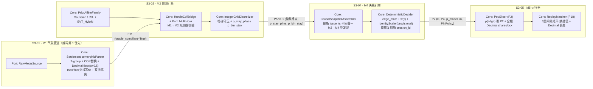

# P8-T8-ALGO4-DESIGN：`T8` 算法四单（`S3-01 / S3-02 / S3-04 / S3-05`）工程设计书（`v0.3` 复核定案版 · `2026-11-19`）

> **坐标声明**：`T8` 算法四单工程设计批（`2026-11-19` 增量复核版）；**本批贡献** = 依据 `v0.2` 审阅意见与《`fee` 定案补充令（`2026-11-19`）》完成全部 7 项要点升级，形成 `v0.3` 供架构侧增量复核（复核通过后方转“编码中”，且 `M1` 为编码批第一优先）；**红线约束** = 复核通过前**零编码、零改动 `src/`（含 `F-2` 锁定区 `src/pricing/`）、不启动录盘、不预判 `D-6`**。  
> **表述纪律**：本文全部设计方案与参数接口均属 **`2026-11-19` 当前决策 / 首期选择（月度复检可替换；数据充分时形态让位于数据）**，不含绝对化承诺用语。

---

## §0 `v0.3` 核心定案总览（对标 `2026-11-19` 修订令与 `fee` 定案补充）

1. **`fee` 公式定案（选项 A · 官方原文核验通过，零缺陷登记）**：
   - **Polymarket 官方文档逐字引证**：
     - [`docs.polymarket.com/trading/fees.md`](https://docs.polymarket.com/trading/fees.md) 原文：`fee = C × feeRate × p × (1 - p)`（*`Where C = number of shares traded and p = price of the shares`*）；同页 `Weather` 类别（`feeRate = 0.05`，`100 Shares`）官方数值表：`$0.10 → $0.45`、`$0.25 → $0.94`、`$0.50 → $1.25`，数学上精确等于 $C \cdot \text{feeRate} \cdot p(1-p)$；
     - [`docs.polymarket.com/programs/fee-and-rebate-changes-november-2026.md`](https://docs.polymarket.com/programs/fee-and-rebate-changes-november-2026.md)（`2026-11-20T23:59Z` 降费公告）原文：*`Taker fees will continue to use the same formula: fee = shares × feeRate × price × (1 − price)`*（`Weather Fee Coefficient = 0.01`）。
   - **只读回核 [`edge_math.py#L65`](../../src/pricing/edge_math.py#L65) 与 [`penetration_probe.py#L168`](../../src/pricing/penetration_probe.py#L168)**：现役代码均实现 `q_eff = p * (1.0 + fee_rate * (1.0 - p))`，与官方 `fees.md` 完全一致、零缺陷（“修正 B / 恒低估”论断已由架构令正式作废）；链上 `CalculatorHelper.sol` `min(p, 1-p)` 系 `base_fee=1000` 签名上限澄清与 `py-clob-client #326` 佐证已并入 [`P8-FACTS-LEDGER v0.4 §2.1`](P8-FACTS-LEDGER_静态事实档案_v0.1.md#21-2026-11-19-s1-06-变费复核与-费率时代标记规则)。
2. **`P5 v1.1` 联动升版（禁用单字段双语义）**：同步升版 [`P8-T4-M4M5-INTERFACE §3.3`](P8-T4-M4M5-INTERFACE_决策与执行接口规格_v1.0.md#33-p5-forecastdistributionsnapshot-v11m2--m4--m7--2026-11-19-s3-02--t8-v03-联动升版)、[`项目方案 v3.0 §8.2`](../项目方案和执行文档/项目方案%20(v3.0)：Polymarket%20温度市场量化投注系统.md#82-协议清单p1p19-十九条--2026-11-18-当前决策) 与 [`P8-T2-M7-LOGGING §2.3 P17`](P8-T2-M7-LOGGING_日志与审计协议规格_v1.0.md#23-p17-forecastsnapshotlogm2--m7)（整数闭区间端点 + `p_stay_phys` / `p_bin_stay` 双字段拆分）。
3. **四单模块正交拆分（Core × Port 依赖倒置）**：

---

## §1 `S3-01` · `M1` 气象数据管道：结算同构流与抽象层设计（编码第 1 优先）

### 1.1 只读输入端口与源隔离边界

1. **`RawMetarSource` Protocol**：`fetch_window(station_id: str, start_utc: datetime, end_utc: datetime) -> tuple[RawMetarReport, ...]`。
   - `LiveAwcMetarAdapter`：采集 `aviationweather.gov` 常规 `METAR`（并置全量采集收集 `SPECI`）；
   - `PaperReplayMetarAdapter`：读取录盘/存档报文，强制因果拦截 **`dispatch_ts_utc <= as_of_ts_utc`**（若历史报文缺失 `dispatch_ts_utc`，**严禁擅自假设 `0s` 滞后**，详见 §5 定案 #1）；
   - `HistoricalShadowMetarAdapter`：服务 `T8` 并入的 `2019` 最小形态影子验证，同样强制防未来切片。
   - **WU 隔离铁律**：Weather Underground 仅保留用于 `M9` 闭市后全天无常规报之三级结算回退（[`ADR-0012 §5`](../adr/ADR-0012：法定结算真值源（NWS%20WRH）、僵尸仓位双轨估值与舍入闭环裁决.md#5-2026-11-19-s1-06--g-15-修订节--世界事实变更跟随当前决策)），**严禁进入 `M1` 日内喂桥 `m_now`**。

### 1.2 结算同构解析核、`max / floor` 交换序性质与双流隔离

1. **`T`-group 优先与精确 `Decimal` 正无穷半度舍入**：
   - 8 位 `T`-group 组（`0.1°C`）优先，缺失回退报文体 `TT/TD`（整度 `°C`）；在精确 `Decimal` 域换算 $d_F = d_C \times 9 / 5 + 32$，执行 `int((d_F + Decimal("0.5")).to_integral_value(rounding=ROUND_FLOOR))`（`-8.5°F → -8°F`，`68.5°F → 69°F`）。
2. **`max` / `floor` 交换序数学注记（小项 ④）**：
   - 因取整算子 $g(x) := \lfloor x + 0.5 \rfloor$ 在 $\mathbb{R}$ 上单调非递减（$x_1 \le x_2 \implies g(x_1) \le g(x_2)$），对任意非空有限观测温度集合 $\{T_1, \dots, T_n\}$，最大元与 `floor(x + 0.5)` **恒可交换**：
     $$\left\lfloor \max_{1 \le i \le n} T_i + 0.5 \right\rfloor \equiv \max_{1 \le i \le n} \left\lfloor T_i + 0.5 \right\rfloor$$
   - **工程应用**：`M1` 在内部累计未舍入极值 $m_{\text{now}}^{\text{exact}}(t) = \max_{o \in \mathcal{O}_{\text{settle}}(D,t)} T_F(o)$ 以保留 `0.1°C` 精度供 `M2` 原子桥定位，同时派生导出结算整数 $m_{\text{now}}^{\text{int}}(t) = \lfloor m_{\text{now}}^{\text{exact}}(t) + 0.5 \rfloor$；由交换律保证先取极大再进位与先逐条进位再取极大在整数结算刻度上 100% 恒等（仅须注意同时间戳 `COR` 先覆盖替换原值再入 `max`，绝不跨作废报文取最大）。
3. **双流隔离与 `M1→M2` 观测龄监控**：
   - **喂桥流（`oracle_compliant = True`）**：仅纳入常规 `METAR`（完全剔除 `SPECI`），依站点 `ZoneInfo` 当地含 DST 日历窗口推进；尚无常规报时置 `m_now_exact_f = None, m_now_int_f = None`。
   - **全量留档流（`P12 CoverageLedgerLog`）**：同步记录 `METAR + SPECI`、`specis_seen_count`、缺口及观测双龄（`physical_age_sec`、`dispatch_age_sec`、`dispatch_age_available`），配置级阈值 `physical_age_limit` / `dispatch_age_limit` 均携带 `provenance`（待标定前采用保守配置并记入 §5 #2）。
   - **逐帧验收**：对假盘前缀 $\mathcal{O}_{\text{settle}}(D, t_i)$，与 `M9` 结算归并器比对恒有 $\text{P11}(t_i).m_{\text{now}}^{\text{int}} \equiv T_{\text{settle}}^{(t_i)} \le T_{\text{settle}}(D)$。
   - **`2026-11-21` `M1 (S3-01)` 验收闭环与尾项登记**：`S3-01` 已完成模块编码与自检补丁并回签转 `DONE`（`64339fd` + `6094dd1`）；尾项 **「`LiveAwcMetarAdapter` 真实端点连通冒烟」** 挂入 `T8` 影子验证（`S3-03`）前置，不回开 `S3-01` 编码态、不阻塞 `M2`。

---

## §2 `S3-02` · `M2` 预测引擎：点质量双字段拆分、档梯守卫与 `P5 v1.1`

### 2.1 先验三族、核注入与 `M1→M2` 观测龄把关

1. **`PriorAffineFamilyModel`**：当 `is_bridge_active == False` 时，严格消费模型自身 `family ∈ {Gaussian, JSU, EVT_Hybrid}` 计算仿射变换 $Y = \mu_0 + \sigma_{\text{adj}} Z$ 之连续 CDF $F_Y(x) = F_{\text{family}}((x - \mu_0)/\sigma_{\text{adj}})$，置 `p_stay_phys = None, p_bin_stay = None`，禁止死档清零。
2. **`M1 → M2` 观测龄职责段（双龄分工第一段）**：`M2` 在构建 `P5` 前显式检查 `P11` 观测新鲜度（`physical_age_sec <= physical_age_limit` 且当可用时 `dispatch_age_sec <= dispatch_age_limit`）与 `oracle_compliant == True`，写入 `P5.upstream_obs_fresh`；一旦观测超龄或 `not oracle_compliant`，`M2` 自动置 `is_bridge_active = False` 退回先验分布（不向 `M4` 流出带毒截断分布）。
3. **`RemainingKernelHook`**：$\sigma_{\text{rem}}(t) = \max(\sigma_0 \sqrt{\eta_s(t)},\; 0.9^\circ\text{F})$（[`P8-ALGO-DEF-SPEC v2.0 L206`](P8-ALGO-DEF-SPEC_气象物理预测到投注端到端严谨数学模型规格书_20261108_v2.0.md#L206)）；$\mu_R$ 严格经 [`MuRHook`](../../src/prediction/dynamic_corrector.py#L116) 注入（`SpecV2BaselineMuRHook` 仅涵 `TMAX` 且含 $\le 0.5$ 上界；`TMIN` 保持 `NotImplementedError` 待 W3 标定），绝不在本层臆造公式。

### 2.2 核一致点质量定义与 `P5 v1.1` 双字段正交拆分（禁用单字段双语义）

当 `is_bridge_active == True` 时，在 `TMAX` 下由 $R_t \sim \mathcal{N}(\mu_R, \sigma_{\text{rem}}^2)$ 与 $X_T = \max(m_{\text{now}}, m_{\text{now}} + R_t)$ 唯一诱导全概率合成右连续 CDF：
$$F_{\text{post}}(x) = \begin{cases} 0, & x < m_{\text{now}} \\ \Phi\!\left(\dfrac{x - m_{\text{now}} - \mu_R}{\sigma_{\text{rem}}}\right), & x \ge m_{\text{now}} \end{cases}$$
依据 `v0.3` 评审令，彻底废除旧 `p_stay` 单字段双语义，正式将 **`P5 v1.1`** 拆为两个严格正交字段（同步见 [`P8-T4-M4M5-INTERFACE §3.3`](P8-T4-M4M5-INTERFACE_决策与执行接口规格_v1.0.md#33-p5-forecastdistributionsnapshot-v11m2--m4--m7--2026-11-19-s3-02--t8-v03-联动升版)）：

1. **`p_stay_phys: Optional[float]`（点质量全档同语义 · 不截顶）**：
   $$p_{\text{stay\_phys}}(t) := \mathbb{P}(R_t \le 0 \mid \mathcal{F}_t) = \Phi\!\left(\frac{-\mu_R(t, m_{\text{now}}, x_t)}{\sigma_{\text{rem}}(t)}\right)$$
   (`TMIN` 对称 $1 - \Phi(-\mu_R/\sigma_{\text{rem}})$）。无论 $m_{\text{now}}^{\text{int}}$ 位于内部档抑或开放极值尾档，**`p_stay_phys` 数学定义全档统一**，绝不因落入开放尾档而被人为篡改或钳至 `1.0`。
2. **`p_bin_stay: Optional[float]`（档内锁定留存概率 · 另立字段）**：
   设包含整数 $m_{\text{now}}^{\text{int}} = \lfloor m_{\text{now}} + 0.5 \rfloor$ 的合约离散档位为 $j$，定义官方结算整数**继续锁定留在档位 $j$ 内**的总概率：
   $$p_{\text{bin\_stay}}(t) := \mathbb{P}\!\left(K_{\text{settle}} \in S_j \mid \mathcal{F}_t\right) \equiv \text{bin\_probs}[j].p_{\text{model}} = F_{\text{post}}(c_j^-) - F_{\text{post}}(a_j^-)$$
   - 在任意内部档上：因包含原子且可能叠加同档未跨档超越增量，恒有 $p_{\text{bin\_stay}} \ge p_{\text{stay\_phys}}$；
   - 在开放尾档上（`TMAX` `upper_int_f is None` / `TMIN` `lower_int_f is None`）：因物理不可能跨出该开放档，**`p_bin_stay == 1.0` 且 `bin_probs[j].p_model == 1.0`**，而 **`p_stay_phys`** 仍忠实保留未截顶物理原子值 $\Phi(-\mu_R/\sigma_{\text{rem}})$，彻底根除单字段双语义冲突。

### 2.3 整数结算刻度、求和望远镜式与档梯守卫（小项 ②）

1. **纯整数闭区间 `BinSpec`（废弃 `.5°F`）**：每个合约档由整数闭端点 `(lower_int_f: Optional[int], upper_int_f: Optional[int])` 唯一确定，对应 $K = \lfloor X_T + 0.5 \rfloor$ 下左闭右开实轴原像 $[a_b, c_b)$（$a_b = L_b - 0.5$ 或 $-\infty$；$c_b = U_b + 0.5$ 或 $+\infty$）。
2. **前置连贯档梯守卫（`validate_contiguous_bin_ladder` · Telescoping Sum Precondition）**：
   望远镜恒等式 $\sum_{b=0}^{M-1} [F(c_b^-) - F(a_b^-)] = F(+\infty) - F(-\infty) = 1.0$ 成立的**充分必要前提**是档位序列 $\{b_0, \dots, b_{M-1}\}$ 构成整数集 $\mathbb{Z}$ 的**严格递增、无缺口、不重叠完备划分**。离散化器在积分前必须强制执行 Fail-Closed 校验（任一失败直接拒签 `P5`）：
   - $M \ge 2$，首档下开（`bins[0].lower_int_f is None`）且 `bins[0].upper_int_f is not None`；
   - 末档上开（`bins[M-1].upper_int_f is None`）且 `bins[M-1].lower_int_f is not None`；
   - 对全部中间档 $0 < b < M-1$ 须满足闭区间合法 `lower_int_f <= upper_int_f`；
   - 对全部相邻档对 $0 \le b < M-1$ 严格校验整数无缝衔接：**`bins[b].upper_int_f + 1 == bins[b + 1].lower_int_f`**（等价连续实轴端点 $c_b = U_b + 0.5 = (U_b + 1) - 0.5 = L_{b+1} - 0.5 = a_{b+1}$）；
   - 经该档梯守卫后，$p_{\text{model}, b} = F(c_b^-) - F(a_b^-)$ 经严格望远镜求和必然收于 $1.0$（容差 $\le 10^{-5}$），与 `P5 v1.1` 全部四条硬不变量 100% 闭环验证通过。

---

## §3 `S3-04` · `M4` 决策引擎：`P5` 消费规则、双龄分段与 `session_id` 确定性重放

### 3.1 `P5` 消费规则、不回替铁律与双龄职责分段

1. **严格因果前缀**：扫描时刻 $t_{\text{scan}}$ 仅消费时间戳均 $\le t_{\text{scan}}$ 的 `P5 / P4 / P6 / P7 / P16`（越界抛 `CausalViolationError`）。
2. **最新 `issue_ts_utc` 胜出、严禁回替（No-Rollback）**：
   - `CausalSnapshotAssembler` 对目标 `(station_id, target_date, target_type)` 选取 `P5* = argmax { issue_ts_utc : P5.issue_ts_utc <= t_scan }`；
   - 若 `P5*` 不满足 `oracle_compliant` 或超出签发龄门限，**严禁回退使用倒数第二条更早的旧 `P5` 快照**（旧快照必然持有更陈旧气象信息，回替即污染决策因果）。
3. **超龄走显式降级枚举与双龄分段（`M2 / M4` 各管一段）**：
   - **双龄职责边界**：
     - **`M2` 段（`M1 → M2`）**：验证观测物理龄与派发龄并落于 `P5.upstream_obs_fresh` / `is_bridge_active`（详见 §2.1 #2）；
     - **`M4` 段（`M2 → M4` 与 `M3 → M4`）**：仅独立检验决策瞬间之预测签发龄 `forecast_age = t_scan - P5*.issue_ts_utc > forecast_age_limit_sec` 与盘口帧龄 `book_age = t_scan - P4.recv_ts_utc > max_book_staleness_sec`。
   - **超龄处分**：当 `P5*` 缺失、`not oracle_compliant` 或 `forecast_age > forecast_age_limit_sec` 时，`M4` 触发显式降级/阻断处置（置 `g_cap_usd = 0.0`、`headroom_d = 0.0`、`target_slice_usd = 0.0` 拦截新开仓，写入 `P1` 并附审计降级标签 `STALE_FORECAST_DEGRADED` / `BLOCKED_NO_BOOK_DEPTH`，绝不裸奔）。

### 3.2 `s(edge)` 端口化（`IdentityScaler`, `provisional`）与交易面常数配置化

1. **`OpportunityScaler`（`IdentityScaler` 三条件约束 · `2026-11-21` 抽查 ② 补正）**：
   - 当 `best_ask_edge < m_threshold` 时必有 $s(\text{edge}) = 0.0$；
   - 当 `best_ask_edge >= m_threshold` 时，因 [`P8-KERNEL-CONSENSUS §六 G`](P8-KERNEL-CONSENSUS_内核讨论定稿_v1.0_20261116.md#g下一桌-d-6-制度合龙议程登记只登记不开桌--2026-11-17) 将 `s(edge)` 形状及 `P16 yellow_multiplier` 作用点明确列为 **`D-6` 待决前置**，`v0.3` 显式将其端口化为 `OpportunityScaler` Protocol，并以 **`IdentityScaler`**（返回 `1.0`）作为首期默认实现；`M4` 编码实现必须**强制落盘且受以下三项硬约束**：
     1. **固定命名与 `policy_id` 强制落盘**：默认缩放器固定命名为 **`provisional_identity_v0`**，且强制将 **`policy_id = "provisional_identity_v0"`**、**`provisional = True`** 与 **`provenance = "PROVISIONAL_UNTIL_D6"`** 随 `P1 / P6` 强制落盘留痕；
     2. **产出用途严格受限**：启用 `provisional_identity_v0` 期间产出的全部决策与模拟结果**仅限链路验证（pipeline verification）与摩擦实测（friction measurement）**，严禁充当正式盈亏/阈值标定定论或绕过 `D-6` 上线实盘；
     3. **`D-6` 成文即作废重跑**：一旦 **`D-6` 规则正式成文**确立 `s(edge)` 与 `yellow_multiplier` 作用点，原标记 `policy_id = "provisional_identity_v0"` 之产出**立即作废**，必须以正式 `OpportunityScaler` **重新运行并重算决策评价**，严禁跨前后口径混算。
2. **交易面常数全部配置化 + `provenance`（小项 ①）**：
   - `M4 / M5` 运行内核中**禁止出现无来源裸数字**：`min_order_size_shares`（源自 `FACT-004`）、`min_notional_usd`（源自 `FACT-004` 占位）、`forecast_age_limit_sec`、`max_book_staleness_sec`、`latency_ms` 等交易面参数均收敛至只读 `TradingExecutionConfig`，且每项字段均配套 `<field>_provenance: str`（或分组 `ConfigProvenance` 元数据）。

### 3.3 扫描日志全链路重放（复用原 `session_id` · 小项 ③）

- **复用原 `session_id` 生成确定性 `decision_id`**：纯决策核 `DeterministicDecider` 严禁读取系统时钟或随机数。计算 `decision_id` 与幂等键时，**重放器必须显式传入原扫描日志中记录的原 `P1.session_id`**（即 `UUIDv5(NAMESPACE, f"{orig_session_id}|{scan_ts_utc.isoformat()}|{scan_clock}|{station_id}|{target_date}|{bin_id}")`），同时重放评估外层仅用独立变量 `replay_audit_run_id` 标记重放批次而不改写事件 `session_id`；
- 由此保证对同一份 `P1` 扫描日志及配套只读流（`P17`, `P13/P4`, `P6`, 因果重演 `P14/P15`），重放出与原日志**逐条、`decision_id` 与全部数值/枚举位级 `==` 精确相等**的同一决策序列。

---

## §4 `S3-05` · `M5` 执行器：`ρ(edge)` 引 `P2`、全程 `Decimal` 与 `P18` 保守撮合

### 4.1 `ρ(edge)` 形状来源与全程 `Decimal` 精确域量化

1. **`ρ(edge)` 规范形状（显式引 [`P8-T4-M4M5-INTERFACE §2.2`](P8-T4-M4M5-INTERFACE_决策与执行接口规格_v1.0.md#L80) `P2` 条款为据）**：
   - 直接遵循既定 `P2 plan_slice` 法定规范：对每个满足 `lvl.edge >= m_threshold` 的卖盘档位，计算逐档深度参与率
     $$\rho(\text{edge}_j) = \text{clip}\!\Big(\rho_0 + k_{\text{slope}} \cdot (\text{edge}_j - m_{\text{threshold}}),\; \rho_{\min},\; \rho_{\max}\Big)$$
     首期设置 `k_slope = 0.0`（退化为固定 `ρ₀`，来自 [`P8-CAPITAL-CONFIG §7`](P8-CAPITAL-CONFIG_资金参数配置_v1.0.md#L98) 账本且带 `provenance`），无需另设非标缩放分支。
2. **`shares` 量化与算费全程 `Decimal` 精确域（`v0.3` 硬规范）**：
   - 将切片美元额、卖档价格、挂单数量、`tick_size` 与手续费从浮点剥离，全程采用 Python `Decimal` 精确算术：
     - `tick_dec = Decimal(str(ask_book_frame.tick_size))`
     - `limit_price_dec = (Decimal(str(raw_limit_price)) // tick_dec) * tick_dec`（向下整数倍对齐动态 `0.01 / 0.001` tick，消除 `float` 除法漂移导致网关 `breaks minimum tick size rule` 拒单）；
     - `target_shares_dec = (target_usd_dec / limit_price_dec).quantize(Decimal("0.01"), rounding=ROUND_FLOOR)`（精确 2 位小数，符合 `FACT-003` 与 `P8-T4-M4M5-INTERFACE §2.2`，确保 `target_shares_dec * limit_price_dec <= target_usd_dec` 零超限）；
     - 核验 `target_shares_dec >= Decimal(str(min_order_size_shares))` 与 `target_shares_dec * limit_price_dec >= Decimal(str(min_notional_usd))`；
     - 序列化写入 `P3` 或网关传参时按精确字符串/定点数输出；
     - **`2026-11-21` 口径对齐登记**：[`P8-T4-M4M5-INTERFACE §2.2`](P8-T4-M4M5-INTERFACE_决策与执行接口规格_v1.0.md#22-p2-plan_slice-正式协议签名与切片算法m4--m5--v10) `SlicePlan` 现行定义为 `float` 域，与本节 `Decimal` 精确域存在口径差，已登记**于 `M5 (S3-05)` 编码批内按 `§8.3` 同步升版 `P2` 对齐**（本批不动 `M5` / `P2` 正文）。

### 4.2 `P18` 保守延迟撮合（禁插值、`Decimal` 点费与逐帧复算）

1. **参数源与间隙守卫**：`t_arrive = submit_ts_utc + latency_ms`（`latency_ms` 由配置注入并携带 `provenance`）；`max_silent_gap_sec` 直接取录制会话 [`RecorderConfig`](../../configs/passive_book_recorder.example.yaml#L19-L20) 之 `heartbeat_timeout_sec + rest_fallback_interval_sec`。严格执行 **R1 尾流无帧拒单 / R2 跨 `(decision_seq_id, F*.seq_id]` 任一 `gap_detected=True` 拒单 / R3 静默超窗拒单**，严禁插值或前向复制造帧；任意间隙判不成交（`PAPER_MATCH_ABORTED_GAP`，全额解冻 `C_freeze`）。
2. **`Decimal` 精确逐档撮合与 §0 定案 `fee` 计算**：
   - 对未倒挂命中帧 $F^*$，在 `Decimal` 域逐档扣减 `fill_i = min(rem_shares_dec, Decimal(str(lvl.size)))`（限价 `Decimal(str(lvl.price)) <= limit_price_dec`）；
   - 按 §0 定案公式（[`fees.md`](https://docs.polymarket.com/trading/fees.md)）用帧内 `fee_rate_dec = Decimal(str(F*.payload.fee_rate))` 计算每档手续费：
     $$\text{fee}_i = \text{fill}_i \times p_i \times \text{fee\_rate} \times (1 - p_i)$$
     并按官方 5 位小数与 `0.00001 USDC` 最小收费规则在整笔成交汇总时对齐（< `0.00001` 舍零，`Decimal("0.00001")` 量化对齐），精确产出 `filled_shares`, `actual_avg_fill_price`, `fee_paid_usd`, `fill_rate` 与相对无量纲滑点 **`slippage_vs_best_ask`**（对齐 `B5 / N3`）。纯函数 100% 逐帧可复算。

### 4.3 `B5` `friction_median` `0.01` 时代实测流程（设计先行，实测依赖 `S2-01`）

待批准 `S2-01` 并采集 `2026-11-20T23:59Z` 后 `fee_rate == 0.01` 时代 `P13` 录盘流后（严禁跨断点混采 `0.05` 样本），以 `P4` 最小单至 `P6.b_budget_usd` 之 `w(τ)` 分位切片网 + 全盘口 `(0, 1)` 合格档 + 配置化 RTT `latency_ms` 驱动 §4.2 同源纯函数走簿，剔除 `PAPER_MATCH_ABORTED_GAP / CANCELLED_UNFILLED` 后计算 `median(slippage_vs_best_ask)` 签入 `P6.RiskGatePolicy.friction_median`。

---

## §5 接口细则与设计定案清单（`v0.3` 裁决全归档）

> 依据 `2026-11-19` `v0.3` 修订令，原 `v0.2` 列示之 5 项接口条目均已合并定案转为 **`已裁决`**（其中裁决 3 严格按 `P5 v1.1` 双字段拆分执行；`S2-01` 录盘、`F-2`、`D-6` 仍保持未越界/未开启）。

| 序号 | 所属单号 | 接口定案事项 | 状态 | 裁决结论与落点（`2026-11-19`） |
| :---: | :---: | :--- | :---: | :--- |
| 1 | `S3-01` | 历史/回放 `RawMetarReport` 缺失 `dispatch_ts_utc` 处理 | **`已裁决`** | **严禁假定 `0s` 滞后**；标 `dispatch_age_available = False` 入 `P12`；假盘/历史因果验证配置可选择按“已戳报文实测滞后上界”保守过滤或拒用无派发戳帧（参数配置化带 `provenance`） |
| 2 | `S3-01` | `M1/M2/M4` 双龄分段与配置门限注入 | **`已裁决`** | **`M2` 管 `M1→M2` 观测龄**（物理/派发龄，写入 `P5.upstream_obs_fresh`）、**`M4` 管 `M2→M4` 预测龄与 `M3→M4` 盘口龄**；门限参数全部配置化附 `provenance`（[`P8-ALGO-DEF-SPEC §1.2`](P8-ALGO-DEF-SPEC_气象物理预测到投注端到端严谨数学模型规格书_20261108_v2.0.md#12-受控参数三分类法定字典) 未标定前取保守配置），最新 `issue_ts` 胜出不回替 |
| 3 | `S3-02` | **`P5` 升版 `v1.1`（整数端点 + 双字段拆分）** | **`已裁决`** | 按本令第 3 条升级版执行：**整数闭区间端点**（废弃 `.5°F`）+ **`p_stay_phys`（全档同义物理原子，不截顶）与 `p_bin_stay`（档内锁定概率，开放尾档为 `1.0`）双字段拆分**；同步联动改写 [`P8-T4-M4M5-INTERFACE §3.3`](P8-T4-M4M5-INTERFACE_决策与执行接口规格_v1.0.md#33-p5-forecastdistributionsnapshot-v11m2--m4--m7--2026-11-19-s3-02--t8-v03-联动升版)、[`项目方案 v3.0 §8.2`](../项目方案和执行文档/项目方案%20(v3.0)：Polymarket%20温度市场量化投注系统.md#82-协议清单p1p19-十九条--2026-11-18-当前决策) 与 [`P17`](P8-T2-M7-LOGGING_日志与审计协议规格_v1.0.md#23-p17-forecastsnapshotlogm2--m7) |
| 4 | `S3-04` / `S3-05` | `ρ(edge)` 依据与 `s(edge)` 端口化规格 | **`已裁决`** | **`ρ(edge)` 严格引 `P2` 条款 `§2.2` 公式**（`k_slope = 0.0` 起步，`M5` 编码批内按 `§8.3` 升版 `P2 SlicePlan` 对齐 `Decimal` 域）；**`s(edge)`** 在 `M4` 端口化为 `OpportunityScaler`，默认 `IdentityScaler` 须满足 **`provisional_identity_v0` + `policy_id` 强制落盘 / 产出限链路验证与摩擦实测 / `D-6` 成文即作废重跑** 三条件 |
| 5 | `S3-05` | `fee` 公式、`Decimal` 精度、重放 `session_id` 与延迟配置 | **`已裁决`** | **`fee = shares × feeRate × p × (1−p)`**（`fees.md` 官方定案，`edge_math.py` 核验零缺陷）；`shares / tick / fee` 全程 **`Decimal` 精确域**；重放复用原 **`P1.session_id`**；全部交易常数与 `latency_ms` 配置化注入并附 `provenance` |
