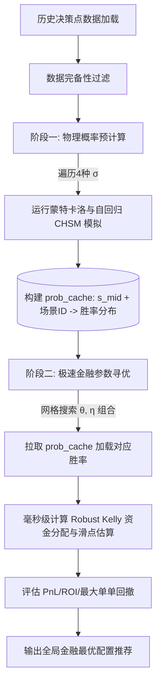

# 天气套利参数标定与联合优化方案

为了确保系统各项底层参数（如纠偏窗口、基准噪声下限、稳健凯利防守乘数等）具有科学统计支撑，避免由于人工硬编码产生的“过度自信重仓”或“过度稀释Edge”风险，本方案对**独立物理标定**、**多维金融联合标定**以及**高性能两阶段仿真**的思路和算法进行完整记录，以备后续持续迭代。

---

## 1. 物理层参数标定 (Physical Calibration)

物理层标定旨在拟合**气象预测模型的客观误差规律**。该过程完全与金融交易逻辑解耦，仅对历史预报残差进行数理统计。

### 1.1 纠偏窗口 `bias_window_days` 自适应网格搜索
滑动纠偏机制的窗口大小 $W$ 决定了系统对近期“微气候波动”的捕获灵敏度。
- **算法思路**：
  在时序上进行滚动回测，针对窗口 $W \in [3, 7]$ 天，计算第 $T$ 天的修正预测与真实实测值（Wunderground 观测极值）的绝对误差：
  $$\text{MAE}(W) = \frac{1}{N} \sum_{i=1}^N |T_{\text{observed}, i} - (T_{\text{forecast}, i} + \text{Bias}_{i}(W))|$$
  其中，$\text{Bias}_{i}(W)$ 为过去 $W$ 天的真实偏差均值。选取使全局 MAE 和 RMSE 达到最小的最优窗口大小 $W^*$（历史数据拟合建议值为 **6 天**）。

### 1.2 底层物理残差标准差 $\sigma_{\text{rolling}}$ 气候区拟合
为防范蒙特卡洛预测发散过窄，需按气候分区设定基准噪声下限 $Baseline_{\text{static}}$：
- **算法思路**：
  将历史数据按气候带划分为 **温带 (mid_lat)** 与 **热带 (tropics)**。对各分区内所有站点的滚动残差标准差进行频数统计，选取其 **第 20 分位数 (20th Percentile)** 作为静态基准下限：
  - 温带基准建议值 $\sigma_{\text{mid\_lat}} \approx 0.49^\circ\text{C}$（原保守配置为 $1.2^\circ\text{C}$）
  - 热带基准建议值 $\sigma_{\text{tropics}} \approx 0.77^\circ\text{C}$（原保守配置为 $0.8^\circ\text{C}$）

---

## 2. 联合标定的「选择性偏差」与「两步标定法」

在实现多参数联合回测时，我们发现了一个根本性的**选择性偏差（Selection Bias / 生还者偏差）**问题，导致系统“回测正收益、实盘负收益”：

### 2.1 历史成交时间戳池的致命缺陷
在 SQL 中，我们通常使用以下方式筛选决策点进行模拟：
```sql
SELECT DISTINCT market_id, timestamp, ... FROM trades
WHERE settlement_date IN ('2026-07-20', '2026-07-21', '2026-07-22')
```
该方法存在一个**不对称盲区**：
1. **决策集失真**：回测的时空样本完全是由**历史原有参数决定的下注时刻与市场**组成的。
2. **“平行世界”下注丢失**：如果使用新参数（如更低的标准差下限 0.49°C），系统本应在一些历史并未参与的时刻和市场（正 EV 机会）进行下注。但这些时刻的快照并不在基于 `trades` 提取的样本池里，新参数被剥夺了在这些“平行世界”中盈利的机会。
3. **安全偏见假象**：当新参数在此样本池内的某时刻决定“不下注”时，其收益被记为 0（看起来规避了风险，Roi 上升），但事实上新参数可能会去别的市场踩雷，而这些雷由于不在样本中完全没有被反映。

---

### 2.2 解决方案：解耦的「两步标定法」
为了规避由于决策时间戳重合导致的选择性偏差，我们将标定解耦为两个独立的子步骤：

#### 第一步：用 Brier Score（布莱尔分数）无偏差标定物理标准差 $\sigma_{\text{mid}}$
Brier Score 衡量的是**模型估计概率与最终结算结果的均方误差**，它完全与“是否下注”、“下注金额”无关：
$$\text{Brier Score} = \sum_{i} \left( p_{\text{model}}(i) - \mathbf{1}_{[i = \text{winner}]} \right)^2$$
- **实施方式**：
  对所有完备的历史预报归档（无论系统当时是否交易）跑一遍模拟。计算模型概率与真实结算档位（1）及落败档位（0）之间的 Brier Score。选取全局 Brier Score 最小（概率估计最准）的标准差 $\sigma_{\text{mid}}$，彻底避开投注偏差。

#### 第二步：用实际成交记录「反事实 sizing 模拟」标定 $\theta$ 与 $\eta$
由于稳健凯利安全乘数 $\theta$ 和不确定惩罚系数 $\eta$ **只影响下注仓位大小 (sizing)，而不影响方向判断**。因此我们可以：
- **实施方式**：
  - 固定历史真实的交易时间戳与买入方向（`BUY_YES` 或 `BUY_NO` 保持不变）。
  - 使用新的参数 $(\theta, \eta)$ 重新计算下注金额 $Stake_{\text{new}}$。
  - 根据真实结算结果计算这笔反事实交易的净盈亏：
    - 若赢：$\text{Profit} = \frac{50\% \cdot Stake_{\text{new}}}{Price} - Stake_{\text{new}}$ (视具体市价折算)
    - 若输：$\text{Profit} = -Stake_{\text{new}}$
  - 该步骤固定了“何时下注与方向”的客观事实，只评估 sizing 参数调整对风险敞口的控制效果，有效避免了选择性偏差。

---

### 2.3 诚实的局限性与长期解法
1. **样本量限制**：当前仅有 3 天（7/20 - 7/22）的高频结算数据。无论何种方法，拟合出的参数置信区间依然较宽。
2. **方向正确性假设**：反事实 sizing 模拟默认历史买入方向是正确的。如果历史上方向本就跑偏（如买贵了），该标定也会失真。
3. **长期解法**：当积累了 2-3 个月、数千笔独立成交样本后，必须引入**时间序列分割（Time-series Split）**：用前 70% 历史数据标定参数，后 30% 验证，严防未来结算信息泄露（Data Leakage）。

---

## 3. 高性能两阶段寻优算法 (Two-Stage Grid Search)

为解决多维网格搜索时，重复运行高算力蒙特卡洛积分导致耗时过长（I/O 阻塞与 numpy 仿真开销）的问题，标定代码采用**概率缓存解耦架构**：



### 3.1 核心收益与风控博弈点
1. **远期建仓期（结算前 24-48 小时）**：较低的物理标准差 $\sigma$（如 $0.49^\circ\text{C}$）能让模型高度敏感地发现定价 Edge。此时 $\theta$ 和 $\eta$ 保持常规防护即可。
2. **结算决战期（结算前 0-12 小时）**：若天气发生预报之外的跳变，极窄物理 $\sigma$ 会将真实结局排除在 3-sigma 范围外。此时**必须匹配更大的稳健安全乘数 $\theta$**，拓宽 Robust Kelly 胜率区间下限，或抬高 $\sigma_{\text{baseline}}$ 的安全垫，以阻止重仓踩雷。

---

## 4. 后续优化方向 (Roadmap)

1. **时变防守系数 $\theta(t)$**：
   引入随距离结算时间 $t$ 变化的安全系数：远期允许 $\theta$ 较小以博取超额收益；短临临盘阶段强制推高 $\theta$，人为扩大胜率区间不确定性，逼迫稳健凯利缩仓防守。
2. **动态 Bias-Window ($W_{\text{dynamic}}$)**：
   若气象站近期温度方差发生剧烈结构性转变（如旱雨季转换），通过检测二阶残差变化，动态缩短或拉长纠正窗口。
3. **市场隐含噪声校准**：
   利用 Polymarket 盘口隐含的概率分布，反推市场定价的隐含标准差（Market Implied Sigma），作为贝叶斯先验与物理标准差进行加权共轭。
