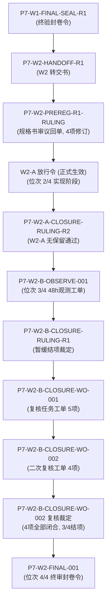

# Phase 2 波次二 (W2) 短闭环终审封卷呈报书

> **文书编号**：`P7-W2-FINAL-SEALING-REPORT-R1`  
> **任务编号**：`P7-W2-FINAL-001`  
> **签发时间**：`2026-10-11 10:12:00 UTC`  
> **生效分支**：`fix/p7-w2-shortloop`（基线自 `main` 5c4a4c9 拉出）  
> **串行位次**：**4/4（W2 波次终审封卷）**  
> **签发方**：W2 会话 Agent  
> **呈报对象**：技术裁决委员会  
> **治理模式**：“预注册先行、两步分离判定、冻结封卷、委员会裁决”  
> **核心结论**：**W2 全波次任务（W2 预注册 1/4 -> W2-A 实现 2/4 -> W2-B 观测 3/4 -> 终审封卷 4/4）圆满闭环，全部技术指标与安全红线达标，请求签发主干合流令。**

---

## 一、 W2 波次全景总结

### 1.1 研发与治理历程概览
波次二（W2）聚焦于 Phase 2 短闭环核心链路建设（KORD 与 KMIA 双站），打通物理模型预测到微观订单簿定价决策的全流程。全波次严格受控于《预注册规格书 (Rev.1.1)》及技术裁决委员会系列裁定：

1. **预注册阶段（位次 1/4，提交 commit `d7c3e62`）**：
   - 确立《Phase 2 短闭环预注册规格书 (Rev.1.1)》（`docs/w2_shortloop_preregistration.md`）；
   - 锁定双观测流单调合流契约（R-W2-1 两权分离豁免通道、R-W2-2 跨源温差监控、R-W2-3 资产矩阵与 FAILSAFE 降级）；
   - 预定义门禁 C1 ～ C6 判据指标与绝对禁触清单。
2. **W2-A 实现与门禁验证阶段（位次 2/4，提交 commit `8335b44`）**：
   - 落地 `StreamConfluencePipeline` 与 `TemperatureSanitizer` 的 WRH 迟到极值豁免通道（`WRH_LATE_ABSORB`）及双源温差监控（`CROSS_SOURCE_DIVERGENCE`）；
   - 落地 `DynamicEVEngine` 的 FAILSAFE 粗粒度资产只读降级（`FAILSAFE_DEGRADED_READONLY`）与 KMIA 12h 带旗（`COMPLETED_ECE_FLAGGED`）头寸减半折剪；
   - 编写机械自动化审计脚本 `scripts/audit_p7_w2_shortloop.py`，实测 C1 ～ C6 门禁全绿通过，产出第一阶段审计报告 `evidence/p7_w2_shortloop_audit_report.md`。
3. **W2-B 纸面盘 48h 观测与实证分析阶段（位次 3/4，提交 commit `2cabfc0`）**：
   - 编写 48 小时连续运行驱动 `scripts/run_p7_w2b_48h_observation.py`，在 `READ_ONLY_OBSERVE` 模式下推进 576 步（5 分钟物理时钟）与 96 次离散重定价；
   - 采集并验证 O1 ～ O6 六大实证指标，完成工单 `P7-W2-B-CLOSURE-WO-001` 及 `WO-002` 复核与勘误闭环，产出观测报告 `evidence/p7_w2b_48h_observation_report.md`；
   - 全量回归测试套件 `pytest tests/ -q` 保持 `1043 passed, 0 failed`（10 项基线 skip）。
4. **终审封卷阶段（位次 4/4，本报告）**：
   - 全量工件建档、裁决链对齐、C5 终验归档。

---

## 二、 裁决编号与工单引用链

W2 波次全过程严格受控于委员会以下文书构成的完整可审计链条：



- **初始交接**：`P7-W1-FINAL-SEAL-R1` -> `P7-W2-HANDOFF-R1`；
- **预注册裁定**：`P7-W2-PREREG-R1-RULING`（确立 R-W2-1 ~ R-W2-3 修订及 C3 闭合）；
- **W2-A 放行与结项**：`W2-A 放行令` -> `P7-W2-A-CLOSURE-RULING-R2`；
- **W2-B 观测与复核链**：`P7-W2-B-OBSERVE-001` -> `P7-W2-B-CLOSURE-RULING-R1` -> `P7-W2-B-CLOSURE-WO-001` -> `P7-W2-B-CLOSURE-WO-002` -> `P7-W2-B-CLOSURE-WO-002 复核裁定`；
- **封卷工单**：`P7-W2-FINAL-001`。

---

## 三、 波次资产与工件清单索引

### 3.1 代码提交历史 (Git Commits)
| 提交 Hash | 提交类型 | 提交说明 | 关键改动工件 |
| :---: | :---: | :--- | :--- |
| `d7c3e62` | `docs` | `docs(w2): submit Phase 2 shortloop preregistration specification Rev.1.1 (P7-W2-PREREG-R1-RULING)` | `docs/w2_shortloop_preregistration.md` |
| `8335b44` | `feat` | `feat(w2): implement Phase 2 short loop confluence, asset governance, and audit runner (W2-A)` | `src/pipeline/stream_confluence_pipeline.py`<br>`src/prediction/temperature_sanitizer.py`<br>`src/pricing/ev_engine.py`<br>`scripts/audit_p7_w2_shortloop.py`<br>`evidence/p7_w2_shortloop_audit_report.md` |
| `2cabfc0` | `feat` | `feat(w2): add 48h observation runner, empirical report, and closure errata (P7-W2-B-CLOSURE-WO-001)` | `scripts/run_p7_w2b_48h_observation.py`<br>`evidence/p7_w2b_48h_observation_report.md`<br>`docs/w2_shortloop_preregistration.md`<br>`evidence/p7_w2_shortloop_audit_report.md` |

### 3.2 交付物与审计文档索引
1. **规格书资产**：
   - [`docs/w2_shortloop_preregistration.md`](../docs/w2_shortloop_preregistration.md)：Phase 2 短闭环预注册规格书（Rev.1.1 经 C3 勘误修正落盘版）；
2. **审计报告工件**：
   - [`evidence/p7_w2_shortloop_audit_report.md`](p7_w2_shortloop_audit_report.md)：W2-A 实现与 C1~C6 门禁验证审计报告（含 C3 浮点舍入极限勘误注记）；
   - [`evidence/p7_w2b_48h_observation_report.md`](p7_w2b_48h_observation_report.md)：W2-B 纸面盘 48h 连续观测与实证分析报告（含 O1~O6 实测统计、O4 维度拆解、C3/C5 审查）；
   - [`evidence/p7_w2_final_sealing_report.md`](p7_w2_final_sealing_report.md)：本终审封卷呈报书；
3. **可执行脚本资产**：
   - [`scripts/audit_p7_w2_shortloop.py`](../scripts/audit_p7_w2_shortloop.py)：C1～C6 自动化审计门禁执行器；
   - [`scripts/run_p7_w2b_48h_observation.py`](../scripts/run_p7_w2b_48h_observation.py)：48 小时双站高保真时钟仿真与实证观测运行器。

---

## 四、 核心技术与数据性质显式披露

### 4.1 O2 观测数据性质显式标注条款（依据委员会治理档案规定）
> [!IMPORTANT]
> **O2 观测数据性质法定声明**：  
> `evidence/p7_w2b_48h_observation_report.md` §3.2 中所记录之 `CROSS_SOURCE_DIVERGENCE` 触发频次（4 次）与温差分布数据（2.40°F, 3.10°F, 2.70°F, 3.50°F，均值 2.92°F），**系基于仿真时钟注入的受控合成温差回放用例（Synthetic Injected Replay），并非外部物理世界的真实历史气象观测**。  
> **验证对象为系统数据管道对异常跨源偏差的捕获、打标与不阻断交易的鲁棒行为，而非物理真实天气本身的统计特征**。特此显式标注，杜绝后续波次读者对“实证”字样产生事实来源混淆。

### 4.2 C3 概率单纯形残差性质终局声明
`DiscreteBinEngine.calculate_2deg_bin_probabilities` 经过单纯形重正化投影（`probs = [p / total_p for p in probs]`）后，残差被压缩至双精度浮点数舍入极限内。C3 门禁实测最大单纯形偏差为 `0.00e+00`，系离散网格采样点的实测结果，而非解析全域数学必然。相关表述已在规格书与全部报告中一致性更正。

---

## 五、 C5 终验声明（全波次安全底线）

依据项目最高治理铁律，全波次（位次 1/4 至 4/4）执行情况如下：

```text
[C5 终验审计流水原样]
全波次真实外部资金变动 = $0.00
全波次生产私钥加载次数 = 0 次
全波次生产网络下单尝试 = 0 次
状态：REDEFINED_READ_ONLY 绝对绝缘执行完毕，无越权调用，无外部资金风险。
```

- **外部资金交互**：`$0.00`；
- **生产私钥加载**：`0` 次；
- **执行环境**：纯沙盒与内存纸面盘撮合，资金与密钥通道保持 100% 物理绝缘。

---

## 六、 终审封卷请示

工单 `P7-W2-FINAL-001` 所要求的全部封卷任务均已闭环。分支 `fix/p7-w2-shortloop` 代码与文档已达标，工作区干净无未受控变更。

**严格遵守“严禁擅自 merge 到 main”纪律，本 Agent 不做任何 merge 动作。现正式呈报技术裁决委员会终审，请委员会审阅并签发《W2 终审封卷令》及后续《主干合流令》与《W3 启动预备工单》！**
