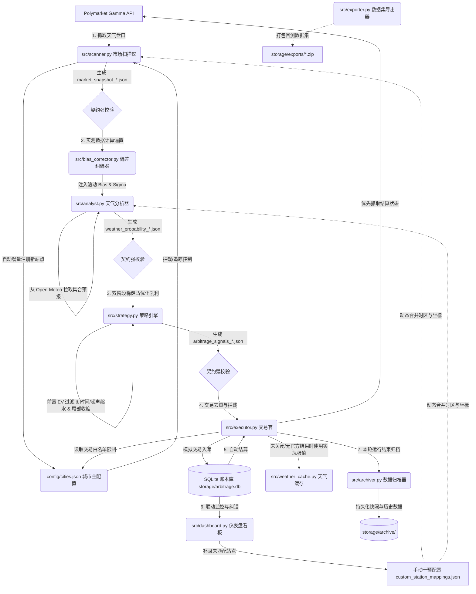

# Polymarket 天气套利自动化交易系统 (Polymarket Weather Arbitrage Trading System)

[](https://www.python.org/)
[](https://streamlit.io/)
[](https://www.sqlite.org/)

这是一个专为 Polymarket 天气预测市场设计的**端到端自动化量化交易与套利系统 (v4.3)**。系统通过对接 Polymarket 盘口要价与 Open-Meteo 40成员集合天气预报（Ensemble Forecasts），并使用 Wunderground（api.weather.com）作为官方天气历史极值唯一数据源，进行多维度数值概率核算，寻找高期望值（EV）区间并自动进行下注套利。同时系统支持双边 YES/NO 稳健凯利凸优化、自动风险对冲与 Dutch Book 无风险套利，并包含完善的 **Human-in-the-Loop（人工干预与快速映射）** 纠错与防灾机制。

---

## 🌟 核心工程架构与模块

系统完全遵循 **Contract-First（契约优先）** 原则，各模块间通过规范 of JSON 协议进行文件级总线通信，并自动运行 JSON Schema 强类型契约校验。



### 1. 市场扫描仪 (`src/scanner.py`)
- 分页监听 Polymarket 天气事件，精准过滤出包含有效气象站 ICAO 代码的温度对赌盘口。
- **城市自动注册与追踪**：
  - 自动从盘口描述中识别 ICAO，若在主配置 `config/cities.json` 中不存在，则自动以 `is_tradable = False` 增量注册，实现只追踪不交易。
  - 支持从 `custom_station_mappings.json` 合并用户手动录入的时区与经纬度。
- **过峰与时效防呆过滤**：
  - **最高温**：站时下午 13:00 后自动下线当天盘口，防止模型预测滞后于实际已发生气温。
  - **最低温**：在白昼非活性期（08:00 - 20:00）自动过滤当天盘口，确保模型不落后于清晨锁定的低温。

### 2. 天气矩阵分析器 (`src/analyst.py`)
- 通过 NOAA AWC 接口根据 ICAO 代码动态解析并缓存经纬度。
- **蒙特卡洛噪声重采样**：将每个预报成员扩展 $K=100$ 次噪声模拟，完美模拟档位边缘的“双向边界渗入效应”。
- **单位与结算转换**：智能匹配摄氏度向下取整（Floor）以及华氏度换算结算规则。
- **自适应不确定性时效衰减 (Uncertainty Time-Decay)**：为了防范远期过度投机，系统在正常阶段引入静态下限（温带 $1.2^\circ\text{C}$，热带 $0.8^\circ\text{C}$）；但在结算前 $T_{\text{fade}}$（默认 12h）决战窗口内，基本标准差下限线性收敛至硬件极限 $\sigma_{\text{min}}$（默认 $0.2^\circ\text{C}$），平滑释放高置信度的临场确定性，避免白白稀释尾盘胜率。
- **Phase III 决战窗口条件时序模拟 (CHSM)**：在结算日当天，从 Wunderground 抓取高频实况（含 METAR 特报），对当天剩余的小时序列采用 AR(1) 自回归进行持续性纠偏与噪声发散推演，与已发生实况合并求极值，彻底消除边界点 100% 概率塌陷的问题。
- **动态极值时间判定 (DEHO)**：根据集合预报的均值曲线动态寻找当天极值出现的小时，以此作为动态 `ref_hour` 结算参考时刻，调整时效衰减和决战阶段高频轮询调度。
- **数据抓取失败熔断保护 (Data Scraping Break-Safe)**：在结算日当天，若 Wunderground 核心接口抓取实况失败，系统**坚决不使用预报进行降级估算**，强行触发单站熔断，不生成概率协议文件，不交易，彻底规避因决策致盲导致的本金暴露风险。

### 3. 动态纠偏与局地微气候分析 (`src/bias_corrector.py`)
- **滑动窗口自适应校准**：拉取最近 7-14 天内该气象站的预报均值与实测值，计算出动态**偏置纠正值 (Bias)** 和**实际物理不确定性标准差 (Sigma)**。
- **残差对齐**：在模拟中注入 Bias 进行物理对齐，并使用站点滚动 Sigma 替代静态误差，解决微气候偏置问题。

### 4. 策略过滤引擎 (`src/strategy.py`)
- **双阶段凸优化稳健凯利求解器 (Robust Kelly)**：第一阶段在无滑点假设下进行基础 Kelly 求解；第二阶段根据初选出的下注额度，极小化极大财富分配。采用 **Robust Kelly** 目标函数，在概率不确定性范围内自动寻找最坏概率分布进行保守防御，规避长尾虚假高期望值代币。
- **连续平滑尾部收缩正则化 (Smooth Tail Regularization)**：引入不确定性惩罚系数 $\eta$（默认 0.25）对胜率估计误差合理膨胀，依靠不确定性范围计算，自动且连续地将非理性长尾低价仓位下注金额降至 0。
- **对冲比例硬约束与风控豁免 (Strict Hedge Ratio & Wind Control Exemption)**：当触发对冲锁利时，由于是净风险减少行为，系统**完全豁免单市场敞口 $C_{\text{loc}}$ 限额限制**，升级以账户总分配资金 $C_{\text{total}}$ 作为预算上限进行 1:1 完全对冲；若所需资金仍超出了 $C_{\text{total}}$，为防止比例缩水导致对冲失效，系统根据**【对冲比例硬约束】硬性放弃对冲交易**（投注本金清零）。
- **期望值非线性软滤波衰减 (Cubic EV Decay - Method B)**：Edge $\le 0.0$ 的合约价格设为 `999.0` 实施硬拦截。对正优势档位且 $0 < \text{Edge} < \text{min\_ev\_threshold}$ 的仓位，计算目标投注额后应用立方衰减因子 $\gamma_{ev} = (\text{Edge} / \text{min\_ev\_threshold})^3$ 平滑缩减，低于起投门槛（`min_bet_usdc = 5.0` USDC）则自动清零，实现“抖动滤波”软着陆。
- **时间自适应分数凯利衰减 (Fractional Kelly Time-Decay)**：剩余时间越长，预算上限占比越低（最低衰减至 5%），实现时间定投并规避早期预测风险。
- **物理噪声自适应缩水 (Physical Noise Adaptive Scaling)**：在预报噪声 $\sigma$ 偏大时，通过立方缩水因子 $\gamma = (\sigma_0 / \sigma)^3$ 强制按比例下调单笔下注额度。
- **增量调仓与 worth-it 过滤**：计算调仓增量 $\Delta = x^* - x_{prev}$，若其小于 `min_bet_usdc` 且未达到防抖门槛，或调仓产生的预期利润低于 $\max(0.5, 0.05 \cdot \Delta)$，则进行拦截。
- **偏离度预警**：计算模型胜率与价格的 L1 距离及单档偏离度，若异常偏离（L1 > 50% 或单档 > 25%），自动输出 `market_anomaly_report_*.md` 供人工介入。

### 5. Dry-Run 交易执行官 (`src/executor.py`) & 缓存管理器 (`src/weather_cache.py`)
- 维护本地 SQLite 账本，确保对同一盘口的幂等性防重买检查。
- **双轨智能结算机制**：
  - 优先通过 Polymarket Gamma API 查询事件的官方结算结果，获取官方获胜档位。
  - 若官方事件已关闭但接口无法解析获胜档位，则启用备用结算：通过 Wunderground 公共接口获取结算日实测极值。

### 6. 历史数据归档器 (`src/archiver.py`)
- 每一轮流水线结束时运行，自动将快照、算法参数、集合预报、CLOB 订单簿深度统一打包组装为标准契约文件归档至 `storage/archive/` 下。

### 7. 数据集导出工具 (`src/exporter.py`)
- 提供对历史归档 JSON 快照、交易账本 SQLite 数据库、天气缓存 SQLite 数据库的指定日期区间自适应 Schema 筛选与 ZIP 归档导出功能。

### 8. 交互监控看板 (`src/dashboard.py`)
- 包含全网套利矩阵概览、折线图双向联动下钻、历史胜率与 EV收敛曲线、明细对账账本、待干预气象站核准。

### 9. 独立概率标定器 (`scratch/calibrate_sigma_brier.py`)
- **无偏 Brier Score 物理概率标定**：摒弃存在幸存者偏差（Survivor Bias）的历史交易 P&L 拟合网格搜索，采用独立于下注与交易方向的多分类 Brier Score，评估已结算历史快照的概率分布真实预测准确度。
- **全局基准标准差标定 ($\sigma_{mid}$)**：在 61 个独立历史市场、2,436 个已结算快照上全量重放，求得极小化 $BS$ 的最佳基准标准差下限 $\sigma_{mid} = 0.50^\circ\text{C}$（低纬度 $\sigma_{tropics} = 0.40^\circ\text{C}$）。
- **实验性标定分支与测试观察**：当前在 `config/config.yaml` 中部署了该标定值，作为**实验性标定分支**在模拟盘（`dry_run`）中持续测试与观察表现。
- **金融风险参数回滚与设定**：金融风险控制参数维持生产默认值 ($\theta = 1.5, \eta = 0.15$)，在缺乏大规模无偏数据前不对其进行过拟合微调。

---

## ⚙️ 系统部署与启动

### 1. 基础环境准备
```bash
pip install -r requirements.txt
```

### 2. 配置文件配置
```bash
cp config/config.yaml.example config/config.yaml
cp .env.example .env
```

### 3. 常驻交易守护后台启动
```bash
PYTHONPATH=. python src/main.py
```

### 4. 实时监控桌面仪表盘启动
```bash
PYTHONPATH=. streamlit run src/dashboard.py --server.port=8501 --server.address=127.0.0.1
```

### 5. 运行单元测试与回归测试
```bash
pytest tests/
PYTHONPATH=. python tests/run_regression_tests.py
```

### 6. 运行 Brier Score 物理概率标定器
```bash
PYTHONPATH=. python scratch/calibrate_sigma_brier.py
```

---

## 📊 策略关键配置参数说明 (`config.yaml`)

| 参数组 | 参数名 | 默认值 | 说明 |
| :--- | :--- | :--- | :--- |
| **全局** | `trading_mode` | `"dry_run"` | 运行模式：`dry_run`（模拟盘）或 `live_run`（实盘） |
| **风控** | `allocated_capital` | `10000.0` | 策略分配虚拟总本金 (USDC) |
| **风控** | `max_portfolio_exposure` | `0.02` | 单场天气事件最大资金占用上限占比 (2%) |
| **风控** | `min_ev_threshold` | `0.08` | 最低期望回报率门槛（Edge 达标线，8%） |
| **风控** | `min_bet_usdc` | `2.0` | 最小下注与增量调仓金额限制 (2 USDC) |
| **风控** | `rebalance_hystersis_rate` | `0.03` | 调仓防抖门槛（单事件本金上限的 3%） |
| **风控** | `obs_error_sigma_baseline_mid_lat` | `0.50` | 温带/中纬度气候城市观测误差基准标准差下限（°C，Brier 标定） |
| **风控** | `obs_error_sigma_baseline_tropics` | `0.40` | 热带气候城市观测误差基准标准差下限（°C） |
| **风控** | `sigma_absolute_min_celsius` | `0.2` | 自适应时效衰减中，临结算前所支持的最低硬件/物理极限误差（°C） |
| **风控** | `sigma_fade_window_hours` | `12.0` | 物理误差平滑衰减的临界触发窗口特征时间（小时） |
| **优化** | `robust_kelly_model_uncertainty_eta` | `0.15` | 稳健凯利模型不确定性惩罚系数（控制连续平滑尾部正则收缩） |
| **优化** | `robust_kelly_theta` | `1.5` | 稳健凯利防守安全系数 ($\theta$) |
| **优化** | `bias_window_days` | `7` | 偏置纠偏器历史残差滑动窗口天数 (7天) |
| **风控** | `kelly_time_decay_lambda` | `0.0578` | 分数凯利随距离结算剩余时间衰减的控制参数（半衰期约12小时） |
| **风控** | `kelly_min_fraction` | `0.05` | 远期保留的分数凯利下限比例 (5%) |
| **收缩** | `shrinkage_q_min` | `0.01` | 尾部收缩：临近结算最低信任中值点 (1%) |
| **收缩** | `shrinkage_q_max` | `0.05` | 尾部收缩：远期最严格信任中值点 (5%) |
| **收缩** | `shrinkage_t_scale` | `48.0` | 尾部收缩：时间衰减窗口特征尺度 (48小时) |
| **套利** | `min_dutch_book_margin` | `0.02` | Dutch Book 无风险套利和对冲触发利润边界 (2%) |

---

## 🔒 隐私与安全性保障 (Git Safe)
项目中配置了完善的 [`.gitignore`](.gitignore) 策略，自动排除并保护了敏感及本地临时数据。
